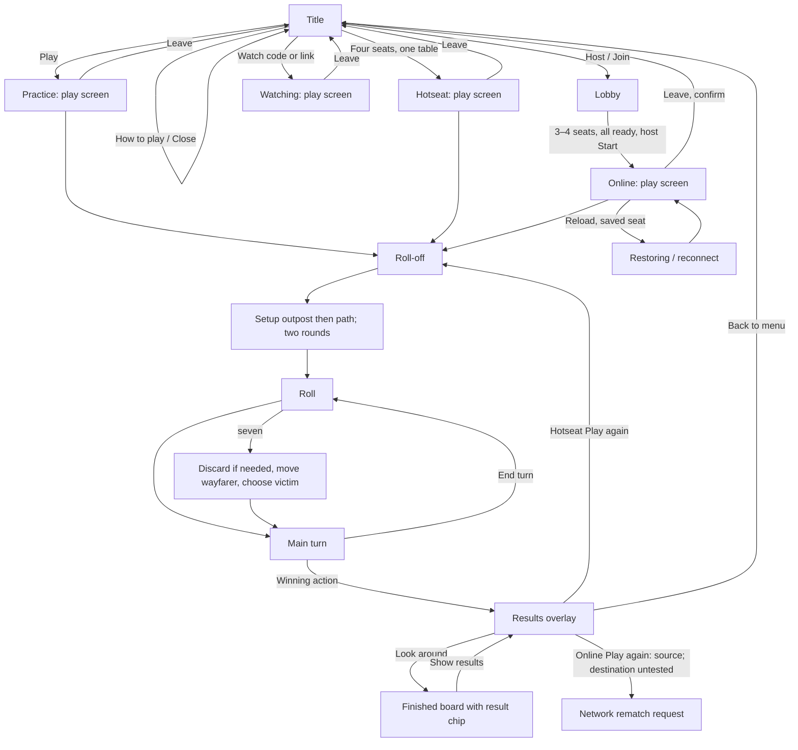

# Emberisle checkpoint 1 — app map

GPT-6 Astra (medium), 2026-10-21. **Review draft with explicit coverage gaps.**
Baseline: `8a9e75d7dd6709192dc8c6fa681cf9725c3e4e95`.
This maps the saved baseline, not later main changes. No recommendations or runtime changes.
The earlier partial map is `1-map-partial.md`. Only its closing to-do list was reworded as a status note.

## Evidence and method

**seen** means observed in the running Vite app and local rules host. **source** means code-read, with baseline file/line anchors. **untested** means not established by this walk.

Evidence labels below refer to `walk-evidence-resumed.json`, supplemented by the original `walk-evidence.json`.
The desktop ran at 1280×720. A separate joining browser used 390×844 touch; a watching browser used 844×390 touch.
Reduced motion was enabled after the first practice sequence. This was software Chromium, not physical-device testing.

Title controls, menus, trade opening, lobby start, joining, watching, results and rematch used UI controls.
Practice setup and robber placement used the existing store's legal pick actions. Hotseat completion used `chooseBotAction` and the existing dispatcher.
Those assisted steps exercised real rules without replacing state or injecting a winner. They do not verify pointer placement or every intermediary animation.
The hotseat action trace reached a real win at turn 23: 3 remaining roll-off actions, 8 outpost placements, 8 paths, 89 rolls, 186 main actions, 15 robber actions and 9 discards.

## App structure

**source:** only three top-level screens exist: title, lobby and play (`src/lib/game/store.ts:257`; `src/components/game/EmberisleApp.tsx:68`).
Results, spectators and the playing modes live within play. Game phases are rollOff, setupSettle, setupRoad, roll, discard, robber, main and over (`src/lib/game/types.ts:6`).
The online-rematch request is source-derived from `src/lib/game/store.ts:915`; its destination and readiness transition remain untested.

## Journey ledger

| Journey and steps | Evidence | State and exits |
|---|---|---|
| Title → Your seat disclosure → name and colour → reload | **seen**: name changed to Map reviewer, Tide selected; reload returned the saved name. **source**: disclosure `EmberisleApp.tsx:198`; name/colour storage `store.ts:541–551`. | Disclosure expansion is separate from saved identity. Colour persistence was not separately asserted. No account/profile route appeared in the component search; account authentication remains **untested**, not declared absent. |
| Title → How to play → Close | **seen**: `entry-help`; full rules text rendered. | Returned to the title. This is reference help; practice also has contextual coaching. |
| Title → invalid code ZZZZ → Join | **seen**: `bad-code`. | Inline “No table with that code”; title remained usable and Play started practice. Watch appears after four code characters. |
| Play → roll-off → tie → roll again | **seen**: `practice-entry`, `practice-after-rolloff`. | Seat dice and instruction changed; tie named the two seats. |
| Roll-off → opening outposts/paths → first turn | **seen, dispatcher-assisted**: practice advanced through legal picks; hotseat action trace independently records both setup rounds. | Pointer hit-testing and touch Place confirmation are **untested**. The practice trace later reached a seven rather than stopping at main. |
| Seven → robber target → steal → main | **seen, dispatcher-assisted**: `practice-robber`, `practice-main`. | Existing legal hex picker and target choice resolved into main. UI victim selection and manual discard steppers remain **untested**. |
| Main → unavailable Stronghold → hint; main → Trade → Escape | **seen**: `unavailable-build-inspection`, `practice-trade`. | Trade displayed give/get quantities, Ask the table and Bank & docks. Actual offer acceptance/bank exchange was not manually walked. Closing retained the game. |
| Main → building, fortunes, turn ownership | **seen, dispatcher-assisted**: real hotseat progression built pieces, acquired/played fortunes and completed turns. **source**: build controls `Hud.tsx:416`, fortunes opener `:238`, tray `FortuneTray.tsx:148`. | Manual fortune tray selection and all card effects remain **untested**. Do not treat assisted rules execution as a complete interaction audit. |
| Practice → Table menu → Leave | **seen**: `practice-leave`. | Returned to title. Local practice is not restored by this exit. |
| Title → hotseat → Roll → next seat | **seen**: `hotseat-entry`, `hotseat-next-seat`. | Same device advances the active seat. Detailed private-information handoff is **untested**. |
| Hotseat → real result → Look around → Show results → Play again | **seen**: `hotseat-result`, `results-look-around`, `hotseat-rematch`. | Result table revealed hidden and total scores. Look around retained the finished board. Rematch entered roll-off. **source**: winner-first seat order `store.ts:920–925`. |
| Host → lobby; second browser joins code link; add bot → Ready → Start | **seen**: `host-lobby`, `join-link-lobby`, `lobby-ready`, `online-start`. | Three seats became ready; Start entered roll-off. Code/link controls, seat list, chat and victory-target selector were present. Changing target, removing bots and lobby leave were not exercised. |
| Watch link → Watch → started game | **seen**: `watch-link-game`, landscape screenshot. | Spectator entered the same roll-off. **source**: watcher cannot hold a seat, send actions or compose chat (`store.ts:341–344`). All restrictions were not independently tested. |
| Online chat → Sounds & stickers; send local message → recipient with chat closed | **seen**: `online-chat`, `online-sounds-stickers`, `phone-received-chat`. | Phone showed the message beside the sender and unread count. Sending used the existing sendChat method. Individual sounds/stickers and keyboard behaviour remain **untested**. |
| Online reload → restoring/rejoin → same table | **seen**: `online-reload-rejoin`. | The phone returned to the same table and roll-off without pressing Join again. Opponent log later said “Ember is back.” |
| Toggle browser offline → online | **seen**: `phone-disconnected`, `phone-reconnected`. | Both snapshots retained roll-off; no visible error appeared. This does **not** prove a socket loss/recovery cycle. Long disconnection and seat expiry remain **untested**. |
| Online Leave → confirmation → Stay; confirmation timeout | **seen**: `online-leave-confirmation`, `online-stay`. | “Your seat goes to the bot.” Stay retained play. A delayed Leave locator timed out after confirmation disappeared. **source**: five-second cancellation `TableMenu.tsx:92`. |

**seen:** confirming online Leave returned the host to title; the other seated browser remained in play (`online-left`, `remaining-player-after-host-left`). Watcher exit returned to title (`watcher-left`).

## Screen, overlay and secondary-state inventory

All paths below are under `src/components/game/` unless prefixed otherwise. Line anchors refer to the baseline. `store.ts` and `types.ts` mean `src/lib/game/store.ts` and `src/lib/game/types.ts`.

| Surface or state | Entry → exit / behaviour | Evidence |
|---|---|---|
| Title seat settings | Your seat disclosure contains name and colour; collapse returns to compact identity. | **seen**; `EmberisleApp.tsx:198`. |
| Title Wayfarer settings | Separate disclosure configures practice/online/hotseat choices. | **source**; `EmberisleApp.tsx:230`; `store.ts:293`. Changes untested. |
| Title help and load failures | How to play opens a lazy sheet; failed lobby load offers reload. | Help **seen**; failures **source**, `EmberisleApp.tsx:334–356`. |
| Lobby | Code/copy/link, editable own name, seats, bot add/remove, Ready, host Start, victory target, chat and leave. | **seen**; `Lobby.tsx:62–95`; target and name editing untested. |
| Roll-off, setup, roll, main, discard, robber, over | Shared board/HUD changes controls and active subject by phase. | All phases **seen in assisted action trace**; phase list `types.ts:6`. |
| Table menu | Help, Costs, sound/music, water, view, online code/log, Leave. Escape closes. | Menu/Costs **seen**; preferences and copy **source**, `TableMenu.tsx:156–220`. |
| Costs / How to play | Modal reference sheets; close returns to the ongoing phase. | **seen**; mounted `Hud.tsx:569–570`. |
| Player actions / score breakdown | Seat button opens public facts; own hidden points and total are conditional. Trade/message actions open their respective surfaces. | **source**; `PlayerMenu.tsx:93–175`. Manual opening untested. |
| Hand / rate details / number strip | Hand shows resource quantities; rate popover describes bank/dock exchanges; numbers list describes paying resources. | Hand **seen**; rate and number detail **source**, `HandRates.tsx:32`, `MyNumbers.tsx:53`. |
| Dock inspection | Board dock inspection target shows the relevant trade rate. | **source**; `src/components/scene/DockInspection.tsx:45`. Untested. |
| Build armed / unavailable hint | Main-turn buttons arm placement or expose shortage information. Escape disarms. | Hint **seen**; armed and cancel **source**, `Hud.tsx:437–474`, `escape-disarm.ts:6`. |
| Placement list / Place chip / pip comparison | Keyboard list exposes legal targets; touch selects then confirms; setup comparison describes candidate corners. | **source**; `PlaceList.tsx:113`, `PlaceChip.tsx:9`, `SetupPipHints.tsx:20`. Untested as UI. |
| First-game coach | Three contextual lessons, with Skip tips; practice only. Progress is saved locally. | Text **seen** in practice; `FirstGameCoach.tsx:21`, `:85–115`. Skip untested. |
| Fortune tray | Lists held kinds, blocked reasons, Play; Plenty and Monopoly use goods chips. Closes on turn change. | **source**; `FortuneTray.tsx:28`, `:148–187`, `Hud.tsx:164`. Manual interaction untested. |
| Trade composer / offer / outcome | Quantity choices lead to table ask or bank exchange; incoming offers have decisions/countdown; outcome collapses to a line. | Composer **seen**; offer/outcome **source**, `TradePanel.tsx:26`, `TradeToast.tsx:30`, `:89`. |
| Discard picker / victim picker | Required goods selection confirms discard; multiple steal targets expose victim choice. | Rules phases **seen assisted**; UI **source**, `DiscardBar.tsx:10`, `TakeFromBar.tsx:9`. |
| Chat panel / Sounds & stickers / seat bubbles | Open/minimize, two tabs, composer/reactions, sounds/stickers; closed recipients see seat message bubbles. | **seen**; tabs `Chat.tsx:85`; seat bubbles `Reactions.tsx:178`. |
| Turn timer / more-time vote | Timed-player request and other-seat vote controls, then result message. | Request text **seen**; voting **source**, `TurnExtensionVote.tsx:8–41`. Untested vote. |
| Turn/gain/dice moments | Transient announcements accompany authoritative game changes; hand quantities remain visible. | **seen** in progression; full animation timing untested. |
| Results / finished-board chip | Winning explanation and contribution table; Look around hides modal; chip reopens; mode-dependent rematch/menu actions. | **seen**; `WinScreen.tsx:72–89`, `:191–215`. Online rematch untested. |
| Restoring / duplicate tab / lost table | Saved seat reconnects; duplicate seat or table loss returns to title with a message. | Reload **seen**; other failures **source**, `store.ts:1237–1257`. |
| Render/chunk recovery | Table error offers saved-seat recovery; sheet/tray load failures reset their open flags; failed result has a fallback. | **source**; `TableRecoveryBoundary.tsx:32–50`, `SheetsFailed.tsx:6`, `TrayFailed.tsx:4`, `WinFailed.tsx:10`. Fault injection untested. |

## State retention and boundaries

- **seen:** name survived reload; closing help, Costs, Trade and the leave question retained the current game.
- **seen:** online phone reload resumed its saved seat; result hiding retained the finished board; hotseat rematch created a new game.
- **source:** name, colour, water/view and chat-open preferences use localStorage (`store.ts:541`, `:551`, `:939–956`).
- **source:** seat identity and live-table marker are stored separately (`store.ts:416–453`). Watching does not replace the saved seat.
- **source:** deliberate goTitle clears game state, network, seats, code, timers, chat, draft, menu and logs (`store.ts:641–675`).
- **source:** startAi/startHotseat close old network/offer timers and create a new state (`store.ts:562–624`).
- **source:** hotseat rematch retains names, puts the winner first and clears placement/trade state (`store.ts:915–935`).
- **untested:** browser Back/Forward, long offline expiry, server restart, duplicate tabs, profile auth, host migration, online rematch and physical-device input.

## Coverage boundary for review

This is a bounded map draft, not a completed exhaustive walkthrough. Each requested journey has an entry in the ledger.
Manual fortune interaction, a completed online match/rematch, trade acceptance, touch placement and forced recovery still need observation.
The generic offline toggle did not establish an actual lost socket. Assisted actions establish game-state reachability, not every manual interaction.
No conclusions about usability, redesign, or defect priority are drawn here. Do not start checkpoint 2 until Jarrod reviews these gaps.

## Screenshots

All are baseline JPGs under 300 KB. Their rendered states correspond to evidence labels above. They were not handed off, so they are not in the repository yet.

1. `screenshots/01-entry-desktop.jpg` — initial title, 1280×720.
2. `screenshots/02-practice-desktop.jpg` — practice roll-off, 1280×720.
3. `screenshots/03-trade-desktop.jpg` — practice trade composer, 1280×720.
4. `screenshots/04-hotseat-result.jpg` — actual hotseat result, 1280×720.
5. `screenshots/05-lobby-desktop.jpg` — host lobby, 1280×720.
6. `screenshots/06-lobby-phone.jpg` — ready lobby, 390×844.
7. `screenshots/07-watching-landscape.jpg` — spectator, 844×390.
8. `screenshots/08-chat-desktop.jpg` — Sounds & stickers, 1280×720.
