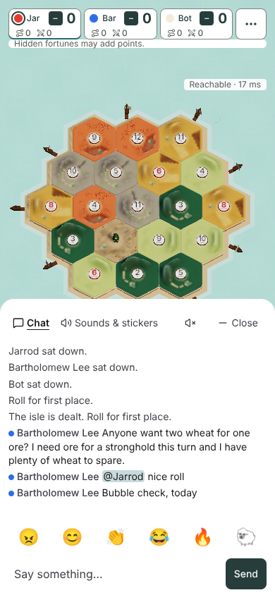
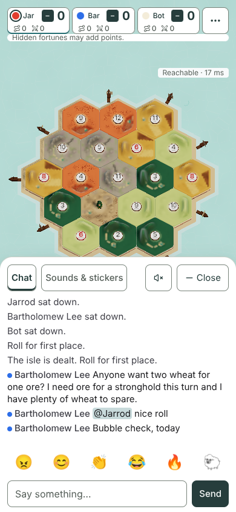
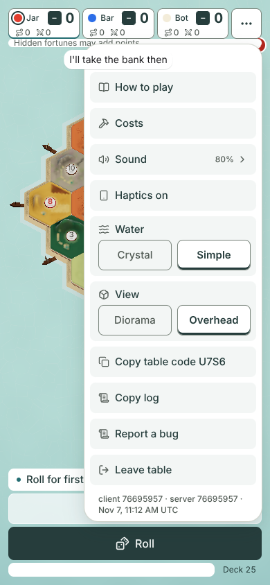
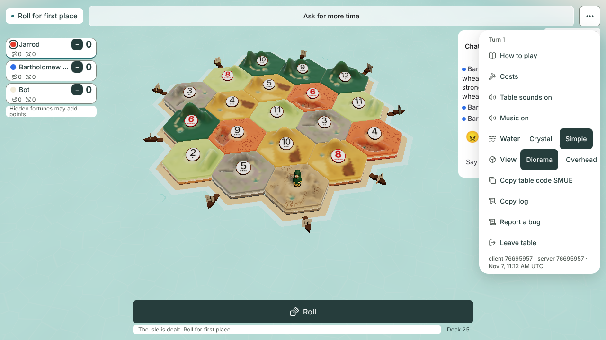
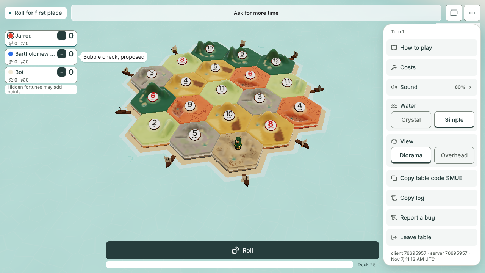
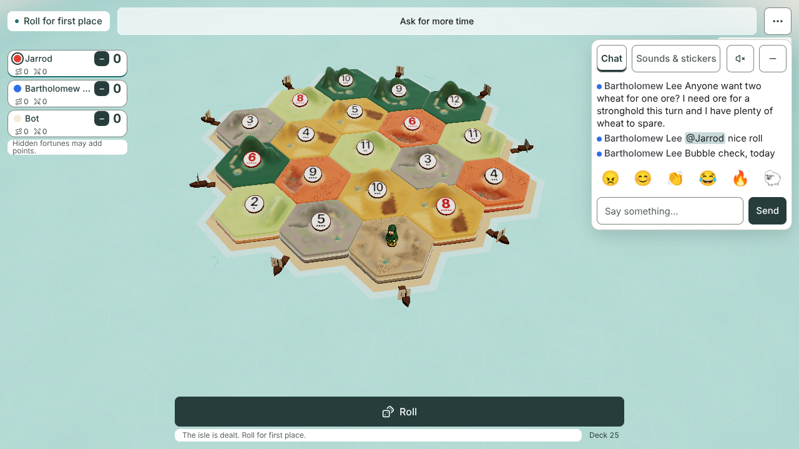
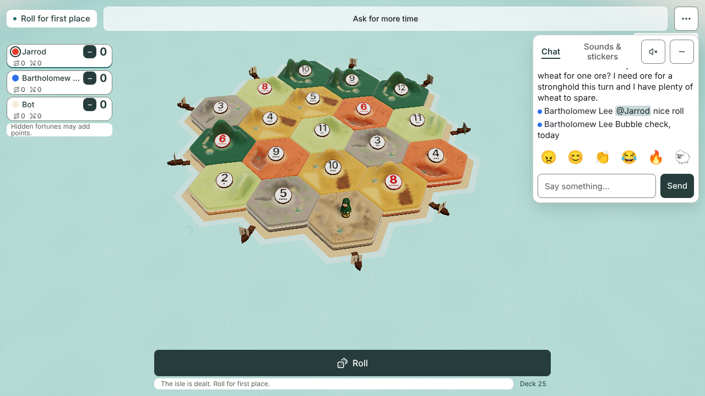

# Chat and Table menu: one control look (#1304, for #1274)

**Design stage only. No game code changes.** Jarrod accepts the pictures and answers the question below; then a builder takes it with #736 (chat) and #669 (Sound).
Author: Claude Opus 5.5, 2026-11-07. Base: the PR base, current `main`.

## What this fixes

Measured on today's game, with none of this proposal's styles loaded ([today-chat-390x844.png](today-chat-390x844.png)):

- The chat's tabs, field, emoji, sound chips and quick lines are white on a white panel. They have no edge, so nothing shows what can be tapped.
- The two tabs are 4 px apart. On desktop, Mute players and Minimize chat are 40 px wide. On a 320 px phone the second tab reads "Sounds…".
- The Table menu and an open chat can be open together. On desktop a tap on `…` opens the menu over the chat panel (79,872 px² overlap at 1280 × 720; the menu is on top). On a phone the chat's dimmed backdrop takes that tap and closes the chat; Enter on `…` opens the menu, and the chat sheet then covers part of it: its centre at 320 × 568 and 844 × 390, its lower part at 390 × 844 ([layers-today-390x844.png](layers-today-390x844.png)). The first Escape closes the menu and leaves the chat open.
- A seat's chat bubble draws over the open Table menu on phones (320, 390 and 844 px wide). On desktop the bubble beside the seat list draws under it.
- On desktop the menu's View row already runs past the menu's right edge ("Overhead" is cut, [layers-today-1280x720.png](layers-today-1280x720.png)).

## The proposal

Every control in the chat and the menu uses the lobby's control look (#1303): 44 px, a 1 px dark grey edge, 8 px corners, 15 px dark text, 8 px apart.

**Chat panel and sheet**

- White, no blur. The desktop panel has a light line around it and a soft shadow.
- The desktop panel grows from 300 to 320 px wide, so two boxed tabs, Mute and Minimize fit on one line (see the question).
- **Tabs:** the chat's two tabs keep their names and order (the owner's 2026-10-20 choice). They take the lobby's tab look: the picked tab has dark text and a 3 px dark bar; the other has grey text. The icons go. A long label takes two lines, never "…" ("Sounds & stickers" on a 320 px phone).
- **Field:** white, the same edge, 15 px text (16 px on a touch screen, so iPhones do not zoom in), grey placeholder. Send keeps today's dark fill, as the owner kept button fills on 2026-11-03.
- **Log lines:** 15 px. A mention keeps today's highlight. Long names and long messages wrap; nothing is cut.
- **Emoji:** no box (they are pictures), 8 px apart. On a 320 px phone they scroll as one row with half of the sixth showing, as the lobby does (#1220).
- **Sounds & stickers:** sound chips and quick lines get the box with 12 px corners. Stickers stay pictures. While more lies below, the bottom 24 px fades.
- **Mute players** and **Minimize** (Close on a phone) are 44 px boxes.

**States** (the failed-send line and the empty line do not exist in the game yet; the capture adds them to the page)

| State | What shows |
|---|---|
| Nothing said yet | One grey line in the log: "No messages yet" (13 px) |
| A send that failed | The words stay in the field. One red line under it: "Not sent. The table did not answer. Press Send to try again." (13 px, read out by screen readers) |
| Unread, chat closed | A badge on the chat button: the danger red, a 2 px white ring, 12 px bold, "9+" past nine |
| Watcher | Today's read-only line, unchanged |

**Table menu**

- A white sheet, 20 px corners, 256 px wide.
- Every row is a 44 px target on the light grey ground, 8 px apart, so each row reads as tappable.
- **Water and View:** the label takes a line of its own, and the two choices share the row below it, each half the width, 8 px apart. Side by side with the label they do not fit in 256 px. The picked choice takes the tab look: white, dark text, the dark bar.
- The two sound rows become the one **Sound** row the owner accepted in #1276 (option A). No other sound control is added.
- When the menu is taller than the screen (320 × 568, 844 × 390), it scrolls and its bottom 24 px fades.
- The version line stays at 12 px.

**One layer at a time**

| Action | Today (measured) | Proposed (measured; the rule that opening the menu closes the chat is proposed behaviour, added to the page by the capture) |
|---|---|---|
| Tap `…` while the chat is open | Desktop: both open, 79,872 px² overlap, the menu on top. Phone: the tap closes the chat and the menu does not open | The menu opens and the chat closes, on every size; 0 px² overlap; the menu is on top at its centre |
| Enter on `…` while the chat is open (phones) | Both open; the chat sheet covers the menu's centre at 320 × 568 and 844 × 390, and its lower part at 390 × 844 | Not needed: the tap works |
| Escape with the menu open | The menu closes; focus goes back to `…`; the chat stays open | The menu closes; focus goes back to `…`; nothing else was open |
| Seat bubbles with the menu open | Drawn over the menu on phones (320, 390, 844 px wide); under it on desktop | Drawn under the menu, at every size |
| Open the chat while the menu is open | The menu closes when focus leaves it | The same |
| How to play, Costs or Sound from the menu | The menu closes and the sheet opens | The same |

How it is done: seat bubbles move under the menu (stacking level 10, not 30), and the top row with `…` sits above the chat's dimmed backdrop, so a tap reaches it. Opening the menu closes the chat; that part is behaviour, so the capture adds it to the page for the proposed pictures.

**Keys** (measured the same today and proposed; this spec changes no key)

- In the menu, Tab goes row by row from the first: How to play, Costs, the sound rows, Haptics (phones), Crystal, Simple, Diorama, Overhead, Copy table code, Copy log, Report a bug, Leave table. The proposal has one Sound row in place of the two sound rows. Tab past the last row leaves the menu, and it closes. Escape inside the menu closes it and puts focus back on `…`.
- In the chat, Tab goes: Chat tab, Sounds & stickers tab, Mute players, Minimize, the log, the six emoji, the field, Send.
- Escape from the chat field closes the chat. Focus then lands on the page, not on the chat button. #1370 (proposal P4A) asks for focus back on the chat button and for Escape anywhere in the panel; this spec keeps that with #1370.

## Pictures

29 pictures of states, 4 of today's layers and 4 of the proposed layers: 37 in all.

| State | 320 × 568 | 390 × 844 | 844 × 390 | 1280 × 720 |
|---|---|---|---|---|
| Today, Chat tab | [today](today-chat-320x568.png) | [today](today-chat-390x844.png) | [today](today-chat-844x390.png) | [today](today-chat-1280x720.png) |
| Chat tab | [chat](chat-320x568.png) | [chat](chat-390x844.png) | [chat](chat-844x390.png) | [chat](chat-1280x720.png) |
| Sounds & stickers | [sounds](sounds-320x568.png) | [sounds](sounds-390x844.png) | [sounds](sounds-844x390.png) | [sounds](sounds-1280x720.png) |
| Failed send | [failed](failed-320x568.png) | [failed](failed-390x844.png) | [failed](failed-844x390.png) | [failed](failed-1280x720.png) |
| Nothing said yet | [empty](empty-320x568.png) | [empty](empty-390x844.png) | [empty](empty-844x390.png) | [empty](empty-1280x720.png) |
| Unread, closed | [unread](unread-320x568.png) | [unread](unread-390x844.png) | [unread](unread-844x390.png) | [unread](unread-1280x720.png) |
| Table menu | [menu](menu-320x568.png) | [menu](menu-390x844.png) | [menu](menu-844x390.png) | [menu](menu-1280x720.png) |
| Layers today: menu and chat open together | [today](layers-today-320x568.png) | [today](layers-today-390x844.png) | [today](layers-today-844x390.png) | [today](layers-today-1280x720.png) |
| Layers proposed | [proposed](layers-proposed-320x568.png) | [proposed](layers-proposed-390x844.png) | [proposed](layers-proposed-844x390.png) | [proposed](layers-proposed-1280x720.png) |
| Desktop panel at 300 px (question, B) | | | | [300 px](chat-300-1280x720.png) |

| Today, 390 × 844 | Chat tab, 390 × 844 | Table menu, 390 × 844 | Layers today, 1280 × 720 | Layers proposed, 1280 × 720 |
|---|---|---|---|---|
|  |  |  |  |  |

## Measurements

From the final run of [capture.mjs](capture.mjs). The full numbers are in [measurements.json](measurements.json). Chromium 153.0.8010.12, browser errors 0.

The capture fails, and writes no pictures or numbers, unless every proposed state is inside the screen, has no control under 44 × 44, keeps 8 px between targets, has nothing past the sheet's edge and no cut tab label; and unless, in the proposed layers at every size, a seat bubble is tested and draws under the menu, the menu and the chat are never open together, the menu is what is drawn at its own centre, and Escape (from inside the menu, and after the tap) puts focus back on `…`. Where a seat's bubble does not reach the menu (844 × 390 and 1280 × 720), the capture moves it over the menu's centre for the test. Today's layers and keys, and the other numbers below, are recorded, not checked.

| Check | Today | Proposed |
|---|---|---|
| Controls under 44 × 44 | 1280 × 720: Mute players 40 × 44, Minimize 40 × 44 | None, at all four sizes, in every state |
| Smallest gap between targets | 4 px (the two tabs) | 8 px, chat and menu, at all four sizes |
| Controls past the sheet's edge | "Overhead" in the menu at 1280 × 720 (seen in the picture; today's menu is not measured) | None |
| Tab labels | At 320 px, "Sounds & stickers" is cut to "Sounds…" | One line from 390 up; two lines at 320 (94 × 44 px). Never cut |
| Panel inside the screen | Yes | Yes, every state |
| Desktop panel | 300 × 312 at 968, 64 | 320 × 304 at 948, 64 |
| Sounds & stickers has more below | Yes, with no cue (see the [#1370 picture](../quick-react-tray/game-sounds-1280x720.jpg)) | Yes, the fade shows, at all four sizes |
| Table menu | 256 px wide | 256 × 488 at 320 × 568 and 256 × 310 at 844 × 390, both scrolling with the fade; 256 × 688 at 390 × 844; 256 × 636 at 1280 × 720 |
| Text sizes in the chat | 14 px lines, 24 px emoji | 15 px lines and controls, 13 px notes, 24 px emoji |
| Unread badge | A bright red of its own | The danger red with a white ring, reading "3" |

**Why 320 px.** At 300 px with 8 px gaps the six emoji shrink to 40 px wide, and "Sounds & stickers" takes two lines even without its box ([chat-300-1280x720.png](chat-300-1280x720.png)). At 320 px every control is 44 px or more.

## Question for Jarrod: how wide is the desktop chat panel?

- **A (recommended):** 320 px, with boxed tabs. Every control is 44 px or more. The island moves 10 px left at 1280 × 720 and keeps its size. **Cost:** the game keeps a strip on the right free of island for the chat, sized for 300 px. A needs it sized for 320 px, which changes one game rule and two existing checks. Those changes need your approval:
  - the rule: `src/lib/scene/mobile-fit.ts:99`, the right strip `12 + 300 * t` becomes `12 + 320 * t` (it grows in between 960 and 1024 px wide, so that ramp moves too);
  - the check `scripts/board-look-prove.mjs:557`, which expects the right strip to be exactly 312 px (it becomes 332);
  - the check `scripts/touch-place-prove.mjs:179`, which expects 312 px for an open chat on the right (it becomes 332).
- **B:** 300 px as today. The tabs keep today's underline with no box, and the emoji shrink to 40 px. No game rule or check changes.
- **C:** 300 px with boxed tabs, and the emoji row loses its 8 px gaps. No game rule or check changes.
- **D:** Something else.

| A, 320 px | B, 300 px |
|---|---|
|  |  |

Everything else in this spec does not depend on the answer.

## What stays, and who owns what

| Kept as it is | Owner of any later change |
|---|---|
| One chat button, two tabs, six emoji, the quick lines row in Sounds & stickers (the owner's 2026-10-20 choice) | That choice |
| Seat bubbles' look, per-seat mute, the log, mentions, the read-only watcher view | #1370 / #736 |
| Tab keys, Escape anywhere in the panel, focus back to the chat button | #1370 (P4A) / #736 |
| Send waits (1 s emoji and stickers, 3 s sounds) | #1370 (P3A) / #736 |
| Sound controls (one Sound row, then the Sound panel) | #1276 option A / #669 |
| Calm / Brisk | #1065 |
| Where the chat goes on a phone held sideways | #774 |
| Every Table menu action and its meaning: How to play, Costs, Sound, Haptics, Water, View, Copy table code, Copy log, Report a bug, Leave table | This spec (look and layers only) |

## Notes for the builder

- The failed-send line needs the field to keep its words until the host echoes the line or answers with an error. Today `Chat.tsx` clears the field as soon as it sends. "Slow down." from the host shows the same line with "Slow down. Try again in a moment."
- The empty line is drawn by the page's styles in this mock. In the build it is one list item the log shows when it has no rows.
- Layers: in `Reactions.tsx` the seat bubbles' `z-30` becomes `z-10`; the header (`Hud.tsx`) sits above the chat's backdrop; opening the Table menu closes the chat (`setChatOpen(false)`).
- Option A changes `mobile-fit.ts:99` and the two checks named in the question, only with the owner's approval. The look itself changes no proof line. The one-layer rule may touch `chat-prove` and `table-menu-prove` layering lines. Replace any such line in its own commit with an old/new table, per [DECISIONS](../../DECISIONS.md) 2026-10-25. Delete none.

## How it was made

- [capture.mjs](capture.mjs) starts a real host. Jarrod hosts at each size. Bartholomew Lee joins on a phone (15 letters; the game allows 16), and a bot sits too. The guest sends a long line and a mention through the real host.
- It measures today's layers and keys first, before any of this proposal's styles are on the page.
- [chat-menu.css](chat-menu.css) is then added to the running page. It uses only the game's own colours and sizes. The Sound row is the #1276 entry (`docs/design/sound-sheet-1276/sheet.mjs`).
- The failed-send line, and the rule that opening the menu closes the chat, are added to the page by the capture: neither exists in the game yet.
- No `src/` file changed. The built CSS is byte-identical with and without this folder.
- Run it from the repo root: `node docs/design/chat-menu-1274/capture.mjs`. It writes to a temp folder; add `--save` to write here.
