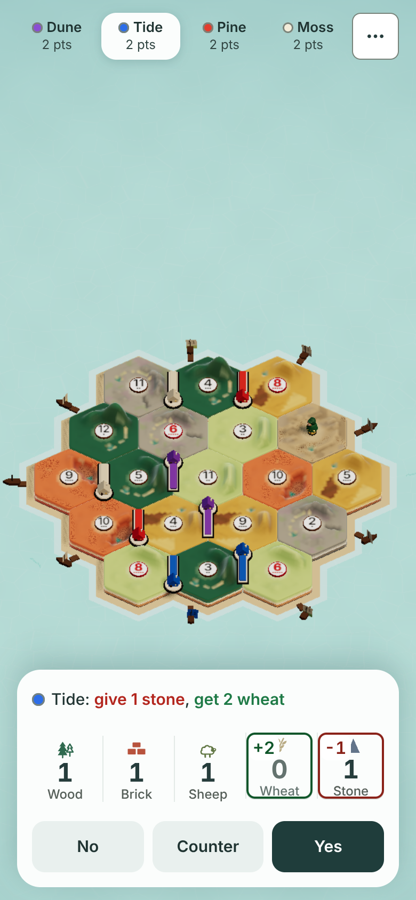
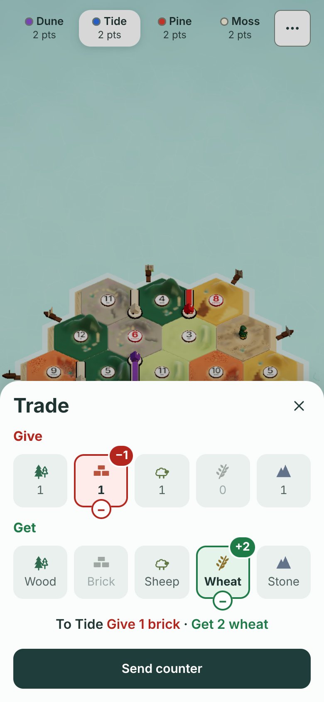
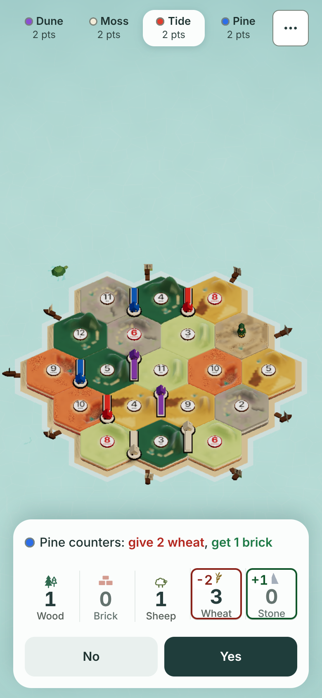
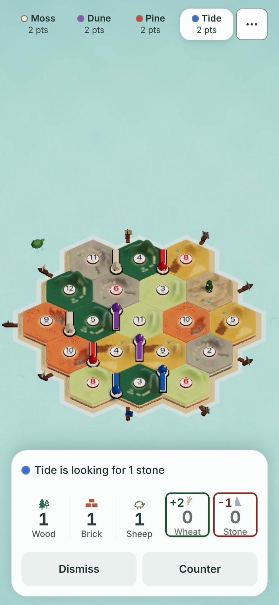
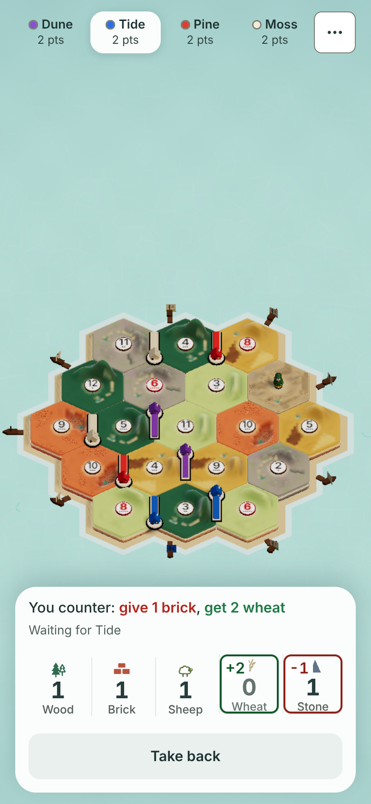
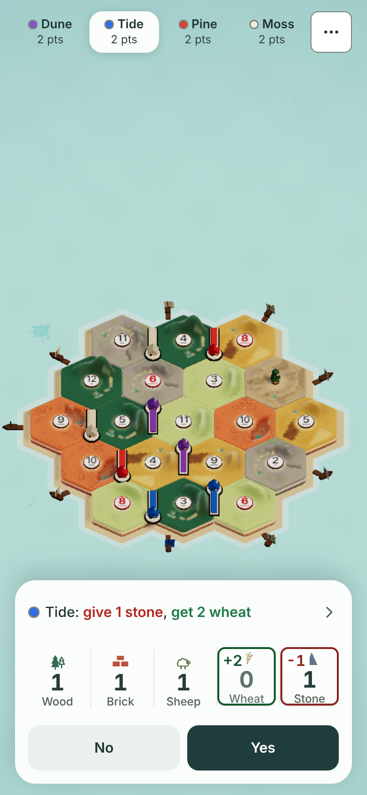
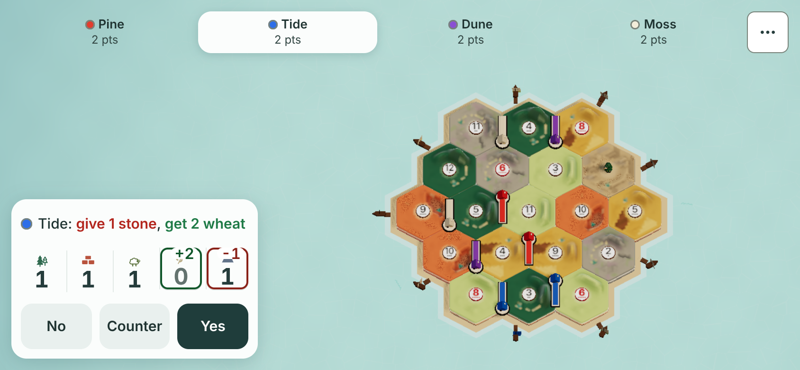
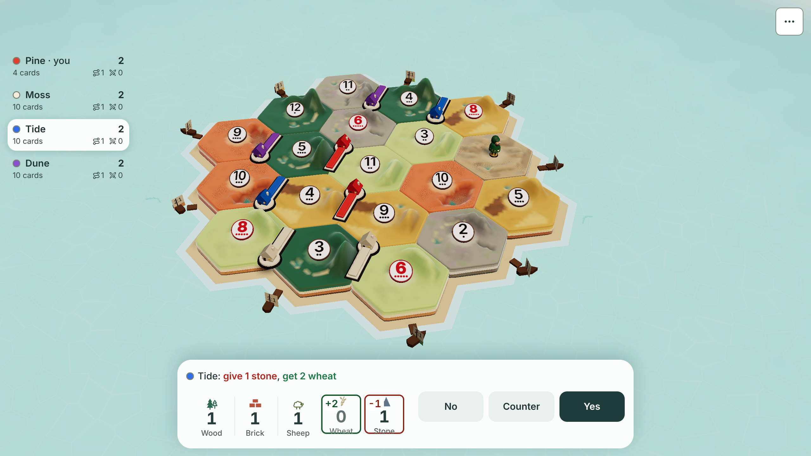

# Counter-offers

Design for part 2 of [#850](https://github.com/jarrodjohnson-gif/emberisle/issues/850). Docs only. No code changes with this file.
Written 2026-11-14 by Claude Fable.

It builds on three things that already exist:

- The tray offer: one line, then No and Yes ([`one-tray/README.md`](one-tray/README.md), slice C).
- The Give and Get trade sheet (slice A, [#1537](https://github.com/jarrodjohnson-gif/emberisle/issues/1537)).
- The protocol study in [`trade-open-ask.md`](trade-open-ask.md). That note left seven policies open (P1 to P7). This design answers the ones a counter needs.

It covers the plain counter only. "Any N cards" and request-only asks from `trade-open-ask.md` stay out.

Nothing here is approved yet. The [owner questions](#owner-questions) at the end need Jarrod's answers before anyone builds.

## The idea in one example

Tide asks the table: 2 wheat for 1 stone.

1. Pine sees "Tide: give 1 stone, get 2 wheat" with **No**, **Counter** and **Yes**.
2. Pine taps Counter. The trade sheet opens with Tide's terms already filled in, from Pine's side.
3. Pine changes Give to 1 brick and taps **Send counter**.
4. Tide's tray reads "Pine counters: give 2 wheat, get 1 brick" with **No** and **Yes**.
5. Tide taps Yes. The goods move once. The offer closes for the whole table.

No goods move until the asker taps Yes. Pine does not confirm again.

## Today, checked against main at `cd79da4`

| Fact | Where |
|---|---|
| One table offer per room, kept in host memory: `{ tradeId, from, give, want, declined, botTimers, until }`. | `server/host.mjs:1713` |
| A Yes is never stored. The first valid Yes settles through `offerTrade` then `respondTrade` on a copy of the state. | `server/host.mjs:1817-1825`, `src/lib/game/rules.ts:796-838` |
| A person's offer has no timeout. A bot's offer runs out after 20 s. | `server/host.mjs:130`, `:1709-1712` |
| A bot's Yes waits up to 8 s while people have not answered. | `server/host.mjs:128`, `:1740-1750` |
| The offer closes when every other seat has said No, when the asker's turn or goods go, or on Cancel. | `server/host.mjs:1806`, `:1895-1907`, `:1767` |
| Offers, Nos and closes go to every seat and watcher. Nothing is hidden. | `server/host.mjs:226-230` |
| The offer is not saved. A rejoin gets it again with the missed Nos. | `server/host.mjs:361`, `:2129-2135` |
| The client drops any host event it does not know. | `src/lib/net/table.ts:274` (`ALLOWED_EVENTS`) |
| With five or six seats, no player trade starts or settles on a partner turn. | `src/lib/game/expanded.ts:251-259` |
| Bots accept with `shouldAcceptTrade`. They have no counter logic. | `src/lib/game/ai.ts:130` |
| The tray offer lives in `TradeToast.tsx`. The sheet lives in `TradePanel.tsx`. | `src/components/game/` |
| Practice mirrors the host's timing in the store. | `src/lib/game/store.ts:258-262` |

Pass and play has no table offers, so it gets no counters.

## Rules

These are the design's calls. Each maps to a policy in `trade-open-ask.md`.

| Rule | Policy |
|---|---|
| A counter is a full deal: what the asker gives and what the asker gets. Both sides hold at least one good. No good appears on both sides. | "Every settling deal has two nonempty, disjoint positive bags" |
| A counter must differ from the offer it answers. | new |
| Each seat may send one counter per offer. A taken-back or refused counter is still that seat's one. | P3, and #850's own text |
| Only the asker can accept a counter. Other seats cannot take it. | P4 |
| The asker answers a counter with Yes or No. The asker cannot counter back. To change terms, the asker cancels and asks again. | P3 |
| A counter does not use up the seat's answer. If the asker says No, the seat may still take the first offer. | P2 |
| The first offer stays open to everyone while counters are out. | P2 |
| The offer closes when every other seat has said No **and** no counter is waiting. | P2 |
| A counter ends with its offer: a deal, Cancel, the end of the turn, a bot taking the seat, or a rematch. | P5 |
| A person's counter has no timeout, like a person's offer. | P5 |
| A seat that cannot pay the first offer may still counter. | "An unaffordable original must not prevent submitting an affordable changed counter" |
| Goods are checked twice: the sender's when the counter goes out, and both hands when the asker taps Yes. Nothing is set aside in between. | "Revalidate at acceptance" |
| No counters on a partner turn, because no offer can be open then. | `expanded.ts` |

### Who sees a counter

| Seat | Sees |
|---|---|
| The asker | The counter in the tray, with No and Yes. |
| The sender | Their own counter in the tray, with Take back. |
| Everyone else, and watchers | One game log line. Their tray does not change. |

Counter terms are public, as offer terms are today (P1). Other seats cannot act on a counter, so it stays out of their tray.

### Bots

| Case | What happens |
|---|---|
| A person counters a bot's offer. | The bot answers after its normal 1 to 2 s. It uses `shouldAcceptTrade` on the counter's terms, seen from the bot's side. |
| A bot's offer is about to run out with a counter waiting. | The bot answers the counter first. Then the 20 s rule applies as today. |
| A bot answers a person's offer. | Yes or No, as today. A bot never sends a counter (P7). |
| A bot holds a Yes for the first offer while a person's counter is waiting. | The bot's Yes waits until the asker answers that counter. People still go first. |
| A recovery bot holds the asker's seat. | The takeover has already closed the offer and its counters. |

## What each player sees

All of it sits in the tray and the trade sheet that exist today. There is no new surface and no new colour.

Text and sizes reuse the tray's classes:

| Part | Size | Class today |
|---|---|---|
| Top line | 15 px on a 20 px line, weight 500 | `.trade-line` |
| Quiet status | 13 px on a 20 px line | `.trade-wait` |
| Buttons | 48 px high, sharing the row equally, 8 px apart | `.trade-answers > button` |
| Give words | `#b3261e` | `.trade-give-text` |
| Get words | `#1e7a46` | `.trade-get-text` |

With three buttons at 390 px wide, the row gives each button about 108 px. The builder measures it. Each stays 44 px or more both ways.

### The seat that got the offer

| State | Top line | Row |
|---|---|---|
| An offer I can pay | "Tide: give 1 stone, get 2 wheat" | No, Counter, Yes. Yes stays the primary button. |
| An offer I cannot pay | "Tide is looking for 1 stone", today's words | Dismiss, Counter |
| My counter is out | "You counter: give 1 brick, get 2 wheat". Quiet status: "Waiting for Tide". | Take back |
| Tide said no to my counter | "Tide said no" for 2.5 s, then the first offer again. | No, Yes. Counter is gone. |
| I took my counter back | The first offer again. | No, Yes. Counter is gone. |
| I already said No to the offer | Nothing, as today. | None |

Counter is a secondary button, like No. It never looks like the main choice.

Counter does not show when the game has no counters: an old host, pass and play, or an asker whose game is out of date.

### The counter sheet

Counter opens the trade sheet that Trade opens today, with three differences:

| Part | Trade today | Counter |
|---|---|---|
| Title | "Trade" | "Counter" |
| Start | Empty rows | Tide's terms, turned to my side: Give 1 stone, Get 2 wheat |
| Sentence under the rows | "Give 2 wheat · Get 1 stone" | "To Tide: Give 1 brick · Get 2 wheat" |
| Main button | "Ask the table" | "Send counter", across the whole footer |
| Bank button | Shown | Hidden. The bank does not trade off your turn. |

"Send counter" is off, with a reason under it, in three cases:

| Case | Reason shown |
|---|---|
| The terms equal Tide's offer | "Change something first." |
| A side is empty, or a good is on both sides | "Pick what to give and what to get." |
| I do not hold what I would give | "You need 1 more brick." |

The reason line always keeps its 20 px of height, so the sheet does not move as you edit.

Closing the sheet sends nothing and answers nothing. The offer is still in the tray.

If the offer closes while the sheet is open, the sheet closes and the tray shows the outcome line.

### The asker

| State | Top line | Row |
|---|---|---|
| My offer is out | "You offer 2 wheat for 1 stone", and who has said no | Cancel, as today |
| A counter arrives | "Pine counters: give 2 wheat, get 1 brick", Pine's seat dot before the name | No, Yes |
| Two counters are waiting | The oldest one. Quiet status: "1 of 2". | No, Yes |
| I said No to a counter | The next counter, or my offer again with Cancel | |
| I cannot pay a counter | The same line. Yes is off. A reason for screen readers: "You need 1 more wheat". | No, Yes (off) |
| I said Yes | "Pine takes it." for 2.5 s, as today | None |

A counter takes the asker's tray until it is answered. Cancel comes back with the offer line.

### Two rules for every state

- **The hand marks follow the top line.** The "−1" and "+2" tags on the hand show the deal the line names. On a counter they show the counter's goods, not the first offer's.
- **A give phrase or a get phrase never breaks in the middle.** On a sideways phone the line may wrap after the comma. "get 2 wheat" stays whole.

The asker hears the offer chime when a counter arrives. Nobody else does.

### Words

| Where | Words |
|---|---|
| Button on an offer | Counter |
| Sheet button | Send counter |
| Sender's tray | You counter: give 1 brick, get 2 wheat |
| Sender's status | Waiting for Tide |
| Sender's button | Take back |
| Asker's tray | Pine counters: give 2 wheat, get 1 brick |
| Refused, on the sender's tray | Tide said no |
| Game log, counter sent | Pine counters Tide: 1 brick for 2 wheat. |
| Game log, deal | Tide traded 2 wheat to Pine for 1 brick. (today's line) |

The tray lines keep "give" and "get" from the reader's side, red and green, like every offer. A name never carries "(bot)".

A refused or taken-back counter adds no log line.

## Protocol

This follows `trade-open-ask.md`, cut down to the counter. Bags are always from the asker's side: `give` leaves the asker, `want` reaches the asker.

| Message | From | Payload | Host does |
|---|---|---|---|
| `tradeCounter` | a seat that is not the asker | `{ tradeId, give, want }` | Checks the rules above. Stores the counter. Sends `tradeCounter` to the table. |
| `tradeCounterAnswer` | the asker | `{ tradeId, counterId, yes }` | No: closes that counter. Yes: settles through `offerTrade` and `respondTrade` on a copy, then closes the offer. |
| `tradeCounterCancel` | the counter's sender | `{ tradeId, counterId }` | Closes that counter. |

| Event | Payload | When |
|---|---|---|
| `tradeOffer` (today's event) | gains `counter: true` | Counters are allowed on this offer. |
| `tradeCounter` | `{ tradeId, counterId, by, name, give, want }` | A counter is stored. |
| `tradeCounterClosed` | `{ tradeId, counterId, why }` with `why` one of `no`, `back`, `gone` | A counter ends without a deal. |
| `tradeClosed` (today's event) | `{ tradeId, taker }` | A deal or any close. It ends every counter under it. |

Details the host must hold to:

- Every new message needs the exact `tradeId`. `tradeCounterAnswer` and `tradeCounterCancel` need the exact `counterId` too. A missing id is refused.
- The host issues `counterId`. The terms behind an id never change.
- `tradeCounter` and `tradeCounterCancel` come from seats that are not on turn. They get the same older-stamp allowance `tradeAnswer` has in `freshAction`. `tradeCounterAnswer` needs the current stamp, like `tradeAsk`.
- A watcher, the asker countering their own offer, a second counter from one seat, and a closed offer are all refused.
- A Yes with the asker short of goods returns "You lack those goods." to the asker. The counter stays.
- A Yes with the sender short of goods closes that counter with `why: "gone"`. The offer stays.
- A rejoin gets the offer, the missed Nos, and every waiting counter, in that order.
- Counters are not saved, like the offer. The room save shape does not change.
- The rate limit in `server/host.mjs:111-112` covers the new messages.

Error strings stay the ones in use: "Offer is gone.", "Bad trade.", "You lack those goods.", "Cannot trade now.".

### Old clients and old hosts

- A client shows Counter only when the offer carries `counter: true`. An old host never sends it, so the button never shows there.
- The host sets `counter: true` only when the asker can answer a counter: the asker is a bot, or the asker's client said it knows counters.
- The client says so through the capability list that the six-player work adds to the hello ([#1611](https://github.com/jarrodjohnson-gif/emberisle/issues/1611), PR #1656). The name is `counter`.
- An old client drops the new events, because `ALLOWED_EVENTS` does not list them. It keeps working as today.
- `PROTO` does not change.

## Building it

Three slices, in order. Each is one issue and one PR. The desk files them once the owner has answered.

| Slice | Lane, tier | Files | Depends on |
|---|---|---|---|
| 1. Host and protocol | `lane:net`, `tier:1` | `server/host.mjs` (the offer record, three handlers, `resendOffer`, bot answer), `src/lib/net/table.ts` (three senders, two events), new `server/trade-counter-prove.mjs` | PR #1656 merged, for the capability list |
| 2. Practice and store | `lane:rules`, `tier:2` | `src/lib/game/store.ts` (counter state, the practice mirror, the bot's answer), `server/practice-trade-prove.mjs` cases | Slice 1 |
| 3. Tray and sheet | `lane:hud`, `tier:2` | `TradeToast.tsx`, `TradePanel.tsx`, the tray rules in `src/styles.css`, `scripts/tray-offers-prove.mjs`, `scripts/trade-prove.mjs`, pictures | Slice 2, and the owner's OK on the pictures |

### Proof cases

Slice 1, against the real host with sockets:

- A counter reaches the asker. A Yes moves exactly the counter's goods, once, and closes the offer.
- A No closes only that counter. The sender can still take the first offer.
- A second counter from one seat is refused. So is the asker's own, a watcher's, and one equal to the offer.
- A counter with an empty side, or a good on both sides, is refused.
- Take back closes the counter. A Yes that arrives after it does nothing.
- Two Yes messages for one counter settle once.
- All seats say No with a counter waiting: the offer stays. It closes when the counter ends.
- The turn ends with a counter waiting: both close, and no goods move.
- A bot asker answers a counter in 1 to 2 s, by `shouldAcceptTrade`.
- A bot's held Yes waits for a waiting person's counter.
- A rejoin gets the waiting counters.
- A client without the capability gets an offer without `counter: true`, and its counter is refused.
- A five-seat table refuses a counter on a partner turn.
- Hands, the deck and the seed stay out of every new event.

Slice 2 mirrors the bot and timing cases on the practice store with the fake clock.

Slice 3, in the browser at 390x844, 844x390 and 1280x720:

- Every state in the tables above shows its exact words.
- Every button is 44 px or more both ways, and no text is under 12 px.
- The tray stays one surface. Nothing covers the island that the offer does not cover today.
- The sheet starts with the offer's terms, and "Send counter" is off until something changes.
- Focus goes to the sheet on Counter, and back to the tray when it closes.
- Escape in the tray still answers No to an offer. It does not answer a counter.
- Zero page errors.

### Size

No existing ceiling or allowance moves for this work.

- The counter states are new markup in `TradeToast` (ceiling 3,000 B) and `sheets` (7,800 B). The net client is `table`.
- If a chunk does not fit, the builder moves the counter states into a new lazy chunk loaded with the first `counter: true` offer. A new chunk's ceiling is the desk's call.
- If it still does not fit, the builder stops and posts the measured bytes.

## Owner questions

Each is one card. A is the recommendation.

**1. Where does Counter go?**
- **A. A third button between No and Yes.** One tap to start a counter. The row is tighter on a phone.
- B. Keep No and Yes. Tapping the offer line opens the counter sheet. Cleaner row, but easy to miss.
- C. No counters. Close part 2 of #850.

**2. Your counter is refused. Can you still take the first offer?**
- **A. Yes.** The first offer comes back with No and Yes.
- B. No. Sending a counter is your No to the first offer.

**3. Who sees a counter?**
- **A. The asker in the tray. Everyone else in the game log.** Matches how offers are public today.
- B. Only the asker and the sender. Needs hidden-terms work on the host.

**4. What do bots do?**
- **A. Bots answer a counter. They never send one.**
- B. Bots also send counters. Needs a pricing rule first, and its own design.
- C. Bots refuse every counter.

## Pictures

These are the real game with a prototype of slice 3 on top (`counter-offers/prototype.patch`). The tray, the sheet and their classes are the real ones. No host code exists yet.

| Got an offer (question 1, A) | The counter sheet | The asker sees the counter |
|---|---|---|
|  |  |  |

| Cannot pay the offer | My counter is out | Question 1, B: tap the line |
|---|---|---|
|  |  |  |

Sideways phone and desktop:

| 844x390 | 1280x720 |
|---|---|
|  |  |

Every state at every size is in [`counter-offers/`](counter-offers/). The measured sizes are in [`counter-offers/measures.md`](counter-offers/measures.md).

Measured at 390x844: No, Counter and Yes are 104.7 x 48 px each. The narrowest row is the sideways phone, at 74.7 x 48 px each. Every top line is one line at 390 px.

Where the prototype differs from this design:

- Its hand marks still show the first offer on the counter states. The build follows the rule above.
- Its sheet title reads "Trade", and its sentence has no colon after "To Tide".
- Its reason line makes the sheet 22 px taller. The build keeps the height fixed.
- On the sideways phone, "You counter: give 1 brick, get 2 wheat" breaks inside "get 2 wheat". The build keeps the phrase whole.
