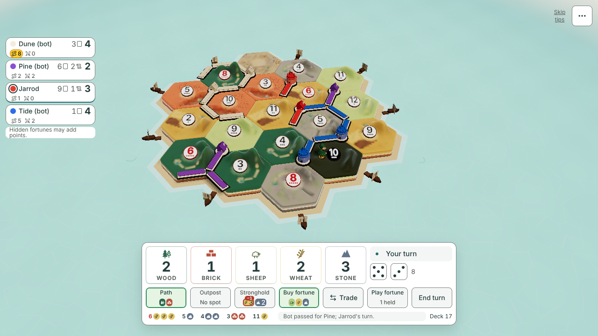
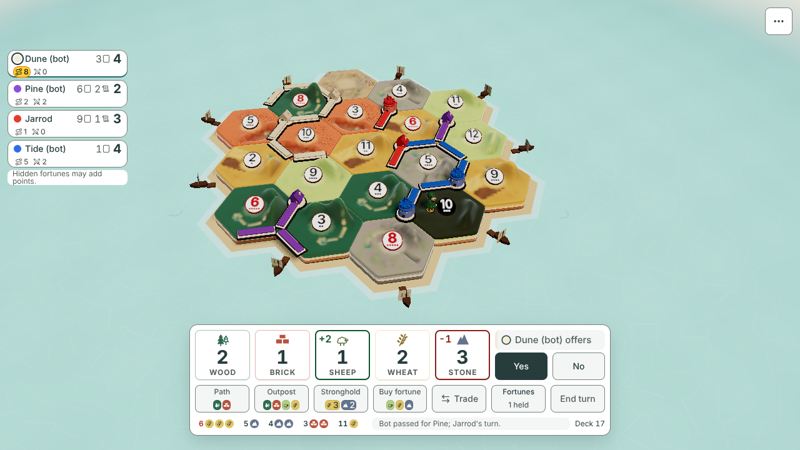

# Desktop dock mock, 672 × 176 (#1300, for #1274)

**Design stage only. No game code changes.** Jarrod accepts these real-game pictures before anyone builds the dock.
Author: Claude Opus 5.5, 2026-11-07. Base: `main` at `5b83aa1`.

This is owner decision 10A on #1274: one 672 × 176 px dock with five 88 px cards and seven controls, shown in the real game.

## The dock

One white box, centred, 24 px above the bottom edge (decision 11). It sits at x 304, y 520 at 1280 × 720.

| Row | Height | Left 472 px | Right 176 px |
|---|---|---|---|
| 1 | 80 | The hand: five 88 × 80 cards, 8 px apart | Turn line (32), then one 44 px slot 4 px below it |
| 2 | 44 | Seven controls across both columns: Path, Outpost, Stronghold, Buy fortune, Trade, Fortunes, End turn | |
| 3 | 20 | Meta line: your numbers, the last log line, Deck N | |

- Padding 8 px, gaps 8 px. 8 + 80 + 8 + 44 + 8 + 20 + 8 = 176. 8 + 472 + 8 + 176 + 8 = 672.
- Each control is 86.9 × 44 px, 8 px apart.
- The edge is a 1 px ring in the control-line colour, so it takes no room from the slots. Corners are 12 px (decision 2).
- The slot under the turn line shows the last roll's dice. When an offer comes in, it holds Yes and No.
- Nothing appears or leaves by phase. A control that cannot be used now is greyed and says why to a screen reader.

Everything inside is the game's own parts, unchanged: the V1 hand cards with their names, gain fill and +N tabs, the cost chips, the buttons, the dice and the number chips. The fills follow today's rules (decision 4C): End turn is filled when nothing can be bought, Yes is filled, a build you can pay for is green.

## Pictures, 1280 × 720

| State | Picture | What it shows |
|---|---|---|
| Your turn | [own-turn-1280x720.png](own-turn-1280x720.png) | Path and Buy fortune ready; Outpost has no spot; Stronghold short 1 wheat; Play fortune, 1 held |
| Offer, option A | [offer-a-1280x720.png](offer-a-1280x720.png) | Yes and No in the slot under the turn line; the seven controls stay |
| Offer, option B | [offer-b-1280x720.png](offer-b-1280x720.png) | Yes, No and Details take the Trade, Fortunes and End turn places |
| Another turn | [other-turn-1280x720.png](other-turn-1280x720.png) | Every control greyed; costs still show |
| Gain off your turn | [gain-1280x720.png](gain-1280x720.png) | +1 wood and +2 wheat from Dune's roll |
| Loss | [loss-1280x720.png](loss-1280x720.png) | −2 stone |
| Empty hand | [empty-1280x720.png](empty-1280x720.png) | Five empty cards; each build shows what it is short; End turn filled |
| Roll | [roll-1280x720.png](roll-1280x720.png) | Roll takes the End turn place (an extra state, from the #1274 study) |

| Your turn | Offer, option A |
|---|---|
|  |  |

Phones are unchanged. The mock does not mount there, and every HUD box keeps its place:
[phone-390x844.png](phone-390x844.png), [phone-844x390.png](phone-844x390.png). The phone dock stays with #1101 and PR #1144.

## Measurements

From the final run of [capture.mjs](capture.mjs). The full numbers are in [measurements.json](measurements.json).

- **Same slots in every state.** The dock, the hand, the turn line, the slot, each of the seven controls and the meta line have the same rectangle in all 8 desktop states.
- **Seven controls**, in the named order, in every state except option B's offer.
- **Targets.** No control under 44 × 44. Gaps between controls are 8 px (7.9 where the 86.9 px widths round).
- **Costs.** Each build shows its chips inside its tile: Path 2, Outpost 4, Stronghold 2, Buy fortune 3. On your turn, a build with no spot shows "No spot" in place of its chips, as today (Outpost in the own-turn and empty pictures). On other turns the chips always show.
- **Gain and loss tabs.** Not clipped. Each tab is 28 px tall at y 504, so it rises 16 px above the dock's top edge for the 3 s cue.
- **Text sizes.** 12, 14, 15 and 30 px, 17.5 px for a tab, 16 px for Yes and No. The 9 px shortfall badge is the game's own cost chip; the mock does not change it.
- **Turn line.** Fits in 176 px in every state: "Your turn", "Roll the dice", "Dune (bot)'s turn", "Dune (bot) offers".
- **Browser errors:** 0. Chromium 153.0.8010.12.

### Scene and island

| What | Rectangle (w × h at x, y) |
|---|---|
| Clear scene: right of the seat rail, above the dock | 1076 × 520 at 204, 0 (the 44 px menu button sits in its top-right corner) |
| The island's fit area today (`__isle.insets()`) | 752 × 426 at 216, 68 |
| Island pixels (every corner on screen) | 509 × 334 at 341, 109 |

The island ends at y 443, 77 px above the dock. It never touches the dock or the seat rail. The mock does not change the island's fit; any refit belongs to the build.

## What moves compared with today

- The turn line leaves the top-left of the screen and sits in the dock.
- The dice leave the End turn row and sit in the slot under the turn line.
- Fortunes is always there in one place, greyed with "0 held" when you hold none (decision of 2026-10-22).
- The fourth build is labelled **Buy fortune**. The deck count leaves that tile; it is already in the meta line as Deck N.
- Hand cards are 8 px apart, up from 4 px.
- Cost chips have 2 px side padding, down from 4 px, so Outpost's four chips fit an 87 px tile.
- The turn line is shorter, to fit 176 px: "Your turn" instead of "Build, trade, or end your turn", and "Dune's turn" instead of "Wait for Dune to build or trade".

## Question for Jarrod: where do Yes and No go?

The issue asks for exactly seven controls. An offer needs Yes and No. Two layouts are drawn.

- **A (recommended): Yes and No go under the turn line.** The seven controls never change. The raised hand cards show the terms (+2 sheep, −1 stone).
- **B: Yes, No and Details take the places of Trade, Fortunes and End turn**, as in the #1274 study. The seven places stay, but three of them change meaning while the offer is open.
- **C: Both.** Yes and No under the turn line, and Details in place of Trade.
- **D: Something else.**

A is recommended because nothing in the row changes meaning under your hand, and End turn is never where Yes was a moment ago.

## Limits

- Long names cut off with "…" in the turn line. The full offer is in Yes and No's description and in the line's tooltip.
- The pale seat's colour bar on the turn line is faint. The dot's dark ring (decision 9A) is drawn.
- The online chat button and timer are not in these pictures (a practice game). They stay in the header, where they are today.
- The tab rising 16 px above the dock is today's tab; a build could keep it inside by raising the padding to 24 px, which costs 16 px of island.

## How it was made

- [capture.mjs](capture.mjs) starts a practice game against three bots at 1280 × 720. It plays the setup and about 12 turns with the bots' own moves, for every seat.
- It then sets each state on the store and calls `mount()` from [dock.tsx](dock.tsx). That renders the game's own components into the slots set in [dock.css](dock.css), and hides today's bottom stack.
- The CSS uses only the game's tokens from `src/styles.css`. No `src/` file changed. The built CSS is byte-identical with and without this folder.
- Run it from the repo root: `node docs/design/desktop-dock-1274/capture.mjs`. It writes to a temp folder; add `--save` to write here. Each run deals a new board.
