# Dock trade marks that blend into the island

Issue [#1491](https://github.com/jarrodjohnson-gif/emberisle/issues/1491). A picture mock: no game code is merged.
Author: Claude Opus 5.5 (builder 2), 2026-11-12. Base: `main` at `2486e10`.

**Why.** On the #881 card (2026-11-09) Jarrod said the screen-sized trade chips were "terrible when zoomed out theyre huge ... the close up looks fine, but is there way to incorpoate the trade symbol in a more naturla way? perhaps one thats better looking and blends into invrioment." The chips stay the same size on screen while the island shrinks, so zoomed out they cover whole hexes.

**What this mock does.**
- **Three options**, each drawn on the island itself, so each one scales with the camera like the piers and goods piles.
- **No text in any of them.** The good is shown by its own symbol (the HUD's), the rate by white pips: two for 2:1, three for 3:1.
- **How they were drawn.** They were prototyped in the real renderer and photographed from the real build.
- **No game code merges.** The prototype is kept here as [`prototype.patch`](prototype.patch), so every picture can be reproduced.

## The options

| | A. Painted plank (recommended) | B. Flag on a mast | C. Standing sign |
|---|---|---|---|
| **What it is** | Today's plank on the end of each pier, repainted: the good's colour, its symbol and the pips. A little larger than today's (0.42 × 0.21 instead of 0.36 × 0.165). | A short mast on the pier head flies the same mark as a flag, facing the camera. | The same mark on a board on two posts at the pier's root, facing the camera. |
| **An owned dock** | A swallow-tailed pennant in the owner's colour on the pier head. | The same pennant, under the flag. | The same pennant, on top of the sign. |
| **Zoomed out** | A coloured plank on the pier, about the size of the goods pile; at this size the symbol becomes a coloured shape with pips. | The flag reads as a coloured card above the pier. The mast barely shows from the camera's height, so it looks as if it floats. | A small card at the shoreline; it can crowd the dockhouse. |
| **Close up** | The clearest: symbol and pips are largest, flat on the deck like a painted sign. | Clear, upright. | Clear, upright, but partly in front of the dockhouse on some docks. |

In all three:
- **A 3:1 dock's symbol** is a ring of five dots in the five goods' colours, meaning any good.
- **No cream.** The marks use white and the goods' colours. Today's plank has a cream border, which this replaces.
- **Ownership is public,** so nothing hidden is shown.
- **An owned dock reads by shape as well as colour:** the pennant is only there when the dock is owned, and it has a swallow tail. The boat's sail already wears the owner's colour today; that stays.

## Pictures

Each picture comes from the real build:
- **The game:** seed 14, four seats on one device, Ember to play. Ember owns the 3:1 dock (an outpost) and the wood dock (a stronghold); Tide owns the brick dock.
- **Sizes:** 390×844, 820×1180 and 844×390, each zoomed right out (the game's least zoom, 0.8), at the home view, and close up on Ember's wood dock at the game's most zoom (2.4).
- **Rows:** *Main* is today's board. *Old tags* is the branch `codex/560-owned-dock-labels` (PR #881) at `29675fbb`, for comparison.

All pictures are in [`pictures/`](pictures/), named `<option>-<size>-<1-out|2-home|3-close>.jpg`.

### Zoomed right out (the case Jarrod raised)

| | 390×844 | 820×1180 | 844×390 |
|---|---|---|---|
| Old tags | 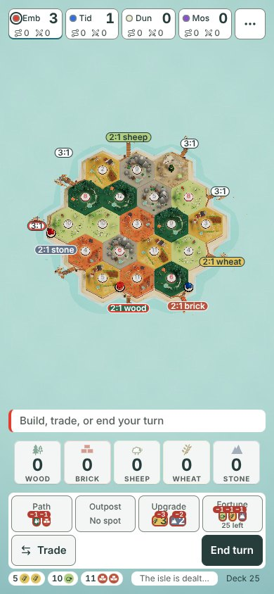 | 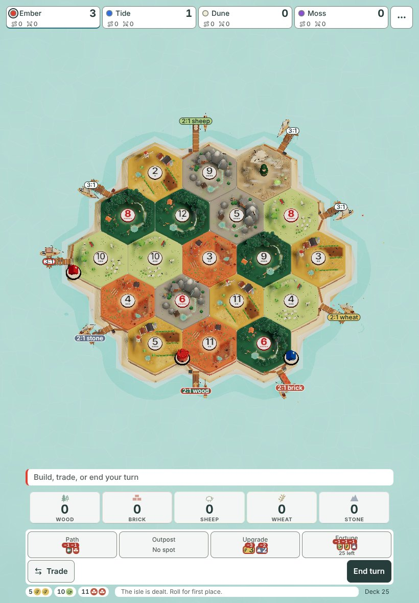 | 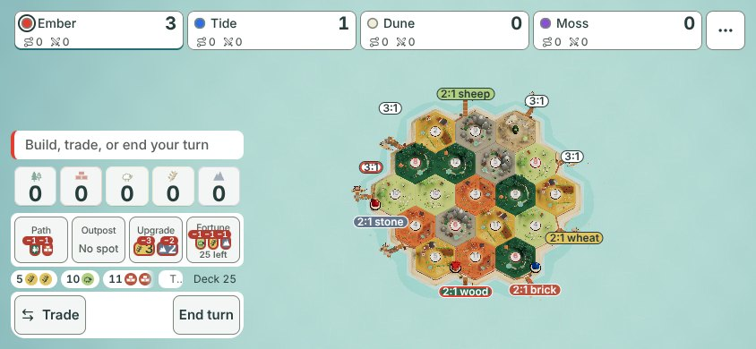 |
| Main today | 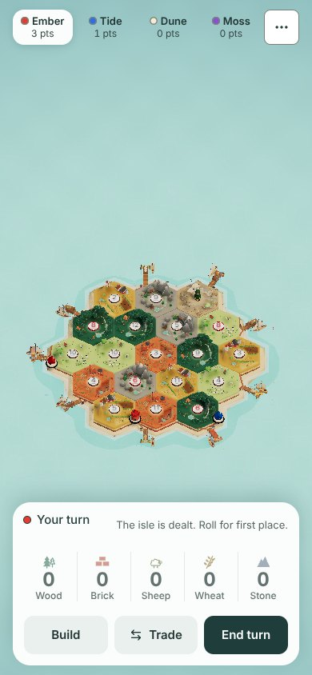 |  |  |
| A. Painted plank |  | 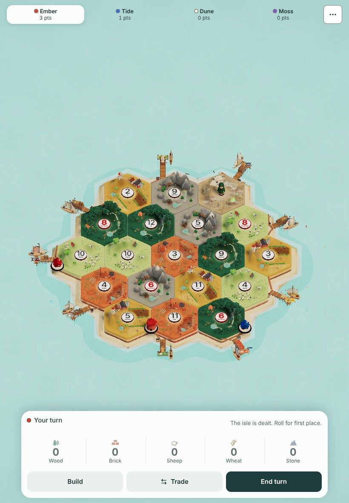 |  |
| B. Flag on a mast |  |  |  |
| C. Standing sign |  |  | 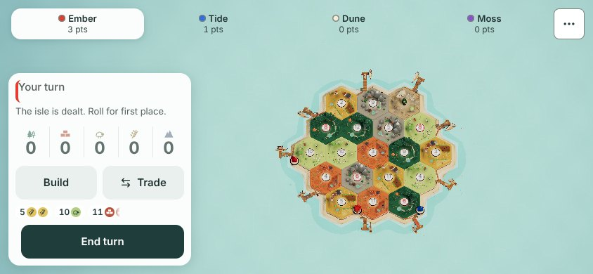 |

### The home view

| | 390×844 | 820×1180 | 844×390 |
|---|---|---|---|
| Old tags | 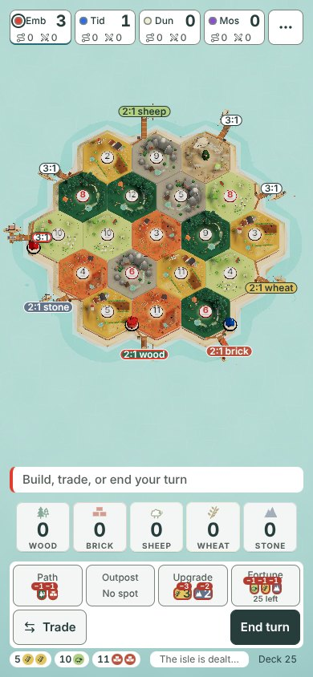 | 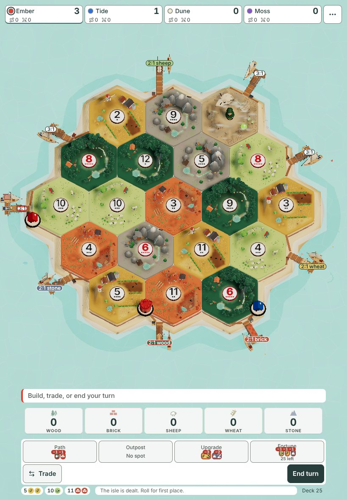 | 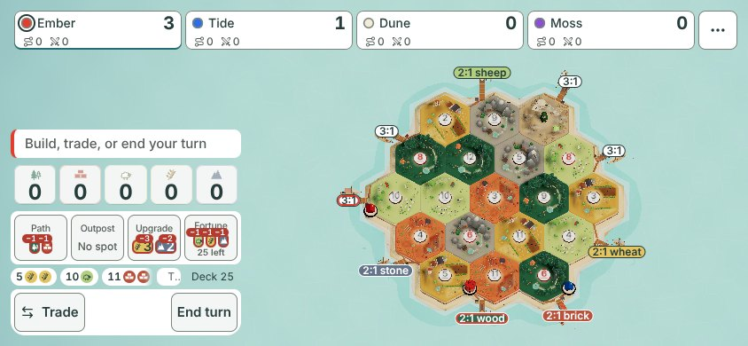 |
| Main today |  |  |  |
| A. Painted plank | 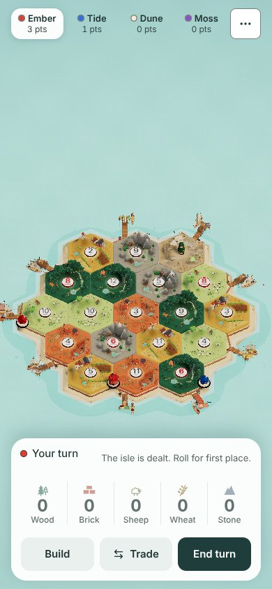 | 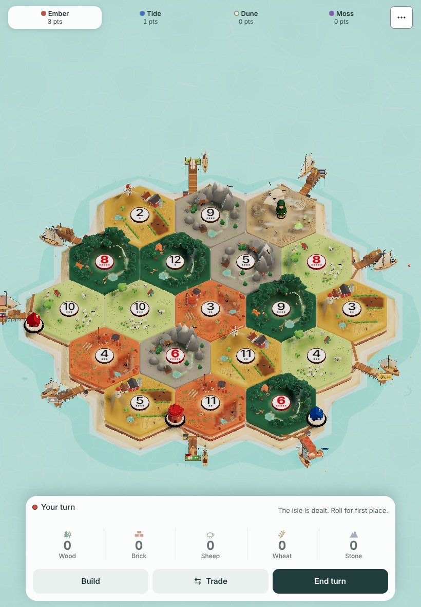 |  |
| B. Flag on a mast |  |  | 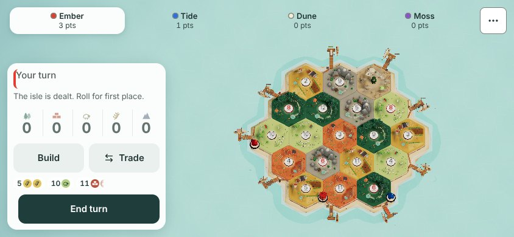 |
| C. Standing sign | 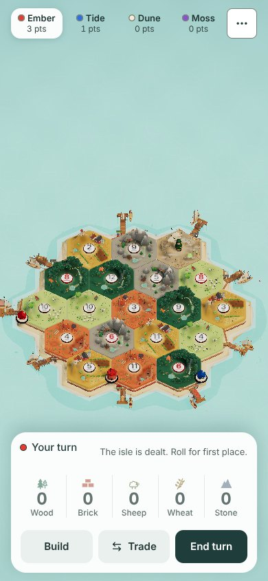 |  |  |

### Close up on Ember's wood dock

| | 390×844 | 820×1180 | 844×390 |
|---|---|---|---|
| Old tags | 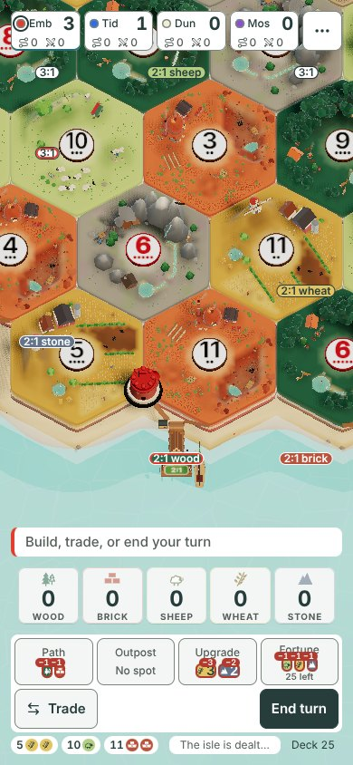 | 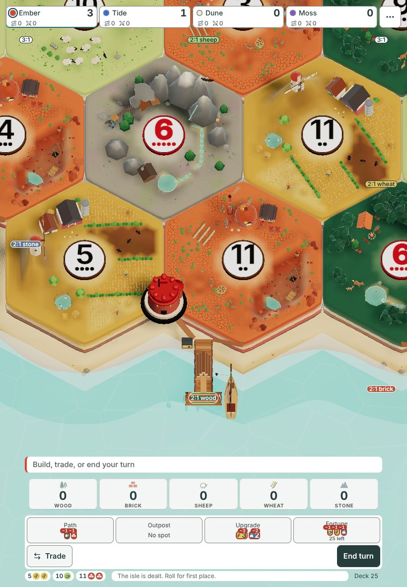 | 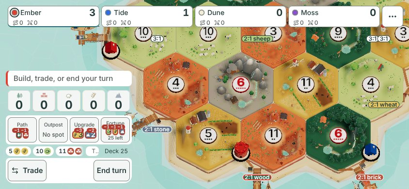 |
| Main today |  | 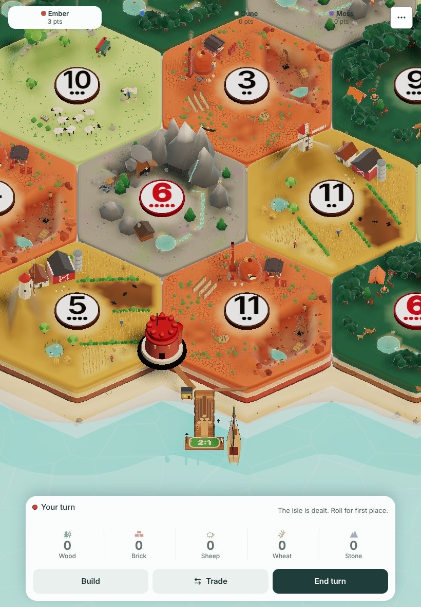 |  |
| A. Painted plank | 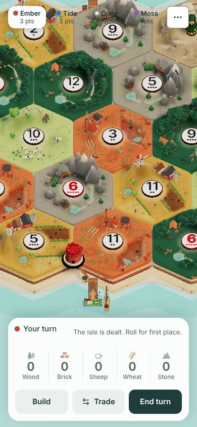 |  |  |
| B. Flag on a mast | 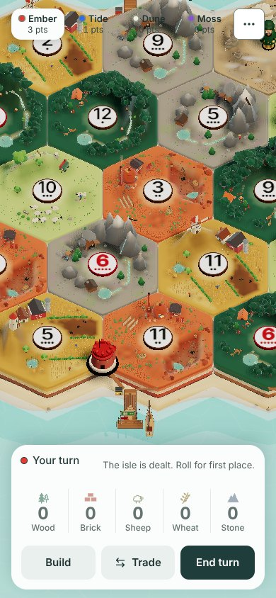 |  | 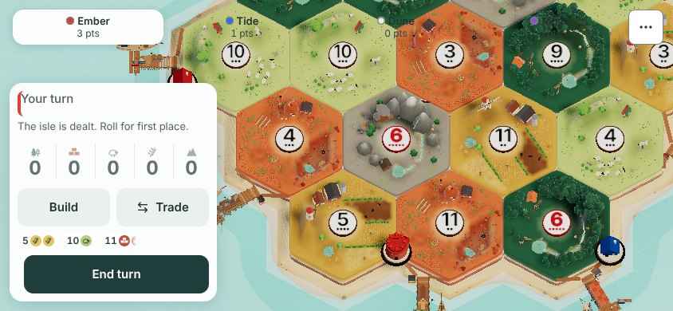 |
| C. Standing sign | 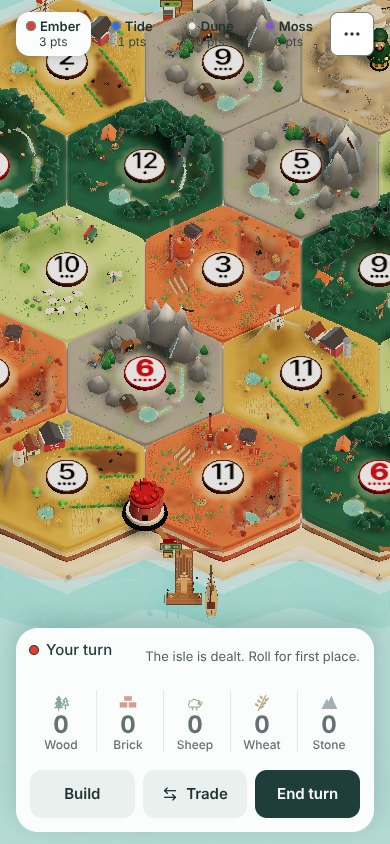 |  |  |

### The three options side by side, close up (820×1180, cropped from the pictures above, not enlarged)

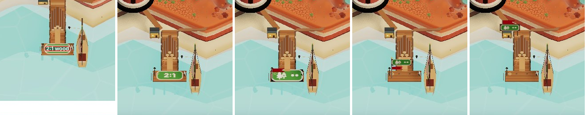

LITE_SECTION

## Cost

The numbers come from `scripts/size-prove.mjs --base <main build>`, run on a build of each option alone. In each build the switch is fixed at build time, so the bundler drops the other options and today's text plank.

| | Where | `harbor-jelly` chunk (gzip) | `IslandCanvas` chunk (gzip) | Against the limits |
|---|---|---|---|---|
| A. Painted plank | Scene (`src/lib/scene/harbor-jelly.ts`), plus the pennant colour in `isle-renderer.ts` | **+670 B** (10,737 → 11,407) | +51 B | Under the 11.50 kB ceiling; over the 200 B growth allowance by 470 B |
| B. Flag on a mast | Scene, same files | +702 B (→ 11,439) | +55 B | Under the ceiling; 502 B over the allowance |
| C. Standing sign | Scene, same files | +720 B (→ 11,457) | +49 B | Under the ceiling; 520 B over the allowance |

- **None of them is an overlay.** Each is part of the scene, so each one scales with the camera, which is what Jarrod asked for.
- **Most of the bytes are shared:** the goods' symbols (the HUD's own SVG paths, drawn onto the plank's texture) and the pennant.
- **Whichever he picks, the build needs his OK** to raise the `harbor-jelly` growth allowance (allowances move only with the owner, DECISIONS 2026-10-25), or a slimmer symbol set.

## Recommendation

**A, the painted plank:** it keeps the plank players already know, it is the clearest close up and the quietest zoomed out, and it costs the least.

## How to reproduce

1. `git apply docs/design/dock-trade-marks/prototype.patch` on `main` at `2486e10`.
2. Run `node docs/design/dock-trade-marks/capture.mjs <repo> <outDir> <label> <a|b|c>`. Leave the option off for today's board. Point it at a checkout of `29675fbb` for the old tags. Add `LITE=1` for the lite board.

Nothing here is game code; the build starts only after Jarrod picks on the Decisions page.
