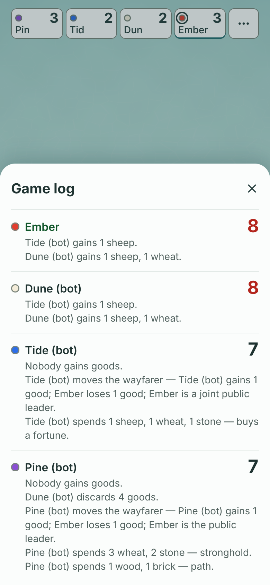

# The end of a game, and the game log

Spec by Claude Fable 5.2, 2026-11-12. Base: `main` at `c0f7100`.
It follows the tray ([one-tray](../one-tray/README.md)) and the north star in [polish.md](../polish.md).
Two slices. Slice 1 is built in this branch. Slice 2 is planned here and waits on one owner answer.

## What is wrong today

Pictures are from one real practice game, played to its end by the real rules and bots ([play.mjs](play.mjs), [capture.mjs](capture.mjs), saved in [game.json](game.json)).

| | 390x844 | 844x390 | 1280x720 |
|---|---|---|---|
| Win screen | [before](before-win-390x844.png) | [before](before-win-844x390.png) | [before](before-win-1280x720.png) |
| Scores hidden | [before](before-win-hidden-390x844.png) | [before](before-win-hidden-844x390.png) | [before](before-win-hidden-1280x720.png) |
| Table menu | [before](before-menu-390x844.png) | [before](before-menu-844x390.png) | [before](before-menu-1280x720.png) |

**The log.**

- The tray shows the newest event only. In practice and hotseat there is no way to read anything older.
- Online, the older lines are mixed into the chat. "Copy log" puts them on the clipboard, which is not reading them.

**The win screen.**

- A card sits in the middle of the screen and covers the island, the thing the player just built.
- The old tray shows through behind the card: a card over a card.
- The score is said three times: "10 points", "10 points, target 10" and the 10 in the winner's row.
- On desktop the table has seven upper-case column heads.
- A practice game ends with "Hide scores" and "Back to menu". There is no "Play again".

## Slice 1: the Game log (built)

Owner decision 2026-11-12 (`q1536-game-log`, A): the full log lives in the Table menu as "Game log".

### What changes

- The Table menu gets one row, "Game log", under Costs. It shows in practice, hotseat and online, and for a watcher.
- The row closes the menu and opens a sheet in the tray-sheet style. It rises from the bottom. The island stays visible above it on an upright phone.
- The sheet has a title, "Game log", and a 44 px Close. Nothing else is a box.
- The log is grouped by turn. The newest turn is on top.
- A turn is one heading: the seat's colour dot, the seat's name (16 px, semibold), and the roll as the number (26 px, bold) on the right.
- Under the heading are that turn's lines, in the log's own words, at 14 px in quiet text.
- A 6 or an 8 is red. Your own turn's name and roll are green. Both follow the 2026-10-22 roll-line decision.
- A line that starts with your name is in full ink, so you can find what you did and what you got.
- Lines from before the first turn sit under "Setup". Once the log is full (200 lines) and has dropped its oldest lines, that last group is "Earlier".
- The sheet updates while it is open.
- Escape, Close and a tap outside the sheet close it. The focus goes back to the menu button.

### The exact words

| Where | Words |
|---|---|
| Table menu row | Game log |
| Sheet title | Game log |
| Close button (screen reader) | Close |
| The list (screen reader) | Turns, newest first |
| The roll number (screen reader) | rolled 9 |
| Group before the first turn | Setup |
| The same group when the log is full | Earlier |

### Fewer words in each turn

The heading already says whose turn it is and what was rolled. So inside a turn:

| The log's line | In the sheet |
|---|---|
| `Tide's turn.` | The heading: Tide |
| `Tide rolled 9!` | The heading's number: 9 |
| `Pine gains 1 wheat; Ember gains 1 wheat — Tide's roll.` | Two lines: `Pine gains 1 wheat.` and `Ember gains 1 wheat.` |
| `Nobody gains goods — Tide's roll.` | `Nobody gains goods.` |
| `… — Tide's roll; the bank is short of stone; nobody gains it.` | The gains, then `The bank is short of stone; nobody gains it.` |
| Every other line | Unchanged |

"Copy log" still copies the log's lines exactly as written.

### What is removed

Nothing leaves the screen in this slice. One row is added to the menu.
"Copy log" stays where it is for now: its checks live in `scripts/chat-prove.mjs`, which two open PRs (#1480, #1502) are changing.
When that file is free, "Copy log" moves into the sheet as a quiet "Copy" beside the title, and the menu loses that row.

### Pictures

Real game, device scale 2, written by `SHOTS=1 npm run game-log-prove` into [`docs/proofs/end-of-game/`](../../proofs/end-of-game/).

| | 430x932 | 390x844 | 844x390 | 1280x720 |
|---|---|---|---|---|
| Menu with the new row | [menu](../../proofs/end-of-game/menu-430x932.png) | [menu](../../proofs/end-of-game/menu-390x844.png) | [menu](../../proofs/end-of-game/menu-844x390.png) | [menu](../../proofs/end-of-game/menu-1280x720.png) |
| Mid-game | [log](../../proofs/end-of-game/log-430x932.png) | [log](../../proofs/end-of-game/log-390x844.png) | [log](../../proofs/end-of-game/log-844x390.png) | [log](../../proofs/end-of-game/log-1280x720.png) |
| Scrolled to the oldest lines | [end](../../proofs/end-of-game/log-end-430x932.png) | [end](../../proofs/end-of-game/log-end-390x844.png) | [end](../../proofs/end-of-game/log-end-844x390.png) | [end](../../proofs/end-of-game/log-end-1280x720.png) |
| A new game | [setup](../../proofs/end-of-game/log-setup-430x932.png) | [setup](../../proofs/end-of-game/log-setup-390x844.png) | [setup](../../proofs/end-of-game/log-setup-844x390.png) | [setup](../../proofs/end-of-game/log-setup-1280x720.png) |
| After the game | | [over](../../proofs/end-of-game/log-over-390x844.png) | [over](../../proofs/end-of-game/log-over-844x390.png) | [over](../../proofs/end-of-game/log-over-1280x720.png) |

### Build notes

- `GameLog.tsx` is a new lazy chunk, fetched as the menu opens. Measured 1,369 B gzip. Proposed ceiling 1,550 B; the desk sets the real one.
- `index` grows by 231 B (the menu row, its icon and the mount), inside its 400 B allowance. No ceiling or allowance moved.
- If the chunk cannot load, the sheet does not open and the next press tries again.
- Proof: `npm run game-log-prove`.

## Slice 2: the win screen (planned)

The end of the game uses the same surface as the rest of the table: one sheet at the bottom, the island in full view above it.

### State by state

| State | What shows |
|---|---|
| The game ends | The tray is replaced by one sheet. The island is not washed out. |
| Headline | The winner's colour dot and "Ember wins" at 34 px bold. For the winner's own screen: "You win". |
| Under it | One quiet line saying how it ended: "Built an outpost." The points are not repeated. |
| Scores | One row per player, 44 px: dot, name, points as a 26 px number. The winner is first. Tap a row to open its breakdown, as the phone list does today. Every screen size uses this list. |
| Practice | Primary: "Play again". It deals a new practice game. Quiet: "Menu". |
| Hotseat | Primary: "Play again". Quiet: "Menu". |
| Online, host | Primary: "Play again". Quiet: "Menu". The "Next game" target stays as one quiet row above the buttons. |
| Online, guest | Primary: "I'll play again". Under the list: "Waiting for Tide to start another." Quiet: "Menu". |
| Watching | Quiet: "Menu". No primary. |
| Scores closed | A 44 px Close folds the sheet into the tray's win line with one button, "Scores". This replaces "Hide scores" and the floating chip. |
| React (online) | Stays, as a quiet button in the sheet. |

### What is removed

- The centred card and the wash over the island.
- The 56 px "10 points" and the "· 10 points, target 10" half of the reason line.
- The equation line ("4 stronghold points + 2 largest army + 4 hidden"). The winner's opened row says it.
- "Tap a player to see how they scored." The arrow on each row says it.
- The desktop table and its upper-case column heads.
- "Hide scores", "Show scores" and the floating chip.
- "Back to menu" becomes "Menu".

### What it must not break

- Island awards and the dice story (#1452, #1453) keep their places: the award inside an opened row, the dice strip under the list.
- The staged celebration (#541) is a later slice. It plays before this sheet and does not change it.
- `sheets` has about 340 B of room. Removing the table and the hero line should pay for the new layout. If it does not fit, the builder stops and reports the bytes.

### Why it waits

- PR #1446 (issue #1406) is open on `WinScreen.tsx`. It is paused on an owner question about the desktop table's columns.
  This slice removes that table. The owner should pick one before either is built. See question 1.
- Issue #1494 is claimed on `scripts/win-list-prove.mjs`, which this slice must edit.

## Open questions for the owner

1. **The desktop results table.** PR #1446 is fixing its column widths. Slice 2 removes the table and shows the phone list on every screen.
   - A (recommended): one list on every screen. Close #1406 and PR #1446 as replaced.
   - B: keep the desktop table inside the new sheet, with sentence-case column heads. PR #1446 lands first.
2. **"Play again" in practice.** Today a practice game ends at "Back to menu".
   - A (recommended): "Play again" deals a new practice game with the same bots.
   - B: keep "Menu" as the only way out.
