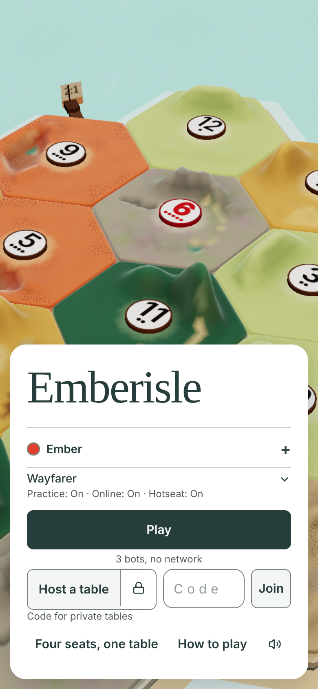
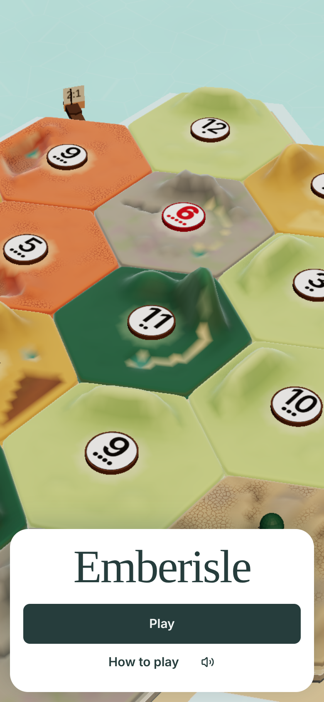
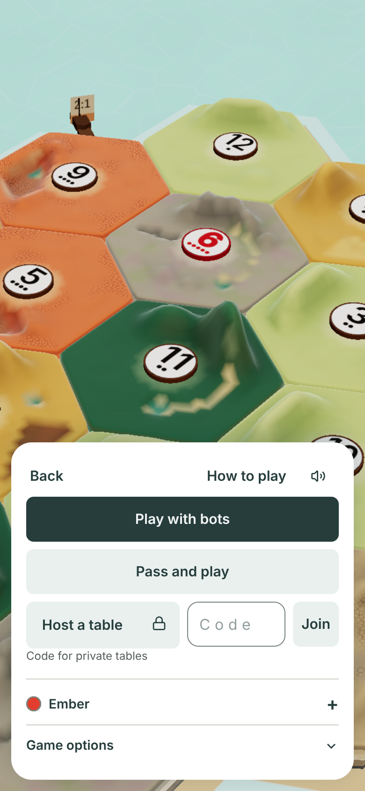
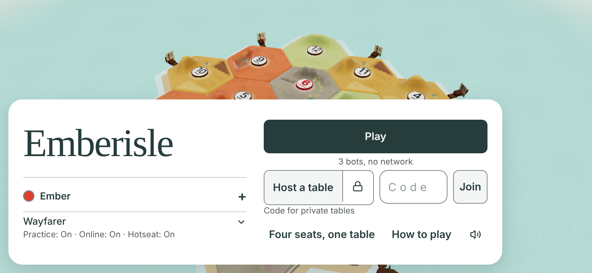
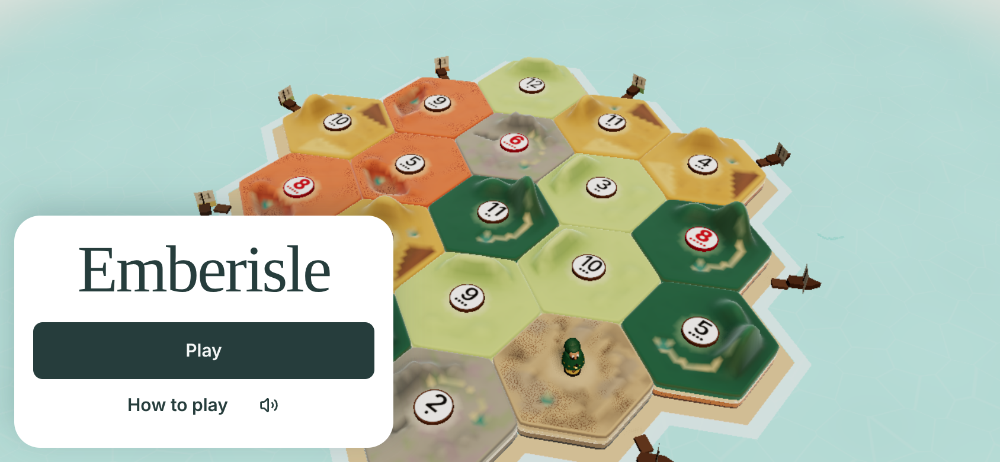
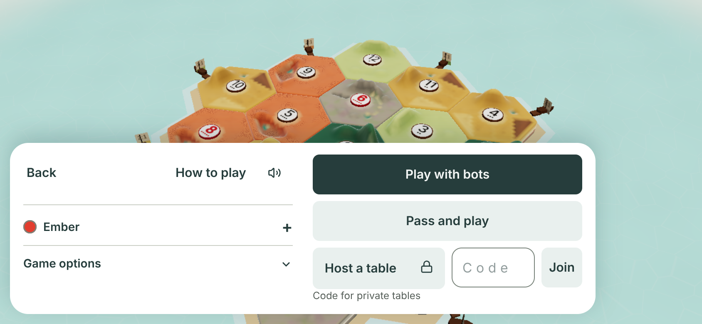
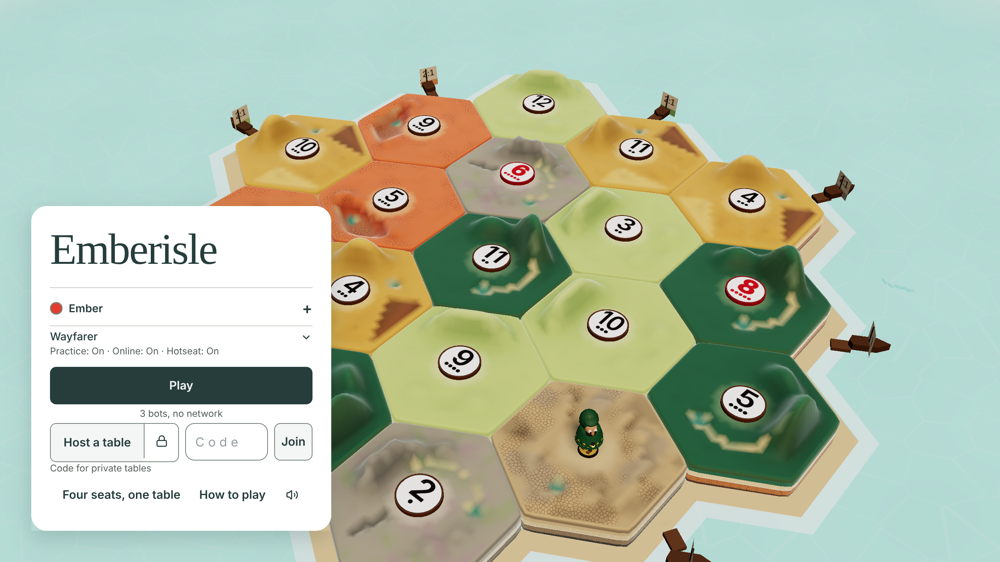
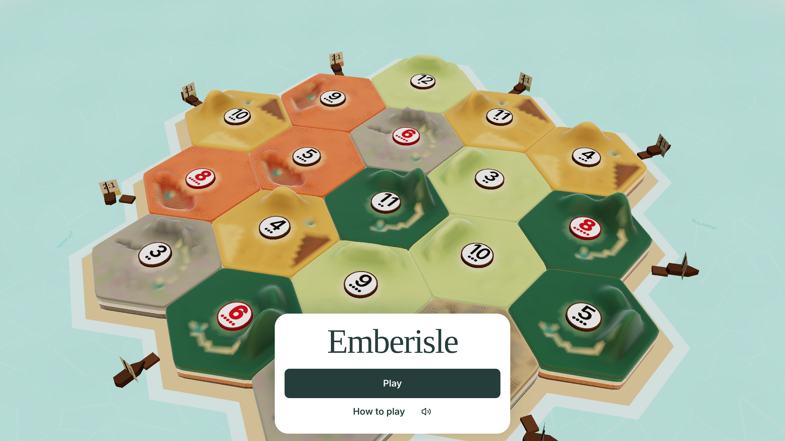
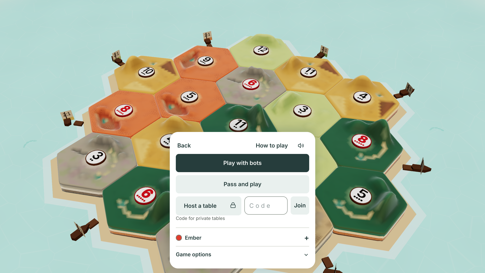
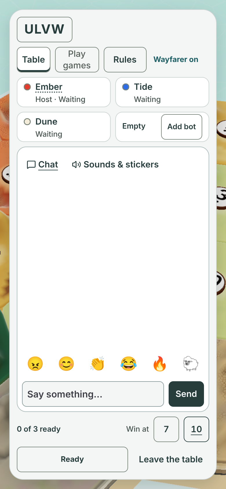

# The first minute: title, then lobby

Written 2026-11-12 by Claude Fable 5.2, designer and builder for this area.
It follows the table's [one tray](../one-tray/README.md) and the north star in [polish.md](../polish.md).
It builds the owner's answer on [#1151](https://github.com/jarrodjohnson-gif/emberisle/issues/1151): a minimal front page, and a Play page with the choices.
It also follows his two notes on PR #1216: one clear primary action, and no jargon on the front page.

## The problem

The table is one tray now. The title and the lobby are still the old game.

- The title is one long card. It holds 11 things to press and two closed drawers.
- It says "Wayfarer", "Practice: On · Online: On · Hotseat: On" and "3 bots, no network" before the first tap.
- Four buttons look equally important: Play, Host a table, Join, and the code field.
- On an upright phone the lobby covers the whole island.

| Today (real game) | Built: front page | Built: Play page |
|---|---|---|
|  |  |  |
|  |  |  |
|  |  |  |

Every picture is the real game. Nothing is drawn.

## The design

One tray at the bottom of the screen, like the table. The island is everything else.

- Upright phone: the tray spans the width, 12 px from the edges.
- Sideways phone: the tray sits bottom left. The Play page is two columns.
- Desktop: the tray is 384 px wide, centred, 12 px above the bottom edge. The table's tray is centred too.
- The tray is white, with a 22 px radius and the table tray's shadow. No border, no card inside it.
- A filled button is the one primary. Other buttons use the table's soft fill, `#e9f0ee`, with no border.
- The wordmark stays 56 px Georgia (#1281).
- Buttons keep the button system (#1418): 15 px semibold, 48 px high for the main ones, 44 px for the quiet ones.

## Slice 1: the title (built)

### Front page

| On screen | What it does |
|---|---|
| Emberisle | The wordmark. Centred. |
| Play | The one primary. Opens the Play page. |
| How to play | Quiet. Opens the rules sheet. |
| Sound button | Quiet. Icon only. "Table sounds on" or "Table sounds off" for a screen reader. |

Nothing else. No name, no colour, no code field, no second sentence.
An error from the last table ("Lost the table") shows as one line above Play.

### Play page

The same tray grows. Top to bottom on an upright phone:

| On screen | What it does |
|---|---|
| Back | Quiet. Shows the front page again. |
| How to play, sound button | The same two tools, on the right of the Back row. |
| Play with bots | The one primary. Starts a game against three bots. |
| Pass and play | Starts a four-seat game on this one device. |
| Host a table, with its lock | Hosts an online table. The lock switches between private and open, as today. |
| Code, Join | Joins a table by its four-letter code. |
| Code for private tables | The approved helper line under the code field. 12 px. |
| Watch | Appears only when the code field holds four characters, as today. |
| Open tables | The list of open tables appears under the buttons when there is one. It shows 3 at a time (1 on a sideways phone), with a quiet More under them that shows the next ones, then the first again, so the tray never scrolls. |
| Your seat (dot and name) | Closed by default. Opens the name field, the four colours and Profile. |
| Game options | Closed by default. Opens the three Wayfarer on or off choices. |

On a sideways phone the buttons are the right column. Back, your seat and Game options are the left column.

### Other states

| State | What shows |
|---|---|
| Join link (`?code=K7QP`) | Its own tray, as today: wordmark, name field, colours, "Join table K7QP" as the primary, and a quiet "Host a table". |
| Watch link (`?watch=K7QP`) | The Play page, with Watch as the primary and Play with bots as a soft button. |
| First visit, after Start | The Play page: Start, then Play with bots, is two taps to a first game (owner, card A on #1151). |
| Later visits, after Start | The front page. |
| Back from a table | The Play page. The front page shows again after Back. |
| Short code | "Enter the 4-letter code." under the buttons, as today. |

### Words that changed

| Old | New | Why |
|---|---|---|
| Play (started a bot game) | Play (opens the Play page), then Play with bots | The owner's two pages. The label says what you play against. |
| 3 bots, no network | removed | "Play with bots" says it. |
| Four seats, one table | Pass and play | The plain name for one device passed around. |
| Wayfarer, with "Practice: On · Online: On · Hotseat: On" | Game options | The owner asked for no jargon here. The status line is gone. |

### What is removed

- The status line under Wayfarer.
- The "3 bots, no network" line.
- The card inside the card on desktop.
- The borders on Host a table and Join.
- Everything except the wordmark, Play and two tools from the first screen.

### What did not change

- Every action: the same store calls, the same prefetch on hover, the same lazy chunks.
- The seat settings, the Profile sheet, the open or private switch and the open tables list.
- The loading screen (#1281). It still ends on the title: the Play page on a first visit, the front page after that.
- The title camera. The island still turns slowly behind the tray.

### How proofs open the title

- `scripts/proof-browser.mjs` already sets `__emberisleSkipIntro` so a proof skips the loading screen.
- With the value `true`, the title also opens on its Play page. Every choice is one press away, as before.
- `chromium.launch({ front: true })` sets the value `"front"`. The loading screen is skipped and the front page shows.
- `first-minute-prove` uses `front: true`. It proves the front page, the Play press, Back, and two taps to a bot game.
- `loading-screen-prove` sets nothing. A first visit goes through the loading screen to the Play page; a second visit in the same browser goes to the front page.

### Proof

`npm run first-minute-prove`. `SHOTS=1` writes device-scale-2 pictures to `docs/proofs/first-minute/`.

Replaced check lines are in [docs/proofs/first-minute/replaced-checks.md](../../proofs/first-minute/replaced-checks.md).

## Slice 2: the lobby (planned, not built)

Draft PR #1480 (#1472, lobby wording) is changing `LobbyView.tsx` and `LobbyWaitBox.tsx`.
Slice 2 starts after it merges or closes. It keeps #1472's words: Leave table, How to play, Away, All ready.

Today on an upright phone:

Sixteen boxes. The chat is a box inside the card and is empty. The island is hidden.

The plan:

- The same tray, in the same place as the title's and the table's. The island shows above it.
- Top line: the table code in 26 px bold. Tapping it copies the invite link. Quiet text on the right: "2 of 3 ready".
- Seats: one row of four, drawn like the table's seat row: dot, name, a tick when ready. An empty seat says "Add bot" for the host.
- One primary: Ready for a guest. For the host it is Start, off until all are ready (#1472 item 5).
- Leave table is quiet, beside the primary.
- Chat is one line: the newest message, and a Chat button. It opens the table's chat sheet. No chat box in the tray.
- Games, How to play, Win at 7 or 10 and the Wayfarer switch move into one "Game options" sheet. Guests see it read-only.
- The profile card on a seat tap (#1350) stays.

It is one PR. It needs its own old/new table for `lobby-layout-prove`, `lobby-prove`, `lobby-wait-box-prove` and `lobby-code-copy-prove`.

## Slice 3: the whole island behind the title (planned, not built)

On an upright phone the title camera shows about five hexes. The island is the hero, so it should all show.

- Pull the title and lobby camera back until the island fits above the tray, as the table's fit does.
- This changes `isle-renderer.ts` and the camera proofs. It is its own PR.

## The owner's answers (Decisions page, 2026-11-12, A on all three)

1. Start opens the Play page on a first visit: two taps to a first game. Later visits, and Back, show the front page. The browser remembers the first visit in `emberisle-seen-title`; with no storage every visit counts as a first one.
2. The one-device button reads "Pass and play".
3. The three Wayfarer on or off choices stay closed under "Game options" on the Play page. The front page shows no Wayfarer status.
