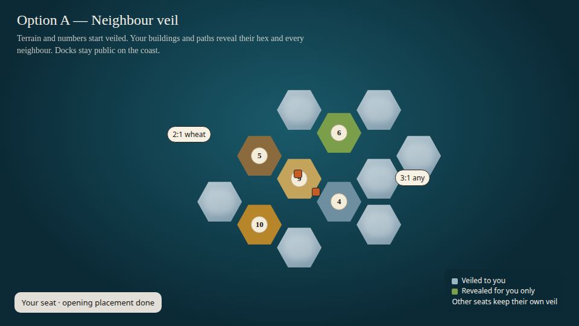
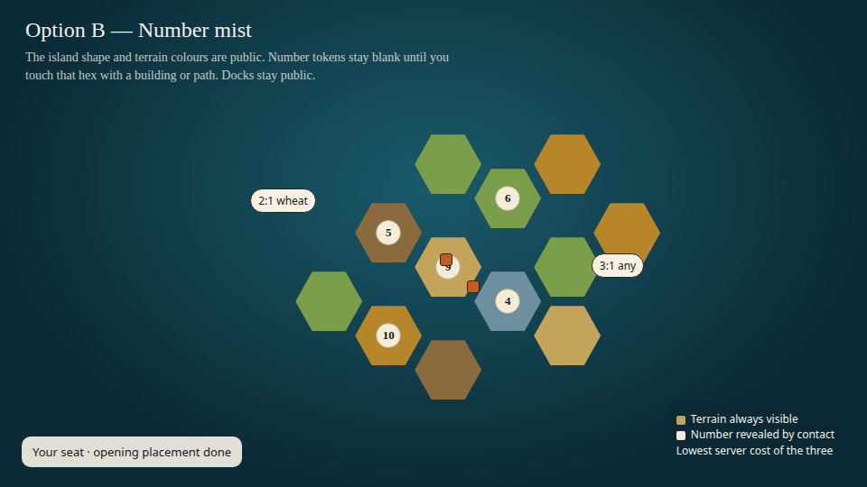
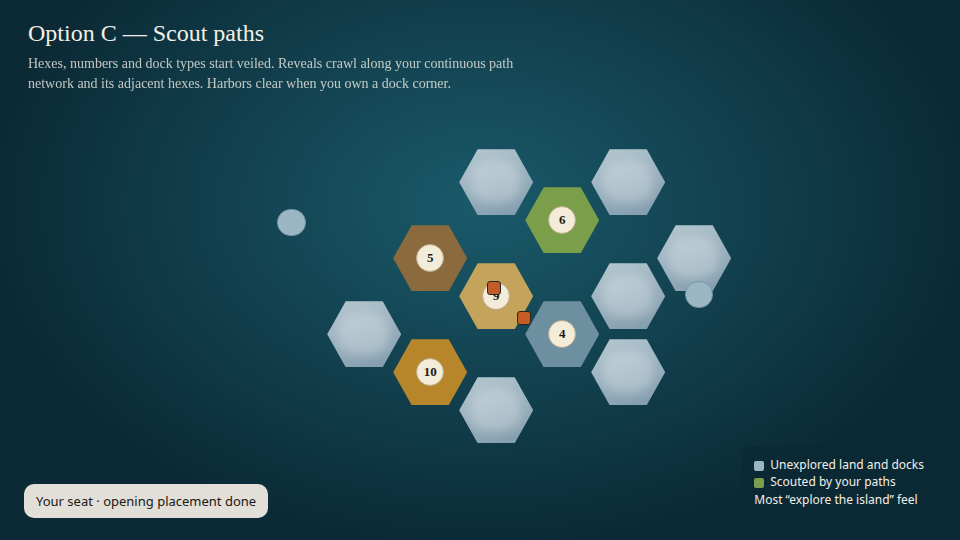

# Design: fog of war mode (issue #842)

Design only. Owner idea, 2026-10-18. No code in this step.

Source: README land and docks; `server/host.mjs` `viewFor` / `closedView`; `src/lib/game/types.ts` `HexCell`, `Vertex.harbor`; [wayfarer-modes.md](wayfarer-modes.md) lobby toggle pattern; [spectator.md](spectator.md) private projections.

## Goal

Add an optional table mode where each seat discovers the island during play.

Hidden facts must never leave the host for a seat that has not revealed them.

Classic (no fog) stays the default.

## Shared rules (all options)

| Rule | Contract |
|---|---|
| Lobby | Host picks Fog: Off / On before Start, next to Wayfarer. Guests see the choice. Rematch keeps it. A new table is required to change it. |
| Default | Off. Legacy rooms without the field play Off. |
| Public always | Seat colours, buildings, paths, public goods counts, chat, dice, the wayfarer hex id, bank trade rates you already own. |
| Private per seat | Unrevealed terrain, pips, and (in C) dock kinds. |
| Host truth | The full map lives only in host memory and room save. |
| Wire | `viewFor(game, you)` strips or masks unrevealed hex and harbor fields for `you`. Watchers get the same mask as a seat with no pieces (all fog), or a dedicated fog-off spectator view — decide in Implementation after the owner pick. |
| Production | A veiled hex still pays its owners when its pip hits. The payer already knows that hex. Other seats learn only that someone gained public goods, not which veiled hex paid. |
| Plenty / monopoly | Bank picks stay legal. They do not reveal map cells. |
| Wayfarer | Moving onto a veiled hex reveals that hex to the moving seat only. Theft stays random from public hand counts. |
| Bots | Use the full host map. Their UI moments show only what the viewing seat may see. |
| Proof | A host proof injects two seats, asserts seat A never receives B's unrevealed `terrain`/`pip`/`harbor`, and that a build expands A's reveal set. |

## Option A — Neighbour veil

**Hidden at start:** every hex's terrain and pip. Coast outline and docks stay visible; dock kinds stay public.

**How it lifts:** a building or path reveals its hexes and every neighbour hex. Reveals stay for your seat.

**What others see:** each seat holds its own veil. You never see another seat's private map. Opponent pieces sit on fog until you reveal that hex. Then you see the true terrain under their piece.

**Server:** store `revealedHexIds: Record<playerId, string[]>`. Mask `hexes[].terrain` and `hexes[].pip` unless revealed. Vertices keep public buildings; `harbor` stays on the wire.

**Feel:** classic Catan pace with a soft scouting bonus for long paths. Lowest rule surprise.

**Cost:** small. One set per seat, filter in `viewFor`, scene paints fog materials for masked cells.

## Option B — Number mist

**Hidden at start:** pip tokens only. Terrain colours and docks are public from the first frame.

**How it lifts:** reveal a hex's pip when your building or path first touches that hex. The personal set matches A, but only for numbers.

**What others see:** everyone sees the same painted island. Only the cream number discs differ per seat.

**Server:** mask `hexes[].pip` only. Terrain and harbors always ship.

**Feel:** light fog. Players still plan from terrain rings; pip luck stays personal until contact.

**Cost:** smallest. Scene already can hide number meshes; almost no board redesign.

## Option C — Scout paths

**Hidden at start:** terrain, pips, and dock kinds. The coast silhouette may show as blank fog jetties.

**How it lifts:** reveals follow your continuous path graph. Each new path reveals neighbours of its endpoint hexes. An owned dock corner reveals that dock's kind. Buildings alone reveal only their own hex. Paths do the scouting.

**What others see:** personal maps, like A. Unowned docks read as "dock" with no rate. They clear when you claim a corner or scout them.

**Server:** same `revealedHexIds` plus `revealedHarborVertexIds`. Mask `harbor` on vertices until revealed.

**Feel:** strongest exploration fantasy. Slowest early game. Highest UI and bot-moment cost.

## Comparison

| | A Neighbour veil | B Number mist | C Scout paths |
|---|---|---|---|
| Hidden | Terrain + pips | Pips only | Terrain + pips + dock kinds |
| Lift | Building/path + neighbours | Contact only | Path network + dock claim |
| Docks | Always public | Always public | Veiled until scout/claim |
| Server risk | Medium | Low | Higher (harbor mask) |
| Matches "fog of war" ask | Strong | Mild | Strongest |

## Recommendation

Pick **Option A — Neighbour veil**.

It hides the map that matters for opening placement. Docks stay readable for bank trades. It fits the existing `viewFor` seat projection. Option B is the fallback if Jarrod wants almost no board change. Option C waits until dock badges (#846) and path UX feel solid.

## Lobby copy

| Control | Text |
|---|---|
| Label | Fog of war |
| Off | Full island for every seat |
| On | Each seat unveils land as it builds (mode A/B/C per owner pick) |
| Helper | "Hidden tiles never leave the host." |

## Out of scope

- Changing pip totals, terrain counts, or dock placement rules.
- Fog in hotseat on one screen (all seats share one view; force Off, or show the acting seat's veil only — Implementation child).
- Metagame tells from production sound alone beyond today's public goods flashes.

## Implementation children (file after owner pick)

1. Research: mask shape in `viewFor` and room save for the chosen option.
2. Design: scene fog material and number/dock hiding.
3. Implement: host reveal sets + wire mask + lobby toggle.
4. Test: two-seat online proof that unrevealed fields never appear on the wire.

## Question

Question: Which fog mode should Emberisle ship first?

Options:

1. **A — Neighbour veil** (recommended): hide terrain and numbers; docks public; reveal hex + neighbours on contact.
2. **B — Number mist**: public terrain; hide pips until contact.
3. **C — Scout paths**: hide terrain, pips, and dock kinds; reveal along your path network.
4. **None for now**: close #842 and leave the idea in IDEAS.md.

Recommendation: **1 (A)**. It matches the playtest ask with the least protocol risk. It reuses the Wayfarer-style lobby toggle.
