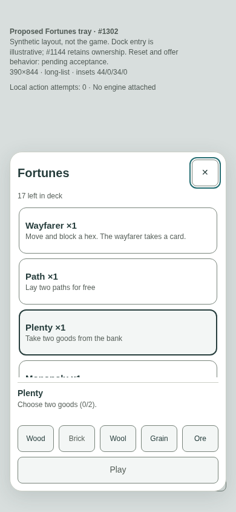
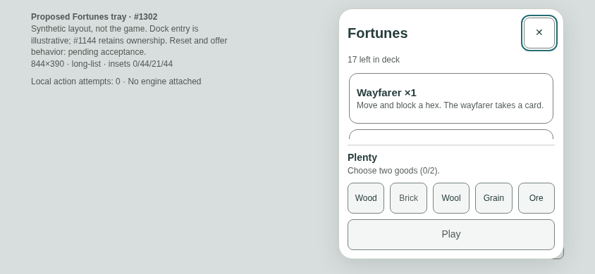
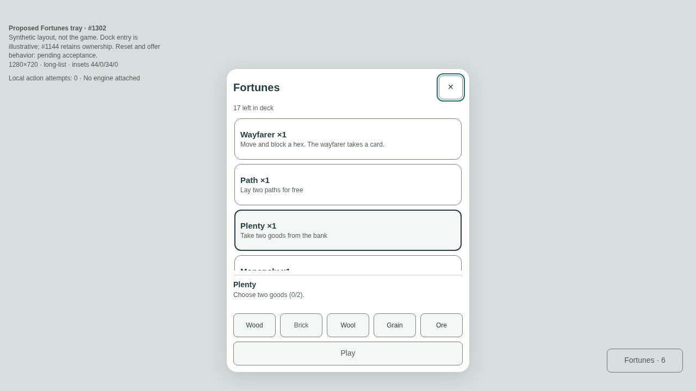
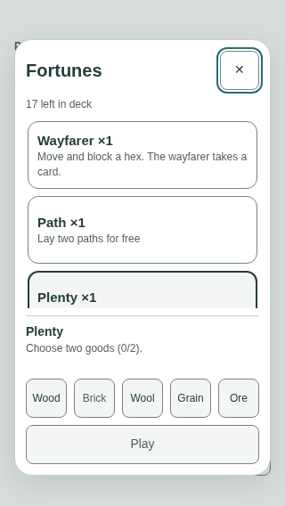

# Fortunes tray — measured proposal for #1302

Astra resumed this packet on 2026-11-05 from `7c2efc1`. It remains a proposal, not accepted runtime work.

Owner decision [8A](https://github.com/jarrodjohnson-gif/emberisle/issues/1274#issuecomment-6621485712) approves bottom anchoring, normal order, selection, and one fixed Play region. It does not approve every dimension or the interruption policy below.

## Scope and acceptance

- Keep the five fortune kinds in their existing order. Show only kinds the local player holds.
- Selecting a row changes selection only. Play performs the selected action.
- Keep existing contextual primary fills. This packet does not adopt a universal teal or ink primary token.
- Keep legality, resource colours, hidden information, wire messages, and rule dispatch unchanged.
- Keep the fixed dock entry owned by #1101 / PR #1144. Its placeholder here is not an implementation spec.
- Require owner acceptance of these dimensions and pictures before runtime work.
- Require shared Hud.tsx reservation release and current dock integration review before runtime work.

This packet contains a synthetic HTML mock and browser measurements. It does not contain production code or a registered production proof.

## Pictures

Each picture shows the five-kind list with Plenty selected, before choosing goods. The list scrolls; the footer stays fixed.

| Viewport | Safe-area example |
|---|---|
| 390×844 |  |
| 844×390 |  |
| 1280×720 |  |
| 320×568 |  |

These are schematic surfaces over a neutral field. They do not establish real-game island visibility or header clearance.

## Proposed geometry

All dimensions are CSS pixels. Border-box measurements appear in `measurements.json`.

| Viewport | Tray width | Tray height | Side position | Bottom gap without / with example inset |
|---|---:|---:|---|---:|
| 390×844 | 358 | 560 | 16px gutters | 16 / 34 |
| 844×390 | 320 | 366 / 357 | Right, max(12px, right inset) | 12 / 21 |
| 1280×720 | 448 | 560 | Centred | 24 / 34 |
| 320×568 | 288 | 536 / 490 | 16px gutters | 16 / 34 |

Portrait height is `min(560px, viewport height - max(16px, top inset) - max(16px, bottom inset))`.
Landscape height subtracts the two `max(12px, inset)` values. Desktop uses the portrait height formula and a 24px bottom gutter.

The 320×568 safe example begins at 44px. That does not reserve the real header and seat strip. The landscape column is on the right, while current Hud.tsx uses a left column. Both differences require a real-game composite and owner acceptance. Do not silently relocate the dock from this mock.

The sheet uses a 20px radius, 12px internal padding, and 8px gaps. Rows use 12px radii and at least 76px height (72px landscape). Close and Play are at least 44px high. All goods targets measure at least 44×44px.

Proposed type: 20px heading, 15px row names, 14px selected label, and 12px descriptions and goods labels. Type remains a proposal; the separate button audit owns any app-wide migration.

Play uses the existing local primary role. Neutral goods rectangles are schematic placeholders for current resource-painted icon chips. Do not replace resource identity with these placeholders.

## State and action contract

| State | List and selected footer | Play behavior |
|---|---|---|
| Empty | `None held`; no rows; `Select a fortune` | Unavailable; no action |
| Unselected | Normal held-kind order; no pressed row | Unavailable; select a row first |
| Selected, legal | One pressed row; selected name and effect context | Exactly one activation |
| Other seat / wrong phase | Row explanation `On your turn` | Unavailable |
| Only newly bought copies | `Bought this turn` | Unavailable |
| Card already played | `One fortune a turn` | Unavailable |
| Points | Count and hidden-point explanation | Never played |
| Before roll | Wayfarer remains eligible; other kinds say `After the roll` | Existing legality applies |
| No legal path / no pieces | `No path to lay` | Unavailable |
| Empty bank | `The bank is empty` | Plenty unavailable |
| Plenty | Two resource picks; oldest pick replaced by a third | Revalidate bank stock before acting |
| Monopoly | One resource choice, independent of bank stock | Dispatch selected resource |
| Wayfarer enabled | Existing effect | Arm board target mode; do not dispatch immediately |
| Wayfarer disabled | Existing Muster effect; button says `Muster` | Existing targetless playKnight dispatch |
| Long list | Five grouped kinds, counts may exceed one | Footer remains visible while list scrolls |
| Refused action | Stay open; announce refusal; retain valid selection | Unlock for explicit retry; no automatic retry |

The mock's all-new and already-played scenarios are synthetic fixtures. Production must calculate eligibility per kind, including mixed old/new copies.

Do not expose another seat's hidden types. Keep `me` and spectator projection semantics. Do not derive hidden deck composition from the public count.

## Lifecycle and focus

Proposed selection policy: clear selection and goods on every close/reopen. This matches current component-local pick disposal on unmount. Selection itself is new, so the reset policy still needs acceptance.

Current turn, current player, and phase changes close the tray through Hud.tsx's `turnKey`. Never reopen automatically. Revalidate legality from current state when Play is pressed.

A successful direct play closes the tray. A failed direct play stays open. Arming a board target closes the tray without consuming a fortune. Cancelled board targeting must permit another legal attempt. A local guard must not lock that fortune for the entire turn after cancellation.

Focus starts on Close. Tab proceeds through held rows, goods when present, then Play. Shift+Tab follows the reverse order. Tab wraps inside the tray. Escape and outside dismissal return focus to the opener. Retain the existing fallback if the opener leaves the DOM.

Use the production focus-trap helper and real accessibility semantics. The mock's manual Tab trap is not the implementation. Preserve Monopoly radio semantics and Plenty group semantics, accessible stock reasons, live pick feedback, and visible focus.

## Incoming offer decision still required

The older checkpoint automatically opened a second offer dialog. That conflicts with the approved dock direction and is removed.

The updated hook closes Fortunes and exposes a nonmodal dock placeholder. It does not add an offer modal. This demonstrates mutual exclusion only; the automatic interruption is **not approved**.

Astra recommends preserving the selected tray until the user dismisses it, then exposing the existing inline offer. An incoming offer must never send a trade response or steal a queued Play press. Alternatively, the owner may choose automatic dismissal to the dock. Neither option may create a second interactive modal or replace the approved inline Yes/No flow.

The hook exercises the automatic-dismiss alternative to reveal its focus consequences. It is not the recommended default. The final policy and real dock focus target need owner and dock-owner coordination.

## Source inventory

Reviewed against recovered source and `origin/main` at `82c440b2b78943494fd15e6bda98cec312454fc3`.

| Source | Contract to retain |
|---|---|
| `src/lib/game/fortunes.ts` | Five-kind order, names, effects, Muster copy |
| `src/components/game/FortuneTray.tsx:29` | Bank-aware Plenty chips; Monopoly radio roles; stock explanations |
| `src/components/game/FortuneTray.tsx:91` | Drop picks the bank can no longer pay |
| `src/components/game/FortuneTray.tsx:100` | Existing blocked-reason precedence and playability |
| `src/components/game/FortuneTray.tsx:110` | Board arming versus direct dispatch; close only on success |
| `src/components/game/Hud.tsx:160` | Close on turn/player/phase change |
| `src/components/game/Hud.tsx:176` | Opener disappearance and focus fallback |
| `src/components/game/Hud.tsx:235` | Dock entry and armed-mode cancellation; reserved by #1144 |
| `src/lib/focus-trap.ts` | Production focus management |
| `scripts/fortune-tray-prove.mjs` | Legality, card purchase, focus, turn change, tray geometry |

FortuneTray.tsx is byte-identical between recovered checkpoint and the checked main. Hud integration must be checked again after #1144 changes.

## Validation and retained limitations

The original 96-case measurements and four pictures are preserved in git at `7c2efc1`. The current JSON and pictures belong to the revised mock. The initial Chromium binary failure occurred before assertions and remains recorded in the palette continuation logs.

The resumed inspection found four shortcomings: 4px goods gaps, 11px labels, missing bank-change/refusal simulation, and a board-arm guard that survived cancellation. The revised mock addresses those points. It also removes the extra offer modal.

Fresh measurements cover four sizes, two inset settings, and twelve states. They check list order, minimum goods targets, viewport bounds, bottom-third Play placement, and fixed footer position. Interaction checks cover selection, repeated activation, bank changes, refusal/retry, board cancellation, reopen, keyboard wrap, turn changes, and nonmodal offer handoff.

These checks observe a local counter and mocked state only. They establish neither production dispatch safety nor online timing. No existing test assertion, test ceiling, runtime file, or CI registration was changed.

Before implementation acceptance, require real-game composites at all four sizes, header/seat/island clearance, current dock compatibility, disabled reasons, focus semantics, and the chosen offer policy. Runtime proofs must preserve existing assertions or replace owner-obsolete expectations separately with old/new tables. Register every new permanent proof in npm and CI.

No owner acceptance or independent repository review is claimed. #1274 remains open for the full audit.
