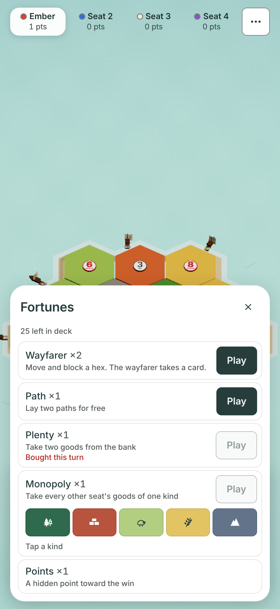
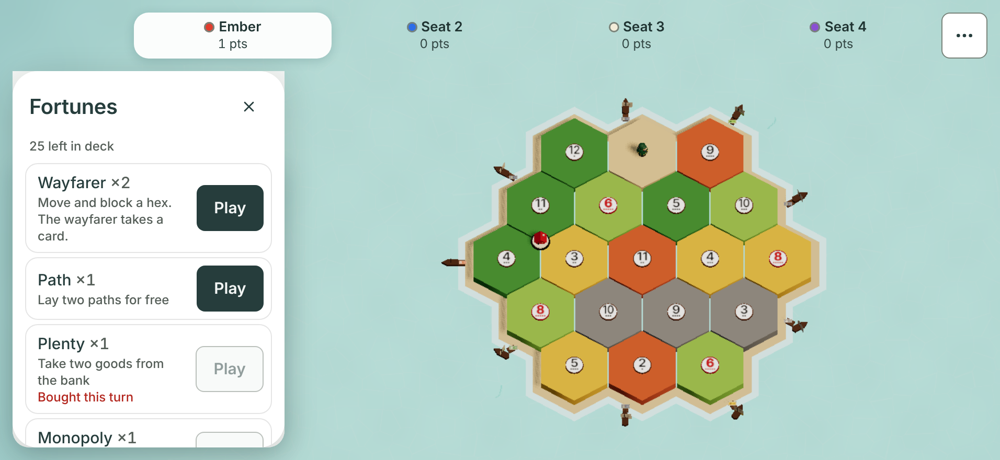
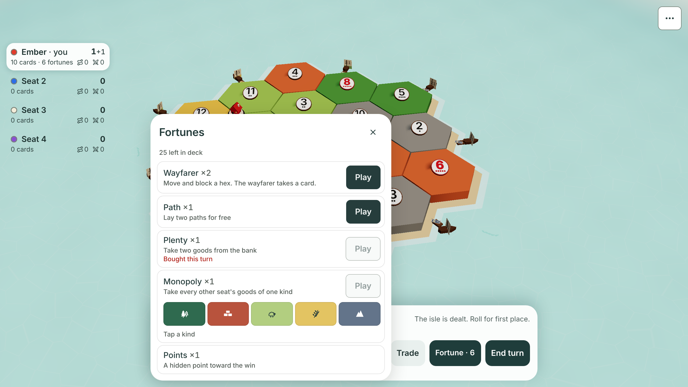

# Fortunes sheet: what #1302 still asks for

Issue [#1302](https://github.com/jarrodjohnson-gif/emberisle/issues/1302) asked for a Fortunes sheet with three things.
Its list keeps normal order. You select a fortune. One fixed Play region sits at the bottom.
The one tray ([`docs/design/one-tray/README.md`](../one-tray/README.md), built in #1539) has since landed.
On 2026-11-14 the desk asked a builder to check which parts of #1302 are on main.
This note is that check, against main at `95dfb8b`. It is not a new design.

The drawings for #1302 stay on the branch `codex/1302-fortune-tray-spec` as history, at [`f7b948b`](https://github.com/jarrodjohnson-gif/emberisle/tree/f7b948bda583f16be498e67b985eb8c492e76d18/docs/design/fortune-tray-1274).
Jarrod said of them on 2026-11-06 (card `q1302-fortunes-pictures`): "doesnt look like a polished video game tbh". Nothing was built from them.

## What the one tray decided

- The Fortunes button no longer shows all the time (DECISIONS.md, 2026-11-12, two rows).
- "Fortune · N" shows in the tray while the seat holds a fortune, or has one armed on the board.
- Buying a fortune is a row in the Build list.
- The button "opens today's Fortunes sheet" (one-tray spec, "Fortune"). The spec did not change the sheet itself.
- Jarrod approved the built tray (`q1542-tray`, A).

## Each #1302 requirement against main

| #1302 asks for | On main | Where |
|---|---|---|
| A fixed Fortunes entry | **Replaced.** The button shows only while a fortune is held or armed | `Hud.tsx`, the `fortunes-button` |
| Normal list and DOM order, never reversed | **Done.** Rows follow `FORTUNES`: wayfarer, path, plenty, monopoly, points | `FortuneTray.tsx`, `src/lib/game/fortunes.ts` |
| A selected fortune | **Not built.** There is no selection. Each row has its own Play | `FortuneTray.tsx` |
| One fixed Play region at the bottom | **Not built.** Play sits on each row. Plenty and Monopoly show their goods chips inside their own row | `FortuneTray.tsx` |
| Long list keeps the action reachable | **Done another way.** The whole sheet scrolls inside a height cap, and each Play scrolls with its row. There are at most five rows | `Hud.tsx`, the `max-h-[…]` classes on `FortuneTray` |
| Empty state | **Mostly gone.** With none held there is no button, so the sheet cannot open empty. The sheet still says "None held" if it is ever reached that way | `FortuneTray.tsx` |
| Unplayable, with a reason | **Done.** The row shows a red reason, and Play is off with the same reason as its description: "On your turn", "After the roll", "No path to lay", "The bank is empty" | `FortuneTray.tsx`, `blocked()` |
| Just bought | **Done.** "Bought this turn" | `FortuneTray.tsx`, `blocked()` |
| Already played this turn | **Done.** "One fortune a turn" | `FortuneTray.tsx`, `blocked()` |
| Point card | **Done.** Points has no Play | `FortuneTray.tsx` |
| Only Play can dispatch, once | **Done.** Picking a chip only sets local state. Only a row's Play dispatches, and a play closes the sheet | `FortuneTray.tsx`, `act()` |
| Close and reopen, turn change | **Done.** Esc, Close or a press outside closes it. A turn or phase change closes it, and it does not reopen by itself | `Hud.tsx`, the `turnKey` effect; `scripts/fortune-tray-prove.mjs` |
| An incoming offer | **Not checked.** The desk's answer is in #1274, comment 6671764662. A trade cannot arrive while you play a fortune. On another seat's turn the sheet stays open as a look window, with no second window. Main never closes the sheet on an offer. Nobody has checked whether the open sheet covers the offer's Yes and No. No proof covers this case | `Hud.tsx`, `src/styles.css` (`.trade-answers`) |
| Keyboard order | **Done.** Focus starts on Close, Tab stays inside, and focus returns to the button | `FortuneTray.tsx`, `useFocusTrap`; `fortune-tray-prove` |
| Pictures at 390x844, 844x390, 1280x720 and 320x568 | `fortune-tray-prove` captures 1280x720, 390x844 and 844x390. Nothing captures 320x568 | `scripts/fortune-tray-prove.mjs` |

## What is left

One thing: **the selected fortune with one fixed Play region.** Everything else in #1302 is on main or was replaced by the one tray.

Jarrod chose A on 2026-11-24: close #1302 as covered. He asked for a Fable design check too.

## Fable's check, 2026-11-24

The sheet as built on main, open with every fortune held and Plenty bought this turn:

| 440x956 | 956x440 | 1280x720 |
|---|---|---|
|  |  |  |

Fable 5.2's verdict: **covered.** Rows keep normal order. Each playable row has its own Play, one tap.
Plenty shows "Bought this turn" with Play greyed. Monopoly's Play stays off until a kind is tapped.
Points has no Play. With five rows at most, a fixed Play region solves no real player problem.

Polish notes, not gaps, for a later issue:

- Monopoly's Play sits above its goods chips, so the eye goes down to pick, then back up.
- At 956x440 the sheet scrolls. Only the cut-off Monopoly row hints that more is below.
- The two open checks above still stand: no 320x568 picture, and no proof for an offer under the open sheet.
