# Design: cinematic game-night invite (#778)

Design only. Owner answers on [#778](https://github.com/jarrodjohnson-gif/emberisle/issues/778) settle music, uploads, RSVP and colour.
This page binds those answers to flows, fields and failure cases.
It builds on [invites.md](invites.md), [profiles.md](profiles.md) and [sound.md](sound.md).
It does not ship code.

## Goal

Friends open one link on the host's own origin.
They meet a short fog-and-lantern camera move.
They leave with a real profile and a clear game time.
The reveal uses the live Jelly board renderer, not a drawn stand-in.

## Where it lives

Serve the invite as a route of the running game on the named tunnel origin (#746, #747).

| Surface | Behaviour |
|---|---|
| Host / tunnel | `/#invite=<token>` loads the cinematic invite inside the Vite app. Profiles and pictures stay on that host. |
| Alternate path | `/invite.html` may stay as a static prototype during rollout. Production should prefer the hash route so one bundle owns board and profile code. |
| GitHub Pages | No invite claim. No profile create. Show a short teaser: "Open Jarrod's game-night link" and a link to the README. Never accept a token on Pages. |

Resolve the fragment on the client.
Strip it from the URL after a successful lookup.
Never put tokens in ordinary path logs.

## Invite token

Reuse the bearer model from [invites.md](invites.md).
Jarrod creates a night invite on the host.

| Field | Contract |
|---|---|
| `token` | ≥128 bits random. Encode as 26 Base32 characters. Accept case and separators. |
| `startsAt` | Absolute instant. Store UTC. Author timezone is always `America/New_York`. "7 PM EST" means 19:00 Eastern that night (EDT in October). |
| `tableCode` | Optional four-character table code. Join still uses the ordinary lobby flow. |
| `profileId` | Optional pre-bound profile. Most nights leave this empty so guests create or resume themselves. |
| `expiresAt` | Default seven days after create. Host clock decides validity. |
| `reuse` | Default one successful Yes RSVP per guest device credential. Jarrod may mint a fresh token. |

Lookup never consumes the token.
Yes / Not tonight writes RSVP state.
Invalid or expired tokens show: "This invite is no longer available. Ask Jarrod for a new one."
Rate-limit lookup and RSVP with the existing ACT / address buckets.

## Five beats

One continuous camera move.
Named beats carry duration and easing.
Copy the structure of the Lanterns prototype `BEATS` table.
Do not copy NullMotion or other unlicensed code.

| Beat | Duration | Ease | Camera / fog | UI |
|---|---|---|---|---|
| `hello` | hold until tap | — | Far night sea, thick fog, floating lanterns | "Hello, traveler." Tap anywhere (44 px full-sky target). |
| `question` | 2800 ms | ease-in-out | Zoom and tilt up; island ghosts through fog | "Would you like to join the journey tonight at 7 PM?" Yes / Not tonight. |
| `profile` | 1600 ms in | ease-in-out | Closer fog; island clearer | Name, 4-digit PIN, favourite colour, picture upload. Save continues. |
| `reveal` | 2400 ms + 1200 ms settle | ease-in-out then ease-out | Fog clears into the **live** `IsleRenderer` / Jelly board | "See you at the table, {name}", countdown, Join table. |
| `decline` | 2200 ms | ease-in-out | Drift back into fog | "The lanterns will stay lit for you." Change my mind. |

Reduced motion: crossfade panels.
Skip camera tweens.
Keep the same copy and controls.

Touching a pasture hex plays the sheep baa (#667). Any other tap makes no sound.
Use the real renderer hit target, not a drawn preview mesh.

### Prototype and real-board shots

Upright and sideways captures of the current Lanterns prototype:

| Beat | Portrait | Landscape |
|---|---|---|
| Hello | 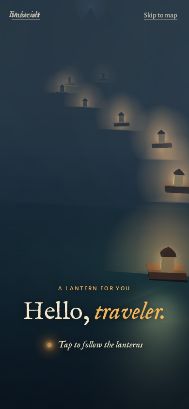 | 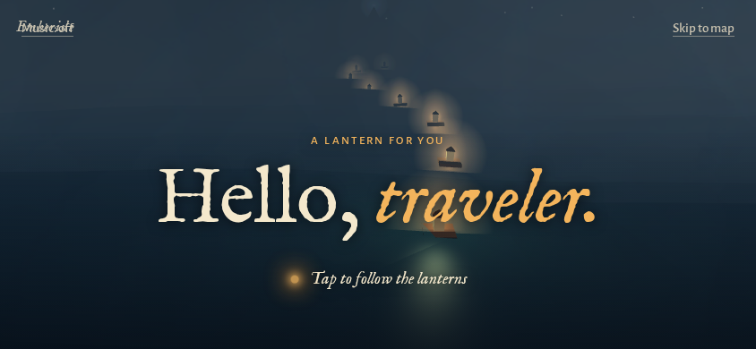 |
| Question | 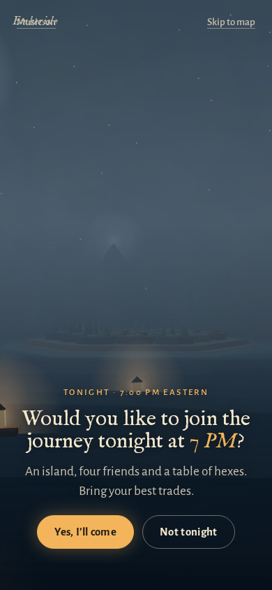 | 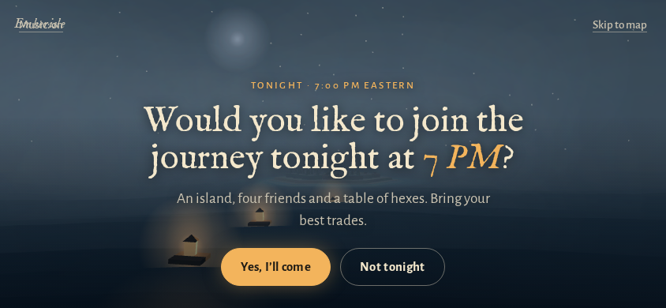 |
| Profile (UI mock; prototype skips this beat today) | 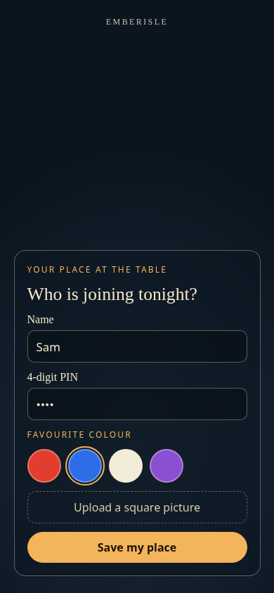 | 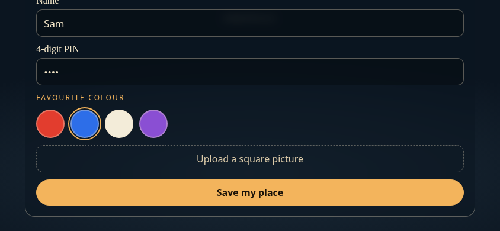 |
| Reveal (drawn stand-in in the prototype) | 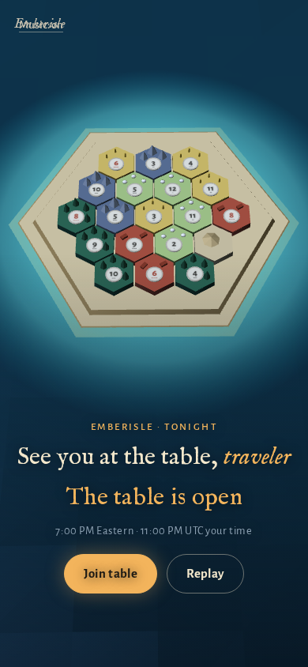 | 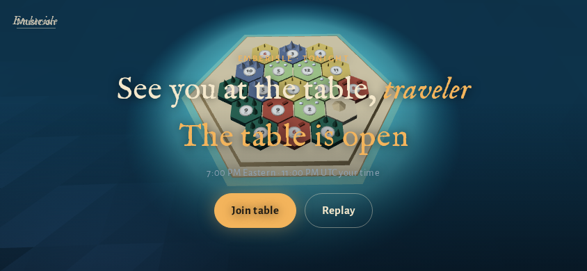 |
| Not tonight | 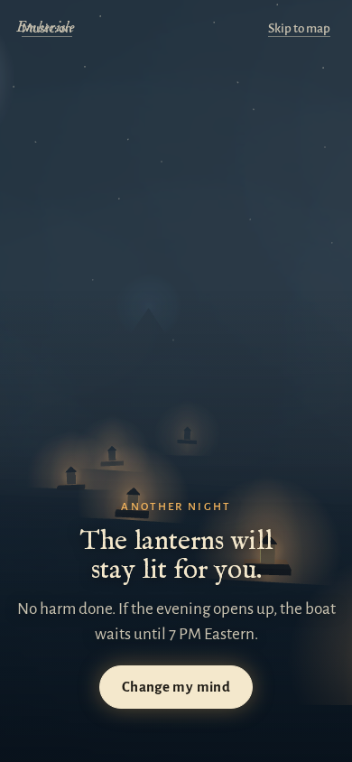 | 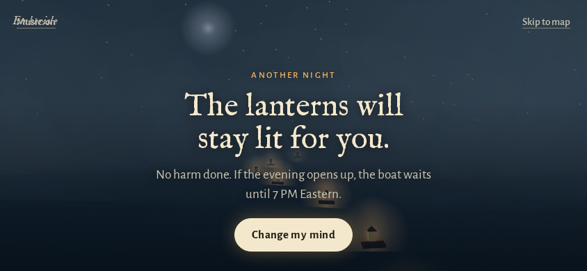 |

Reveal must mount the current game board.
Mocks from a live practice table:

| Viewport | Shot |
|---|---|
| Desktop | 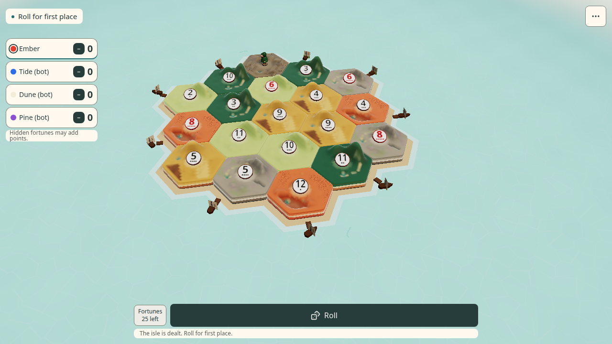 |
| Portrait phone | 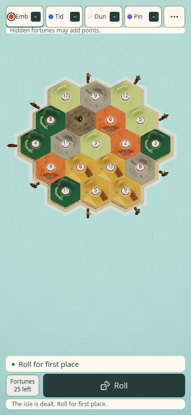 |
| Landscape phone | 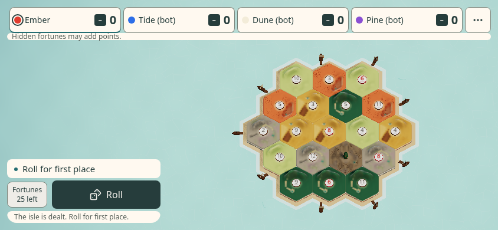 |

## Profile setup

Create or resume a profile through the invite, per [profiles.md](profiles.md) as fixed by #770.

| Field | Contract |
|---|---|
| Display name | Required. Strip controls. Cap 16 characters. |
| Login name | Required ASCII slug, 3–24 characters: `^[a-z0-9]+(-[a-z0-9]+)*$`. Suggested automatically from the display name, editable before submit. Enforced unique by the host. |
| PIN | Exactly four ASCII digits. Confirm on create. Hash with the existing scrypt recipe. Never store plaintext. |
| Favourite colour | One free seat colour for this invite night (see Colour). |
| Picture | Optional upload (see Picture upload). |

### How a login slug is chosen

When the guest enters their Display name on the invite screen, the form automatically suggests a proposed login slug:
1. Strip diacritics and convert text to lowercase ASCII.
2. Replace whitespace and non-alphanumeric characters with hyphens.
3. Collapse repeated hyphens and strip leading or trailing hyphens.
4. If shorter than 3 characters, append `-1` (e.g. `al` → `al-1`).
5. Truncate at 24 characters on a clean word/hyphen boundary.
6. The proposed slug is displayed in an editable field so the guest can customize it if desired.
7. The host enforces the canonical regex `^[a-z0-9]+(-[a-z0-9]+)*$` and rejects collisions with existing profiles. If taken, the form alerts: "That login name is already taken. Pick another."

HTTPS / WSS only, through the tunnel.
Plain LAN stays guest-only for profiles.
Saving the profile is what makes the invite feel real.
A remembered device credential resumes the profile on the next open of the same link.

Failure cases:

- Weak or non-HTTPS transport → refuse create / login; allow viewing the teaser copy only.
- PIN mismatch or lock → same generic sign-in error as profiles.md.
- Colour taken mid-submit → ask the guest to pick again.
- Upload rejected → keep the profile without a picture; show a one-line reason.

## Picture upload

Owner decision: uploads are allowed for profile pictures only.
This reverses "curated media only" from #678 and #770 for that one field.

| Rule | Detail |
|---|---|
| Accept | PNG, JPEG, WebP. Reject SVG, GIF and non-images. |
| Cap | Hard upload cap 8 MB before decode. |
| Process | Centre crop to square. Resize max edge 256 px. Re-encode WebP. Strip all metadata. |
| Store | On Jarrod's PC beside the profile store. Serve through the host and tunnel. No Cloudflare R2. |
| Visibility | Same table seats and the profile owner only. |
| Lifecycle | Backed up with profiles. Deleted with the profile. Jarrod's admin command can remove one. |

Never trust client-declared MIME alone.
Sniff magic bytes on the host after the size cap.

## Favourite colour

Only colours still free for guests who said Yes for this night.
Taken colours show greyed with the holder's display name.
First come, first served.
The host enforces it.

If someone switches to Not tonight, free their colour.
If two guests claim the last colour together, the host accepts one.
The other sees "That colour was just taken. Pick another."

Seat palette today: `#e23d2e`, `#2d6ee8`, `#f3ecd9`, `#8a4fd3`.

If more than four guests RSVP Yes when only 4 seat colours exist, the extra guests are confirmed on the night's RSVP guest list as standby/spectator ("All 4 table seats are claimed; you are RSVP'd as standby/spectator"). If a seated guest later switches to Not tonight, the freed colour becomes available to the next standby guest.

## Lobby and invite music

Owner pick: **"The Old Tower Inn"** by RandomMind (CC0).
[OpenGameArt page](https://opengameart.org/content/medieval-the-old-tower-inn) (licence checked 2026-10-18).

Ship a small looped MP3 or OGG.
Lazy-load after the first tap.
Play at music volume `0.5`.
Mute is remembered in `localStorage` (`emberisle-music`, sharing #823's global toggle so one switch controls music everywhere, with `emberisle-invite-music` accepted as fallback).
The loop is not a sting.
`src/lib/sound.ts` must treat it as a music loop category.
Credit RandomMind in the README as courtesy.

This is a new owner decision against sound.md Decision 2's "no music loop".
Gameplay background music remains a separate issue (#814).
Invite / lobby music may share the same file if Jarrod keeps that pick.

### Music shortlist (verified 2026-10-18)

| Track | Licence check | Source sizes | Loop notes |
|---|---|---|---|
| **The Old Tower Inn** (RandomMind) — **chosen** | OGA lists **CC0** | Full MP3 ~2.5 MB; loop WAV ~8.8 MB; PR re-encode ~0.78 MB / ~50 s | Preferred ship form: re-encoded loop under ~1 MB |
| The Bard's Tale (RandomMind) | OGA lists **CC0** | Full MP3 3.8 MB; loop WAV 10.2 MB | Alternate tavern feel |
| King's Feast (RandomMind) | OGA lists **CC0** | Full MP3 5.2 MB; loop WAV 14.2 MB | Brighter feast tone |
| Kenney Music Jingles | Kenney page lists **CC0** | Package of short jingles (85 assets) | Stings only; not a lobby loop |

Sea / lantern search: no stronger CC0 fog-sea loop beat the inn track for this invite.
Keep optional sea ambience as the separate Table-menu toggle (#662), off by default.

## Countdown

Show Eastern wall time and the guest's local equivalent.
Example: `7:00 PM Eastern · 4:00 PM your time`.
Count down to `startsAt`.
After start: `The table is open`.

If the host process is down, Join fails with a calm retry.
The countdown still runs from the stored instant.
Do not invent a fake table.

## RSVP

Owner decision: yes, Jarrod sees the list.

| Viewer | Sees |
|---|---|
| Jarrod (host / admin) | Going, Not tonight, No answer. Names and colours. |
| Guests | Who else is coming: names and colours only. Never who declined. |

Change my mind moves Not tonight → Going and re-enters colour pick if needed.

## Performance and access

| Concern | Rule |
|---|---|
| Load | Lazy-load music and the full board chunk after the first tap. Keep invite shell inside size-prove budgets. |
| Lite GPU | Use the existing software / lite board path when `IsleRenderer` would. |
| Reduced motion | Panel crossfades only. |
| Targets | Every control ≥ 44×44 px. |
| Phones | Support upright and landscape; respect safe-area insets. |

## Child issues (do not file yet)

| Lane | Child |
|---|---|
| `lane:net` | Invite token create / lookup / RSVP on the host; durable fields beside profiles. |
| `lane:net` | Picture upload endpoint, re-encode, storage and admin delete. |
| `lane:hud` | Invite route UI: five beats, profile form, countdown, Join. |
| `lane:board` | Mount live `IsleRenderer` for reveal; pasture hex touch → sheep baa (#667); other taps silent. |
| `lane:hud` | Colour picker with host-enforced availability. |
| `lane:net` / `lane:hud` | Lobby + invite music loop wiring in `sound.ts`. |
| `lane:net` | Jarrod-only RSVP admin view; guest coming list. |
| `lane:docs` | README credit line for RandomMind; sound.md Decision 2 amend. |

## Owner decisions recorded

All four questions from the issue are answered on the issue (2026-10-18):

1. Picture upload confirmed (profile pictures only; host-side resize).
2. Lobby music confirmed (Old Tower Inn, CC0).
3. RSVP list confirmed (Jarrod sees all; guests see going only).
4. Colour rule confirmed (available colours only; host tie-break).

No open `Question:` remains for this design.
Implementation issues may still ask product polish questions later.
