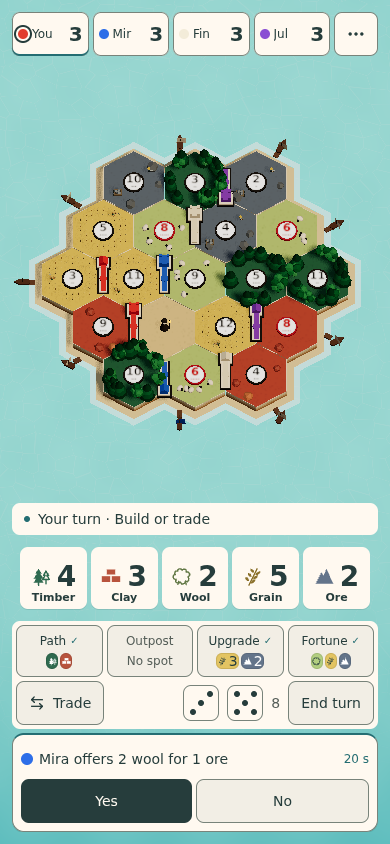
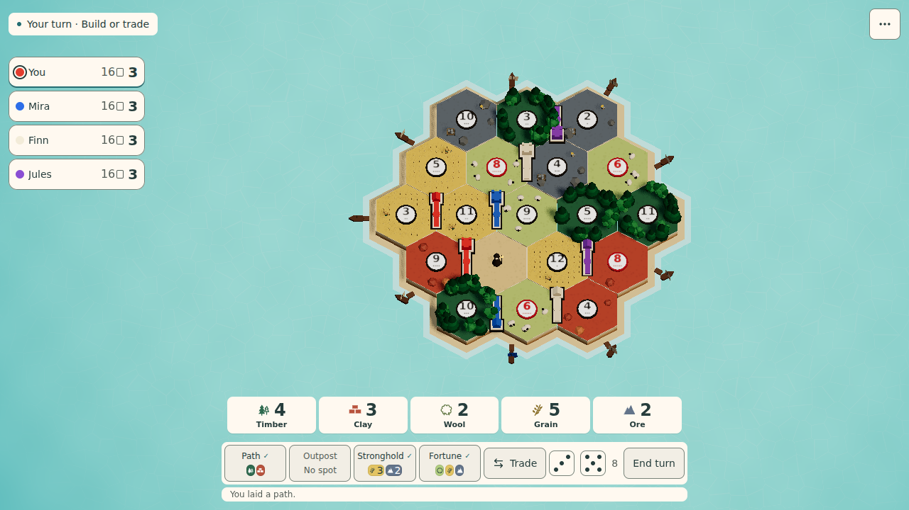

# Jelly Ocean — actual browser capture

These are Chromium frames from the implemented UI. The video shortens waiting intervals to show all three visitors; shipped visits use the timings in [jelly-ocean.md](../jelly-ocean.md).

[Watch wildlife and island work](ambient-showcase.webm) · [Measured board space and tap targets](metrics.json)

| View | Title | Main phase | Offer | Menu |
|---|---|---|---|---|
| Desktop 1280×720 | [Title](1280-title.png) | [Main](1280-main.png) | [Offer](1280-offer.png) | [Menu](1280-menu.png) |
| Phone 390×844 | [Title](390-title.png) | [Main](390-main.png) | [Offer](390-offer.png) | [Menu](390-menu.png) |
| Phone 844×390 | [Title](844-title.png) | [Main](844-main.png) | [Offer](844-offer.png) | [Menu](844-menu.png) |

[Dolphin](1280-dolphin.png) · [Turtle](1280-turtle.png) · [Whale](1280-whale.png)

