# Lobby room code placement: pictures (Part of #1430)

**Picture mock only. No game code changes.** Author: Claude Sonnet 5.5, 2026-11-08.

The owner chose option C on PR #1451: the header row stays as the lobby's title row. The code sits at the left as plain title text with the lobby's dotted "tappable text" underline (no box). The Wayfarer and connection lines move from the end of the Table row to the right of the header.

## How the pictures were made

Real game, real lobby. `capture.mjs` starts the real local host and Vite on a checkout of PR #1451's head (`99dab2f7`), opens a real host (Jarrod) and a real guest (Josh, Ready, with one chat line), and adds a bot and leaves one seat empty. It takes the "today" picture, then injects throwaway markup and CSS in the page (a DOM move of `.lobby-rule-status` into `.lobby-header`, plus a few CSS rules, all inside `capture.mjs`) and takes A, then adds the C rule and takes C. Nothing in `src` is edited. Chromium 153, reduced motion, 0 browser errors. Measurements are in [`measurements.json`](measurements.json).

Sizes: 430 x 932, 390 x 844, 375 x 812, 820 x 1180, 844 x 390.

| Size | 1. Today (#1451) | 2. Option A: code in a box, status right | 3. Option C: underlined text, status right |
|---|---|---|---|
| 430 x 932 | 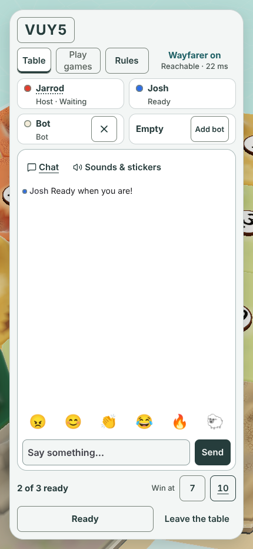 |  | 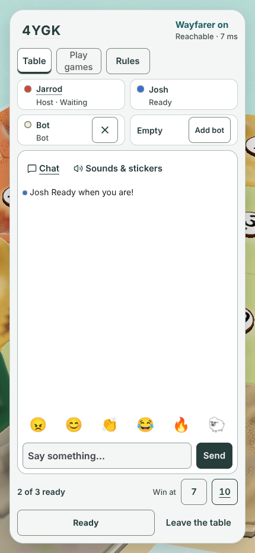 |
| 390 x 844 |  | 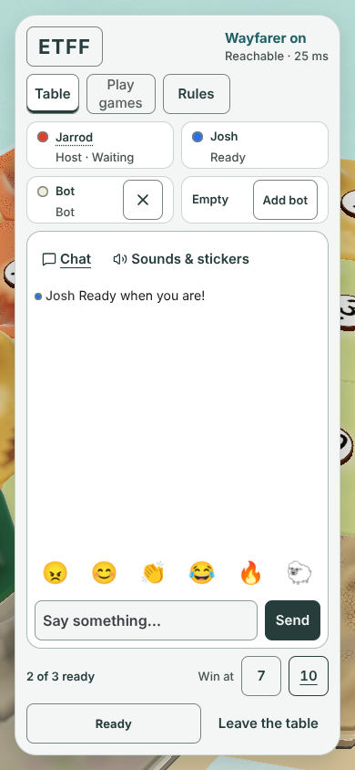 | 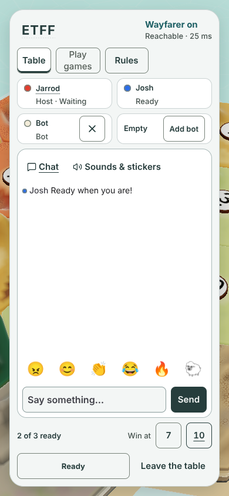 |
| 375 x 812 | 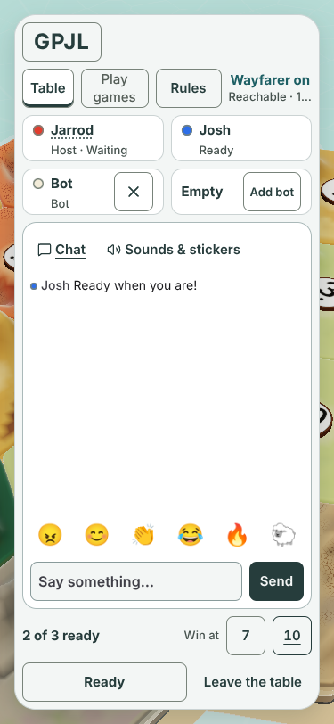 |  | 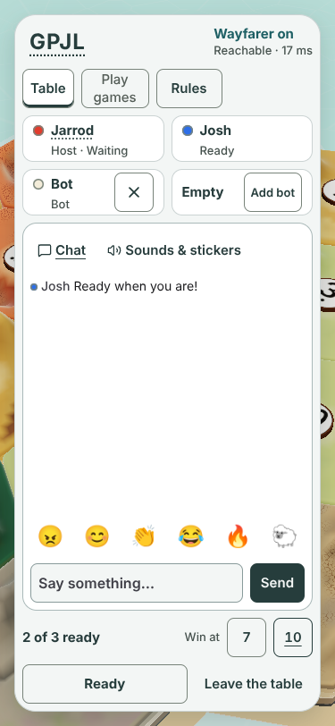 |
| 820 x 1180 | 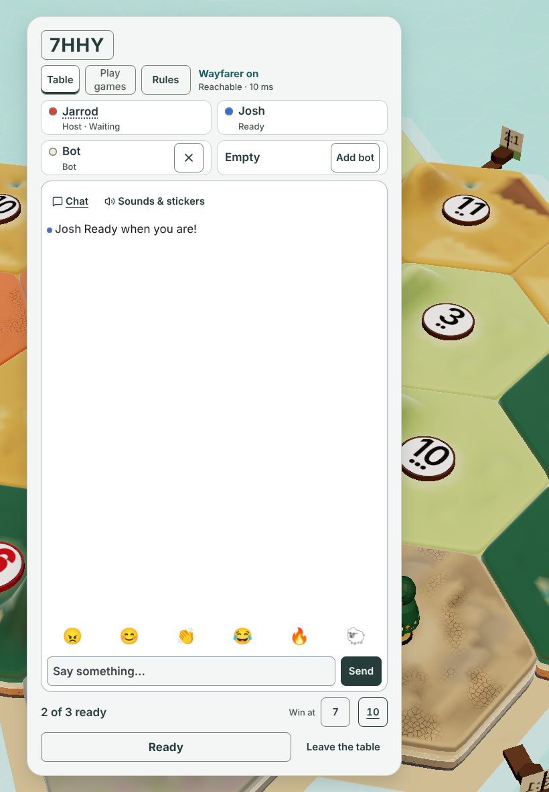 |  | 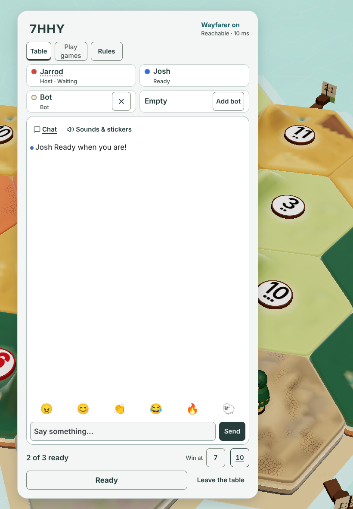 |
| 844 x 390 | 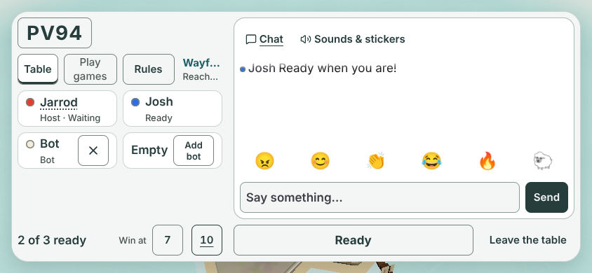 | 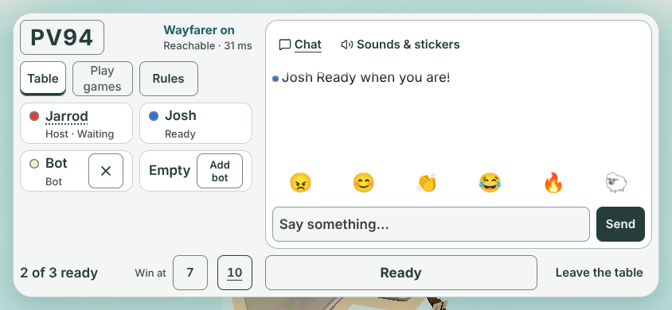 | 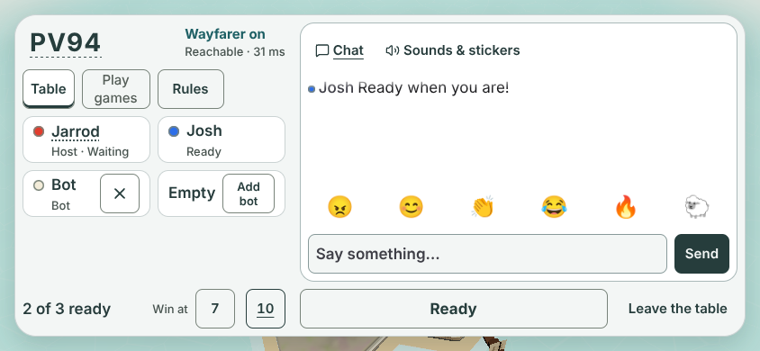 |

## Measurements

Room for the status is the header width minus the code and one 8 px gap. Today's status is the box it gets at the end of the Table row. "Reachable" is the connection line.

| Size | Today: status width | Today: connection line | A: room for status | C: room for status | Code box A / C |
|---|---|---|---|---|---|
| 430 x 932 | 140 px | fits | 266 px | 276 px | 98 x 44 / 88 x 44 |
| 390 x 844 | 100 px | **cut off** | 236 px | 246 px | 88 x 44 / 78 x 44 |
| 375 x 812 | 93 px | **cut off** | 228 px | 238 px | 89 x 44 / 79 x 44 |
| 820 x 1180 | 286 px | fits | 411 px | 421 px | 99 x 44 / 89 x 44 |
| 844 x 390 | 60 px | **both lines cut off** | 180 px | 190 px | 104 x 44 / 94 x 44 |

- The longest connection line ("Reconnecting · 2999 ms") needs 151 px. It fits in A and C at all five sizes (the injected text was measured, `worstCase` in the JSON). Today it does not fit at 390, 375 or 844 x 390.
- Tap target: the code stays a 44 px tall button in C. Width is the text plus 8 px each side, 78 px at the narrowest (min 72 px). The 44 px height and the 44 px minimum width hold at every size. The header row stays 44 px, so no row grows or moves; the chat panel is the same size in all three (for example 458 px tall at 390 x 844, 486 x 288 sideways).
- Row 2 is Table 58, Play games 76, Rules 74 px, all 44 tall, in all three.
- Sideways, the header is the left column (292 px). Code plus status share it; the chat still runs from the top.

## The spec rows (what a builder would do)

1. `LobbyView.tsx`: move the `.lobby-rule-status` div (Wayfarer line over the connection line) from `.lobby-rules` into `.lobby-header`, after the code button. Keep `data-testid="lobby-caption"`, `connection-status`, `role="status"` and `aria-live="polite"`. Tab order is unchanged.
2. `lobby.css`, header: `.lobby-header { justify-content: space-between }`; `.lobby-header > .lobby-rule-status { margin-left: auto; align-items: flex-start; min-width: 0; flex: 0 1 auto }`. The text stays left-aligned inside its block. Drop `.lobby-rules > .lobby-rule-status`.
3. `lobby.css`, option C code: `.lobby-layout .lobby-code { border: 0; padding: 0 8px; text-decoration: underline dotted; text-underline-offset: 6px }`. Keep the 28/24/18 px code sizes, the 72 px minimum width, the fade to "Copied" and the aria name. This is the same dotted underline as `rename-seat` (4 px offset there, 6 px here to clear the 28 px type).
4. Proof lines: none replaced. `lobby-layout-prove` reads 8 px text padding on `.lobby-header button`, which `padding: 0 8px` keeps. Add two lines to `lobby-code-copy-prove`: the status sits inside `.lobby-header`, and `connection-status` has `scrollWidth <= clientWidth` at 390 and 844 x 390.

## Things to look at

- With no box, the code's text sits 8 px in from the card's padding edge (the button padding), so it does not line up with the "Table" box below it. Aligning it means a negative left margin of 8 px; not applied here.
- Discoverability is lower than a box. README and the host's printed hint already say "tap the code".
- The status block in the header is two lines (44 px), the same height as the code, so the row looks balanced. In A and C the Wayfarer line is teal and bold as today.
