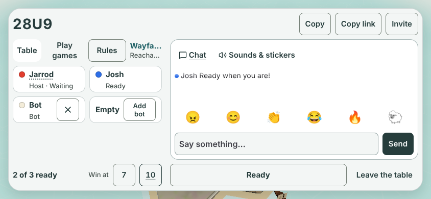
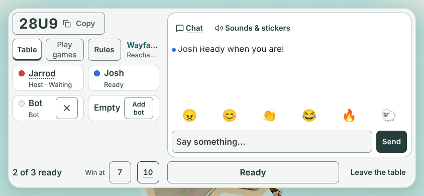
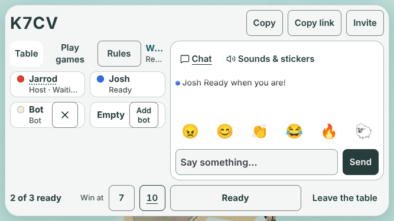
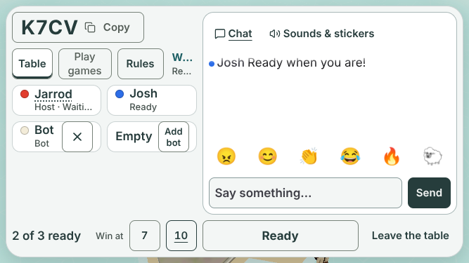
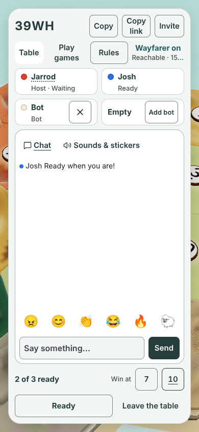
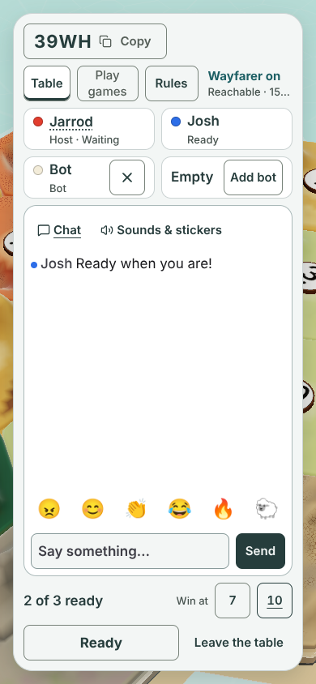
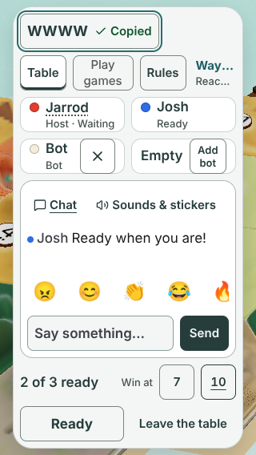
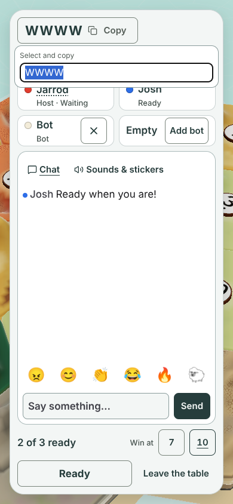
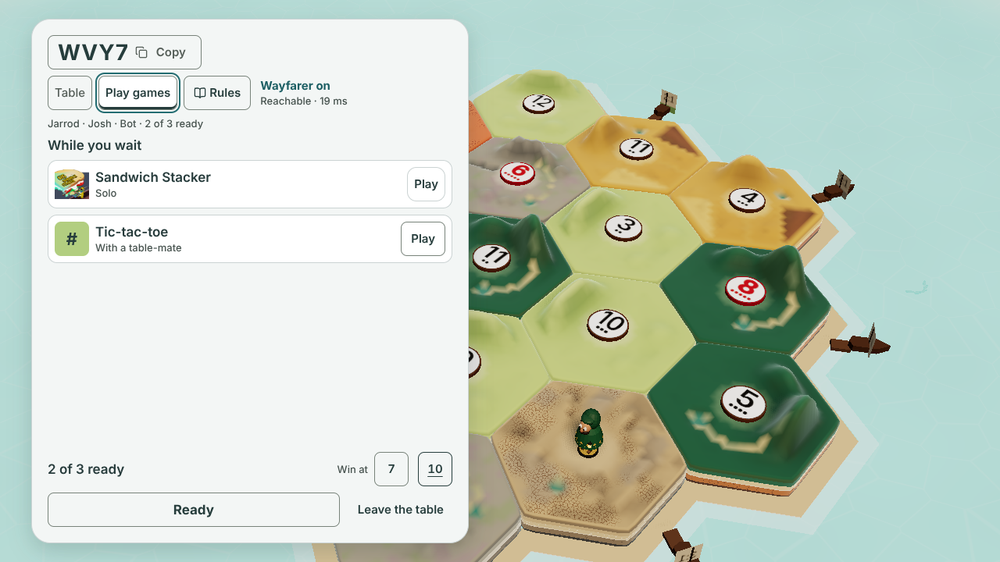

# Lobby controls: one look, and tap the code to copy (#1303, for #1274)

**Design stage only. No game code changes.** Jarrod answers the open question below, then a builder takes it after #1220 lands.
Author: Claude Opus 5.5, 2026-11-07. Base: `main` at `2525ea2`.

## What the owner asked for

- 2026-11-03, on #1274: Copy, Copy link and Invite "look really weird". The code could be copied by tapping it. Rules has a box, but Table and Play games do not. Give all three one look.
- 2026-11-07, on #1303 (from the #1388 pictures): "Perhaps landscape we move the top right buttons so the chat is bigger. I already said we can just make COPY by clicking the 4 digit code though, so we can get rid of those 3 I think?"

"Those 3" are the three buttons at the top right of today's lobby: **Copy**, **Copy link** and **Invite** ([before-390x844.png](before-390x844.png)). All three go.

## The proposal

**Header.** Only the room code is left. The code is the copy button: the code, a copy icon and the word "Copy". A tap copies the code, and the word turns to a green "Copied" for 1.5 s.

**Phone held sideways.** With the three buttons gone, nothing sits at the top right. The code keeps to the left column, and the chat (or Play games) runs from the top of the card. The chat gains 52 px of height:

| Size | Today: chat panel | Proposed: chat panel | Chat log | Share of the card |
|---|---|---|---|---|
| 844 × 390 | 486 × 236 at y 77 | 486 × 288 at y 25 | 62 → 114 px | 39.5% → 48.2% |
| 667 × 375 | 363 × 237 at y 69 | 363 × 289 at y 17 | 63 → 115 px | 36.8% → 44.8% |

| Today, 844 × 390 | Proposed, 844 × 390 |
|---|---|
|  |  |

| Today, 667 × 375 | Proposed, 667 × 375 |
|---|---|
|  |  |

On an upright phone and on desktop the chat keeps its size; the header row just holds the code.

**Table row.** Table, Play games and Rules are the same box as every other lobby button: 44 px tall, no fill, a 1 px control-line edge, 8 px corners, 15 px text. Buttons and the picked tab are semibold (600); the other tab is medium (500). They sit 8 px apart.

- The picked tab is filled white, with ink text and a 3 px ink bar along its bottom edge.
- The other tab has no fill, grey text and no bar.
- Rules has ink text, and a book icon on wide screens. It opens a sheet; it never shows as picked.

| Today, 390 × 844 | Proposed, 390 × 844 |
|---|---|
|  |  |

Every proposed picture also carries the accepted #1220 type and spacing ([`lobby-hig/after.css`](../lobby-hig/after.css)), which is being built in PR #1388. "Today" pictures are `main` as it is.

## What each control does

| Control | Tap | Keyboard and screen reader | After |
|---|---|---|---|
| Code | Copies the code | A button named "Table code A B 2 3. Copy". The letters are read one by one. | "Copied" for 1.5 s, and the polite live line says "Copied" |
| Code, clipboard blocked | Shows today's fallback: "Select and copy" with the code in a field, selected and focused | The live line says "Select and copy" | Stays until the next copy |
| Table, Play games | Picks the view | `role="tablist"` with two `role="tab"`, `aria-selected`. Left and Right move between them; Home and End jump. Only the picked tab is in the Tab order | The view changes under the row |
| Rules | Opens the rules sheet, as today | A button named "Rules" | Focus goes back to Rules when the sheet closes, as today |

Nothing else changes: host, Ready, Start, Add bot, Remove bot, chat, reactions, the Play games shelf and Leave all work as today. The tic-tac-toe invite badge stays on the Play games tab.

**What goes with the three buttons.** Copy link copied the join link, and Invite opened the phone's share sheet (or copied the link). After this change the lobby has no way to share the link; a friend joins by typing the 4-letter code on the title screen. A join link someone already has still works. See the question below.

## Pictures

All with a real host, a guest (Josh), a bot and one chat line.

| State | 320 × 568 | 390 × 844 | 667 × 375 | 844 × 390 | 1280 × 720 |
|---|---|---|---|---|---|
| Today | [before](before-320x568.png) | [before](before-390x844.png) | [before](before-667x375.png) | [before](before-844x390.png) | [before](before-1280x720.png) |
| Proposed | [table](a-table-320x568.png) | [table](a-table-390x844.png) | [table](a-table-667x375.png) | [table](a-table-844x390.png) | [table](a-table-1280x720.png) |
| Joined tabs (question) | [joined](joined-table-320x568.png) | [joined](joined-table-390x844.png) | [joined](joined-table-667x375.png) | [joined](joined-table-844x390.png) | [joined](joined-table-1280x720.png) |
| Copied, code `WWWW` | [copied](a-copied-320x568.png) | [copied](a-copied-390x844.png) | [copied](a-copied-667x375.png) | [copied](a-copied-844x390.png) | [copied](a-copied-1280x720.png) |
| Clipboard blocked | [blocked](a-blocked-320x568.png) | [blocked](a-blocked-390x844.png) | [blocked](a-blocked-667x375.png) | [blocked](a-blocked-844x390.png) | [blocked](a-blocked-1280x720.png) |
| Play games tab | [games](a-games-320x568.png) | [games](a-games-390x844.png) | [games](a-games-667x375.png) | [games](a-games-844x390.png) | [games](a-games-1280x720.png) |
| Host alone | [empty](empty-320x568.png) | [empty](empty-390x844.png) | [empty](empty-667x375.png) | [empty](empty-844x390.png) | measured |
| Four seats, Start | [full](a-full-320x568.png) | [full](a-full-390x844.png) | [full](a-full-667x375.png) | [full](a-full-844x390.png) | measured |
| Text 125% | [125](a-text125-320x568.png) | [125](a-text125-390x844.png) | [125](a-text125-667x375.png) | [125](a-text125-844x390.png) | measured |
| Text 150% | [150](a-text150-320x568.png) | [150](a-text150-390x844.png) | [150](a-text150-667x375.png) | [150](a-text150-844x390.png) | [150](a-text150-1280x720.png) |

| Copied, 320 × 568 | Blocked, 390 × 844 | Play games, 1280 × 720 |
|---|---|---|
|  |  |  |

## Measurements

From the final run of [capture.mjs](capture.mjs). The full numbers are in [measurements.json](measurements.json), browser errors included (0). Chromium 153.0.8010.12. The capture records these results; it does not fail on them, so read the numbers, not the exit code.

| Check | Result |
|---|---|
| Header fits, nothing cut, every state, at 100%, 125% and 150% text, with the real code, `WWWW` and `MMMM` (copied) | Yes, at all five sizes |
| Table, Play games and Rules fit their row, every state, every text size | Yes, at all five sizes |
| Controls under 44 × 44 | None in any state. The one exception is today's blocked-clipboard field (32 px tall on phones, 30 px at 1280 × 720), which this design does not change |
| Gap between targets | 8 px minimum in every 100% state, with two exceptions. The joined tabs touch (0 px), by design. In the blocked state, today's fallback panel lies over the Table row, as it does today |
| Chat share (#1103 floors) | 52.3% at 390 × 844 (floor 52%) and 41.6% at 1280 × 720 (floor 40%), the same as today. 48.2% at 844 × 390 (floor 39%, today 39.5%) |
| Chat at 320 × 568 | At 100% text the log keeps 48 px, about two lines, with #1220's scrolling emoji row (0 px today). At 125% it falls to 9 px and at 150% to 0 px: no line shows (see Text size) |
| Wayfarer line cut | At 100% text, the same as today at every size. Rules drops its book under 901 px wide so the line keeps its room. At 125% and 150% it is cut further; there is no "today" picture at those sizes to compare |

Code button widths at 100% text: 150 px at 320 × 568 (174 px with `WWWW` and "Copied"), 178 px at 390 × 844 (203 px), 184 to 197 px at 667 × 375, 844 × 390 and 1280 × 720 (228 px). Widths vary a few pixels with each run's code.

### Text size

The new controls use rem, so they follow the user's text size. The studies set the page to 125% and 150%.

- The header row and the Table row hold at every size and both text sizes.
- The code itself does not grow past its 100% size, so the 44 px header row never grows.
- At 150% text on a 320 × 568 phone and on a phone held sideways (667 × 375, 844 × 390), Rules keeps only its book (44 px wide); its name stays "Rules". At 390 × 844 it keeps its word (86 × 62 px).
- The rest of the lobby is still in px and breaks at 150% (Remove bot, Add bot and the chat field overlap). That is #1235's work, not this issue's.
- **Chat at 320 × 568 is not reachable at big text.** The two top rows grow from 44 to 52 px (125%) and 62 px (150%), and the chat log shrinks to 9 px and then 0 px. #1303 asks for reachable chat at 320; this design meets it at 100% text only. Keeping it at big text needs #1235's work on the rest of the card, or the top rows held at 44 px.

### Sizes outside the lobby type scale

The accepted lobby sizes are 13, 15, 17, 22 and 28 px (decision 7). One size here falls outside them: the 18 px code on a 320 px phone, from #1220's accepted CSS.

## Questions for Jarrod

**1. Sharing the join link.** With Copy link and Invite gone, the lobby cannot send the join link. A (recommended): leave it out; friends type the code on the title screen. B: tapping the code copies the join link, which carries the code. C: keep one small "Share link" button at the bottom of the card, by Leave the table. D: something else.

- A matches "get rid of those 3" and keeps the card simplest.
- B pastes as a link that opens the table, but a friend reading it aloud then has a long address, not 4 letters.

**2. The tab look.** A (recommended): Table and Play games are two boxes 8 px apart, and the picked one is white with an ink bar. B: the two tabs join in one track (the iPhone look), 0 px apart. C: keep today's tabs and take the box off Rules instead. D: something else.

- A keeps the 8 px rule between every two targets.
- B reads more clearly as "pick one of two", but the tabs touch.

## Notes for the builder

- Build after #1220 (same files, PR #1388). Keep `data-testid="table-code"` on the code text inside the new button; many proofs read it.
- These proof lines use today's controls. Each is replaced in its own commit with an old/new table, per [DECISIONS](../../DECISIONS.md) 2026-10-25. None is deleted.
  - `scripts/lobby-layout-prove.mjs`: lines 194, 245 to 251, 259, 276, 277, 297, 312, 320 to 325 and 390 (the Copy, Copy link and Invite buttons and `.lobby-copy-controls`).
  - `scripts/lobby-wait-box-prove.mjs`: 106, 172, 220 and 229 (Play games and Table as `aria-pressed` buttons in `.lm`).
  - `scripts/lobby-tictactoe-prove.mjs`: 86, 137, 152 and 157 (the same).
  - `scripts/client-prove.mjs`: 605 and 619 (Copy link and Copy).
- Today `lobby-layout-prove.mjs:320-325` clicks Copy and checks the code reached the clipboard, clicks Copy link and checks the link did, then installs a stand-in share sheet and checks Invite shares the link. The Copy step becomes a click on the code button with the same clipboard check. The Copy link and Invite steps have nothing left to click under question 1's answer A; they are replaced only as that answer allows.
- The landscape layout change is in `lobby.css` (`@media (max-height: 600px) and (orientation: landscape)`): the header takes column 1 only, and the chat panel and Play games take rows 1 to 3 of column 2.
- This capture records the last copied text (`copies` in measurements.json) but does not fail on it.

## How it was made

- [capture.mjs](capture.mjs) starts a real host and opens the lobby at each size, then adds a guest, a bot and a chat line.
- [controls.tsx](controls.tsx) draws the proposed header and Table row with the game's own data and copy helper. Table and Play games press today's hidden buttons, so the lobby below is the real one. [controls.css](controls.css) holds the look, in the game's tokens.
- No `src/` file changed. The built CSS is byte-identical with and without this folder.
- Run it from the repo root: `node docs/design/lobby-controls-1274/capture.mjs`. It writes to a temp folder; add `--save` to write here. Codes differ between runs.
