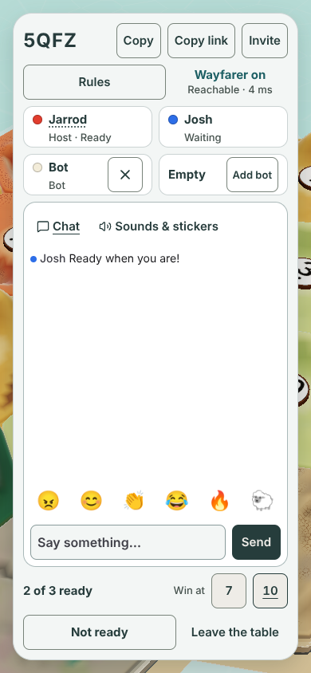
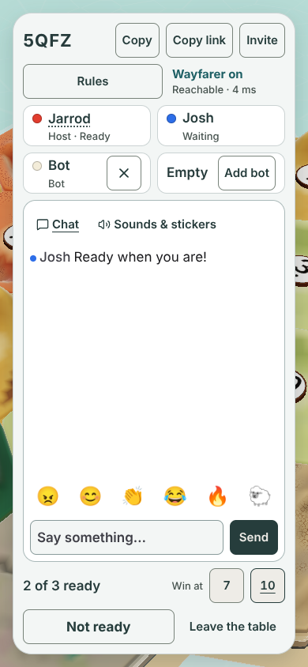
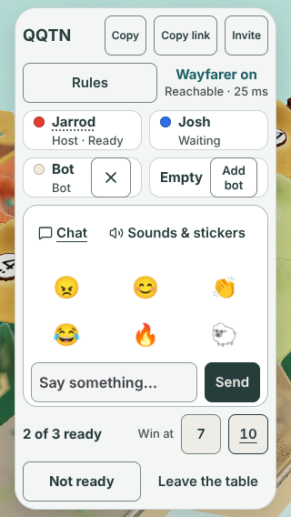
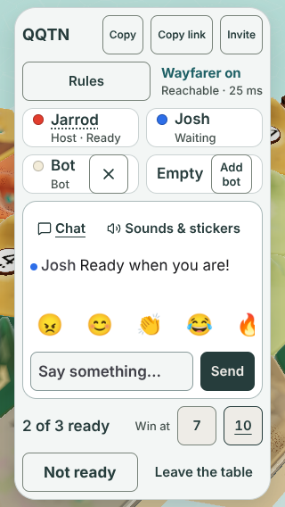

# Lobby: font and spacing against Apple's HIG

**Design stage only. No game code changes.** Issue [#1220](https://github.com/jarrodjohnson-gif/emberisle/issues/1220).
Owner request (Jarrod, 2026-10-30): "Refer to Apple standards for this whole page as far as designing font, spacing, etc".
Author: Claude Opus 5.5 (desk subagent builder), 2026-10-31. Base: `main` at `55d0575`.

Owner answer 2026-10-31: A, accepted as proposed (Desk Decisions card q1220-lobby-hig).

[All pictures side by side](gallery.html) · [Proposed CSS](after.css) · [Measurements](measurements.json) · [Capture log](capture.log) · [Capture utility](capture.mjs) · [Verification](verification.md)

GitHub shows HTML as source. Use the PNG links below to review there.

## How this was measured

- The real lobby ran against a real local host, with Chromium 153.0.8010.12 and Playwright 1.63.0. These are the versions the repo proofs pin.
- Each picture shows the host Jarrod, guest Josh, one bot, one empty seat and one chat line.
- Each picture has a normal 4-letter room code from the host. Codes differ between sizes, not within a pair.
- "After" is the same page, with [after.css](after.css) added on top. No `src/` file changed.
- The capture also sets the widest code, `WWWW`, and presses Copy. It measures both states, but pictures neither.
- HIG numbers come from Apple's pages, read on 2026-10-31: [Typography](https://developer.apple.com/design/human-interface-guidelines/typography), [Accessibility](https://developer.apple.com/design/human-interface-guidelines/accessibility), [Layout](https://developer.apple.com/design/human-interface-guidelines/layout), [Buttons](https://developer.apple.com/design/human-interface-guidelines/buttons).
- CSS px equal iPhone points at the default zoom. The table uses px.

### The HIG numbers used

| HIG item | Value |
|---|---|
| iOS text, default and minimum | 17 pt default, 11 pt minimum |
| Text styles, iOS Large (default) | Title 1 28/34, Title 2 22/28, Title 3 20/25, Headline 17/22 semibold, Body 17/22, Callout 16/21, Subheadline 15/20, Footnote 13/18, Caption 1 12/16, Caption 2 11/13 |
| Control size, iOS | 44×44 pt default, 28×28 pt minimum |
| Space around controls | About 12 pt around bezeled controls; about 24 pt around unbezeled ones ("in general") |
| Safe areas | "Respecting the safe area is essential" |
| Alignment | "Align elements to make them easier to scan" |
| Text size changes | "Be prepared for text-size changes"; keep truncation to a minimum |

## Audit

**Kind** says who decides. **Strict** is a HIG minimum or a "must". **Taste** is HIG guidance that Jarrod accepts or declines.
Line numbers are for `main` at `55d0575`.

| # | What | Where | HIG rule | Current (measured) | Proposed | Kind |
|---|---|---|---|---|---|---|
| 1 | Smallest text | Whole lobby | 11 pt minimum | 12 px at 320 wide; 13 px elsewhere | No change. It already passes. | Strict, passes |
| 2 | Room code size | `lobby.css:31`, `:111`, `:150` | Title styles | 28/36 bold on landscape and desktop; 24/32 portrait; 18/32 at 320 | Title 1 28/34 on landscape and desktop. Title 2 22/28 on portrait phones. 18/28 at 320. | Taste |
| 3 | `WWWW` beside the copy buttons at 375 | `lobby.css:111`, `:32` | Paraphrase: avoid truncation; keep hierarchy | At 24 px, "Copy link" text padding drops under 8 px | At 22 px it fits, 12.84 px clear of Copy | Taste (fixes a measured squeeze) |
| 4 | Copy, Copy link, Invite at 320 | `lobby.css:152` | 11 pt minimum; Subheadline 15 | 12/16 px | Keep 12/16. No 15 px label fits beside `WWWW` (see Question 1). | Strict, passes |
| 5 | Seat names | `lobby.css:66` | Headline 17/22 semibold | 15 px bold | 17 px semibold. Seat row heights stay. | Taste |
| 6 | Seat status, connection line, "Win at" | `lobby.css:44`, `:68`, `:167` | Footnote 13/18 | 13 px; lines mix 17.33 px and 18 px | 13/18 everywhere | Taste |
| 7 | "2 of 3 ready" status | `lobby.css:102` | Headline 17/22 | 15 px bold, 22.5 px line | 17/22 semibold | Taste |
| 8 | Ready and Start (primary actions) | `lobby.css:22`, `:105` | Headline 17/22 | 15/20; Ready is bold | 17/22. Ready stays bold. "Leave the table" stays 15. | Taste |
| 9 | Chat lines | `Chat.tsx:53` (`text-sm leading-snug`) | Body 17/22 | 14/19.25 | 17/22 in the lobby only, written as `1.0625rem` | Taste |
| 10 | Chat input text | `lobby.css:22`, `styles.css:298` | Body 17 | 16 px on touch; 15 px with a mouse | 17 px. Touch stays above 16 px, so iOS Safari never zooms. | Taste |
| 11 | Add bot | `lobby.css:69` | Subheadline 15/20 | 13/16. Two lines at 320 and 844×390. | 15/20 on one line at 375, 390 and 1280. Keep 13/16 at 320 and 844×390, where 15 px breaks the 8 px text padding. | Taste |
| 12 | Number of text sizes | Whole lobby | Keep a clear hierarchy | 320: 12, 13, 14, 15, 16, 18 px. 390: 13, 14, 15, 16, 24 px. Emoji not counted. | 13, 15 and 17 px, plus the code at 22 or 28 px. At 320, the 12 px buttons and 18 px code stay. | Taste |
| 13 | Touch targets | Every button, input and tab | 44×44 pt | All 44 px or more, at all five sizes | No change | Strict, passes |
| 14 | Space between bezeled buttons in a row | `lobby.css:27` | About 12 pt around bezeled controls | 8 px | 12 px in the header, footer and 7/10 rows when wider than 700 px. 8 px on phones. | Taste |
| 15 | Space between card rows | `lobby.css:10` | Group with space | 8 px | Keep 8 px. 12 px measured 50.5% chat at 390×844 (floor 52%) and 39.4% at 1280×720 (floor 40%). | Taste, keep |
| 16 | Card padding | `lobby.css:12`, `:110`, `:119`, `:154`, `:172` | Consistent spacing | 20 desktop; 12 at 390; 8 at 375, 320 and landscape | Keep. At 375, 12 px squeezes the emoji gaps to 7.16 px, under the 8 px rule. | Taste, keep |
| 17 | Side margins | `lobby.css:4`, `:109`, `:116` | Paraphrase: respect layout margins (the HIG gives no number) | 16 px on phones; 40 px on desktop | No change. 16 px matches UIKit's default iPhone side margin. The HIG pages give no number. | Taste, keep |
| 18 | Top and bottom margins at 320×568 | `lobby.css:169` | Layout margins | 8 px | Keep. Height is the scarce space there. | Taste, keep |
| 19 | Wayfarer and connection lines | `lobby.css:37` | Align to the leading edge | Centred in their half. Every other row starts at the left. | Left-aligned, 4 px in | Taste |
| 20 | Safe area, landscape under 700 px wide | `lobby.css:136` | Respect the safe area | Fixed 8 px inset. It ignores `env(safe-area-inset-*)`. | `max(8px, env(safe-area-inset-*))` on all four sides | Strict |
| 21 | Safe area, tablet and desktop layout | `lobby.css:2`–`4` | Respect the safe area | Fixed 24/24/40 px. It ignores `env()`. | `max()` with `env()` on top, bottom and left | Strict |
| 22 | Chat at 320×568 | `lobby.css:153`, `talk.tsx:183` | Put important content first | Emoji wrap to two rows. The chat log is 0 px, so no message shows. | One scrolling emoji row, 12 px gaps, half of the fifth emoji showing. The log gets 48 px, about two lines. | Taste (Question 2) |
| 23 | Text that follows the user's text size | Whole lobby | Be prepared for text-size changes | 2 of 33 texts follow the root size (the chat lines) | Still 2 of 33. Full support is a separate change (Question 3). | Strict guidance, not met |
| 24 | `WWWW` with "Copied" showing | Header | Avoid truncation | Squeezed at 320, 375 and 390, before and after | Owned by PR #1181's fitting, not this audit | Out of scope |

24 rows: 5 strict (1, 4, 13, 20, 21), 1 strict guidance not met (23), 17 taste, 1 out of scope.
Rows 1, 4 and 13 already pass. Rows 20 and 21 are the only strict gaps the proposed CSS closes.

## Pictures

| Size | Before | After |
|---|---|---|
| 320 × 568 | [before-320x568.png](assets/before-320x568.png) | [after-320x568.png](assets/after-320x568.png) |
| 375 × 667 | [before-375x667.png](assets/before-375x667.png) | [after-375x667.png](assets/after-375x667.png) |
| 390 × 844 | [before-390x844.png](assets/before-390x844.png) | [after-390x844.png](assets/after-390x844.png) |
| 844 × 390 | [before-844x390.png](assets/before-844x390.png) | [after-844x390.png](assets/after-844x390.png) |
| 1280 × 720 | [before-1280x720.png](assets/before-1280x720.png) | [after-1280x720.png](assets/after-1280x720.png) |

| 390 × 844 before | 390 × 844 after |
|---|---|
|  |  |

| 320 × 568 before | 320 × 568 after |
|---|---|
|  |  |

Rows 20 and 21 do not show in pictures. Desktop Chromium reports every safe-area inset as 0.

## Proposed CSS

These are the exact values. A builder moves them into `lobby.css` after Jarrod accepts them. The letters match [after.css](after.css).

| Group | Selector | Proposed value | Rows |
|---|---|---|---|
| A | `.lobby-header > p` | 28px / 34px | 2 |
| A | `.lobby-header > p`, portrait up to 600 px wide | 22px / 28px | 2, 3 |
| A | `.lobby-name` and the rename button | 17px, weight 600 | 5 |
| A | `.lobby-player-status`, `.lobby-rule-status > *:last-child`, `[data-testid="victory-target"]` | 13px / 18px | 6 |
| A | `.lobby-summary > p` | 17px / 22px, weight 600 | 7 |
| A | `.lobby-action-buttons > button:not(:last-child)` | 17px / 22px | 8 |
| A | `[data-testid="chat-log"] > li`, lobby only | 1.0625rem / 1.375rem (17/22) | 9 |
| A | `.lobby-layout input` | 17px | 10 |
| A | `.lobby-player > button` (Add bot), portrait from 361 px wide, or taller than 600 px | 15px / 20px, `nowrap` | 11 |
| B | `.lobby-rule-status` | `align-items: flex-start; padding-left: 4px` | 19 |
| C | `.lobby-copy-controls`, `.lobby-action-buttons`, `.lobby-summary [role="radiogroup"]`, wider than 700 px | gap 12px | 14 |
| D | `.lobby-layout`, at least 601 × 601 px | `top: max(24px, env(safe-area-inset-top))`, same for bottom; `left: max(40px, env(safe-area-inset-left))` | 21 |
| D | `.lobby-layout`, landscape up to 700 px wide | `inset: max(8px, env(safe-area-inset-*))` per side | 20 |
| E | `.lobby-header > p`, portrait up to 360 px wide | 18px / 28px | 2, 4 |
| E | `[data-testid="emoji-row"]`, portrait up to 360 px wide | flex row, gap 12px, `overflow-x: auto`, scroll snap, 44 px buttons | 22 |

## What stays unchanged

- Every 44 px target, 8 px text padding, and 8 px gap between controls.
- The card grid, row heights, row gaps, card padding, side margins, radii and colours.
- The 52%, 39% and 40% chat-share floors from #1103.
- The 12 px copy buttons at 320, and the 13 px two-line Add bot at 320 and 844×390.
- Emoji at 24 px, tabs at 15 px, and "Leave the table" at 15 px.
- All wording, the layout order, the fonts (`ui-rounded` code, system UI text) and every behaviour.
- The game screen. All selectors stay inside the lobby card.

## Questions for Jarrod

1. **Copy buttons at 320.** HIG passes at 12 px. 15 px only fits if "Copy link" becomes "Link". Recommendation: keep 12 px and the wording.
2. **Emoji row at 320.** One scrolling row brings back about two chat lines. It hides the sixth emoji until you swipe. Recommendation: accept the scrolling row. Without it, no chat message shows at 320×568.
3. **Text size.** The lobby uses fixed px. HIG asks apps to follow the user's text size. Supporting it means rem units and a test at 125% and 150%. Recommendation: file it as its own issue after this one.
4. **The rest.** Accept or decline the taste rows one by one. Rows 20 and 21 are strict and need no taste call.

## Notes for the builder

- Merge this with PR #1181 first, or rebase on it. #1181 fits the code to the header on the fly. The 22 px base here makes plain `WWWW` fit without that fitting at 375 and 390.
- The existing `lobby-layout-prove` passes with every proposed value except one. Row 22 fails `scripts/lobby-layout-prove.mjs:75` ("inside card") for the scrolled-out sheep at 320×568.
- If Jarrod accepts row 22, replace that line in its own commit with an old/new table, per [DECISIONS](../../DECISIONS.md) 2026-10-25. Never delete it.
- Run `node docs/design/lobby-hig/capture.mjs` from the repo root to redo every picture and number.
