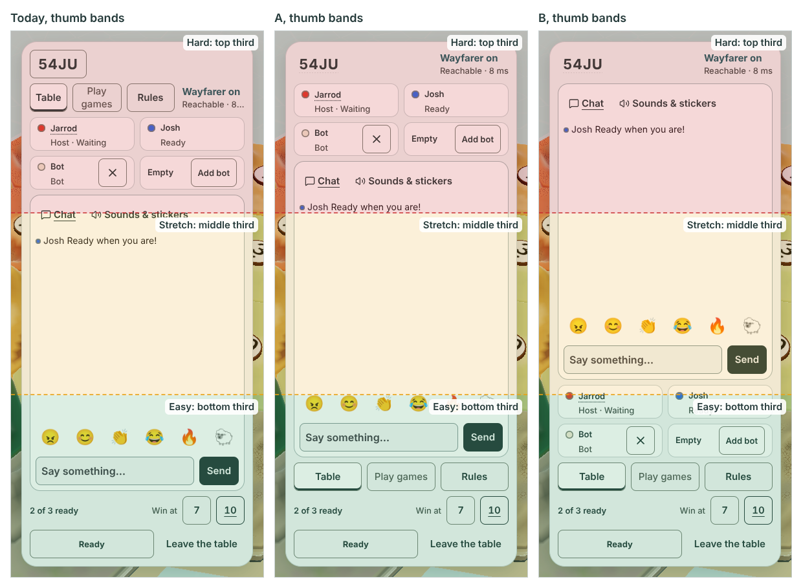
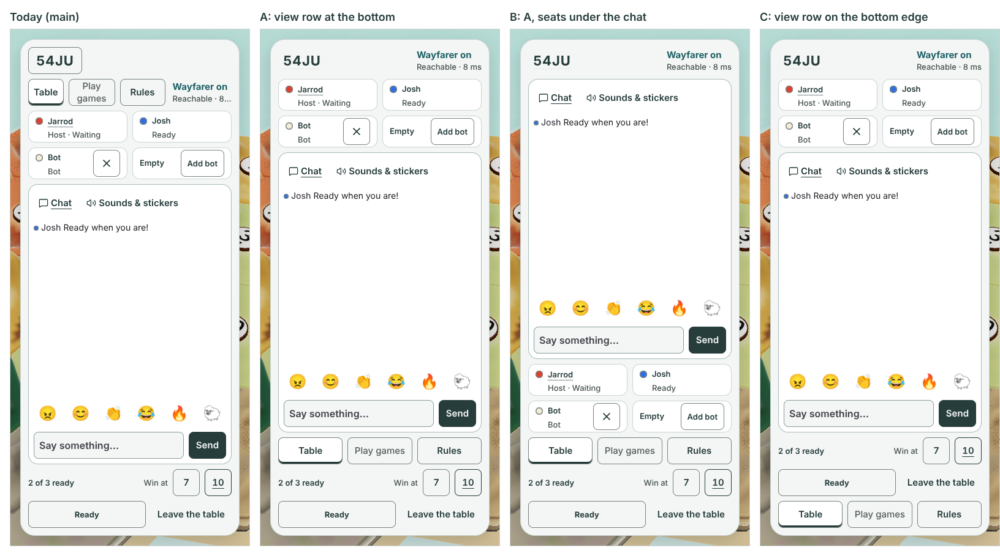
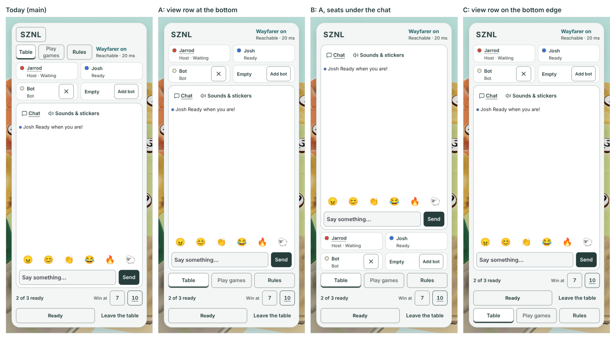
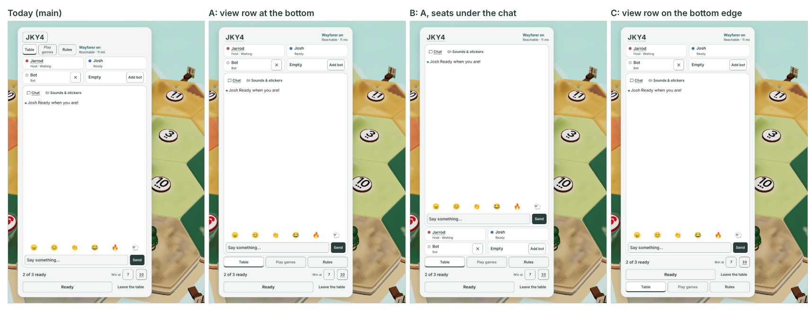
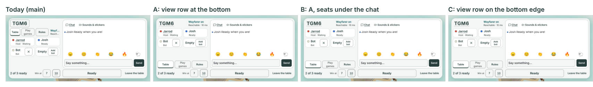
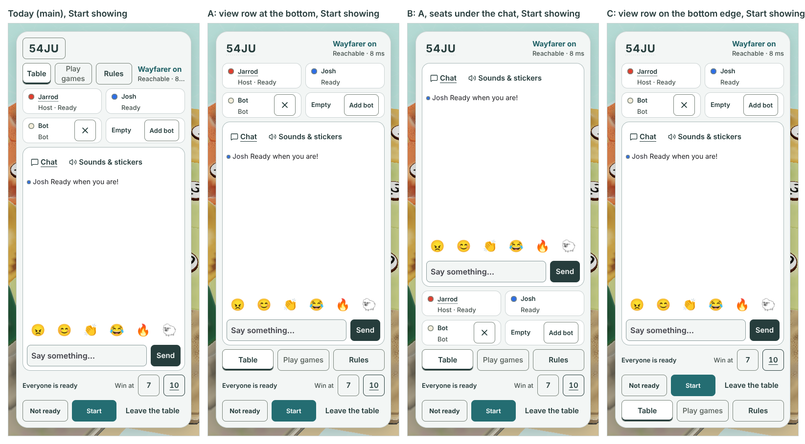

# Lobby reach: bring the controls down to the thumb (Part of #1430)

**Mock and audit only. No game code changes.** Author: Fable 5.1, 2026-11-09. Measured on `main` at `2f0c2932` (a docs-only PR; later merges do not change these numbers).

On Desk Decisions card `q1430-wasted-space` the owner chose D, "something else", on 2026-11-09 at 04:03 UTC. The note said: "The top seems really far to reach." The code placement comes from card `q1430-code-placement`, owner answer C (underlined text code), 2026-11-08. His players hold a phone upright, or an iPad upright. One hand holds the phone, and the thumb does the tapping. Today the code, the view row and the seat buttons sit at the top. That is a long stretch. This mock measures the stretch and shows three ways to shorten it. After this mock the owner chose D again on card `q1470-lobby-reach`, 2026-11-09 at 04:23 UTC: "Chat stays in middle, names stay up top since you don't click on em". The desk reads that as option A.

## What stands

Every earlier owner answer is kept in all three options.

- A tap on the code copies the join link. There is no copy icon and no label beside the code. The Copied fade stays.
- The code is underlined title text at the left of the header. The Wayfarer and connection lines sit at its right (`q1430-code-placement`, option C, PR #1456).
- Table and Play games are two boxes 8 px apart. Rules is a third box.
- No cream. The chat log is 16 px here, above the 14 px floor. The chat keeps its other floors. Every target is 44 px, and every gap is 8 px.
- The lobby text sizes from PR #1388 do not change.

## How the pictures were made

Real game, real lobby. [`capture.mjs`](capture.mjs) starts the real local host and Vite on this checkout. It opens a real host (Jarrod) and a real guest (Josh, Ready, one chat line). It adds a bot and leaves one seat empty. It takes the "today" picture. Then it injects throwaway CSS and one DOM move into the page and takes A, B and C. Then the host taps Ready, so Start shows, and it measures all four again. Nothing in `src` is edited. Chromium 153.0.8010.12, reduced motion, 0 browser errors.

Sizes: 430 x 932, 390 x 844, 375 x 812, 820 x 1180 and 844 x 390. The numbers are in [`measurements.json`](measurements.json) and [`capture.log`](capture.log).

**Distances.** Every number below is the gap from a control's bottom edge to the screen's bottom edge, in px. The thumb bands follow the brief. **Easy** is the bottom third of the screen. **Stretch** is the middle third, and **hard** the top third. A control's band comes from its centre.

## 1. Today, measured

Start showing, three seats and one empty seat. The host taps column is a judgement, not a measurement.

| Control | Host taps per table | 430 x 932 | 390 x 844 | 375 x 812 | 820 x 1180 | 844 x 390 |
|---|---|---|---|---|---|---|
| Code (tap copies the link) | once | 859 (hard) | 771 (hard) | 743 (hard) | 1091 (hard) | 321 (hard) |
| Table tab | few | 807 (hard) | 719 (hard) | 691 (hard) | 1039 (hard) | 269 (hard) |
| Play games tab | few | 807 (hard) | 719 (hard) | 691 (hard) | 1039 (hard) | 269 (hard) |
| Rules | rare | 807 (hard) | 719 (hard) | 691 (hard) | 1039 (hard) | 269 (hard) |
| Add bot | 0 to 3 | 691 (hard) | 603 (hard) | 575 (hard) | 923 (hard) | 153 (stretch) |
| Remove bot | rare | 691 (hard) | 603 (hard) | 575 (hard) | 923 (hard) | 153 (stretch) |
| Your name | rare | 755 (hard) | 667 (hard) | 639 (hard) | 987 (hard) | 217 (stretch) |
| Chat and Sounds tabs | few | 626 (hard) | 538 (stretch) | 510 (stretch) | 858 (hard) | 312 (hard) |
| Emoji row | many | 194 (easy) | 194 (easy) | 190 (easy) | 210 (easy) | 138 (stretch) |
| Chat input and Send | many | 142 (easy) | 142 (easy) | 138 (easy) | 158 (easy) | 86 (easy) |
| Win at 7 and 10 | rare | 81 (easy) | 81 (easy) | 77 (easy) | 97 (easy) | 25 (easy) |
| Ready, Start, Leave | once each | 29 (easy) | 29 (easy) | 25 (easy) | 45 (easy) | 25 (easy) |

What this says:

- Upright, 9 of 17 controls sit in the hard band at 430 and on the iPad. At 390 and 375 it is 7. On the iPad the code is 1,091 px from the bottom edge.
- The chat, Ready and Start are already where the thumb is. The owner's players use them most.
- The reach problem is the two top rows and the seat buttons. The view row is tapped a few times per table. Add bot is tapped up to three times, by the host only.

## 2. Which controls the host needs most

In the order a host meets them per table: copy the link (once), then Add bot (0 to 3). Then chat and emoji (many), Play games (a few, while waiting), Ready and Start (once). Rules, Remove bot, Your name, Win at and Leave are rare.

So the frequent controls that are far today are the view row and Add bot. The code is far too, but it is tapped once and read aloud many times. Reading needs no reach. The code stays at the top in every option below.

## 3. Three options

All three share the same base: the header holds the code and the status (PR #1456, option C). The view row leaves the top and fills its row as three equal boxes. The chat panel keeps its size in every option, so the chat floors do not move.

| Option | What moves | One line |
|---|---|---|
| **A (recommended)** | The view row drops to just above the "2 of 3 ready" row | The view row comes to the thumb, the chat stays where it is |
| **B** | A, and the seats move under the chat | Every host control but the code sits in the bottom half, the chat input rises to mid screen |
| **C** | The view row sits on the card's bottom edge, under Ready and Start | The view row at the very bottom, with Start one row up |

### Pictures

Left to right: today, A, B, C. Each column is the real lobby at that size.

| Size | Picture |
|---|---|
| 390 x 844 |  |
| 430 x 932 |  |
| 820 x 1180 |  |
| 844 x 390 |  |
| 375 x 812 | [compare-375x812.png](compare-375x812.png) |
| 390 x 844, Start showing |  |

Single pictures: `today-`, `a-`, `b-` and `c-<size>.png`, plus `<state>-start-390x844.png`.

### A (recommended): the view row at the bottom

Rows, top to bottom: header (code and status), seats, chat, view row, summary with Win at, Ready and Start.

- The view row (Table, Play games, Rules) moves from 719 px to 133 px from the bottom at 390 x 844. That takes it from hard to easy at every upright size.
- The chat input moves up 52 px, to 194 px from the bottom. It stays in the easy band at every upright size.
- Add bot stays at the top, 655 px from the bottom at 390. It moves up 52 px, because the view row left row 2.
- Start stays on the bottom edge, as today. Every player already knows where Ready and Start are.
- Easy band: 8 of 17 controls today, 11 with A, at 430, 390, 375 and 820. Hard band: 7 today at 390 and 375, 9 at 430 and 820, and 6 with A at all four.

Why A first: the chat is tapped most, and A keeps it where it is. A bottom row of view buttons is a common phone pattern. It reads as a switch for the content above it.

### B: A, and the seats under the chat

Rows: header, chat, seats, view row, summary, Ready and Start.

- Add bot and Remove come down from 603 px to 189 px from the bottom at 390. Your name comes to 253 px. All easy.
- The chat input rises to 314 px from the bottom at 390 (stretch band). On the iPad it is 330 px, still easy on a 1,180 px screen.
- The chat tabs move to the top band, 710 px at 390. The chat panel now starts under the header.
- Easy band: 11 of 17 at 390, with 3 in stretch and 3 in hard. On the iPad 13 of 17 are easy.
- The cost: the chat log reads top to bottom. Its newest line and its input now sit mid screen, above the seats. Messaging apps keep the input at the bottom edge. B breaks that habit to bring Add bot down.

Pick B if Add bot matters more than the chat input. Only the host taps Add bot, up to three times per table. Everyone types in the chat.

### C: the view row on the card's bottom edge

Rows: header, seats, chat, summary, Ready and Start, view row.

- The view row sits 29 px from the bottom edge at 390.
- Ready, Start and Leave move up one row, to 81 px from the bottom. Win at moves to 133 px. All still easy.
- Everything else is as in A. The band counts are the same as A.
- The cost: Start leaves the bottom edge. The row every player taps once per game moves up 52 px for a row tapped a few times. The summary, Ready and view row also read as three stacked rows with no content between them.

### Sideways (844 x 390)

Every option is the same sideways. The view row moves to the bottom of the left column, right above Ready. It takes the 72 px hole under the seats that the earlier audit found. The chat keeps the right column from top to bottom, 486 x 288 as today.

- View row: 269 px (hard) today, 77 px (easy) in A, B and C.
- Add bot: 153 px today, 205 px with the move (both stretch). Your name: 217 px today, 269 px (hard).
- Play games wraps to two lines, as today, because each box is 92 px wide. The 44 px box holds both lines.
- 667 x 375 was not measured. Its left column is 263 px, so the three boxes would be 82 px each. The builder measures it.

## 4. Measured, per option

Distances from the bottom edge at 390 x 844, Start showing. The other sizes are in [`capture.log`](capture.log) and [`measurements.json`](measurements.json). They move the same way.

| Control | Today | A | B | C |
|---|---|---|---|---|
| Code (tap copies the link) | 771 (hard) | 771 (hard) | 771 (hard) | 771 (hard) |
| Table and Play games tabs | 719 (hard) | 133 (easy) | 133 (easy) | 29 (easy) |
| Rules | 719 (hard) | 133 (easy) | 133 (easy) | 29 (easy) |
| Add bot and Remove bot | 603 (hard) | 655 (hard) | 189 (easy) | 655 (hard) |
| Your name | 667 (hard) | 719 (hard) | 253 (easy) | 719 (hard) |
| Chat and Sounds tabs | 538 (stretch) | 590 (hard) | 710 (hard) | 590 (hard) |
| Emoji row | 194 (easy) | 246 (easy) | 366 (stretch) | 246 (easy) |
| Chat input and Send | 142 (easy) | 194 (easy) | 314 (stretch) | 194 (easy) |
| Win at 7 and 10 | 81 (easy) | 81 (easy) | 81 (easy) | 133 (easy) |
| Ready, Start, Leave | 29 (easy) | 29 (easy) | 29 (easy) | 81 (easy) |
| Controls in the easy band | 8 of 17 | 11 | 11 | 11 |
| Controls in the hard band | 7 of 17 | 6 | 3 | 6 |

Same table at 820 x 1180:

| Control | Today | A | B | C |
|---|---|---|---|---|
| Code | 1091 (hard) | 1091 (hard) | 1091 (hard) | 1091 (hard) |
| Table, Play games, Rules | 1039 (hard) | 149 (easy) | 149 (easy) | 45 (easy) |
| Add bot and Remove bot | 923 (hard) | 975 (hard) | 205 (easy) | 975 (hard) |
| Chat input and Send | 158 (easy) | 210 (easy) | 330 (easy) | 210 (easy) |
| Ready, Start, Leave | 45 (easy) | 45 (easy) | 45 (easy) | 97 (easy) |
| Controls in the easy band | 8 of 17 | 11 | 13 | 11 |

Rule checks, every option, every size, both states:

| Check | Result |
|---|---|
| Targets 44 x 44 or more | All 17, in every state |
| Smallest gap between two targets | 8 px, in every state |
| Card scrolls | Never |
| Status lines fit (caption and connection) | Today: cut at 390, 375 and 844 x 390. A, B and C: fit at all five sizes |
| Chat panel | Unchanged: 332 x 458 at 390, 518 x 762 on the iPad, 486 x 288 sideways |
| Chat share of the card | Unchanged: 52.3% at 390 x 844, 48.2% at 844 x 390 (floors 52% and 39%) |
| Code size and underline | 22 px on phones, 28 px on the iPad and sideways; dotted underline in A, B and C |
| View row boxes | 105 px each at 390, 119 at 430, 103 at 375, 167 on the iPad, 92 sideways |
| Play games on one line | Yes upright in A, B and C (two lines today). Two lines sideways, as today |

## 5. The spec rows (what a builder would do)

Shared by every option, `src/components/game/lobby.css` and `LobbyView.tsx`:

1. PR #1456's option C rows: move `.lobby-rule-status` into `.lobby-header`, after the code. `.lobby-header { justify-content: space-between }`. The code loses its box and gains the dotted underline.
2. The view row fills its width: `.lobby-rules { display: grid; grid-template-columns: calc((100% - 16px) * 2 / 3 + 8px) minmax(0, 1fr); gap: 8px }`. `.lm { display: grid; grid-template-columns: repeat(2, minmax(0, 1fr)) }`. Drop the 76 px width and the 60 px span cap in the `max-width: 900px` block.
3. Sideways (`max-height: 600px and landscape`): `grid-template-rows: 44px 112px minmax(0, 1fr) 44px`. Seats in row 2, `.lobby-rules { grid-row: 3; align-self: end }`, chat and `.ly` rows 1 to 3, actions row 4.
4. The 320 x 568 and 390 x 640 block (`max-height: 700px and portrait`) sets its own rows. Reorder it the same way, then measure at 320 x 568.
5. Keyboard order. The DOM order stays code, view row, Rules, seats, chat, Ready. With the row at the bottom, Tab would jump from Rules up to the seats. Better: move the `.lobby-rules` block in `LobbyView.tsx` to just before `.lobby-actions` (A and B) or after it (C). It is a JSX move with no new strings. LobbyView is at about 2,480 B of its 2,500 B ceiling, so measure. If it does not fit, keep the CSS order and say so in the PR.
6. `.lobby-copy-fallback { top: 60px }` now lies over the seats, not the view row. It is a transient panel. No change.

A only, the base grid: `grid-template-rows: 44px 112px minmax(0, 1fr) 44px 96px`. `.lobby-players { grid-row: 2 }`, `.lobby-chat-panel { grid-row: 3 }`, `.ly { grid-row: 2 / 4 }`, `.lobby-rules { grid-row: 4 }`, `.lobby-actions { grid-row: 5 }`.

B only: `grid-template-rows: 44px minmax(0, 1fr) 112px 44px 96px`. Chat row 2, seats row 3, `.ly { grid-row: 2 / 4 }`, view row 4, actions row 5.

C only: `grid-template-rows: 44px 112px minmax(0, 1fr) 96px 44px`. Seats row 2, chat row 3, `.ly { grid-row: 2 / 4 }`, actions row 4, view row 5.

Size: 0 B of JS for the CSS rows. The two JSX moves (status and view row) add no strings. `lobby.css` has no ceiling.

## 6. Proof lines

- `lobby-layout-prove.mjs:304` chat floors (.52, .39, .40): pass, the chat panel is unchanged.
- `lobby-layout-prove.mjs` codeDy and the 8 px label padding on `.lobby-header button`: pass, the header row is unchanged.
- `lobby-code-copy-prove.mjs:197` "the header row keeps the full width" against `.lobby-rules`: pass, both are full width.
- `lobby-code-copy-prove.mjs:169` sideways, `near(chat.bottom, players.bottom)`: **one replaced line** under the 2026-10-25 rule. The chat now runs down to the view row, so it becomes `near(chat.bottom, rules.bottom)`. Own commit, old/new table in the PR.
- `lobby-wait-box-prove.mjs:205` and `lobby-tictactoe-prove.mjs:109` (game above `lobby-actions`): pass in A, B and C. The `.ly` block always ends above the actions row.
- `connection-health-prove.mjs:341` to `366` wants the status inside the lobby at 320, 390, 667 x 375 and 844 x 390. PR #1456 measured the header move at four of its sizes. Re-run it after step 4.
- `chat-prove.mjs:509` and `:561` (card margins, four whole lines): pass, the card and the chat panel are unchanged.
- Add a line to `lobby-code-copy-prove` at 390 x 844 and 820 x 1180. In A and B the view row starts below the chat panel.
- In C, the view row starts below `lobby-actions`.
- Add one more check sideways: the view row ends 8 px above `lobby-actions`.

## 7. Things to look at

- Desktop (1280 x 720) gets the same rows, because the base grid changes. It was not measured here. A mouse has no reach problem, but one layout everywhere is simpler and keeps one proof set.
- 320 x 568, 390 x 640 and 667 x 375 were not measured. Steps 3 and 4 cover them, and the builder measures.
- With the view row at the bottom, the top of the card holds the header and the seats only. The chat log keeps its height at every size, because every row keeps its height. The wasted space audit on #1430 (comment 6718930663) covers that separately.
- In B, the seats sit between the chat input and the summary. A seat bubble (a reaction) then appears mid screen, not at the top.
- In C, the view row touches the bottom edge of the card. On a phone with a home indicator the card already keeps `env(safe-area-inset-bottom)`, so nothing is covered.
- The equal thirds for the view row is a look choice. The alternative is today's widths, left aligned, with about 160 px empty at the right at 390. The pictures show the equal thirds.
