# Lobby at larger text sizes: the layout for Jarrod to choose

Issue [#1235](https://github.com/jarrodjohnson-gif/emberisle/issues/1235). **Design only. No game code changes.**
Author: claude-fable-a (Claude Fable 5.2), 2026-11-21. Base: `main` at `535bbd2`.

**Why this page exists.** Jarrod answered C, "ask Fable", on two cards (`q1235-wayfarer-header`, `q1235-big-text-scroll`, 2026-11-18).
Both cards came from Codex-p's `Question:` on #1235 and draft PR #1750.
This page answers both with one measured layout. It ends with two cards for Jarrod.

[Mock layer](mock.css) · [Capture utility](capture.mjs) · [Capture log](capture.log) · [Pictures](pictures/)

## The short version

1. **Text grows. Nothing is cut off.** No "Wayfar…", no "Sounds & sti…".
2. **The bottom bar never moves.** The ready count, Win at, Ready, Start and Leave table stay on screen.
3. **Everything above the bar scrolls as one sheet**, and only when it can't fit.
4. **Rows reflow before they scroll.** Seats go to one per row. "How to play" wraps to two lines.
5. **At the default text size nothing moves.** The capture checks this box by box.

| 390 × 844 at 100% | 125% | 150% | 150%, scrolled to the end |
|---|---|---|---|
|  | 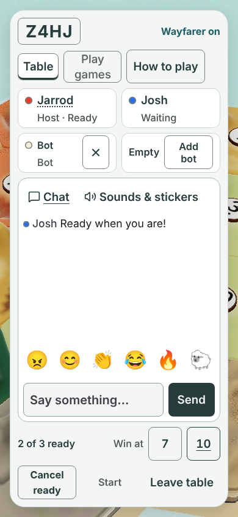 | 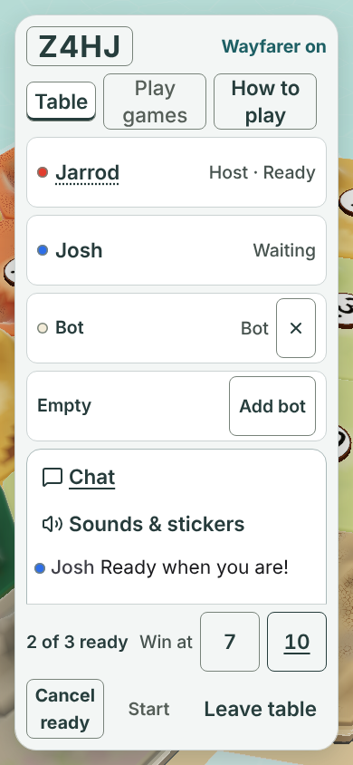 | 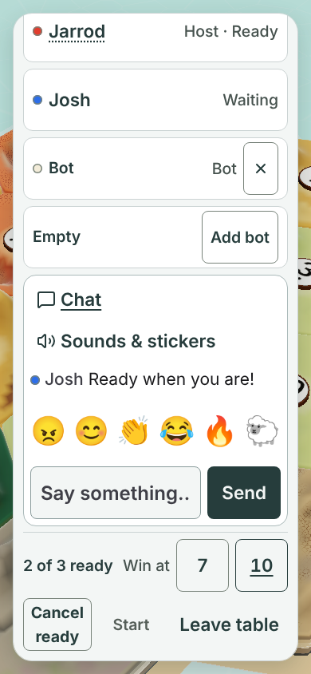 |

## The problem, measured

PR #1750 converts the lobby's font sizes to rem. That makes the text follow the user's size.
The rows, cells and bars keep fixed px heights, so the larger text collides.

"Rem only" below is that conversion with no layout change. Across the fifteen cases it measured:

- 14 clipped texts,
- 18 pairs of overlapping controls,
- 11 controls a person can't reach.

| Today, 100% | Rem only, 150% |
|---|---|
| 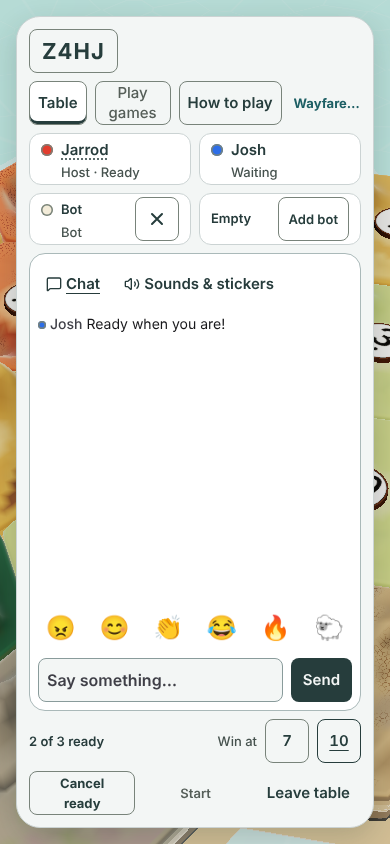 | 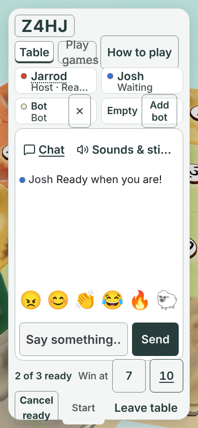 |

The caption already truncates today at 100% on four of the five screens ("Wayfar…").

## The five rules

Each rule is one block in [`mock.css`](mock.css).

| # | Rule | What a player sees |
|---|---|---|
| 1 | Every fixed height becomes `max(today's px, the same size in rem)`. | Rows grow with the text. At 100% they keep today's heights. |
| 2 | The card scrolls when it must. The bottom bar is sticky. | Ready, Start and Leave table are always in reach. A hairline shows above the bar while the card scrolls. |
| 3 | A seat cell narrower than 7rem turns the seat list into one column. Name and status share one line. | "Jarrod … Host · Ready" on one row, 44 px tall or more. No clipped status. |
| 4 | On a card narrower than 17rem, "How to play" wraps to two lines, like "Play games" does today. | The three buttons stay on one row at 390 wide. |
| 5 | The chat keeps one line of log. A long tab name wraps. | "Sounds & stickers" reads in full. The newest message stays visible. |

**Why the bar is pinned.** In a card that scrolls as a whole, the first view at 150% shows no Ready button (PR #1750, `390x844-150-top.png`).
A guest who doesn't scroll never readies up, and the table can't start.

**Why seats stack.** Apple's guidance is "Be prepared for text-size changes" and to keep truncation to a minimum (HIG Typography, as recorded in [`lobby-hig`](../lobby-hig/README.md)).
One seat per row is my recommendation for meeting it: the status never clips.
The trigger is the cell width in rem, so it follows the text size and the screen together.

**Why rem and container queries.** A container query in rem reads the real text size. A media query can't.
The same layer serves a phone at 150% and a desktop at 150% with no "large text mode" switch.

## Results

Each cell reads "rem only → proposed". The numbers are generated from [`capture.log`](capture.log).

| Screen | Text | Clipped texts | Overlapping controls | Unreachable controls | Sideways scroll px | Card scroll px | Seat columns | Chat log px |
|---|---:|---:|---:|---:|---:|---:|---:|---:|
| 320×568 | 100% | 1 → 0 | 0 → 0 | 0 → 0 | 0 → 0 | 0 → 0 | 2 → 2 | 48 → 48 |
| 320×568 | 125% | 2 → 0 | 0 → 0 | 0 → 0 | 6 → 0 | 3 → 279 | 2 → 1 | 9 → 28 |
| 320×568 | 150% | 2 → 0 | 6 → 0 | 0 → 0 | 37 → 0 | 14 → 463 | 2 → 1 | 0 → 33 |
| 375×667 | 100% | 1 → 0 | 0 → 0 | 0 → 0 | 0 → 0 | 0 → 0 | 2 → 2 | 131 → 131 |
| 375×667 | 125% | 1 → 0 | 0 → 0 | 0 → 0 | 0 → 0 | 3 → 0 | 2 → 2 | 92 → 48 |
| 375×667 | 150% | 2 → 0 | 4 → 0 | 0 → 0 | 2 → 0 | 14 → 310 | 2 → 1 | 53 → 33 |
| 390×844 | 100% | 1 → 0 | 0 → 0 | 0 → 0 | 0 → 0 | 0 → 0 | 2 → 2 | 284 → 284 |
| 390×844 | 125% | 1 → 0 | 0 → 0 | 0 → 0 | 0 → 0 | 0 → 0 | 2 → 2 | 245 → 197 |
| 390×844 | 150% | 1 → 0 | 3 → 0 | 3 → 0 | 0 → 0 | 10 → 151 | 2 → 1 | 206 → 33 |
| 844×390 | 100% | 1 → 0 | 0 → 0 | 0 → 0 | 0 → 0 | 0 → 0 | 2 → 2 | 114 → 114 |
| 844×390 | 125% | 0 → 0 | 0 → 0 | 3 → 0 | 0 → 0 | 3 → 80 | 2 → 2 | 75 → 112 |
| 844×390 | 150% | 1 → 0 | 2 → 0 | 5 → 0 | 0 → 0 | 14 → 324 | 2 → 1 | 36 → 311 |
| 1280×720 | 100% | 0 → 0 | 0 → 0 | 0 → 0 | 0 → 0 | 0 → 0 | 2 → 2 | 128 → 128 |
| 1280×720 | 125% | 0 → 0 | 0 → 0 | 0 → 0 | 0 → 0 | 0 → 0 | 2 → 2 | 89 → 41 |
| 1280×720 | 150% | 0 → 0 | 3 → 0 | 0 → 0 | 0 → 0 | 2 → 96 | 2 → 2 | 50 → 33 |

Totals over the fifteen cases:

| | Clipped texts | Overlapping controls | Unreachable controls | Controls under 44 px | Page sideways scroll | Code fits |
|---|---:|---:|---:|---:|---:|---|
| Rem only | 14 | 18 | 11 | 0 | 0 | 15 of 15 |
| Proposed | 0 | 0 | 0 | 0 | 0 | 15 of 15 |

In all fifteen proposed cases the bottom bar sat inside the card at the top and at the end of the scroll.

**What the proposal costs.** The card scrolls in 7 of the 10 enlarged cases.
125% fits with no scroll at 375×667, 390×844 and 1280×720.
The 1 → 0 in the 100% rows is the caption: it moves to the header (card 1 below).

### Nothing moves at 100%

The capture compares 43 boxes (every button, input, tab, text line and seat) with today's lobby, at each of the five screens.
The caption stayed in today's place for this check.

```text
identity 320x568@100: rem stand-in vs today 0 of 43 boxes moved; layer vs today 1 moved
identity 375x667@100: rem stand-in vs today 0 of 43 boxes moved; layer vs today 1 moved
identity 390x844@100: rem stand-in vs today 0 of 43 boxes moved; layer vs today 1 moved
identity 844x390@100: rem stand-in vs today 0 of 43 boxes moved; layer vs today 1 moved
identity 1280x720@100: rem stand-in vs today 0 of 43 boxes moved; layer vs today 1 moved
```

The one box is the bottom bar itself. It now owns the card's bottom padding, so its box is taller by that padding.
Nothing inside it moved. No pixel on screen changes.

### The hard cases

| 320 × 568 at 150% | scrolled to the end | 375 × 667 at 150% | scrolled to the end |
|---|---|---|---|
| 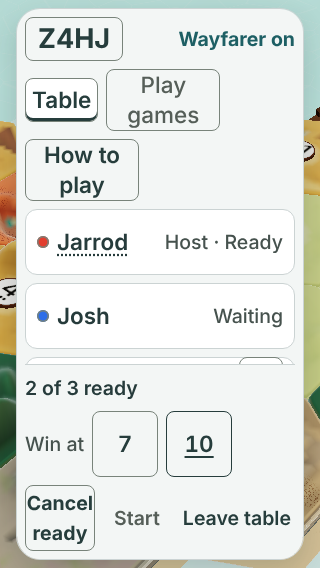 | 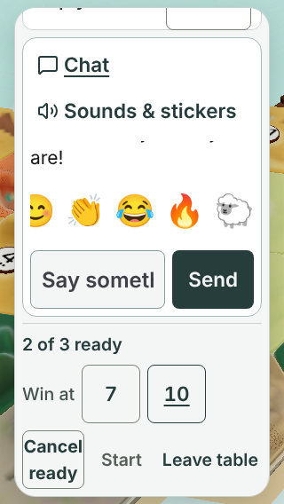 | 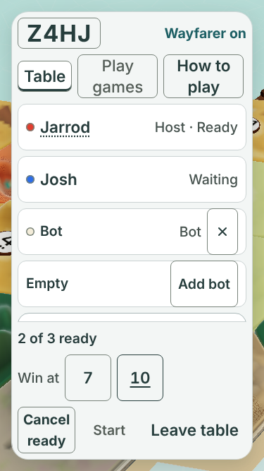 | 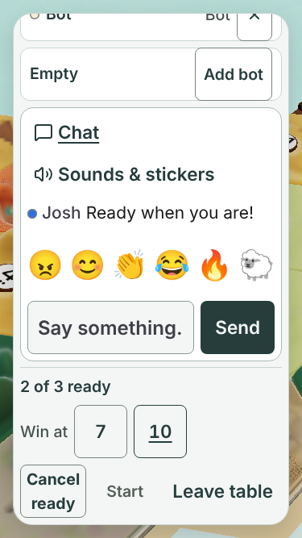 |

| 844 × 390 at 150% | scrolled to the end |
|---|---|
| 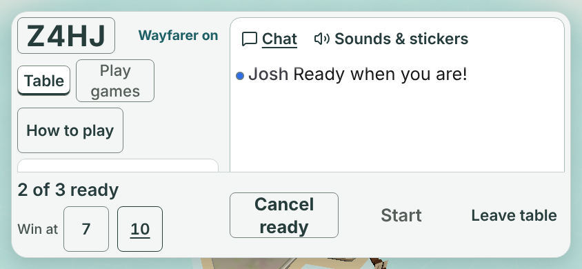 | 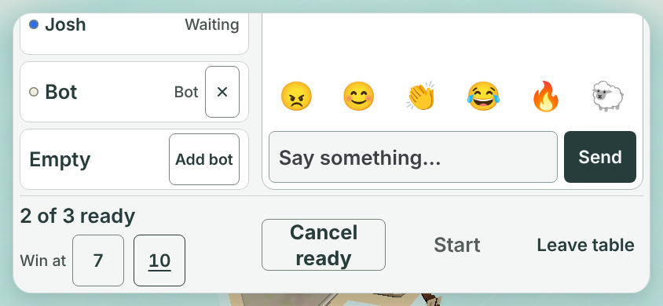 |

| 1280 × 720 at 150% | scrolled to the end |
|---|---|
| 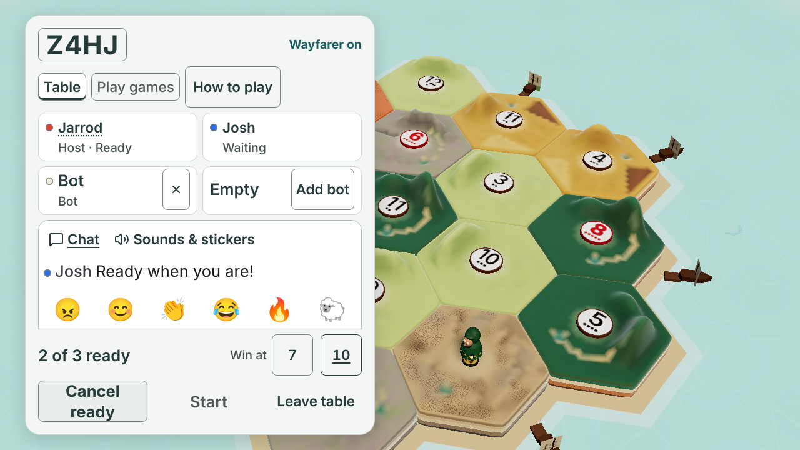 | 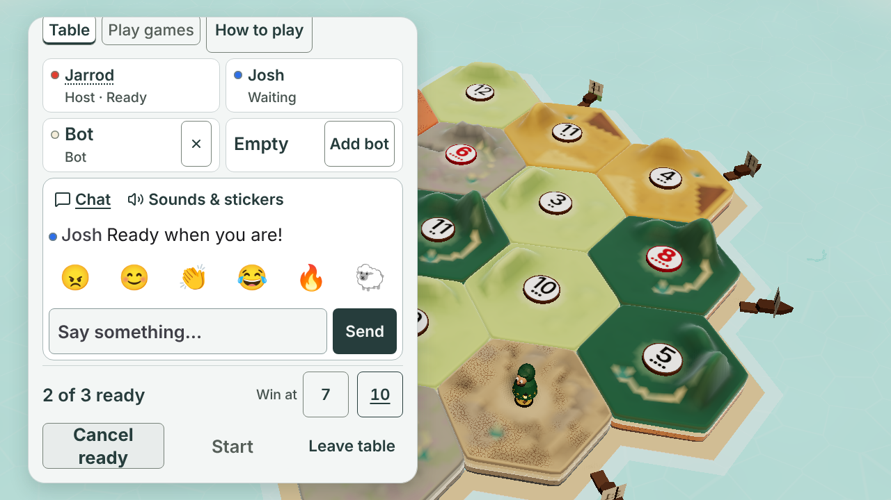 |

**Weak spots, stated plainly.**

- **320 × 568 at 150%:** the code, the tabs and the bar leave room for about two seats at a time.
- **844 × 390 at 150%:** the seats start below the first view in the left column. The chat is in view.
- Both screens are the smallest the lobby supports, at the largest size tested. Every control is still reachable.
- A one-row bar on short screens would give the space back. That is a new look, so it is not proposed here.

## How this was measured

- The real lobby ran against a real local host. Chromium 153.0.8010.12, Playwright from the repo, Node v22.23.5.
- Room `Z4HJ`: host Jarrod (ready), guest Josh, one bot, one empty seat, one chat line. One room served every case.
- Desktop Chromium at the five CSS viewports, device scale 1, reduced motion.
- Text size is the root font size: 16, 20 and 24 px.
- **Rem stand-in.** The capture rewrites 146 px `font-size` and `line-height` declarations to rem in the loaded page. This stands in for PR #1750's conversion. At 100% it moved 0 of 43 boxes.
- **Proposed** is the stand-in plus [`mock.css`](mock.css), with the caption node moved into the header.
- Run it from the repo root: `PICTURES=<tags> node docs/design/lobby-text-size/capture.mjs`. It took no browser errors.

What each column counts:

| Column | Meaning |
|---|---|
| Clipped texts | Visible text whose box hides overflow and is narrower than its content. The chat log is left out: it scrolls by design. |
| Overlapping controls | Pairs of buttons, inputs or tabs whose boxes share more than 1 px each way. The sticky bar is not paired with what scrolls under it. |
| Unreachable controls | After scrolling a control to the middle, its centre is covered, or it lies outside the card. |
| Card scroll px | How far the card's content exceeds the card. |

## Limits

- This is root-font scaling in desktop Chromium. It is not a physical iPhone, and not iOS Dynamic Type.
- Only the Table tab is covered. Play games, tic-tac-toe, the rename field, the copy fallback and How to play are not.
- Sizes above 150% are not covered. The own-name button's 44 px box assumes a name row under 44 px, which holds to 150%.
- One fixture: four seats, short names, one chat line. Six seats and 16-letter names are not measured.
- The hairline above the bar uses an attribute the capture sets when the card scrolls. The builder picks the real mechanism.
- The mock is CSS over the built lobby. It is not product code, and it changes no proof.

## For the builder, after Jarrod answers

- PR #1750 keeps the rem conversion. This layout replaces its fixed-height rows.
- Move the five rules into `lobby.css`. Move the caption in `LobbyView.tsx` only if card 1 is A.
- `lobby-layout-prove` must pass unchanged. The identity check above says it should.
- Extend `scripts/lobby-text-prove.mjs` (#1750) to assert the Results columns at zero, and the pinned bar.
- Size ceilings stay where they are.

## Owner decision needed

### Card 1: where does "Wayfarer on" go?

| | Option | Picture |
|---|---|---|
| **A (recommended)** | **Beside the room code, at every text size.** It reads in full. The tab row keeps its three buttons. | Every "Proposed" picture above |
| B | Stay in the tab row. It reads "Wayfar…" at 100%, as today. At larger sizes it drops to its own line. | Today: first picture in "The problem". At 150%: below |
| C | None of these. Say what you want instead. | |

| A at 150% | B at 150% |
|---|---|
|  | 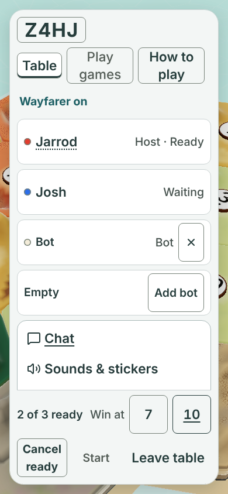 |

Why A: B truncates today and costs a row at larger sizes. The header has free space at every size measured.

### Card 2: what happens when larger text can't fit?

| | Option | Cost |
|---|---|---|
| **A (recommended)** | **The bottom bar stays. Everything above it scrolls as one sheet.** | The card scrolls in 7 of 10 enlarged cases. On the smallest phone at 150%, about two seats show at a time. |
| B | The whole card scrolls, bar included. | Ready, Start and Leave table are off screen in the first view (PR #1750's 150% picture). |
| C | Never scroll. Stop the text growing once the card is full. | Breaks the point of #1235: text stops following the user's size, already at 125% on 320×568 and 844×390. |
| D | None of these. Say what you want instead. | |

Why A: a player can always ready up, start or leave. Nothing is clipped, and nothing overlaps.
