# Mini-games shelf: the lobby design for Jarrod to accept

Issue [#929](https://github.com/jarrodjohnson-gif/emberisle/issues/929). Design only: no game code changes.
Author: Claude Opus 5.5 (builder 2), 2026-11-02. Base: `main` at `39592f6`.

**Why now.** Jarrod on card `q970-waitbox` (2026-10-31): "C, wait for the mini-games shelf design … Get this finished asap we alr had mocks."
- **The starting point** is the mock that already exists ([`docs/design/mini-games-hub`](../mini-games-hub/README.md)). Its structure, screens and wording are kept.
- **What changes:** the mock's look and spacing. They now follow what Jarrod accepted for the lobby on 2026-10-31 ([`docs/design/lobby-hig`](../lobby-hig/README.md), card `q1220-lobby-hig`, answer A): the lobby's **white colours, not the mock's cream**, the lobby text sizes, and 44 px targets.
- **Fit:** a few layout changes so each open game fits above the footer. Every change from the mock is listed below.
- **After Jarrod accepts it,** PR #970's "Play while you wait" box moves into the shelf.

## The design in one paragraph

The lobby card gets two tabs under the room code: **Table** (today's seats and chat, unchanged) and **Play games**.
- **The Play games tab:** opening it swaps the seats and chat for a "While you wait" shelf. The room code, a one-line roster and the Ready footer stay.
- **The shelf:** one tile per game. Only one game is open at a time.
- **Sandwich Stacker** is solo, and runs in #970's Ruffle box inside the tab.
- **Tic-tac-toe** is played with a table-mate, with moves relayed through the host.
- **Start:** when the host presses Start, any open game closes itself and the table never waits.
- **Defaults:** nothing opens by itself, sound is off, and there are no scores.

## The five questions on #929, with the mock's answers (Jarrod accepts or changes)

| # | Question | Recommendation | Why |
|---|---|---|---|
| 1 | One shelf with a tile per game, or one game at a time? | One shelf; one game open at a time | One box keeps the open game above the footer (measured below); a second open game would not fit. |
| 2 | Where does it sit on a phone versus desktop? | A **Play games** tab in the lobby card, on both | A side panel would cover the island. A third chat tab would break Chat C's two-tab rule (DECISIONS 2026-10-20). |
| 3 | Which native game first? | Tic-tac-toe | Small rules, two players, nothing to write. Trivia needs question content and someone to write it. |
| 4 | Does it open by itself? | Only on tap; closed and muted by default | Matches #970 and #937 ("no key capture when closed"). Nothing loads until tapped. |
| 5 | Scores or leaderboards? | None to start | Each needs storage and profile work (#889 series). It is easy to add later. |

## What changed from the mock

All changes are in [`hig-layer.css`](hig-layer.css), applied over the unchanged mock. Nothing is game code.

| Change | Mock as drawn | Proposed | Why |
|---|---|---|---|
| **Colour** | Cream card `#fff9f0`, cream ground `#eeece7`, line `#cbcfc6` | The lobby's white: card `#ffffff`, ground `#f3f6f5`, line `#cbd3d3` (the island's number discs are white too) | Owner: no cream (DECISIONS 2026-10-20); Jarrod on #929: the mock "uses today's cream tokens". |
| Text | 12, 14, 16, 36 and 56 px | Footnote 13/18, Subheadline 15/20, Headline 17/22 semibold; room code 22/28 on a phone and 28/34 on desktop | The accepted lobby scale. |
| Targets | Phone: Copy and Copy link 32 px. Desktop: both tabs, Copy, Copy link, Close, Quit game, Sound and Leave the table at 32 to 36 px | **None under 44 px** at any size drawn | The accepted lobby meets 44 at every size. |
| Gaps | 4 px between the tabs, between Copy and Copy link, and between the Win-at targets; 6 px between board cells | 8 px or more between every pair of neighbouring controls | Spacing scale (law 4). |
| Copy and Copy link | Stacked beside the code | One row beside the code, as in the real lobby (`lobby-copy-controls`) | Frees about 50 px so the open game fits. |
| Tic-tac-toe | Names row, then a separate "Moss's turn" line; 96 px cells; a "Moves go through the host. Nothing is saved." line | Whose turn sits on the names row, between You and Moss; 68 px cells on a phone and 48 px on desktop; the host line is dropped (it describes the build, not something a player needs) | The whole board now ends above the footer at 390×844 and 1280×720. |
| Trivia tile | A locked "Trivia, Soon" tile | Hidden (choice F, as recommended) | The pictures now show the recommendation. |
| "Starting…" stamp | Centred on the screen, covering the card's "Game closed." line on a phone | Over the island: near the top on a phone, to the right of the card on desktop | "Game closed." stays readable. |

## Fit, measured

[`measure.mjs`](measure.mjs) checks every screen at each size. The full output is in [`measure-proposed.txt`](measure-proposed.txt) and [`measure-as-drawn.txt`](measure-as-drawn.txt). For each screen it records:
- the card's top edge and height;
- whether the open game (or the shelf) ends above the sticky footer;
- whether anything covers "Game closed.";
- controls under 44 px, and neighbouring controls closer than 8 px;
- every font size in use.

| Size | Open game or shelf above the footer | Under 44 px | Closer than 8 px | "Game closed." |
|---|---|---|---|---|
| Phone 390×844 | **All six screens fit** (12 px to spare; tic-tac-toe 12 px) | None | None | Visible |
| Desktop 1280×720 | **All six screens fit** (Sandwich Stacker 12 px, tic-tac-toe 7 px to spare) | None | None | Visible |
| Small phone 320×568 | **Does not fit: the card scrolls under its fixed footer.** The shelf scrolls 51 px, Sandwich Stacker 157 px and tic-tac-toe 229 px. | None | Only board cells scrolled under the footer | Visible |
| Sideways phone 844×390 | **Scrolls under the fixed Ready row.** The card is the wide lobby card (812×358), not the 342 px side card. The shelf ends 61 px under, Sandwich Stacker 42 px and tic-tac-toe 88 px. See [The sideways phone](#the-sideways-phone). | None | None | Visible |

At 320×568 the card already fills the screen on the Table tab, so the Play games tab scrolls like the rest of the lobby there. The footer stays put and the game scrolls under it.

## Pictures (proposed)

The pictures are rendered 1:1 from the mock with [`hig-layer.css`](hig-layer.css) on top, by [`capture.mjs`](capture.mjs) (shared setup in [`views.mjs`](views.mjs)). The mock's review callouts and notes column are hidden.

The mock had a bug, fixed for both picture sets: the host's Start button has the class `sea`, which the mock also uses for the full-screen ocean (`position: absolute; inset: 0`), so on host screens Start filled the whole card. The fix is one scoped style in `views.mjs`.

| Screen | Phone 390×844 | Desktop 1280×720 | Small phone 320×568 |
|---|---|---|---|
| A. Lobby, Table tab (Play games closed) | 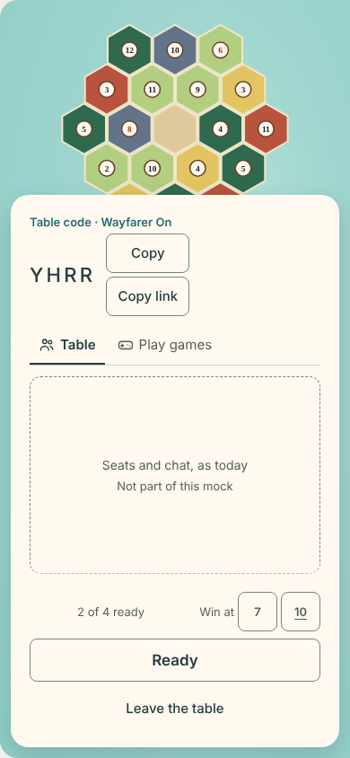 | 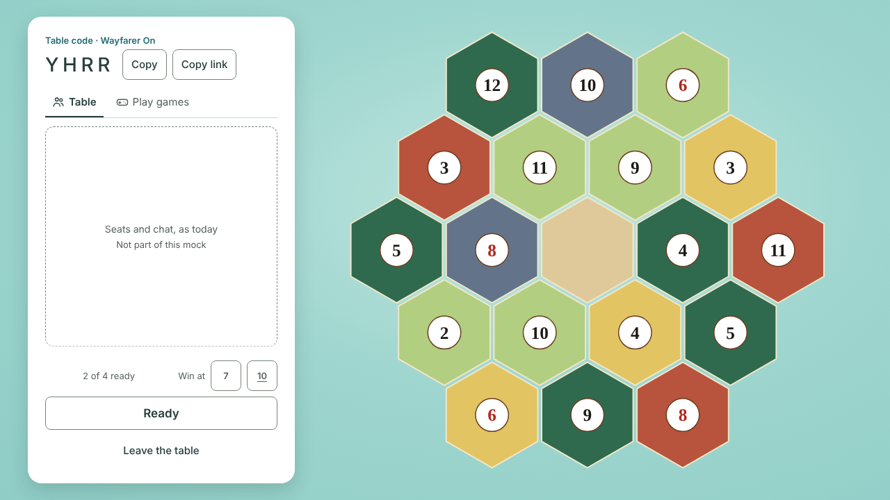 | 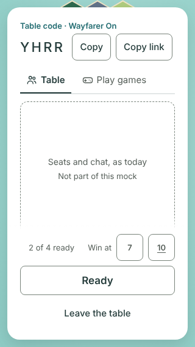 |
| B. The shelf | 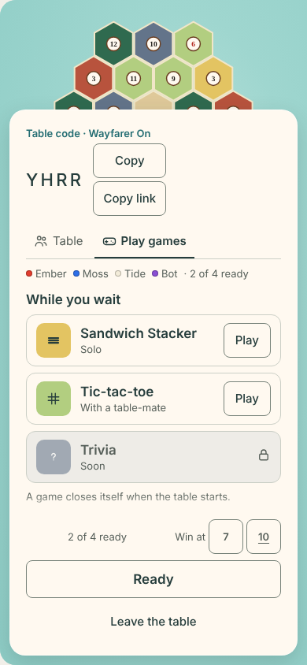 |  | 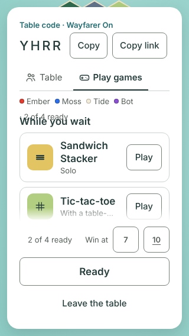 |
| B. Shelf, alone at the table (tic-tac-toe needs a table-mate) | 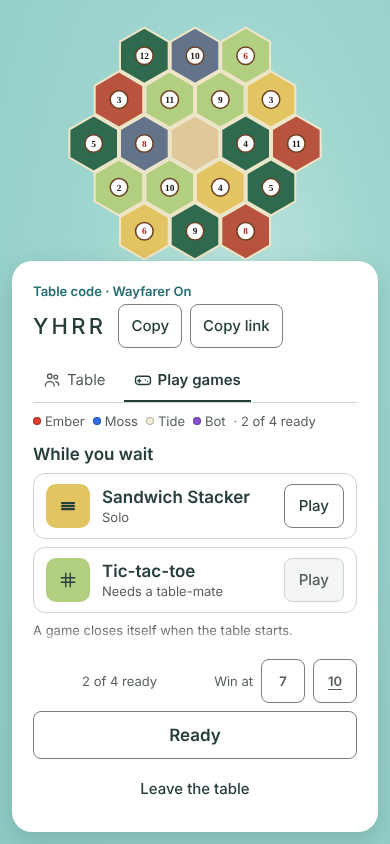 | 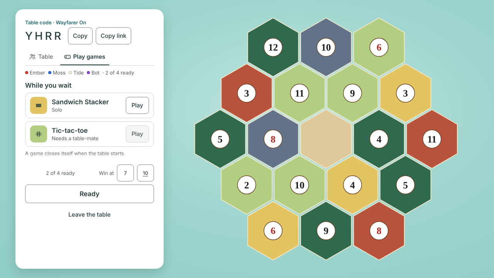 | 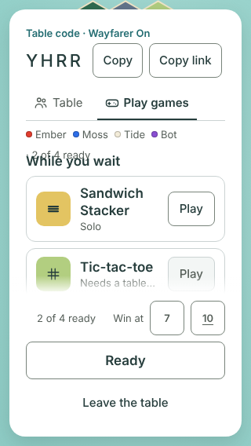 |
| B. Shelf, a table-mate invited you (badge on the tab) | 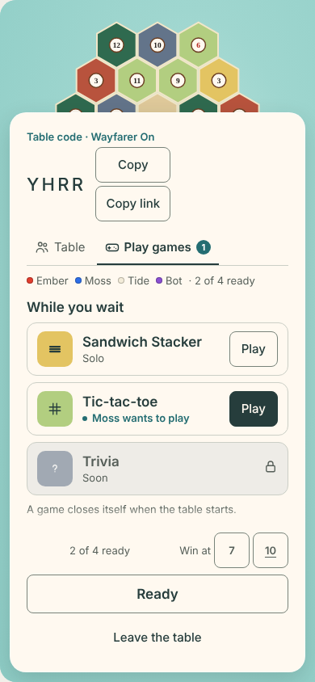 | 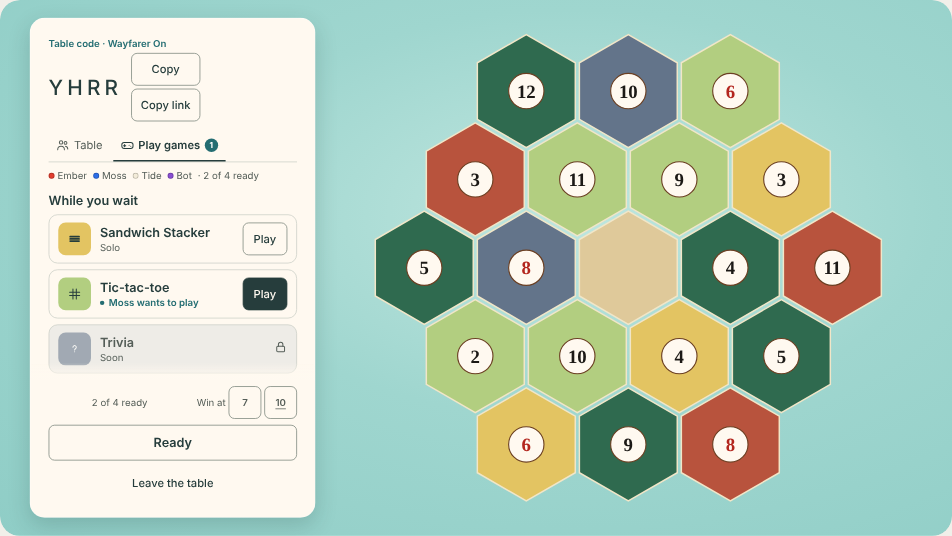 | 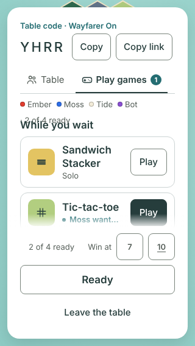 |
| C. Sandwich Stacker open (580:320 stage, muted, Close) | 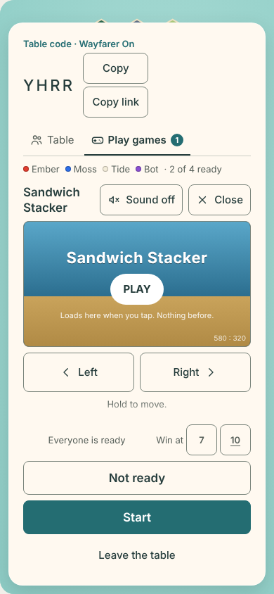 | 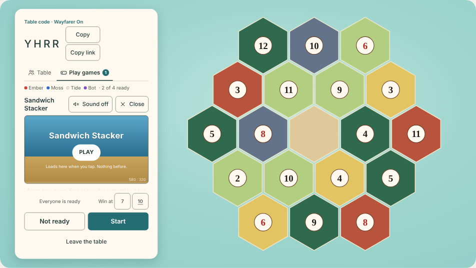 | 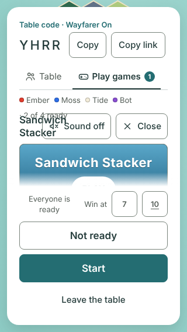 |
| D. Tic-tac-toe with a table-mate | 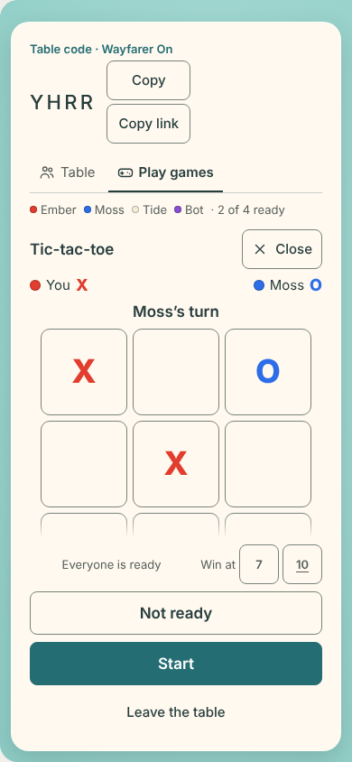 | 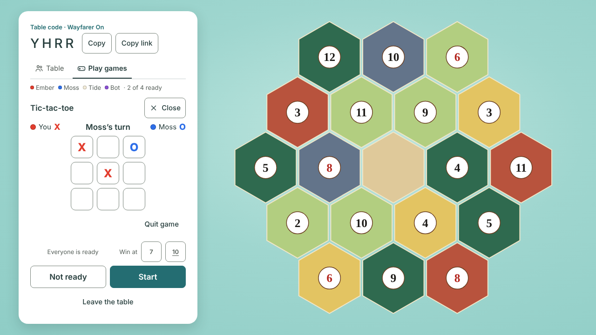 | 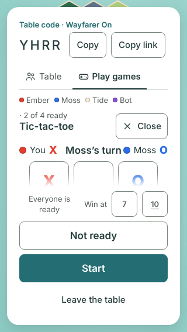 |
| E. Host presses Start: the game closes itself | 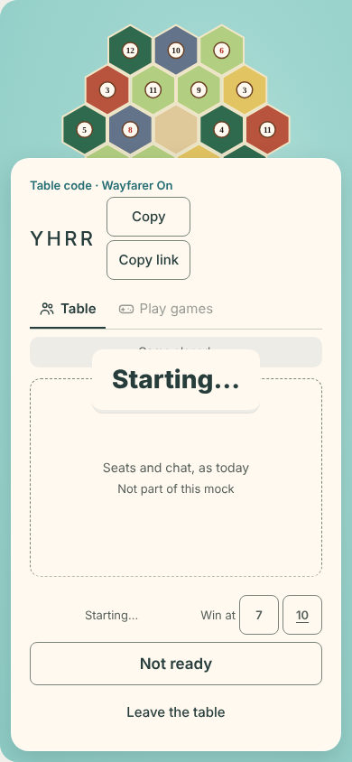 | 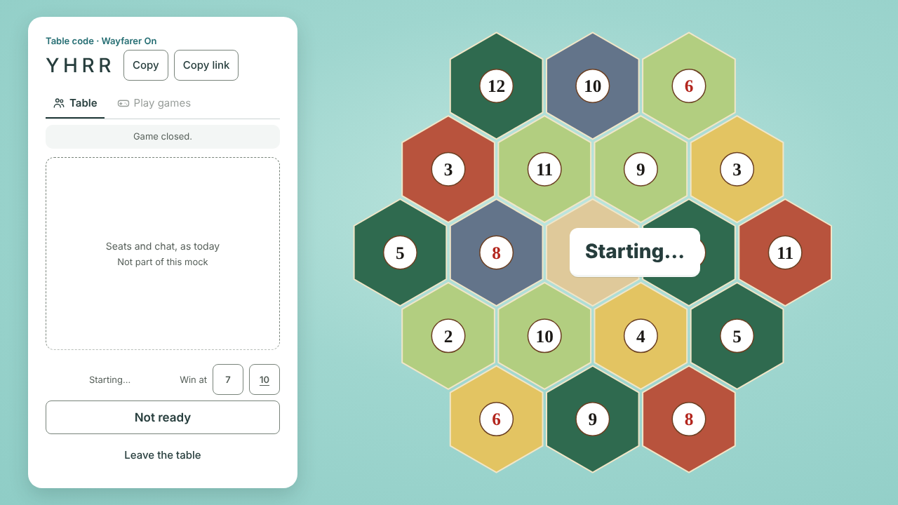 | 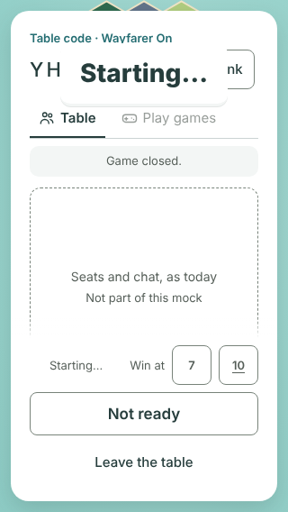 |

Choice D, as recommended:
- **Desktop (screen C):** no Left and Right buttons; the line under the stage reads "Arrow keys move. Keys stay in the game while it has focus."
- **Phone:** the held Left and Right buttons show under the stage.

The same screens as the mock drew them (cream, mock sizes, the Trivia tile) are in [`pictures/as-drawn/`](pictures/as-drawn/), for comparison.

## The sideways phone

Issue [#1264](https://github.com/jarrodjohnson-gif/emberisle/issues/1264) draws 844×390. Grok 4.7, 2026-11-03. Design only.

Choice H is already answered. On a portrait phone the card may grow while a game is open. This section is the sideways phone. It does not need a new owner choice.

The old note used the desktop side card. That card is 342 px tall at 844×390. The real lobby is not that card. At this size the lobby is one wide card, 16 px in from each edge. The card is 812 by 358 px. It stays that size when a game opens. Ready is one fixed row along the bottom. The shelf and the open games are taller than the room above that row. They scroll under Ready. Ready does not move.

The open-game pictures are scrolled so you can see that. Scroll 0 would show only the top of a tall game. These pictures move until the controls meet Ready.

| Screen | Picture | Ends under Ready |
|---|---|---|
| The shelf | 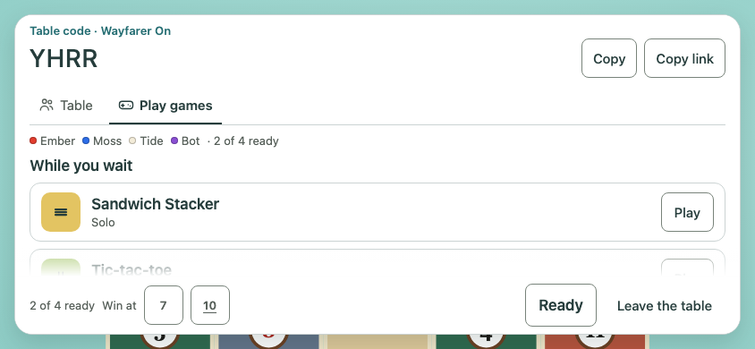 | 61 px |
| Sandwich Stacker open | 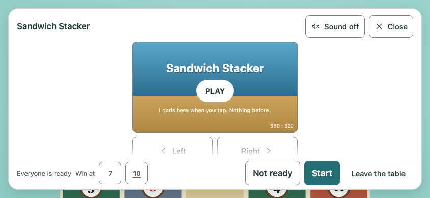 | 42 px |
| Tic-tac-toe open | 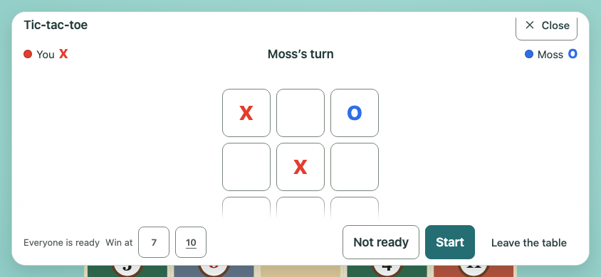 | 88 px |

No control is under 44 px. No two controls sit closer than 8 px. Colours are the lobby white tokens. The card is `#ffffff`. Lines are `#cbd3d3`. The ground is `#f3f6f5`. There is no cream. The room code is 28/34, the wide lobby size. Other text stays on the lobby scale. Sandwich Stacker shows Left and Right, because this size is a touch phone.

The card does not take a new sheet. Nothing stacks on top of the lobby. The strip above the card stays 4% of the screen. A strip of the island also shows along the bottom edge. Opening a game does not change that.

### Small phone, for comparison

The old 320×568 shelf let the seats line cover the heading. "2 of 4 ready" sat on top of "While you wait". The accepted pictures still show that overlap. This comparison does not. The seats wrap, and the heading starts 12 px below them.

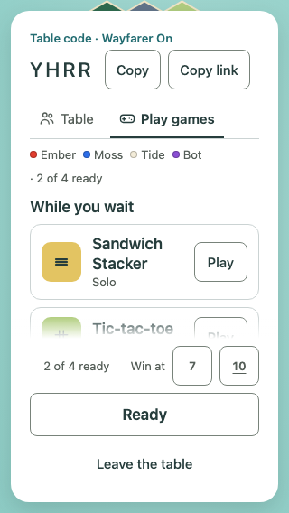

The card still scrolls under Ready there. The shelf ends 75 px under it. Sandwich Stacker ends 181 px under it. Tic-tac-toe ends 253 px under it. Three board cells sit 5 px from the Win at buttons. Those cells are under the footer. Nothing at 844×390 is that close.

Every number is in [`sideways/measure.txt`](sideways/measure.txt). The drawing is [`sideways/sideways-layer.css`](sideways/sideways-layer.css), applied as the capture layer. Pass `ONLY=sideways,320` to draw just these pictures.

Known small issue: at 17 px, the desktop "Sandwich Stacker" title in screen C wraps to two lines beside Sound and Close. The build can shorten the title or let the buttons wrap; the shelf itself is not affected.

## Text sizes that are not on the lobby scale

| Size | Where | Real chrome or mock? |
|---|---|---|
| 11 px | The "1" badge on the Play games tab | **Real chrome.** The build sets it to Footnote 13 (Caption sizes are not in the accepted scale). |
| 11 px, 10 px, 22 px | "Loads here when you tap", "580 : 320" and the title inside the game stage | Game art: the stage is Ruffle's, not ours. |
| 18, 24 and 28 px | The X and O marks (names row and board) | Game marks, not text styles. |
| 28 px | "Starting…" | Today's turn stamp (`.turn-stamp`, 28/32), unchanged. |
| 14 px | "Seats and chat, as today" | A mock placeholder for the real lobby. |
| 7.68 to 25.3 px | Island numbers | The mock's stand-in island, scaled to the screen. |

## The laws for adding something new (design laws, "Adding something new")

- **Home:** the lobby card, as a second tab beside Table.
- **Card size (laws 1 and 2):** the card does change size, as measured.
  - **Phone 390×844:** the card is 567 px tall on the Table tab (top at 265 px), 571 px on the shelf (top at 261), and grows to 752 px for Sandwich Stacker (top at 80) and 785 px for tic-tac-toe (top at 47).
  - **Desktop:** the card is a fixed 672 px column at every state.
  - The phone card's change in size is choice H below.
- **Island share (law 3):** law 3 is written for the table, not the lobby. In the lobby on a phone, the island above the card is 31% of the screen on the Table tab and the shelf, 9% with Sandwich Stacker open and 6% with tic-tac-toe open. On desktop the island keeps the whole space beside the card at every state.
- **Optional:** never needed for practice, hosting or joining.
- **Quiet state:** the shelf with nothing open, at a fixed place (screen B). The tile line says "Needs a table-mate" when no one is free, and the shelf never shows a gap.
- **Exit:** Close, or Start (the game closes itself). Nothing else moves.
- **Proof:** the shelf build issue carries one registered proof. It checks the tab, the shelf, each open game above the footer at 390×844 and 1280×720, 44 px targets, 8 px gaps and contrast.

## Open choices for Jarrod (one card)

Each has a recommendation; any of them can change without touching the rest.

| # | Choice | Recommendation | Why |
|---|---|---|---|
| A | Names: tab "Play games", heading "While you wait" | Keep both | Plain words; "While you wait" says the table comes first. |
| B | Do seats and chat hide while Play games is open? | Yes, the tab swaps them; the one-line roster and Ready stay | Leaves room for the open game above the footer (measured above). |
| C | Tic-tac-toe: invite a named seat, or "anyone free"? | Named seat (as the mock draws it) | No surprise games; the invite badge goes to one person. |
| D | Left and Right buttons for Sandwich Stacker on desktop | Hide on desktop (arrow keys); show on touch | The buttons exist for phones; desktop has a keyboard. |
| E | Does pressing Ready close an open game? | No; only Start closes games | Ready is "I'm here"; a game can keep running until the table starts. |
| F | Show a locked "Trivia, Soon" tile? | Hide it until trivia exists | Fewer things on the screen (Jarrod's 10-31 note on the title: "too busy"). |
| G | What do spectators get? | Sandwich Stacker only, with no invites | They have no seat to play from; solo play stays harmless. |
| H | Phone: may the card grow upward when a game is open (island 31% → 6%), or stay one fixed height on both tabs? | Let it grow while a game is open, and drop back on Close | A fixed height would be the tic-tac-toe height (785 px) on the Table tab too, which covers the island in today's lobby. At the shelf's 571 px, the board does not fit above the footer even with 44 px cells: the card would need 214 px more, and 44 px cells save only 72. |
| I | Colour: the lobby's white tokens instead of the mock's cream | Yes, white, as drawn here | No cream (DECISIONS 2026-10-20); it matches the accepted lobby. |

## After acceptance

The build issues are filed only after Jarrod's OK on the Decisions page. Nothing in this folder is game code. The planned split, by risk:
1. **Shelf and tab (tier 2, `lane:hud`):** the two tabs, the shelf, and #970's box moved into it, at the accepted scale and colours, with the one registered proof above. PR #970 is reworked or replaced so its box lands here, not above the chat.
2. **Tic-tac-toe (tier 1, `lane:net`):** host messages, invites, seat-id relay, and closing on Start and Leave. It must never block or slow the table. Opus builds; a different model reviews.
3. **Trivia:** later. It needs content and an owner decision on who writes it.
4. **Sideways phone:** drawn in [The sideways phone](#the-sideways-phone). The wide card stays put. The open game scrolls under Ready. No separate owner choice.
