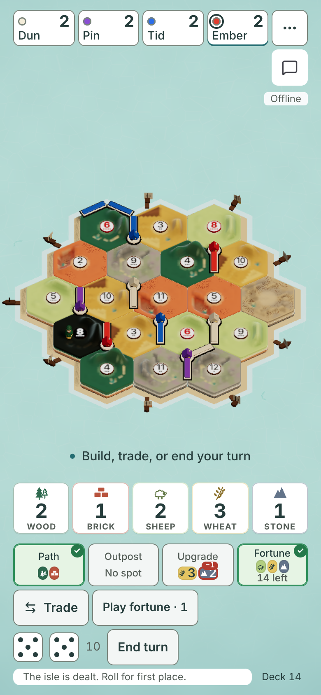
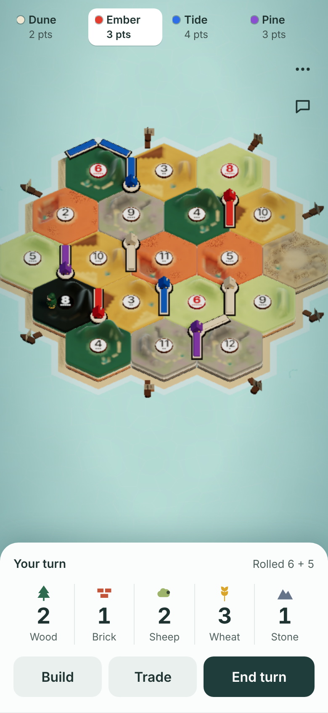
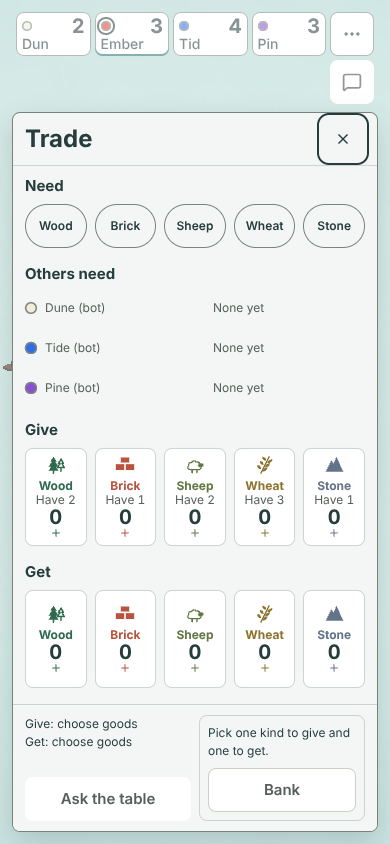
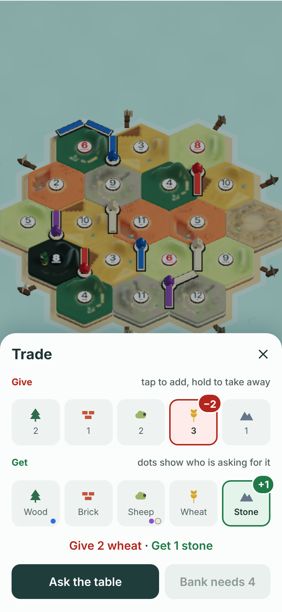
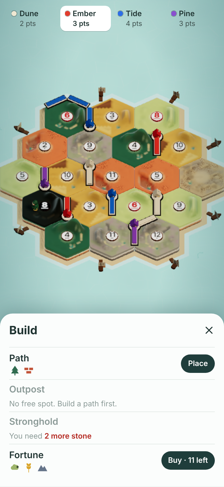
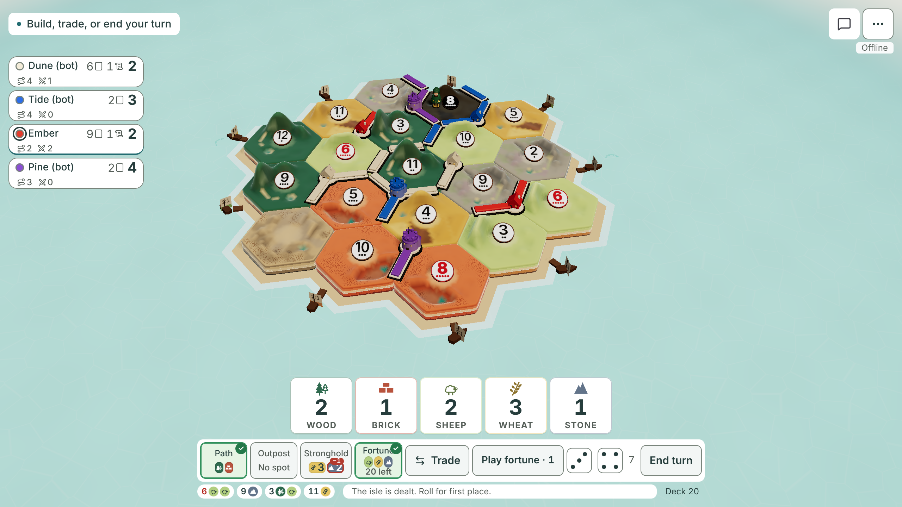
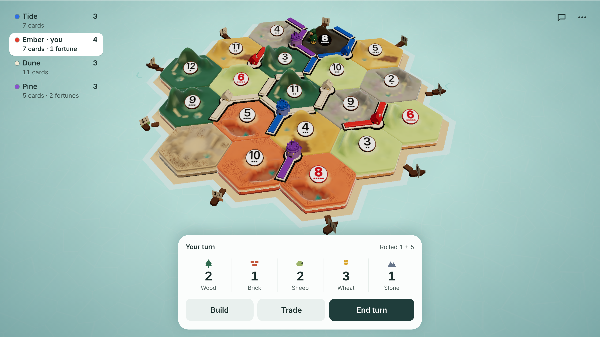

# One tray: the table and trade, redesigned

Spec for [#1535](https://github.com/jarrodjohnson-gif/emberisle/issues/1535). Docs only.
Written 2026-11-12 by Claude Fable 5.2, who makes the design decisions and reviews each build.
Sonnet or Opus subagents build the slices, one at a time.

## Owner approval

Jarrod saw real captures beside these mocks in chat on 2026-11-12 and approved all three (hub comment 6811144611).
He asked for two changes to trade. Both are in the mocks below.

- The labels are "Give" and "Get". Never "You give".
- What you give is red. What you get is green.

This replaces one earlier decision: the 2026-10-22 row that keeps the Fortunes button always visible in one fixed spot.
It keeps the other half of that row: an incoming offer is one line plus No and Yes in the action row.

## The problem

- On a 390x844 phone the controls under the island are 18 boxes in four rows, all the same weight.
- Three of four seat names are cut off ("Dun", "Tid", "Pin").
- Trade is five sections and 20 boxes, with two separate places to press.

| Today (real game) | Approved mock |
|---|---|
|  |  |
|  |  |

Build list: 

Desktop today: 

Desktop mock: 

The island in each mock is the real board, enlarged. Only the controls are drawn.

## A correction to the mocks: island size

The mocks draw the island about 20% wider than today. The tray alone does not do that.

- On an upright phone the island is limited by the screen's width, not its height.
- The existing fit keeps every dock's 44 px target and every goods pile on screen.
- A wider island on phones comes from [#1526](https://github.com/jarrodjohnson-gif/emberisle/issues/1526) (side goods moved inward), which the owner already chose.
- What the tray adds on a phone is height: about 100 px less chrome under the island at 390 wide.
  The island sits in the middle of the sea, not pushed to the top.
- On desktop the island is limited by height. As built (#1539) the desktop tray is one row, the hand beside the buttons, so the island keeps 18 px more height than before (the declared bottom is 168 px, was 186).

Slice B measures the real island before and after. Nobody quotes the mock's width as a result.

## Look

One rule: a box marks one thing you can press. Nothing else gets a border.

| Token | Value | Used for |
|---|---|---|
| Ink | `#1f3d3b` | Primary button fill, selected seat ring |
| Text | `#1f3331` | All text on the tray |
| Quiet text | `#52625f` | Names under numbers, hints. 12 px minimum. |
| Tray | `#fbfdfc` | The tray and every sheet |
| Soft fill | `#e9f0ee` | Secondary buttons, resting trade tokens |
| Give | `#b3261e` on `#fdecea` | What leaves your hand |
| Get | `#1e7a46` on `#e4f4ea` | What you receive |
| Divider | `#e3eae7` | 1 px lines between hand columns and list rows |

- Use the repo's existing tokens where one matches. Add a token only for Give and Get.
- The tray has a 22 px top radius and one soft shadow. Buttons have a 12 px radius.
- Type: 26 px bold numbers, 15 px semibold buttons (the button system, #1418), 14 px status, 12 or 13 px quiet text. Nothing under 12 px.
- Every button and every token is at least 44 px in both directions. Main buttons are 48 px high.
- The sea gets darker toward the screen edges, by a CSS overlay above the canvas. The scene itself does not change.

## The tray

One surface at the bottom of the screen. On a phone it spans the width. On desktop it is centred, up to 720 px wide, 12 px above the bottom edge, and the hand sits beside the action row in one row (as built in #1539; the mock above shows the earlier stacked sketch).
In a sideways phone it is the same tray in today's left column, as tall as its rows: Build and Trade share a row and End turn has its own, with the dice beside it.

Three parts, top to bottom:

1. **Top line.** Left: the status text, with today's wording from `phaseCopy`, `armedCopy` and `waitingCopy`. Right: the newest event in quiet text.
2. **Hand.** Five columns: icon (22 px), number, name. No card. A zero is greyed.
3. **Action row.** One row of buttons. What it holds depends on the state.

What leaves the main screen, and where it goes:

| Today | New home |
|---|---|
| Dice row | The top line's right side, in the roll line's words: "Ember rolled 11!". A sideways phone keeps the two dice beside End turn. The centre-screen roll moment stays. |
| Log line | The top line's right side, when no roll is newer. Red 6 and 8 and the green own roll stay (2026-10-22). |
| Deck count | The Fortune row of the Build list, and the Fortunes sheet. |
| Build costs | The Build list. |
| My numbers (desktop) | In the top line on desktop, between the status and the newest event. A sideways phone keeps its quiet line under the action row; an upright phone shows none, as today. |
| Turn countdown | The top line's right side in the last 30 s. It replaces the event text. |

### The action row in every state

| State | Action row |
|---|---|
| My turn, main | Build, Trade, End turn. End turn is the primary button. |
| My turn, main, holding a fortune | Build, Trade, Fortune · N, End turn. Four equal columns. |
| My turn, before the roll | Roll, full width, primary. With a fortune held: Fortune · N, then Roll at twice its width. |
| Roll-off, my roll | Roll, full width. |
| Setup, my placement | No action row. The top line carries the instruction. |
| Build armed, nothing picked | Cancel, full width. |
| Build armed, a spot picked | Cancel, Place. Place is primary. This replaces the floating place chip on touch. |
| Moving the wayfarer | No action row. |
| Choosing who to take from | "Take from whom?" in the top line. One button per seat, with its colour dot. |
| Discarding on a 7 | The hand numbers become steppers. The row is one Discard button, off until the count is right. |
| An offer I can answer | Top line: "Tide: give 1 wood, get 1 brick", Give in red and Get in green. Row: No, Yes. Yes is primary. |
| An offer I cannot pay | Top line: "Tide is looking for wood". Row: Dismiss. |
| My offer is out | Top line: "You offer 2 wheat for 1 stone" and who has said no. Row: Cancel. |
| Another seat's turn | No action row, or Fortune · N alone when I hold one. |
| Watching | No hand, no action row. The top line says who is playing, with the Watching badge. |
| Game over | The win line. No action row. |

- The hand hides during roll-off and setup until the seat holds a good, as today.
- A long press on a hand column still opens the rates sheet.
- Gains and losses still flash +N and −N on the number. The column tints with the good's colour for the same time as today.
- The vote for more time keeps its wording. It takes the action row while it is open.
- In hotseat the top line names a seat only when it owes a discard on another seat's turn, as today.

### Fortune

- Buying a fortune is a row in the Build list.
- The Fortune · N button shows in the tray whenever the seat holds at least one fortune. It opens today's Fortunes sheet.
- With none held, the tray has no Fortune button.

## The Build list

A sheet that rises from the tray. The island stays visible above it. Close is 44 px, top right.
Four rows, each at least 56 px high, split by 1 px dividers:

| Row | Can do it | Cannot |
|---|---|---|
| Path | Cost icons (20 px) and a Place pill | "None left", or "You need 1 more brick" |
| Outpost | Cost icons and Place | "No free spot. Build a path first.", "None left", or what is missing |
| Stronghold | Cost icons and Place | "No homes to upgrade", "None left", or what is missing |
| Fortune | Cost icons and "Buy · 11 left" | "The deck is empty", or what is missing |

- Place closes the sheet and arms that build, as tapping the build button does today.
- A missing good is named in red: "You need 2 more stone".
- A row that cannot be done is greyed and still readable. Pressing it does nothing and plays today's refusal sound.
- The phone label for a stronghold is "Stronghold" here. There is room for the word.

## Trade

A sheet from the tray. The island stays visible. Top to bottom:

1. **Give** (red label). Five tokens, 64 px high: icon and how many you hold. A good you have none of is greyed.
2. **Get** (green label). Five tokens: icon and name.
3. **The offer in words.** "Give 2 wheat · Get 1 stone", Give in red, Get in green. Empty: "Pick what to give and what to get."
4. **Two buttons.** Ask the table (primary) and the bank button.

- Tap a token to add one. A chosen token gets a red or green edge and tint, and a badge: "−2" or "+1".
- Take one away with a long press, a right click, or the minus key. A 44 px minus button also shows on a chosen token.
  This is one change from the mock, which had no visible way to take one back.
- Limits stay: Give up to what you hold, Get up to 19, and a good cannot be on both sides.
- **Who needs what.** A seat-colour dot sits on a Get token for each seat asking for that good. Each dot has a text label for screen readers.
  The "Others need" list is removed.
- **What I need.** The Need row is removed from this sheet. Your own needs follow from your last offer: its Get goods, at most 2.
  Question 1 below asks the owner to confirm this.
- **Bank.** One button. It says "Bank 4:1", "Dock 3:1" or "Wood dock 2:1" when the trade is valid, and trades at once.
  Otherwise it is off and says why in the button: "Bank needs 4", "Bank has no stone", "Bank: one kind each".
- In hotseat there is no Ask the table button, as today.

## Seats

- **Phone strip.** No boxes. A colour dot, the full name on one line at 13 px, points under it at 12 px.
  The seat on turn gets a white pill. Names shorten only when they truly do not fit, as today.
- **Desktop rail.** No boxes. Name left, points right, one quiet line under: cards and fortunes.
  Path and army tallies stay, on the same quiet line.
- A tap still opens the player menu. Need dots, gain pills, Away and the roll-off die stay.

## Build slices

One subagent at a time. Each slice is one issue and one PR. Fable reviews real captures against the mocks before the desk sees them.

| Slice | What | Main files | Chunk and limit |
|---|---|---|---|
| A | Trade sheet: Give and Get rows, the sentence, need dots, the bank button | `TradePanel.tsx`, `TradeResource.tsx`, `trade-panel.css`, `SeatNeeds.tsx` | `sheets` 7,800 B, `TradeResource` 1,650 B, `SeatNeeds` 1,900 B |
| B | The tray: top line, hand numbers, action row for turn, roll, armed and off-turn states. The Build list. The fit numbers in `playHole`. | `Hud.tsx`, `Hand.tsx`, `BuildCost.tsx`, `Dice.tsx`, `PlaceChip.tsx`, `CostCard.tsx`, `mobile-fit.ts`, `styles.css`, `hand-motion.css` | `index` 127,000 B, `sheets` |
| C | Offers, discards and take-from in the tray | `TradeToast.tsx`, `DiscardBar.tsx`, `TakeFromBar.tsx` | `TradeToast` 3,000 B, `losses` 1,600 B |
| D | Seats without boxes | `SeatRail.tsx` | `index` |

Rules for every slice:

- No ceiling or allowance moves. `index` has about 110 B of room, so slice B must remove more than it adds.
  The Build list goes in the lazy `sheets` chunk for that reason.
- If a slice cannot fit, the builder stops and reports the bytes. Fable asks the owner. Nobody golfs unrelated code.
- Keep every `data-testid` that still names the same thing (`hand-dock`, `resource-<kind>`, `turn-banner`, `trade-give-<kind>`, and so on).
- A test line the approved design makes wrong is replaced, never deleted, in its own commit with an old and new table (DECISIONS 2026-10-25).
- Each slice adds one proof at 390x844, 844x390 and 1280x720: 44 px targets, 12 px text, nothing off screen, and each state in the table above that the slice owns.
- Pictures are real-game PNGs at 430x932, 390x844, 844x390 and 1280x720, beside the mock.

Proofs each slice is known to touch (from a read of `scripts/`):

- **A:** `trade-tabs`, `trade-contrast`, `practice-trade`, `needs`, `rotate-overlays`, `lazy-hud`.
- **B:** `hand-cards`, `hand-hidden`, `hand-offer`, `dock-rates`, `build-ready`, `stronghold-upgrade`, `upgrade`, `turn-copy`, `contrast`, `button-system`, `first-game-coach`, `fortune-tray`, `fortune-count`, `roll-moment`, `hud-roll-line`, `roll-log`, `upright-table`, `my-numbers`, `visual-direction`, `hole`, `hud-safe-area`, `reflow`.
- **C:** `trade-prove`, `trade-map`, `hand-offer`, `hotseat`, `steal-picker-push`.
- **D:** `seat-rail`, `longest-army`, `seat-gains`, `seat-menu-sheet`, `chat`.

Slice B is the large one. Its builder first lists every assertion that will change and sends the list to Fable before writing code.

## Open questions for the owner

Two, both from details the mocks did not show.

1. **Your own "Need" marks.** Today you pick up to two goods you need, in the trade panel. The mock has no such row.
   - A (recommended): your needs follow from your last offer. Its Get goods become your need dots.
   - B: keep a small "I need" row at the top of the trade sheet.
   - C: drop your own need marks. Offers say it already.
   - D: something else.
2. **The log.** The newest event shows in the tray's top line. Where is the full list?
   - A (recommended): in the Table menu, as "Game log".
   - B: tap the top line to open it.
   - C: no full list. Chat and "Copy log" are enough.
   - D: something else.

Slice A builds with 1A unless the owner says otherwise. Nothing in slice A depends on question 2.
