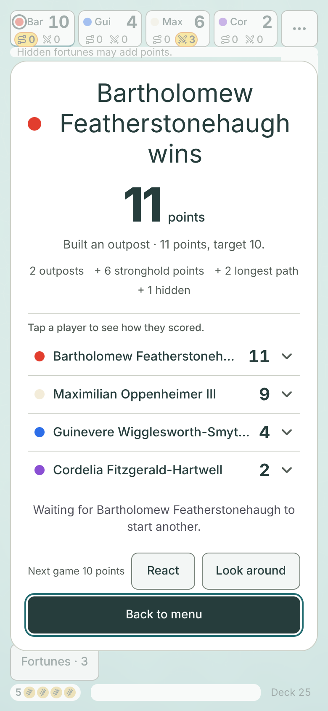
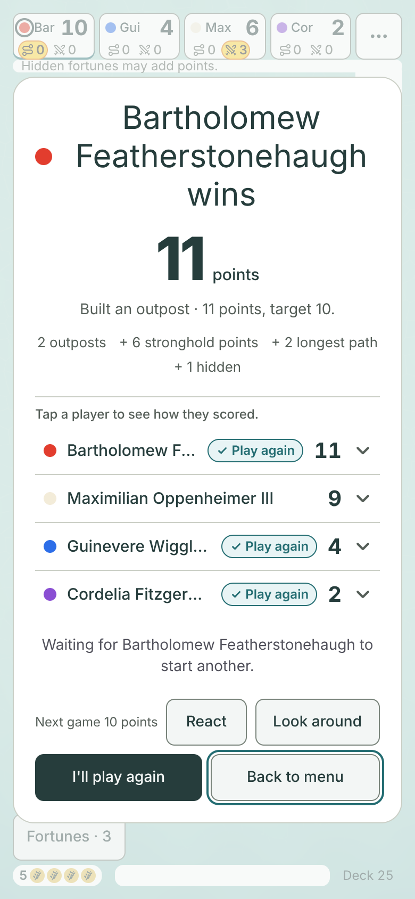
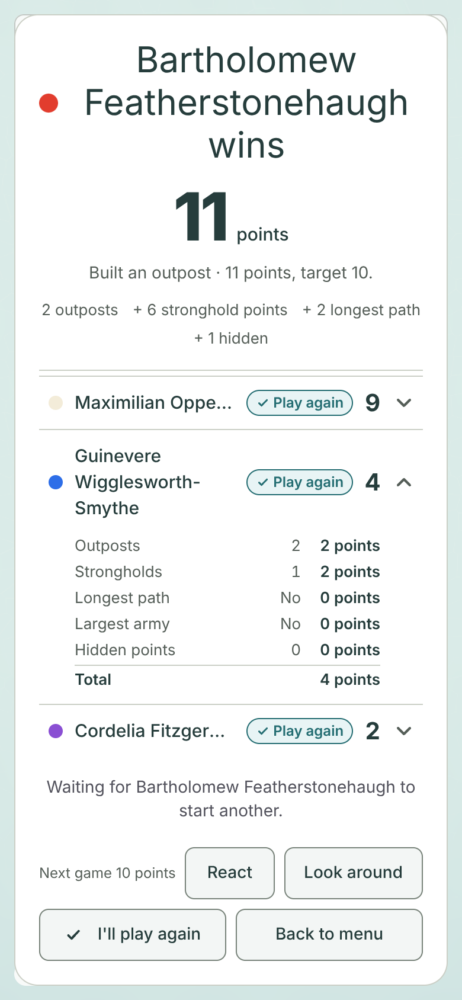
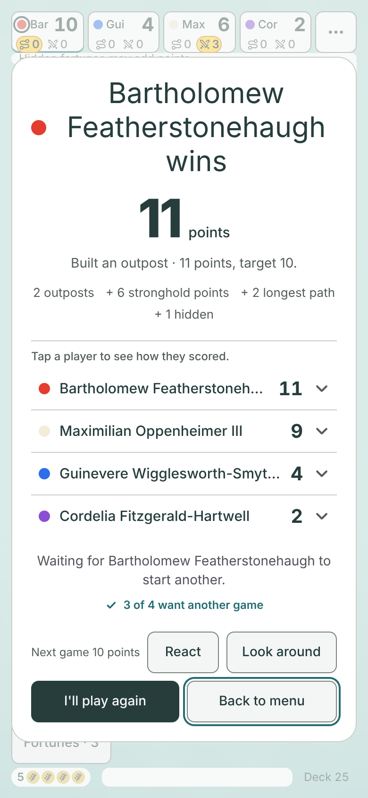
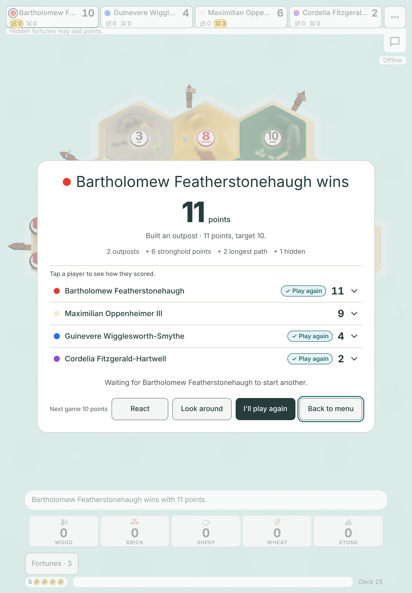
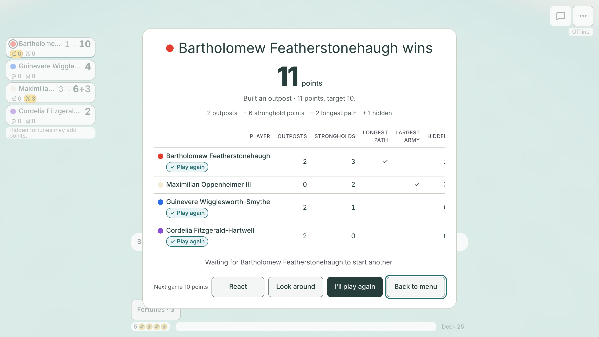
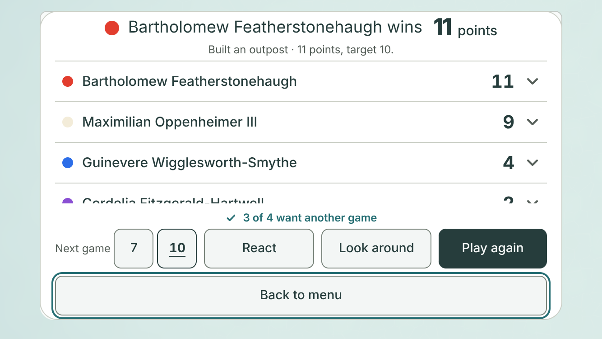

# Who wants to play again (#1411)

**Design stage only. No game code changes.** Jarrod approves or changes this, then #1411 is built from it.
Author: Claude Opus 5.5, 2026-11-07. Base: `main` at `a534478`, with the compact results list (#748) merged.

## TLDR for Jarrod

- Today, only the host has a **Play again** button. Everyone else sees "Waiting for (host) to start another." Nobody can say they want another game, and nobody can see who does.
- The proposal gives every other player an **I'll play again** button. Tap it again to take it back.
- **Option A (recommended):** each player's row on the results gets a small **✓ Play again** tag once they are in. You can see at a glance who is in and who has not said yet.
- **Option B:** no tags. One line above the buttons says **3 of 4 want another game**. It is smaller, but it does not say who.
- The host still decides when the next game starts, as today. A tap is only a "count me in". It does not start, block or delay anything.
- The host must send one new piece of information per seat: "this player said yes". The other players and anyone watching already see every seat's name, so this is no more private than the lobby's Ready.

## What players see today

| Who | What they see after a game |
|---|---|
| The host | The results, then Next game (7 or 10), React, Look around, **Play again**, Back to menu. |
| Another player | The results, "Waiting for (host) to start another.", then Next game (read only), React, Look around, Back to menu. No way to say "me too". |
| Someone watching | The results, Look around, Back to menu. No Play again, no React. |
| Hotseat (one device) | Play again, as today. Everybody is at the same screen. |
| Practice | No Play again. |

The game keeps no "wants to play again" state today. The host's **Play again** sends one message, `again`, and the host starts the next game at once with every player still connected, and every bot (`rematch` in `server/host.mjs`; [rematch.md](../rematch.md), "Consent: host-only `again`. No second ready round.").

## Before and after

The game is the finished four-player game from the #748 mock, with long names. Bartholomew is the host and won.
Guinevere has said yes. Cordelia is a bot. The pictures are from **Maximilian's** screen, who has not said yet.
In "open", Maximilian has tapped **I'll play again** and opened Guinevere's row.

| Size | Today | Option A: tags | A, tapped and one row open | Option B: count | B, tapped and one row open |
|---|---|---|---|---|---|
| Big phone upright 430 × 932 | [today](before-430x932.png) | [A](a-430x932.png) | [open](a-open-430x932.png) | [B](b-430x932.png) | [open](b-open-430x932.png) |
| Phone upright 390 × 844 | [today](before-390x844.png) | [A](a-390x844.png) | [open](a-open-390x844.png) | [B](b-390x844.png) | [open](b-open-390x844.png) |
| Small phone upright 375 × 812 | [today](before-375x812.png) | [A](a-375x812.png) | [open](a-open-375x812.png) | [B](b-375x812.png) | [open](b-open-375x812.png) |
| iPad upright 820 × 1180 | [today](before-820x1180.png) | [A](a-820x1180.png) | [open](a-open-820x1180.png) | [B](b-820x1180.png) | [open](b-open-820x1180.png) |
| Big phone sideways 932 × 430 | [today](before-932x430.png) | [A](a-932x430.png) | [open](a-open-932x430.png) | [B](b-932x430.png) | [open](b-open-932x430.png) |
| Phone sideways 844 × 390 | [today](before-844x390.png) | [A](a-844x390.png) | [open](a-open-844x390.png) | [B](b-844x390.png) | [open](b-open-844x390.png) |
| Small phone sideways 812 × 375 | [today](before-812x375.png) | [A](a-812x375.png) | [open](a-open-812x375.png) | [B](b-812x375.png) | [open](b-open-812x375.png) |
| Small phone sideways with a notch 667 × 375 | [today](before-667x375-insets.png) | [A](a-667x375-insets.png) | [open](a-open-667x375-insets.png) | [B](b-667x375-insets.png) | [open](b-open-667x375-insets.png) |
| iPad sideways 1180 × 820 | [today](before-1180x820.png) | [A](a-1180x820.png) | [open](a-open-1180x820.png) | [B](b-1180x820.png) | [open](b-open-1180x820.png) |
| Desktop 1280 × 720 | [today](before-1280x720.png) | [A](a-1280x720.png) | [tapped](a-open-1280x720.png) | [B](b-1280x720.png) | [tapped](b-open-1280x720.png) |

The host's own screen: [today](host-before-390x844.png), [A](host-a-390x844.png), [B](host-b-390x844.png) at 390 × 844; [today](host-before-667x375-insets.png), [A](host-a-667x375-insets.png), [B](host-b-667x375-insets.png) at 667 × 375 with a notch; [today](host-before-1280x720.png), [A](host-a-1280x720.png), [B](host-b-1280x720.png) on the desktop.
With Cordelia away instead of a bot: [A, 390 × 844](away-a-390x844.png).

| Phone upright, today | Option A | Option A, tapped and Guinevere opened | Option B |
|---|---|---|---|
|  |  |  |  |

| iPad upright, option A | Desktop, option A | Host on a notched sideways phone, option B |
|---|---|---|
|  |  |  |

### What the numbers say

From the final run of [capture.mjs](capture.mjs). Full numbers are in [measurements.json](measurements.json). "Scrolls N px" means the list scrolls down by N px with every row closed.

| Size | Other player, today | Other player, A | Other player, B | Host, today | Host, A | Host, B |
|---|---|---|---|---|---|---|
| 430 × 932 | fits | fits | fits | fits | fits | fits |
| 390 × 844 | fits | fits | fits | fits | fits | fits |
| 375 × 812 | fits | fits | fits | fits | fits | fits |
| 820 × 1180 | fits | fits | fits | fits | fits | fits |
| 932 × 430 | fits | fits | fits | fits | fits | fits |
| 844 × 390 | fits | fits | fits | fits | fits | fits |
| 812 × 375 | fits | fits | fits | fits | fits | fits |
| 667 × 375 with a notch | fits | scrolls 34 px, 3 of 4 rows seen | scrolls 58 px, 2 of 4 rows seen | fits | **fits** | **scrolls 22 px**, 3 of 4 rows seen |
| 1180 × 820 | fits | fits | fits | fits | fits | fits |

- Every row is 44 px and every result button is 44 px and on screen, at every size, in every view. Browser errors: 0.
- No tag is cut or runs into a total. No list scrolls sideways on a touch screen.
- Names cut with "…" (of 4): at 430 × 932, 0 today and 3 with A; at 390 × 844 and 375 × 812, 2 today and 3 with A. B cuts none extra. An opened row shows the full name.
- The other player's buttons take one more line at 375 × 812 (3 lines, not 2). Everything still fits.
- Desktop 1280 × 720: the table already runs 67 px off its right edge today, so the totals are hidden (#748, question 3). A and B leave that exactly as it is: the tag goes under the name, and the table gets no wider.
- With one row open, the list scrolls on phones and sideways screens, as it does today since #748.

## The design

### The button: I'll play again

- Every seated player who is not the host gets **I'll play again**, where the host has **Play again**.
- It is the main (dark) button until it is tapped. **Back to menu** turns light, as it is for the host.
- Tapped, it turns light with a ✓ and stays pressed. Tap it again to take it back.
- It is a real toggle button with `aria-pressed`, 44 px tall like every other result button.
- Its words differ from the host's **Play again** on purpose. A player who taps it must not think the game is starting.
- The "Waiting for (host) to start another." line stays, word for word.

### Option A: a tag on each row (recommended)

- A row gets a small **✓ Play again** tag between the name and the total once that player is in.
- The host's row always has it: the host's own button is the host's yes.
- A bot's row always has it: a bot always plays the next game.
- A player who is away gets a grey **Away** tag instead. Away players are left out of the next game, as today.
- A player who has not said yet has no tag.
- The tag is words plus a ✓, not colour alone. Screen readers hear "wants to play again" or "away" as part of the row.
- Rows stay 44 px. The tag is 22 px tall and sits inside the row. A long name is cut with "…" a little sooner to make room. Opening a row still shows the full name.
- On the desktop table, the tag sits under the name, so the table gets no wider.
- A hidden status line also reads out "3 of 4 want another game" for screen readers when it changes.

### Option B: one count above the buttons

- One line above the buttons: **✓ 3 of 4 want another game**. It updates as players tap.
- The count is the same as in option A: the host, bots, and players who tapped, out of everyone not away.
- It is a polite status line, so screen readers hear the change.
- It does not say who. On a phone held sideways, it pushes the list into a scroll for the host (see the numbers).

### Recommendation

**Option A.** You asked to show *who* wants to play again. Only the tags do that. They also cost no height, so the host's results on a small sideways phone still fit without scrolling. Option B costs a line of height on every screen and makes the host's list scroll on the notched 667 × 375 phone.

## Who sees what

| Who | Button | Sees the tags or count | Notes |
|---|---|---|---|
| Host | **Play again**, as today | Yes | Counts as yes. Starts the next game whenever they like, as today. |
| Another seated player | **I'll play again** (new) | Yes | Their tap shows on their own row at once. |
| Bot | none | Yes, always ✓ | A bot always plays. |
| Away player | none | Shown as **Away** | Left out of the next game, as today. Back before the host starts, they show with no tag until they tap. |
| Someone watching | none, as today | Yes | Cannot say yes. Watchers stay and see the next game, as today. |
| Hotseat | **Play again**, as today | No | One device, so there is nobody to wait for. |
| Practice | none, as today | No | No next game. |

- A tap does not start, block or hold up the next game. The host can start with players who have not tapped, as today. Changing that is a bigger rule change and is not proposed here.
- Every "yes" is cleared when the next game starts.
- **Look around** keeps today's chip (Show scores, the host's Play again, Back to menu). The new button is not added to the chip. See question 3.

## What data exists, and what the host must add

**Already there.** The host sends every seat to every seated player and every watcher after each change (`seatsOf` and `broadcast` in `server/host.mjs`). Each seat already carries its name, colour, `host`, `bot`, `away`, `ready` and its player id. That is enough to show the host, bot and away tags today.

**Missing.** Nothing says "this player wants another game". `ready` cannot be reused: it is the lobby's flag, every seat is still `ready` from the lobby, and the rematch does not reset it.

**What the build adds** (a small server and protocol change, no breaking change):

| Where | Change |
|---|---|
| `server/host.mjs` | A seat field `again` (yes or no). A new message `{ "type": "wantAgain", "value": true or false }`, accepted only from a seated person (not a bot) while the game is over, like `ready`. It sets the field and sends the seat list again. It counts against the seat's existing message limit (20 at once, 4 a second). `rematch` clears every `again`. |
| `seatsOf` | Sends `again: true` only for a seat that said yes. The host and bot ✓ are worked out on the screen from `host` and `bot`. |
| Saved rooms | Not saved. The saved seat list names its fields, and `again` is not one of them. A host restart clears every yes, which is harmless. |
| `src/lib/net/table.ts` | `again?: boolean` on `Seat`, and a `wantAgain(value)` call. |
| Store and win screen | A `wantAgain` action; the button, and the tags or count, read from `seats`. |
| Protocol version | No bump. The new field and message are additions, and `proto.ts` bumps only on breaking changes. The host and the page ship together. |

**Privacy.** A "yes" goes to the same people who already see each seat's name, colour, Ready and Away: the other seated players and the watchers. It is not saved, not sent to profiles and not part of the game result. It is no more private than the lobby's Ready, so this adds no new exposure.

**Who may start a game does not change.** `rematch` keeps its host check, its "Need 3 or 4 at the table" check, and who it takes along.

## Accessibility

- The tag and the count are words, not colour alone. The ✓ is extra.
- Screen readers hear "wants to play again" or "away" inside each row's button name, and the count as a polite status line.
- Every row stays 44 px, closed. Every result button stays 44 px and on screen at every size. The capture fails if not.
- The new button is a real `<button>` with `aria-pressed`, reachable with Tab inside the win screen's focus trap.
- Tag text is the game's teal ink on a pale teal fill (contrast above 5:1). The Away tag is the game's muted grey on its page colour.

## Effect on the proof lines

Nothing is loosened, removed or replaced. Every line below still passes with option A.

| Proof | Line | What it checks | Effect |
|---|---|---|---|
| `scripts/client-prove.mjs` | 537–541 | A guest has no `win-again` and no `win-again-chip`, and the waiting line reads "Waiting for Ember to start another." | Passes. The new button has its own test id (`win-want`), not `win-again`. The waiting line is unchanged. |
| `scripts/win-list-prove.mjs` | 212, 222–223 | The host has Play again. A watcher has no Play again and no React. | Passes. Watchers get no new button. |
| `scripts/win-action-prove.mjs` | 98–105 | At 480 px tall or less, the list does not scroll down, and each row fits. It views the host's screen. | **Option A passes**: the host's list fits at every size 480 px tall or less (the capture fails otherwise). **Option B fails it** at 667 × 375 with a notch, unless the count is hidden at 480 px tall or less. |
| `scripts/watch-ui-prove.mjs` | 449 | The watcher's desktop table text equals the player's. | Passes. Both see the same tags, because a tag depends only on the seat, not on who is looking. |
| `scripts/victory-target-prove.mjs` | 87 | The host's Play again starts a game with the new target. | Passes. Unchanged. |

The build adds a new proof (both host and guest, real host): the button sends `wantAgain`; every screen and the watcher see the tag; taking it back clears it; a bot and the host show ✓; an away seat shows Away; the next game clears every yes; a watcher and a bot cannot send it; a guest still cannot start a game. It is registered in `package.json` and `.github/workflows/ci.yml`.

**Size.** The `WinList` chunk is 1,253 B of its 1,360 B ceiling (DECISIONS, 2026-11-07). The tags may not fit in the 107 B left. If the build measures more, the builder asks the desk for a new ceiling with the measured bytes; it does not raise it.

## Questions for Jarrod

1. **Tags (A) or a count (B)?** Recommended: A. It says who, and it keeps the host's results free of scrolling on small sideways phones.
2. **Does the host count as "yes"?** Recommended: yes, with a ✓ on the host's row, because the host's own button is their yes. The other choice is a **Host** tag and a count of the others only.
3. **Add I'll play again to the Look around chip?** Recommended: no. The chip stays small; Show scores brings the button back in one tap.
4. **On the smallest sideways phone, other players' lists now scroll.** At 667 × 375 with a notch, the new button adds a line of buttons, so the list scrolls 34 px and shows 3 of 4 rows (see the numbers). No proof covers this view. Rows stay 44 px and scroll, as you approved for #748. Recommended: accept it.

## How it was made

- [capture.mjs](capture.mjs) starts the game, loads the finished game into the store and sets the seat list a real host would send, as the #748 mock and `scripts/client-prove.mjs` do.
- "Today" pictures are the real game, untouched.
- **"Option" pictures are a mock.** The capture adds the tags, the count and the button from [mock.css](mock.css) and a little DOM, on top of the real list, table and buttons. The button really toggles, and the tags and count are worked out from the real seat list in the store.
- The capture fails if the real win screen, four rows, totals, Look around, Back to menu, the host's Play again or the waiting line are missing or wrong. It also fails if a tag is cut or runs into the total, a row or button is under 44 px, a button leaves the screen, the list scrolls sideways (or, on the desktop, gets wider than today), the page itself scrolls, the waiting line changes, the count is wrong after the tap, or option A makes the host's list scroll on a screen 480 px tall or less.
- Pictures are at device scale 2, with touch on every size but desktop. Chromium 153.0.8010.12.
- Run it from the repo root, one browser at a time: `node --import ./server/register.mjs docs/design/play-again-1411/capture.mjs`. Add `--save` to replace the pictures here.
