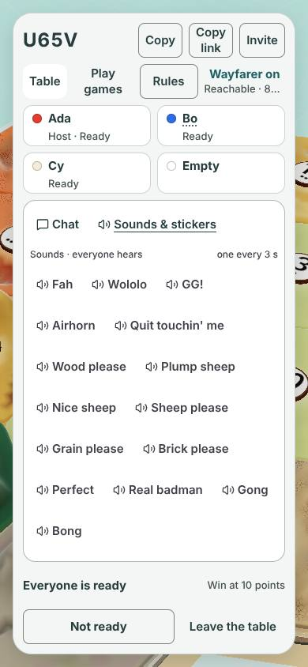
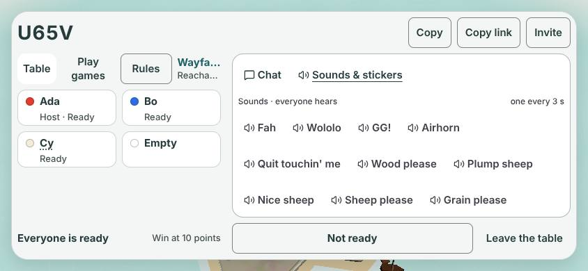
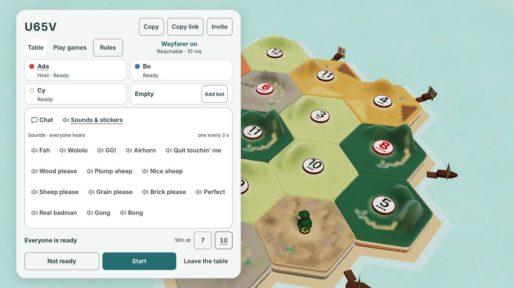
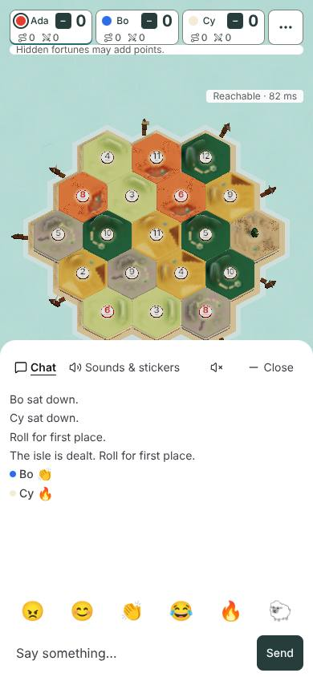
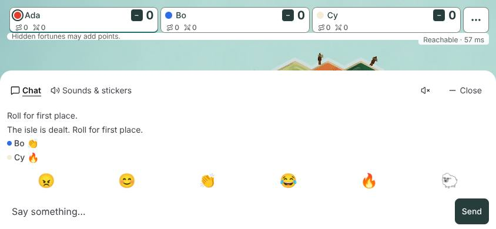
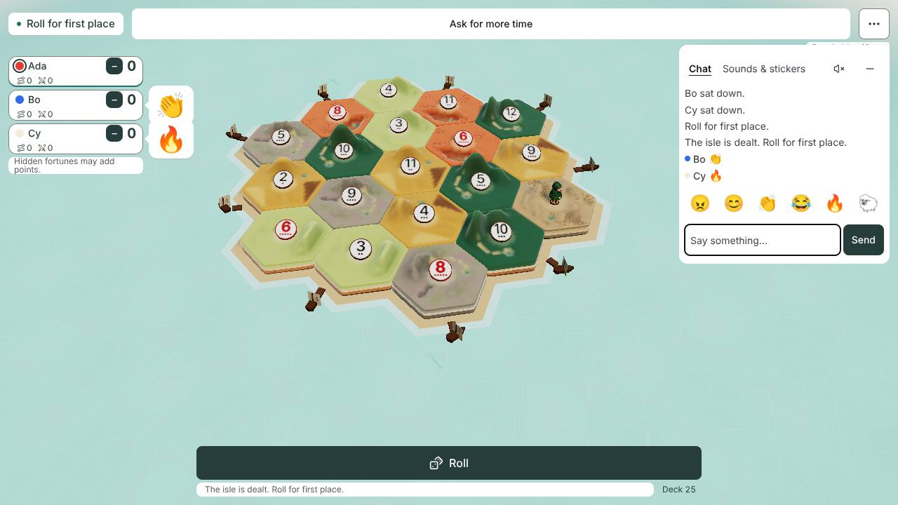
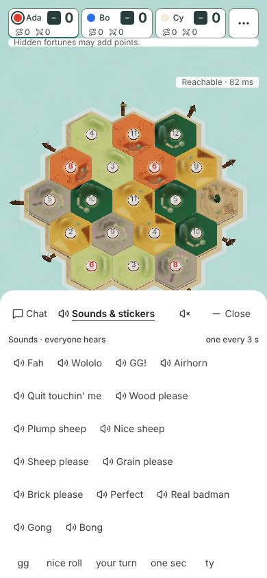
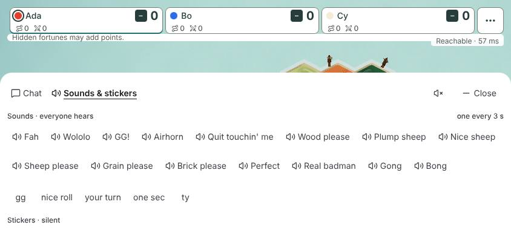
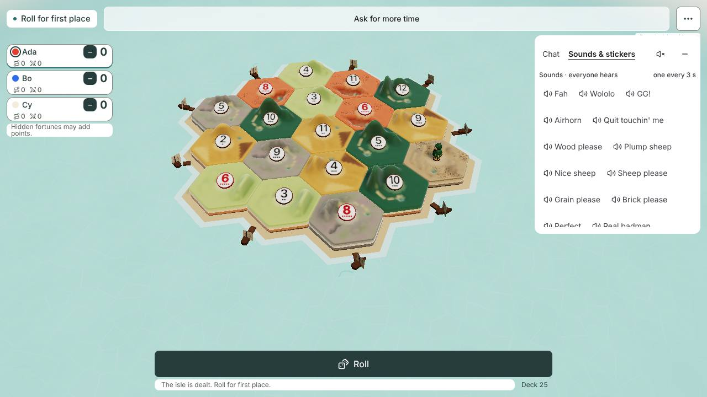

# Quick-react tray (#664): the contract for #736, #737 and #738

Status: **proposal, waiting for the owner.** Nobody builds from it until Jarrod accepts or changes each proposal in section 3.
Issue: #1370. Written against `main` 5b83aa1e on 2026-11-07.

The first #664 design (2026-10-17) was never committed. This doc replaces it.

## 1. Where things stand

### The decisions so far

- **2026-10-16**, `docs/design/emotes.md` Decision 4: emoji, stickers and sounds sit in one tray, in the game and in the lobby. The chat's own emote tray goes.
- **2026-10-20**, Chat C: Jarrod picked direction C (`docs/design/chat-c/README.md:3`). One chat button opens one panel with two tabs. `docs/DECISIONS.md:54` records the two tabs, and `:46-47` record two details of the pick. Chat has the six emoji. Sounds & stickers has the sounds and the stickers. The separate quick-reaction button goes.
- Chat C's README says Decision 4 "stays true: the tray is now the chat panel". PR #918 shipped it on 2026-10-21.
- Decision 5 (the win button reads **GG! 🔊**) is not built yet. `WinScreen.tsx:202` still says "React".

#664, #736, #737 and #738 were written before Chat C. Several of their requirements describe UI that is no longer on `main`:

| #736–#738 assumes | `main` today |
|---|---|
| A `QuickReactions` button beside Open chat | Gone. Open chat is the one button (`Chat.tsx:395`). `scripts/chat-prove.mjs:311` checks there is no "Quick reactions" button |
| A `quick-reaction-picker` Escape layer | Gone (`escape-disarm.ts:9`) |
| Nine soundboard ids | 15 chips (`Reactions.tsx:11-27`; `emotes.md` Decision 6, amended 2026-10-25) |
| A Smile tray and a speaker toggle inside the chat box | Gone. `scripts/chat-prove.mjs:325` checks for both |
| A new lobby trigger | The lobby already has the same panel, inside the card (`LobbyView.tsx:157`) |
| Aimed reactions in the player menu | Gone. `talk.tsx:156` is the only place that sends a reaction |

### What the tray is today

- **Chat tab:** the log, then six emoji (keys 1–6 send them in the game), then the input and Send.
- **Sounds & stickers tab:** 15 sound chips, then five quick lines ("gg", "nice roll" and so on), then 15 stickers. The tab scrolls up and down, never sideways.
- **Watchers** see the log only, with no tabs and no buttons.
- **Placement:**
  - Desktop game: a 300 px panel at the top right, below the top row.
  - Phone game: a bottom sheet across the full width.
  - Lobby: inside the card, below the seat list (`lobby.css:23`). In short landscape (height up to 600 px) it moves beside the seat list (`lobby.css:129`, `:139-140`).

### Measured

`node docs/design/quick-react-tray/capture.mjs` ran a real host with three seated tabs. Its output is in [`quick-react-tray/measurements.txt`](quick-react-tray/measurements.txt).

| Size | Where | Panel x, y, w, h | Inside the screen | Sideways scroll | Under 44 px |
|---|---|---|---|---|---|
| 1280x720 | lobby, Sounds & stickers | 61, 269, 518, 302 | yes | no | none |
| 390x844 | lobby, Sounds & stickers | 29, 253, 332, 458 | yes | no | none |
| 844x390 | lobby, Sounds & stickers | 333, 77, 486, 236 | yes | no | none |
| 1280x720 | game, Chat | 968, 64, 300, 312 | yes | no | Mute players 40x44, Minimize chat 40x44 |
| 1280x720 | game, Sounds & stickers | 968, 64, 300, 360 | yes | no | Chat tab 43x44, Mute players 40x44, Minimize chat 40x44 |
| 390x844 | game, both tabs | 0, 424, 390, 420 | yes | no | none |
| 844x390 | game, both tabs | 0, 120, 844, 270 | yes | no | none |
| 320x640 | game, both tabs | 0, 220, 320, 420 | yes | no | none |

### Gaps found

1. Three desktop controls are under 44 px: Mute players and Minimize chat (40 px, `Chat.tsx:298`, `Chat.tsx:498`) and the Chat tab (43 px).
2. Only the input closes the panel on Escape (`Chat.tsx:255-258`). Escape on a sticker button left the panel open and disarmed the armed Path instead (measured). `escape-disarm.ts:19` steps aside only for a text field.
3. Closing the panel from the keyboard leaves focus on the page body. The Open chat button is not drawn while the panel is open, so focus has nowhere to return.
4. Both tabs are in the Tab order. The arrow keys do not switch tabs.
5. The win screen's GG! keeps its own 3 s rest (`WinScreen.tsx:195-199`). The soundboard keeps another (`talk.tsx:158-164`). The host allows one sound per seat every 3 s (`server/host.mjs:1570`). So GG! followed by a chip within 3 s gets "Slow down."
6. The two send waits belong to the whole page, not to a table. After leaving one table and joining another, a wait can carry over for up to 3 s.

What already works and must stay:

- The 1 s wait is shared by emoji and stickers. The 3 s wait is for sounds alone. Each wait ignores the other (`talk.tsx:32-34`).
- Both waits survive closing and reopening the panel and switching tabs (measured).
- The host's limits, the sound echo, per-seat mute, seat bubbles and the log stay as they are.

## 2. Pictures

Real game, `main` 5b83aa1e. Ada is at 1280x720, Bo at 390x844 and Cy at 844x390. Bo sent 👏 and Cy sent 🔥 before the game shots.

| | 390x844 | 844x390 | 1280x720 |
|---|---|---|---|
| Lobby, Sounds & stickers |  |  |  |
| Game, Chat tab |  |  |  |
| Game, Sounds & stickers |  |  |  |

Under proposal 1A, these pictures are the tray's layout. The proposals change sizes by at most 4 px and change behaviour, not the look.

## 3. Proposals

Each proposal lists A (recommended), B, C, and D for something else. The `Question:` on #1370 asks the same.

### P1. What the tray is

- **A (recommended).** The Chat C panel is the one tray. No second button and no popup. The order stays as Chat C has it: emoji in the Chat tab, then sounds, quick lines and stickers in the Sounds & stickers tab.
  - Why: the owner picked Chat C four days after Decision 4, and its README calls the panel the tray.
- **B.** Bring back #664's separate quick-react button beside Open chat. It opens a popup with Emoji, Stickers and Soundboard, in that order. The panel keeps its tabs too.
  - Cost: two ways to do the same thing, and one more button in the top row. Chat C removed exactly this button.
- **C.** Keep one panel, but reorder the Sounds & stickers tab to #664's order: the six emoji, the stickers, then the sounds. The quick lines go last.
  - Cost: the emoji then show in both tabs.
- **D.** Something else.

### P2. Placement and size (the "portal geometry")

- **A (recommended).** Keep the three placements as measured. Do not move the panel into a portal.
  - Raise Mute players and Minimize chat to 44 px wide on desktop. Give each tab at least 44 px of width. They still fit in the 300 px panel.
  - The rule for every surface: every control is at least 44x44 px from 320 px wide up. Nothing scrolls sideways. The tab scrolls up and down inside the panel. The panel stays inside the screen and its safe area.
- **B.** Keep today's sizes. The 40 px desktop buttons stay, because a mouse does not need 44 px.
- **C.** Move the panel into a portal at the page root and clamp it to the screen, as #736 asked for its popup.
  - Cost: more code for a problem the measurements did not find. No parent clips the panel today.
- **D.** Something else.

### P3. Who owns the send waits (the "send deadlines")

- **A (recommended).** `talk.tsx` stays the one owner of both waits: 1 s for emoji and stickers together, 3 s for sounds alone.
  - The win screen's GG! uses the same 3 s sound wait as the chips. Then GG! and a chip can no longer trip the host's "Slow down."
  - Both waits clear when the table changes, so a new table starts fresh.
  - Closing, reopening and switching tabs keep the waits, as today.
- **B.** Keep today's waits. GG! keeps its own rest.
- **C.** Move both waits into the game store, keyed by table and seat. This is #736's "session ownership".
  - Cost: more code for a 3 s edge case that A already covers.
- **D.** Something else.

### P4. Focus and keys (the "focus rules")

- **A (recommended).**
  - Open chat moves focus into the input, as today.
  - Escape anywhere inside the open panel closes the panel and does nothing else. An armed build stays armed. A second Escape disarms it, as from the input today.
  - Closing the panel (Escape, Minimize or Close) puts focus back on Open chat.
  - The tabs follow the standard tabs pattern. Only the selected tab is in the Tab order. Left and Right switch tabs.
  - There is no focus trap in the desktop panel or the phone sheet. Tab leaves the panel in page order.
  - Keys 1–6 stay as today: in the game, with the panel open, and never while typing in a field.
- **B.** Keep today's rules. Only Escape from the input closes the panel.
- **C.** A, plus a focus trap in the phone sheet, which then acts as a modal.
  - Cost: Tab can no longer reach the board or the top row while the sheet is open.
- **D.** Something else.

## 4. What the child issues become if every A is accepted

- **#736:** P2A, P3A (without the win button) and P4A, in `talk.tsx` and `Chat.tsx`, with its focused proof.
  - Its dependency on #669 is dropped. #736 waited on #669 because #669's claim reserved `Reactions.tsx`. The desk released that whole stale claim on 2026-10-25 ([#669 comment](https://github.com/jarrodjohnson-gif/emberisle/issues/669#issuecomment-6393541299)). Nothing here needs the Sound sheet.
  - The obsolete requirements in the table in section 1 come out of its body.
- **#737:** Chat C (#918) already did it. The lobby has the panel, and the chat's own pickers are gone, with `chat-prove` checks. Recommend closing it as done by #918.
- **#738:** the GG! 🔊 label (Decision 5), GG! on the shared sound wait (P3A), and the integration proof with its npm and CI registration.
- **#664** closes when #736 and #738 merge.

The desk edits the child issues after the owner answers. This doc does not change them.

## 5. Not changed here

The emoji list (Decision 1), the sticker pipeline (#663), the sound list (Decision 6), the host's limits, the wire messages, the seat bubbles and per-seat mute all stay. #669's Sound sheet is separate work.
