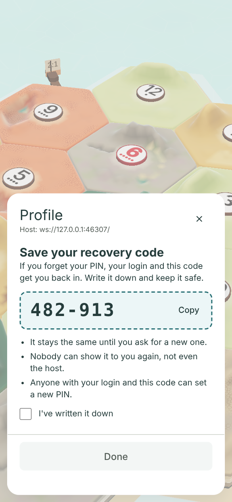
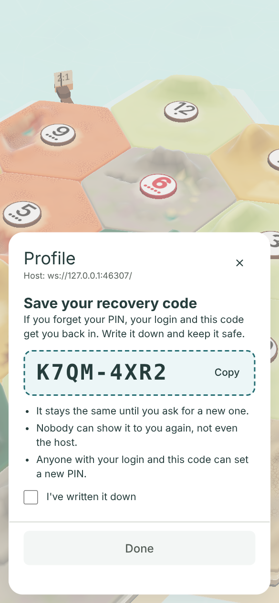
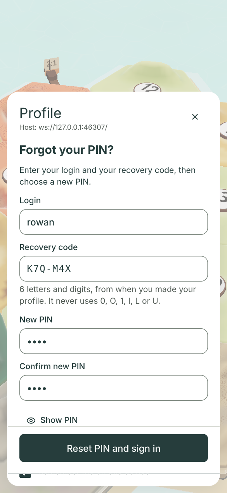
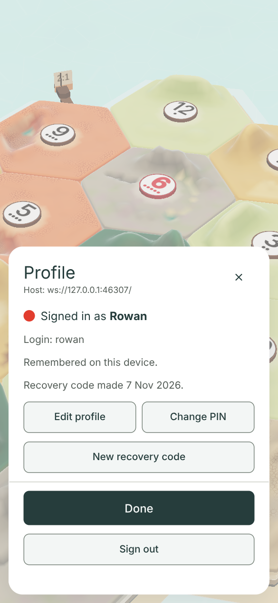
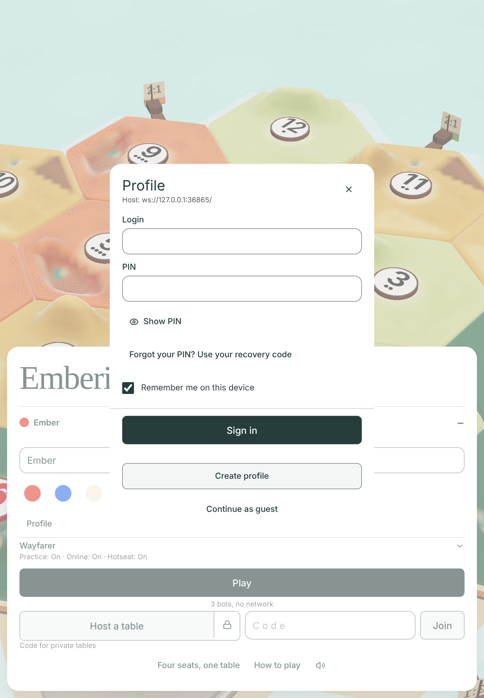
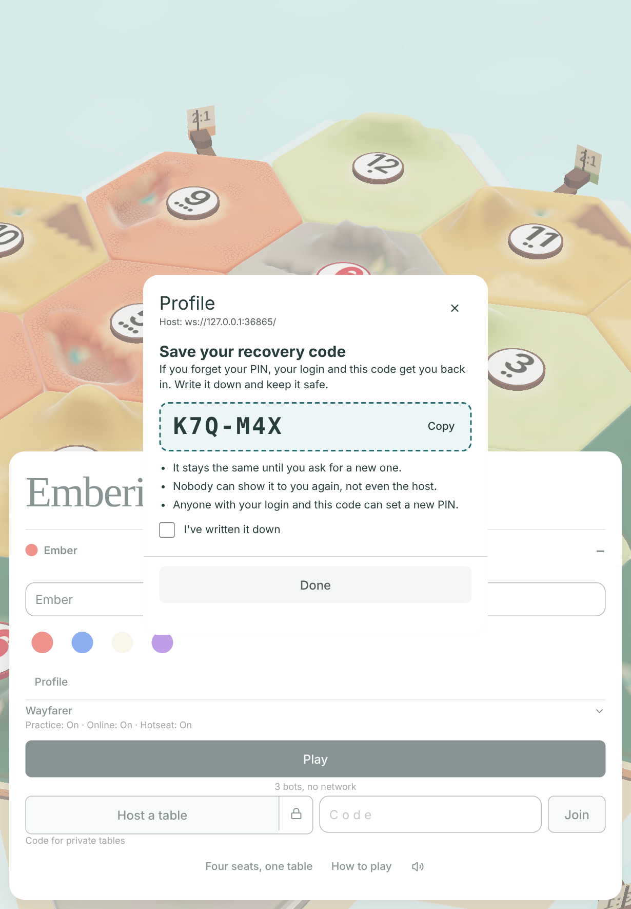

# The short permanent recovery code (#1414, from #1070)

**Design stage only. No game code changes.** Jarrod approves or changes this, then a builder issue follows.
Author: Claude Opus 5.5, 2026-11-07. Base: `main` at `a3dde1fd`, with profiles slice 2 (#1401) and the rename cap (#1069) merged.

## TLDR for Jarrod

- You chose a **short permanent code** on #1070. This packet says how to make it safe, and shows it in the real Profile sheet.
- **Recommended: option B.** Six letters and digits, like **K7Q-M4X**. It never uses 0, O, 1, I, L or U, so nobody misreads it.
- The game makes the code when a profile is made. It shows it **once**, on a "Save your recovery code" screen.
- Forgot your PIN? Tap **Forgot your PIN? Use your recovery code** under Sign in. Type your login, the code and a new PIN.
- The code only works **together with its login**. A code typed with any other login does nothing.
- Wrong codes are strictly limited. After 10 wrong tries at one code, it stops working. Your local reset, or the owner making a new code with their PIN, unlocks it.
- With these limits, a stranger guessing B has about **1 chance in 73 million** per code, ever. Today's PIN is about 1 in 333.
- The code is stored scrambled (the same scrypt hashing as the PIN). Nobody can read it back, not even you as host.
- So "show my code" can't show the old one. **New recovery code** makes a new one instead, after the player types their PIN.
- Lost the code and the PIN? Your local reset still works, as today. It also gives the friend a new code.
- Five questions for you are at the end. The main one: which code (A, B, C or D)?

## The pictures

All pictures are the real game: the title, the real Profile sheet, and a real rules host.
The profile "Rowan" is really created on that host. The recovery parts are drawn over the real sheet (see [How it was made](#how-it-was-made)).

| Size | Sign in today | Sign in, proposed | Recovery form | After Create today | Save your code | Signed in, proposed | New code |
|---|---|---|---|---|---|---|---|
| Big phone 430 × 932 | [today](before-signin-430x932.png) | [link](signin-430x932.png) | [form](recover-430x932.png) | [today](before-summary-430x932.png) | [save](save-430x932.png) | [summary](summary-430x932.png) | [new](newcode-430x932.png) |
| Phone 390 × 844 | [today](before-signin-390x844.png) | [link](signin-390x844.png) | [form](recover-390x844.png) | [today](before-summary-390x844.png) | [save](save-390x844.png) | [summary](summary-390x844.png) | [new](newcode-390x844.png) |
| Small phone 375 × 812 | [today](before-signin-375x812.png) | [link](signin-375x812.png) | [form](recover-375x812.png) | [today](before-summary-375x812.png) | [save](save-375x812.png) | [summary](summary-375x812.png) | [new](newcode-375x812.png) |
| iPad 820 × 1180 | [today](before-signin-820x1180.png) | [link](signin-820x1180.png) | [form](recover-820x1180.png) | [today](before-summary-820x1180.png) | [save](save-820x1180.png) | [summary](summary-820x1180.png) | [new](newcode-820x1180.png) |

At 390 × 844 only: [a wrong code](recover-error-390x844.png), and the save screen with [option A](save-a-390x844.png) and [option C](save-c-390x844.png).

| Save your code (B) | Option A | Option C | Recovery form | Signed in |
|---|---|---|---|---|
|  |  |  |  |  |

| iPad, sign in with the new link | iPad, save your code |
|---|---|
|  |  |

### What the numbers say

From the final run of [capture.mjs](capture.mjs). Full numbers are in [measurements.json](measurements.json).

- Every control in every picture is at least 44 px tall. The sheet never leaves the screen. Browser errors: 0.
- The main button (Sign in, Reset PIN and sign in, Done, Make new code) is on screen in every picture.
- The code is never cut. B is 143 px wide at every size. C is 184 px wide on the 366 px sheet at 390 × 844.
- The PNG set is 7,870,053 bytes (31 pictures).
- The recovery form is long. On phones it scrolls inside the sheet: 153 px at 430 × 932, 224 px at 390 × 844, 249 px at 375 × 812. On the iPad it fits.
- The main button stays stuck to the bottom while the form scrolls, as on today's Edit profile form.
- Done on the save screen stays off until "I've written it down" is ticked. The capture checks both states.

## The recommended design

### The code

- **Six symbols from a 30-symbol set:** `2 3 4 5 6 7 8 9 A B C D E F G H J K M N P Q R S T V W X Y Z`.
- Left out: 0 and O, 1 and I and L (they look alike), and U (it can spell rude words).
- Shown as two groups of three, **K7Q-M4X**. The dash is only for reading.
- Typing is forgiving. Lower case works. Spaces and dashes are ignored.
- A typed 0, O, 1, I, L or U is refused on the device, beside the field. It is never sent, so it costs no try.
- The host picks each symbol with `crypto.randomInt(30)`, so every code is equally likely.
- Codes are not unique, and need not be. A code only works with its own login (see below).

### It only works with its login

- The recovery form asks for the login and the code together. The host looks up the login, then checks that profile's code.
- A code is never searched for across profiles. So guessing one code tells you nothing about anybody else.
- Only the profile's **current** login works. A former login reserved by a rename (#1069), or the login of a deleted profile (#891), acts like an unknown login.
- Every refusal reads the same: "Couldn't use that code. Check your login and code, or try again later."
- The form always adds "Still stuck? Ask the host for a reset."

**Making refusals look alike.** The words are not enough: a refusal must also take the same time.
Today's PIN check does not fully do this, and the code check must not copy it:

- `refused()` (`server/profiles.mjs:334–345`) answers a spent budget at once, before any hashing.
- A real login gets a life lock there; an unknown login is called with `lifetime` false and never gets one.
- So after 10 wrong tries, a real login would be refused instantly, while an unknown login still takes about 0.4 s.
- That gap would tell a stranger which logins are real.

The build closes it with these rules:

1. **New PIN first.** The host checks the new PIN's format and that both copies match before it looks at the code. A bad new PIN never reveals that the code was right.
2. **Same work every time.** A try refused by a spent budget or a locked code still runs one dummy hash, so it takes as long as a real check.
3. **Unknown logins get a life count too.** `unknownRecovery[login]` keeps the same 3, 5 and 10 counters as a real code.
4. Creating a profile deletes that login's `unknownRecovery` entry, as `create` already does for `unknownLogins` (`server/profiles.mjs:496`).
5. **A profile with no code yet** (every profile made before this feature) is checked against the dummy hash and counted exactly like an unknown login.
6. Only then does "Nobody learns which" hold: a wrong code, an unknown login, a profile with no code, a spent budget and a locked code all look and time alike.

`server/profile-auth-prove.mjs:250` only compares a wrong PIN with an unknown login. The new proof adds a line for the refused path: a locked real login and a locked unknown login answer alike and take about the same time.

### What a wrong code costs

Codes get their own budget. It sits beside the PIN budget and never touches it.

| Limit | Codes (new) | PINs (today, unchanged) |
|---|---|---|
| Per profile, short | 3 wrong in 15 minutes, then a 15-minute wait | 5 wrong in 15 minutes, then a 15-minute wait |
| Per profile, per day | 5 wrong in a rolling 24 hours | 10 wrong in a rolling 24 hours |
| Per code, for life | **10 wrong, then the code is locked** | 30 wrong per profile, then PIN sign-in is locked |
| Per address | **5 code tries per hour** (new), inside the 20 sign-in requests per minute | 20 sign-in requests per minute |
| Unlocks | Your local reset, or the owner making a new code with their PIN | Only your local reset |

- Each try is reserved on disk before hashing, as PIN tries are. A host crash counts it as a wrong try.
- A right code does not give back earlier wrong tries.
- **A new code starts with fresh counters.** Wrong tries at the old code say nothing about a new random code.
- So the life limit is 10 wrong tries **per code**. Making a new code needs the PIN, so a stranger can't use this to get more tries.
- Apart from a new code or your local reset, nothing clears the code's counters: not time, restarts, renames or a successful sign-in.

**The per-address limit** is kept in the host's memory only (`windowed`, `server/profile-protocol.mjs:64`), like today's 20-per-minute limit.

- A host restart empties it. The per-code counters are on disk and survive.
- Right and wrong codes both count toward the 5 per hour.
- Everyone behind one address shares it: a home, a school, a phone network, or one IPv6 /64.
- So one friend spending 5 tries can make a housemate wait up to an hour. The per-code limits are what keep codes safe.
- **A code never refills the PIN budget and never clears a PIN lock** (the accepted #766 amendments). A PIN never refills the code budget either.
- After a code reset, the PIN keeps its failure history. The daily windows still run out on their own.
- **Under a PIN life lock (30 wrong PINs), the code is refused** with today's message: "PIN changes are locked. Contact the host for a verified local reset." See question 2.
- The new PIN is checked first, then the code. So only someone with the right code learns about the lock.

### What the right code does

- The player types their login, the code, and a new PIN twice.
- The host checks the code, then saves the new PIN.
- Every other device is signed out, as with Change PIN today. This device is signed in.
- The code stays the same. It is permanent, as you asked.
- The login, profile, history and win song are not touched.
- **Temporary PINs.** Your local reset deletes the code. So while a temporary PIN waits to be changed (`pinMustChange`), the profile has no code, and every code try fails like an unknown login.
- The friend changes the temporary PIN as today. Only then do they get a code again (question 4, or **Get a recovery code**).

**Build notes.**

- Hashing runs outside the store's write step. So inside the final write, the host checks again that nothing changed meanwhile.
- It re-checks the PIN life lock, and that the stored code's salt and hash are still the ones it tested. `samePin` does this for PINs today (`server/profiles.mjs:606`).
- If either changed, the try fails and saves nothing, as a stale PIN change does today.

### Making a new code ("show my code")

- The host keeps only the scrambled code, so it can never show the old code again.
- **New recovery code** in the signed-in sheet makes a fresh code. The old one stops working at once.
- It asks for the current PIN. A wrong PIN counts against the PIN budget, as on Change PIN.
- Why the PIN: a stolen remembered device must not mint a code and then reset the PIN.
- `profiles.md` says: "A stolen device credential plus 30 wrong guesses therefore cannot reset the PIN or revoke the owner's other devices." Asking for the PIN here keeps that true.
- The new code starts with fresh counters (see above).
- Under a PIN life lock, New recovery code is refused, like Change PIN.
- The new code then shows on the same "Save your recovery code" screen.
- Profiles made before this feature have no code. Their summary says "No recovery code yet." with **Get a recovery code**. It works the same way.

### When the code is lost

| The player still has | What they do |
|---|---|
| Their PIN | Sign in, then New recovery code. |
| A remembered device and their PIN | Same: New recovery code. |
| A remembered device, but not their PIN | Ask you for a local reset. The device alone can't make a code. |
| Nothing (no PIN, no device, no code) | Ask you for a local reset, as today. |
| The code, but the code is locked (10 wrong) | With their PIN: New recovery code. Without it: ask you for a local reset. |

### Your local reset (#763, #857)

- `profile-admin.mjs` keeps working as today: random temporary PIN, 15 minutes, devices signed out, PIN budgets cleared.
- It also **deletes the old code and clears the code's counters and lock**.
- After the friend changes the temporary PIN, their device shows "Save your recovery code" with a new code. See question 4.
- You never see the friend's code. The terminal only says "Old recovery code deleted. They get a new one after changing the PIN."

### Deleting a profile (#891, #1392) and the rename cap (#1069)

- The scrambled code and its counters live inside the profile record. The deletion write removes them with it.
- The deletion tombstone and the reserved login stay, as today. A code typed with that login acts like an unknown login.
- A deleted profile can never come back through its code.
- A rename keeps the code. The code belongs to the profile, not the login. Former logins don't take it.
- Code tries never count as renames, and the cap of five reserved logins is unchanged.

## Short code against longer codes

The "chance" columns are for a stranger who knows the login and has no other help.
"Whole life" uses the 10-try limit for one code. Each new code the owner makes gives a stranger 10 more tries against a fresh code.
"Every profile" assumes 30 profiles on the host, so 300 tries.

| Option | Example | Possible codes | Chance on one code, whole life | Chance on any of 30 profiles | Chance per year with no life limit (5 a day) |
|---|---|---|---|---|---|
| Today's PIN, for scale | 4821 | 10,000 | 1 in 333 (30 tries) | — | — |
| **A.** 6 digits | 482-913 | 1,000,000 | 1 in 100,000 | 1 in 3,333 | 1 in 548 |
| **B.** 6 safe symbols | K7Q-M4X | 729,000,000 | 1 in 72,900,000 | 1 in 2,430,000 | 1 in 399,452 |
| **C.** 8 safe symbols | K7QM-4XR2 | 656,100,000,000 | 1 in 65,610,000,000 | 1 in 2,187,000,000 | 1 in 359,506,849 |
| **D.** 12 safe symbols (#1070 option 2) | K7QM-4XR2-9HCW | 5.3 × 10¹⁷ | about never | about never | about never |

- The last column shows why A needs the life limit. Without it, a patient stranger has 1 chance in 548 each year.
- B is safe with the life limit and still fairly safe without it.
- User-chosen PINs are less safe than the PIN row says: many people pick 1234. Codes are random, so their numbers hold.

**If someone steals the host's `profiles.json` file**, they can test guesses on their own computer, with no limits.
One check took 0.34 to 0.41 s, average 0.38 s, on one core of this test machine (5 runs, Node 22.23.4, `N=131072, r=8, p=1`).
Trying every value on one core takes (a full sweep; on average the right value turns up halfway):

| Today's PIN | A | B | C | D |
|---|---|---|---|---|
| about 63 minutes | about 4.4 days | about 8.8 years | about 7,900 years | billions of years |

- A thief with many cores divides these times. With 100 cores, B's 8.8 core-years becomes about a month.
- The code is permanent, while a PIN can be changed. So a code cracked from an old copy of the file stays useful until the owner makes a new code.
- The PIN already falls in about an hour. So even with A, the code is never the weakest part of a stolen file.

**Why B.** It is as short to write as A: six symbols. It is 729 times harder to guess than A.
So the life limit is a second safety, not the only one. Letters cost a keyboard switch on a phone; that is its one cost.
C is safer still, but eight symbols are harder to copy right. D is the long code you turned down on #1070.

**Cost of the life limit.** Someone who knows a friend's login can spend that friend's 10 code tries on purpose.
The friend then makes a new code with their PIN, or needs your reset if they forgot it. The PIN has the same problem today.
The 5-a-day limit makes burning one profile's 10 tries take over a day.
The 5-per-hour address limit stops one address from burning many profiles at once.

## Storage

| Where | What is added |
|---|---|
| Profile record | `recovery`: `{ alg: "scrypt", N, r, p, salt, hash, at }`, or none. `at` is when the code was made. |
| Profile record | `recoveryGuard`: `{ times, pending, lifetime }`, the same shape as the PIN's `guard`, with its own counters. |
| Store | `unknownRecovery`: code counters for unknown logins, the same shape and cap (1,024) as `unknownLogins`. |

- The code is upper-cased and its dashes and spaces dropped, then hashed with scrypt.
- It uses the PIN's parameters (`SCRYPT` in `server/profiles.mjs`) and its own random 16-byte salt.
- Checks share the PIN's hash queue: one running, eight waiting, extra requests refused before hashing.
- Creating a profile now needs two hashes (PIN and code). It claims two queue places.
- `schemaVersion` stays 1. The fields are additions; `validDoc` checks them when present.
- An older host loads such a store and ignores the new fields. Each write copies the whole store, so it keeps them. It just offers no recovery.

**The code in plain text exists only:**

- in the host's memory, from making it to sending it;
- in one reply frame on the profile connection;
- in the page's memory while "Save your recovery code" is open;
- in the one request frame that uses it.

**It never appears in:** logs, the profile file, saved rooms, saved results or history, the seat list, profile cards, game frames, chat, URLs or browser storage.

## Protocol additions

All of these are on the profile connection only (`server/profile-protocol.mjs`). Table sockets never carry them.

| Frame | Sent by | Fields | Reply |
|---|---|---|---|
| `profileHello` (today) | page | — | `caps` adds `"recoveryV1"` beside `"profilesV1"`. The page shows the new link only when it is there. |
| `profileCreate` (today) | page | unchanged | `profileSession` adds `recoveryCode` (once) and `recoverySetAt`. |
| `profileLogin`, `profileResume`, `profileEdit` (today) | page | unchanged | `profileSession` adds `recoverySetAt` (a time, or null). |
| `profileRecover` (new) | page | `id, login, code, newPin, newPinConfirm` | `profileSession` with a new device credential. |
| `profileNewCode` (new) | page | `id, credential, pin` | `profileRecoveryCode`: `{ id, code, setAt }`. |
| `profileChangePin` (today) | page | unchanged | After a local reset, `profileSession` adds the new `recoveryCode` (question 4). |

- Both new fields sit beside `profile` in the session frame, not inside it. The owner allowlist inside `profile` does not change.
- New error code: `recoverFailed`, with "Couldn't use that code. Check your login and code, or try again later."
- Reused error codes: `invalid`, `pinLocked`, `mustChangePin`, `signedOut`, `signInFailed`, `busy`, `slowDown`, `https`, `unavailable`.
- Error frames keep today's exact shape: `type, id, code, message`.
- **No `PROTO` bump.** `PROTO` (`src/lib/net/proto.ts`) versions table frames. Profile frames are versioned by `caps`.
- An old page never sends the new frames. A new page sees no `recoveryV1` on an old host and hides the link.

## Privacy

- The code is a secret, like the PIN. Only its owner's own replies carry it.
- `recoverySetAt` is in the owner's session only. Seat lists, profile cards, Wins and results get nothing new.
- Your admin terminal never shows a code, so you can't leak one by accident.
- The save screen says plainly that nobody can show the code again, not even the host.
- The Copy button copies the code to the device's clipboard. It is the player's choice.

## Accessibility

- The code box is a labelled group, "Your recovery code". Screen readers spell the code out: "K, 7, Q, M, 4, X".
- The code is large monospace type, with dark ink on a pale sea fill.
- The code field turns off autocorrect and spell check, and asks for capitals.
- The field's hint ("It never uses 0, O, 1, I, L or U") is linked to it, so screen readers read it.
- The refusal is an alert under the fields, like the sheet's other form errors.
- "I've written it down" is a real checkbox. Done stays off until it is ticked.

## Effect on the proof lines

Nothing is loosened, removed or replaced. Every line below still passes with this design.

| Proof | Line | What it checks | Effect |
|---|---|---|---|
| `server/profile-auth-prove.mjs` | 25, 182 | The session's `profile` carries only the owner allowlist. | Passes. The new fields sit beside `profile`, not in it. |
| `server/profile-auth-prove.mjs` | 159 | `profileHello` advertises `profilesV1`. | Passes. It checks with `includes`. |
| `server/profile-auth-prove.mjs` | 249–251 | An unknown login and a wrong PIN answer alike, and cost alike. | Passes. Codes never touch the PIN path. |
| `server/profile-auth-prove.mjs` | 295, 331, 350, 378, 384–390 | The PIN's 5, 10 and 30 limits; nothing refills them; resume works under a lock. | Passes. Code tries never change `guard`. |
| `server/profile-auth-prove.mjs` | 448 | No plain PIN on disk. | Passes. The new proof adds the same line for codes. |
| `server/profile-auth-prove.mjs` | 461 | Game frames carry no profile fields. | Passes. The new frames are profile-socket only. |
| `server/profile-rename-cap-prove.mjs` | 54, 85 | A cap refusal is not a PIN failure; a refusal frame is `code,id,message,type`. | Passes. Same shapes. |
| `server/profile-deletion-prove.mjs` | 290–292, 334, 349 | Tombstone, reserved login, no stored trace, login not re-taken. | Passes. The code goes with the record. |
| `scripts/profiles-ui-prove.mjs` | 156 | Every sheet control is at least 44 px. | Passes. The capture checks the new controls the same way. |
| `scripts/profiles-ui-prove.mjs` | 304, 519 | This proof's PINs appear only in their own request frames. | Passes. It never opens recovery. The new proof checks codes the same way. |
| `scripts/profiles-ui-prove.mjs` | 228, 323, 389, 549 | After Create (and after a forced PIN change), wait for "Signed in as" or "Not remembered". | **Passes unchanged, with a step added before each.** The save screen now comes first. The builder adds "tick and press Done" before these waits. No line is edited or deleted. |

**The new proof** (registered in `package.json` and `.github/workflows/ci.yml`) checks, on a real host:

- create shows the code once; the store holds only its hash; no log line holds it;
- the right code with the right login resets the PIN, signs out the other devices, keeps the code;
- the right code with another login, a former login, or a deleted profile's login fails alike;
- the 3, 5 and 10 code limits survive a restart; the 5-per-hour address limit holds while the host runs (it is in memory, like today's address limits);
- a new code starts with fresh counters;
- a bad new PIN is refused before the code is checked, and costs no code try;
- a profile with no code, an unknown login, and a spent or locked budget (real and unknown login) answer alike and take about the same time;
- code tries leave the PIN's `guard` byte for byte unchanged, and PIN tries leave the code's counters unchanged;
- a PIN life lock refuses the right code with `pinLocked`;
- New recovery code needs the PIN, kills the old code, and is refused under a PIN life lock;
- the local reset deletes the code and the next PIN change shows a new one;
- an interrupted code try is counted as wrong after a crash.

**Size.** `ProfileSheet` has a 6,000 B ceiling and `ProfileForms` 2,350 B (`scripts/size-prove.mjs`).
The save screen belongs in `ProfileSheet`, not in a lazy chunk. Otherwise a failed chunk load would lose a code shown only once.
The recovery and New code forms can join `ProfileForms` or a new chunk. If a ceiling is too tight, the builder asks the desk with the measured bytes.

## Questions for Jarrod

1. **Which code?**
   - **A.** 6 digits, like 482-913. Quickest to type on a phone. Needs the life limit to be safe.
   - **B.** 6 letters and digits, like K7Q-M4X. **Recommended.** As short as A, 729 times harder to guess.
   - **C.** 8 letters and digits, like K7QM-4XR2. Safer still, but longer to copy.
   - **D.** 12 letters and digits. The long code from #1070, which you turned down.
2. **Under a PIN life lock (30 wrong PINs), may the code still reset the PIN?** Recommended: **no**. The lock still needs your reset, as #1070 recommended. "Yes" would let a code holder skip a lock that someone else's guessing set off.
3. **"Show my code" can't show the old code, because only its hash is kept. Is New recovery code (with the PIN) right instead?** Recommended: **yes**. Keeping codes readable would put every friend's code in the host's file in plain form.
4. **After your local reset, should the friend get a new code automatically?** Recommended: **yes**. The old code may be what went wrong, and you never have to see or send a code.
5. **How should "Forgot your PIN? Use your recovery code" look?** In the pictures it uses the sheet's plain (ghost) button style, so it reads like plain text. Recommended: **keep it plain**. It stays quiet beside Sign in. The other choice is an outlined button, like Create profile, which is easier to spot but competes with Sign in.

## How it was made

- [capture.mjs](capture.mjs) starts a real rules host (`server/host.mjs`) on a fresh profile store, one per size. It uses the explicit loopback development switch (`PROFILES_DEV=1`).
- It opens the real title, opens "Your seat", taps Profile and waits for the real Sign in form from that host.
- "Today" pictures are the real sheet, untouched.
- For the signed-in pictures, it really creates the profile Rowan with the real Create profile form. "After Create today" is what the real sheet shows next.
- **Proposal pictures are a mock.** The capture adds the link, the forms, the code box and the New code button from [mock.css](mock.css) and a little DOM.
- The mock reuses the real buttons' classes and copies the real field and action-row classes. The run fails if those drift from the real sheet.
- The run fails if the real sheet, host line, Sign in form, Login and PIN fields, Sign in, Create profile, Continue as guest, Show PIN or Remember me are missing.
- It also fails if the real signed-in summary (Signed in as, Edit profile, Change PIN, Done, Sign out) is missing after Create.
- It also fails if a control is under 44 px, the sheet or its main button leaves the screen, the page scrolls, the code is cut, Done works before the tick, or the page logs an error.
- The "Done is off until ticked" check tests the mock's own little handler, not the real sheet. The build's proof must test the real one.
- Pictures are at device scale 1.5, with touch, to keep the set under 8 MB. Chromium 153.0.8010.12.
- The host line reads `ws://127.0.0.1:…` because of the development switch. Through your tunnel link it shows the `wss://` address.
- Run it from the repo root, one browser at a time: `node --import ./server/register.mjs docs/design/recovery-code-1070/capture.mjs`. Add `--save` to replace the pictures here.

### Seen in passing

- On phones, the long recovery form scrolls, and a sliver of the row below shows under the stuck button row.
- It comes from the real sheet's sticky row and its 20 px bottom padding, which the mock reuses.
- Today's forms may show it too when they scroll. This was not checked; a builder should look when building the form.
