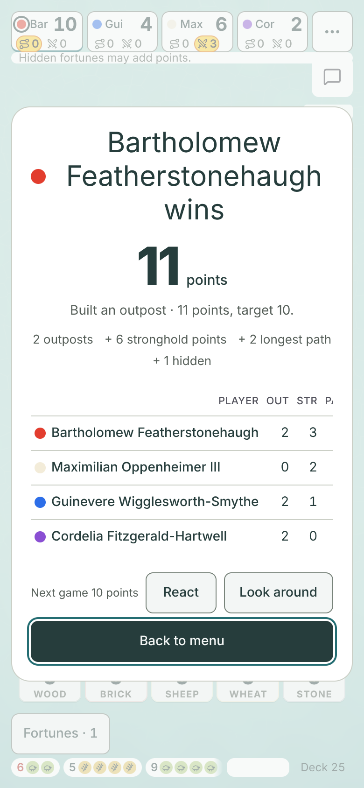
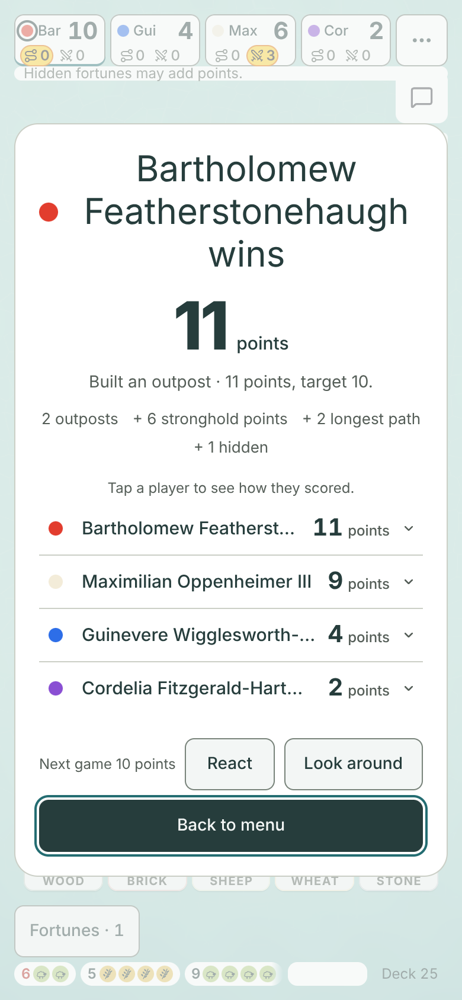
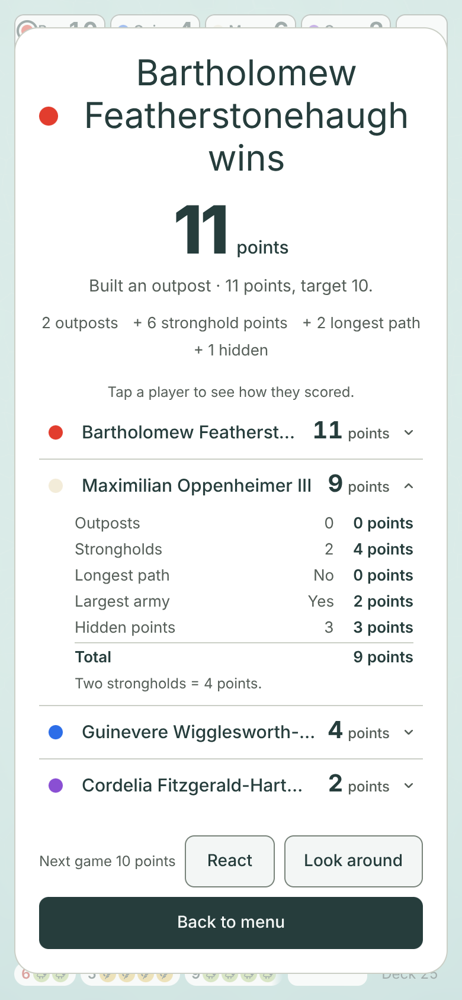
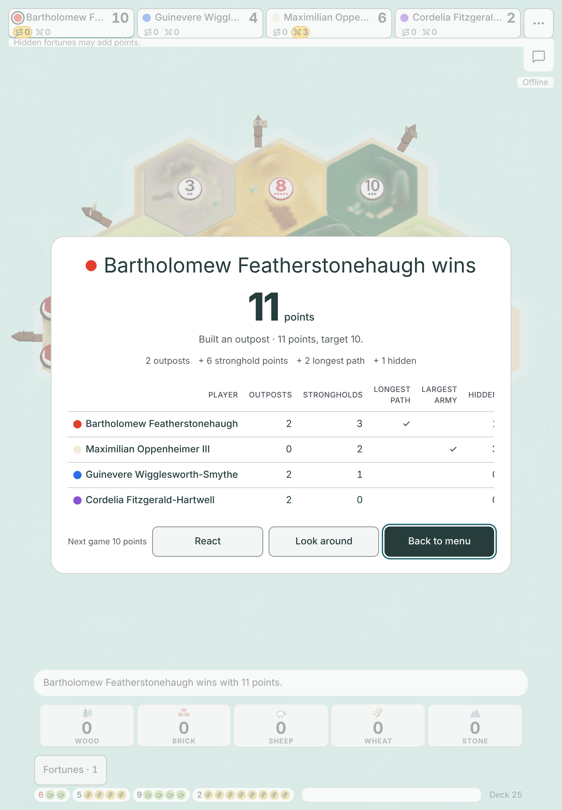
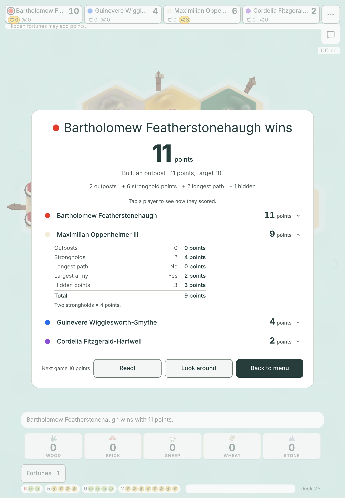
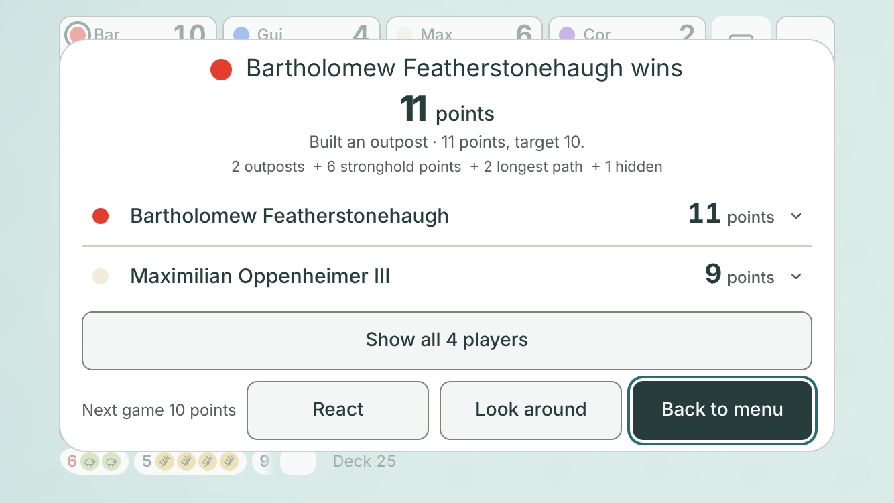

# Compact results mock (#748)

**Design stage only. No game code changes.** Jarrod approves or changes this, then #748 is built from it.
Author: Claude Opus 5.5, 2026-11-07. Base: `main` at `aa1c155`.

## TLDR for Jarrod

- Today, on a phone held upright and on an iPad, the score table is too wide. Each player's **total is hidden off the right edge**. You have to swipe the table sideways to see who scored what.
- The proposal shows **one line per player**: colour dot, name and total. Nothing is hidden and nothing swipes sideways.
- **Tap a player** to see how they scored: outposts, strongholds, longest path, largest army and hidden points. Tap again to close it.
- On a phone held sideways, the list fits with every player closed. When you open a player, the list scrolls down. That breaks one test line, so it needs your OK (see [The one test line](#the-one-test-line-that-needs-jarrods-ok)).
- The desktop with a mouse keeps today's table.

## Before and after

The game is a finished four-player game with long names. Bartholomew won with 11 points.

| Size | Today | Proposal | One player opened |
|---|---|---|---|
| Phone upright 390 × 844 | [before](before-390x844.png) | [after](after-390x844.png) | [open](open-390x844.png) |
| Small phone upright 375 × 667 | [before](before-375x667.png) | [after](after-375x667.png) | [open](open-375x667.png) |
| Big phone upright 430 × 932 | [before](before-430x932.png) | [after](after-430x932.png) | [open](open-430x932.png) |
| iPad upright 820 × 1180 | [before](before-820x1180.png) | [after](after-820x1180.png) | [open](open-820x1180.png) |
| iPad sideways 1180 × 820 | [before](before-1180x820.png) | [after](after-1180x820.png) | [open](open-1180x820.png) |
| Phone sideways 844 × 390 | [before](before-844x390.png) | [after](after-844x390.png) | [open](open-844x390.png), [scrolled down](open-scrolled-844x390.png) |
| Small phone sideways 667 × 375 | [before](before-667x375.png) | [after](after-667x375.png) | [open](open-667x375.png), [scrolled down](open-scrolled-667x375.png) |
| Small phone sideways with a notch | [before](before-667x375-insets.png) | [after](after-667x375-insets.png) | [open](open-667x375-insets.png), [scrolled down](open-scrolled-667x375-insets.png) |
| Desktop 1280 × 720 | [before](before-1280x720.png) | unchanged | |

| Phone upright, today | Phone upright, proposal | Phone upright, Maximilian opened |
|---|---|---|
|  |  |  |

| iPad upright, today | iPad upright, Maximilian opened |
|---|---|
|  |  |

### What the numbers say

From the final run of [capture.mjs](capture.mjs). Full numbers are in [measurements.json](measurements.json).

| Size | Today: totals you can see | Today: swipes sideways | Proposal: totals you can see | Proposal: swipes sideways | Proposal: list scrolls down |
|---|---|---|---|---|---|
| 390 × 844 | 0 of 4 | yes | 4 of 4 | no | no, even with a player open |
| 375 × 667 | 0 of 4 | yes | 4 of 4 | no | only with a player open |
| 430 × 932 | 0 of 4 | yes | 4 of 4 | no | no, even with a player open |
| 820 × 1180 | 0 of 4 | yes | 4 of 4 | no | no, even with a player open |
| 1180 × 820 | 0 of 4 | yes | 4 of 4 | no | no, even with a player open |
| 844 × 390 | 4 of 4 | no | 4 of 4 | no | only with a player open |
| 667 × 375 | 4 of 4 | no | 4 of 4 | no | only with a player open |
| 667 × 375 with a notch | 0 of 4 | yes | 3 of 4, the 4th by scrolling 7 px | no | yes, by 7 px |
| 1280 × 720 (desktop) | 0 of 4 | yes | not changed | | |

Today, rows are 37 px tall upright and 21 px sideways. In the proposal every row is 44 px. Every result button stays on screen at every size. Browser errors: 0.

## The design

### One row per player

- One 44 px row per player: seat colour dot, name, then the final total with "points".
- The order stays as today: the winner first, then the highest total down.
- A long name ends in "…" while the row is closed. Opening the row shows the full name.
- A short line above the list says "Tap a player to see how they scored." It is hidden when the screen is 480 px tall or less.
- Rows sit on the white sheet with a thin line between them. They use the game's own text sizes and colours from `src/styles.css`.

### Opening a row

Tap a row to open its breakdown under it. Tap it again to close it. More than one row can be open.

| Part | Count | Points |
|---|---|---|
| Outposts | 0 | 0 points |
| Strongholds | 2 | 4 points |
| Longest path | No | 0 points |
| Largest army | Yes | 2 points |
| Hidden points | 3 | 3 points |
| **Total** | | **9 points** |

- Every part is shown, including the zeros.
- The count and the points sit side by side, so two strongholds read as 4 points.
- A note under the breakdown says "Two strongholds = 4 points." when there are two, or "Each stronghold is worth 2 points." otherwise.
- The numbers come from the game's own score rules (`publicScoreBreakdown` and `totalVP` in `src/lib/game/rules.ts`). The capture checks each total against `totalVP`.

### For screen readers and keyboards

- Each row is a real button inside a heading, with `aria-expanded` and `aria-controls`.
- The breakdown is a named region, for example "Maximilian Oppenheimer III's score".
- Enter and Space open and close a row. The capture checks tap, Enter and Space.
- Every row and button is at least 44 px tall. The capture fails if one is shorter.
- The win screen's focus trap, Look around, Show scores, Play again and Back to menu do not change.

### Where it applies

The list shows wherever the game's own phone test is true: a touch screen, or a window under 768 px wide (`src/lib/viewport.ts`). That covers phones both ways round and iPads both ways round. A desktop with a mouse keeps today's table.

### Phone held sideways

- With every player closed, the list fits on 844 × 390 and 667 × 375 with no scrolling.
- On a small phone with a notch (667 × 375 with the safe-area insets `win-action-prove` uses), the closed list scrolls by 7 px.
- With a player open, the list scrolls down inside the sheet. The heading and the buttons stay put. See [open](open-844x390.png) and [scrolled down](open-scrolled-844x390.png).

#### Alternative for short sideways screens: two rows and More

On a screen 480 px tall or less, show the top two players, then a 44 px **Show all 4 players** button. Tap it to show the rest. It then reads **Show fewer**.

| 844 × 390 | 667 × 375 | 667 × 375 with a notch |
|---|---|---|
| [two rows](more-844x390.png), [all shown](more-open-844x390.png) | [two rows](more-667x375.png), [all shown](more-open-667x375.png) | [two rows](more-667x375-insets.png), [all shown](more-open-667x375-insets.png) |

| Two rows and More, 667 × 375 with a notch |
|---|
|  |

- It keeps the first view free of scrolling on every sideways size.
- After More, the list scrolls down, just like the main design. The test line still breaks.
- It adds a tap to see the other players, and hides who came last.

**Recommendation:** the main design, without More. The closed list already fits the common sideways sizes. More only saves 7 px on a notched small phone and adds a tap.

### The one test line that needs Jarrod's OK

`scripts/win-action-prove.mjs`, line 100, inside `if(height<=480)`:

```js
assert.ok(dims.scrollHeight<=dims.clientHeight,`table must not scroll vertically: ...`);
```

It says the score list must not scroll down at a height of 480 px or less. Opening a player makes the list scroll at those heights, by design. Line 105 (`row must fit within table wrap`) depends on it.

| | Old | New |
|---|---|---|
| Line 100 | At height 480 or less, the score list must not scroll down. | At height 480 or less, the **desktop table** must not scroll down. |
| Line 105 | At height 480 or less, each row must fit inside the list. | For the compact list, scroll each row into view first. It must then fit inside the list and the screen. |

Every other check in that proof stays: no sideways scroll, totals inside the list, every row on screen, the win text. This is the same change the helper branch `helper/748-compact-results` asked for on #748 (2026-10-29). Under the 2026-10-25 rule in `docs/DECISIONS.md`, the builder makes it in its own commit, with this table in the PR body.

## Questions for Jarrod

1. **Approve the narrowed test line?** Recommended: yes. The other choice is the two-rows-and-More layout. Even that scrolls once More is tapped.
2. **iPads get the list, not the table.** The game already treats an iPad as a phone. Recommended: yes, since iPad totals are hidden today.
3. **The desktop table also hides the total today** with long names (1280 × 720: [before](before-1280x720.png)). #748 keeps the desktop table. Recommended: a separate small issue to let the desktop table fit, not this one.

## How it was made

- [capture.mjs](capture.mjs) starts the game, and loads the finished game straight into the store, as `scripts/public-score-prove.mjs` does.
- "Today" pictures are the real game, untouched.
- **"Proposal" pictures are a mock.** The capture hides the real table and adds the list from [list.css](list.css) and a little DOM. The list is built from the real game state, and reuses the real seat dots and the real Look around button style.
- The capture fails if the real win screen, table, four rows, totals or Look around button are missing. It also fails if a mock total differs from the real table or `totalVP`, a row or button is under 44 px, the list scrolls sideways, a total is out of reach, or a result button leaves the screen.
- Pictures are at device scale 2, with touch on every size but desktop. Chromium 153.0.8010.12.
- Run it from the repo root, one browser at a time: `node --import ./server/register.mjs docs/design/results-748/capture.mjs`. Add `--save` to replace the pictures here.
