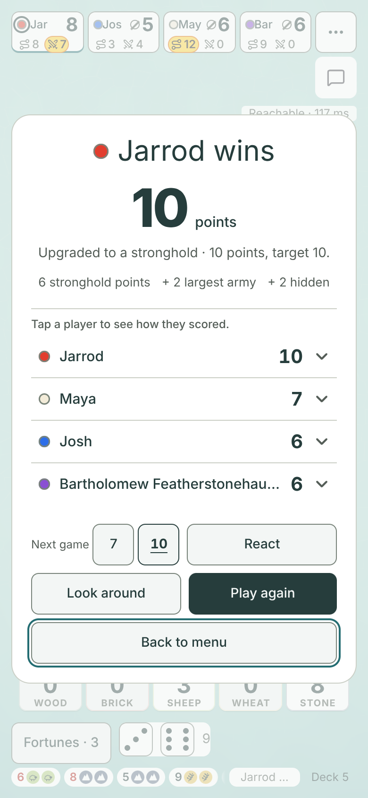
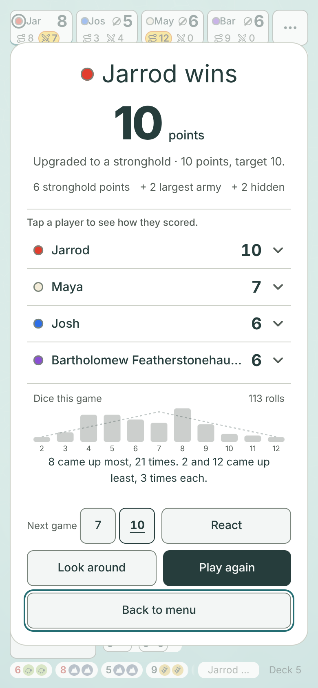
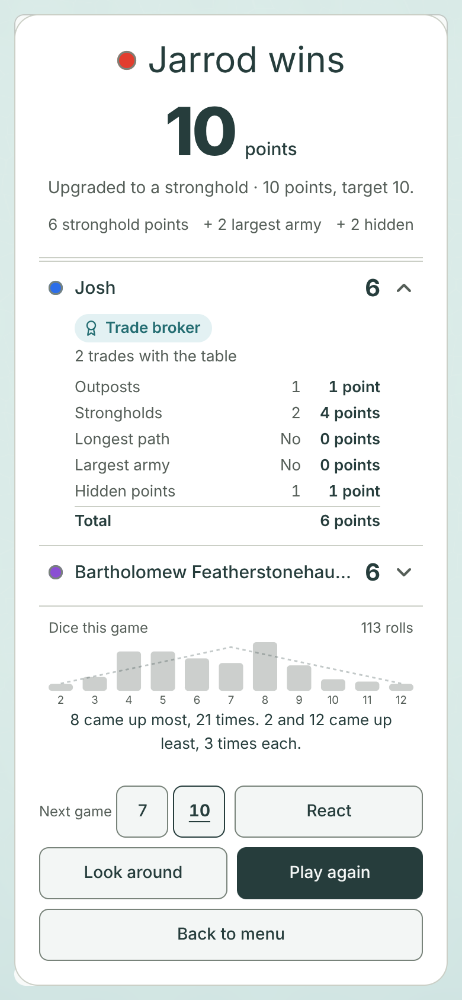
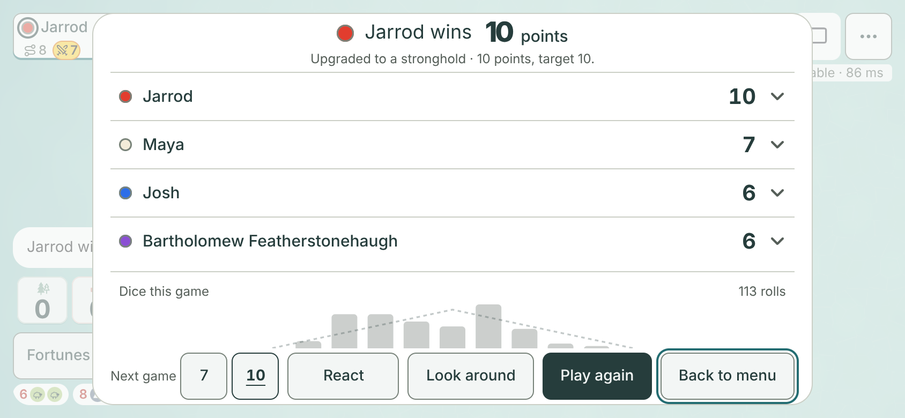
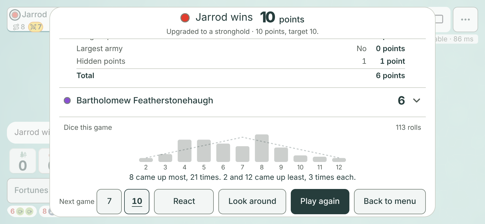

# Island awards and dice story on the results screen (#1452, #1453)

**Design stage only. No game code changes.** Jarrod approves or changes this, then #1452 and #1453 are built from it.
Author: Claude Opus 5.5, 2026-11-08. Base: `main` at `4f60ffbb`.
One packet covers both issues, so the results screen is designed once.
The issues name two folders, `docs/design/island-awards/` and `docs/design/dice-story/`. This one folder replaces both, as the desk's brief asked.

## TLDR for Jarrod

- **Awards:** every player who lost gets one funny, earned title, like "Trade broker · 2 trades with the table". The winner gets one only if a title is left over.
- The title sits **inside the player's opened row**, above the score breakdown. With every row closed, nothing new shows.
- **Dice story:** one calm strip under the list. It shows how often each sum from 2 to 12 came up, with a faint dashed line for the odds, and one sentence.
- The sentence calls the dice unusual only when a proper test says so. Fair dice trip it in about 1 game in 20. Otherwise it states plain facts: "8 came up most, 21 times. 2 and 12 came up least, 3 times each."
- Both show only on the results screen. Nothing is shown during play. Hidden counts stay hidden until the win.
- Both load as **one new small download**, estimated at 1.1 to 1.4 kB, with a proposed 1,600 B ceiling.
- On phones and iPads held upright, the list still fits with every row closed. On a phone held sideways, the strip makes the closed list scroll by about 50 px.

## Before and after

The pictures come from a real game. The real rules and the real bots played it to the end. The real host then ran the winning move, and the browser joined as Jarrod through that host. See [How it was made](#how-it-was-made).

Jarrod won 10 points to Maya 7, Josh 6 and Bartholomew 6, after 113 rolls. The "open" pictures open Josh, a last-place player.

| Size | Today | Proposal, rows closed | Josh opened |
|---|---|---|---|
| Big phone upright 430 × 932 | [before](before-430x932.png) | [after](after-430x932.png) | [open](open-430x932.png) |
| Phone upright 390 × 844 | [before](before-390x844.png) | [after](after-390x844.png) | [open](open-390x844.png) |
| Small phone upright 375 × 812 | [before](before-375x812.png) | [after](after-375x812.png) | [open](open-375x812.png) |
| iPad upright 820 × 1180 | [before](before-820x1180.png) | [after](after-820x1180.png) | [open](open-820x1180.png) |
| Phone sideways 844 × 390 | [before](before-844x390.png) | [after](after-844x390.png) | [open](open-844x390.png), [scrolled down](open-scrolled-844x390.png) |

| Phone upright, today | Proposal, rows closed | Josh opened |
|---|---|---|
|  |  |  |

| Phone sideways, proposal | Josh opened, scrolled down |
|---|---|
|  |  |

### What the numbers say

From the final run of [capture.mjs](capture.mjs). Full numbers are in [measurements.json](measurements.json).

| Size | Dice strip height | Strip in view, rows closed | List scrolls, rows closed | List scrolls, Josh opened | Award line height |
|---|---|---|---|---|---|
| 430 × 932 | 138 px | yes | no | no | 24 px |
| 390 × 844 | 131 px | yes | no | yes | 46 px (the fact wraps) |
| 375 × 812 | 128 px | yes | no | yes | 46 px (the fact wraps) |
| 820 × 1180 | 120 px | yes | no | no | 24 px |
| 844 × 390 | 120 px | partly: header and bar tops | yes, by 50 px | yes | 24 px |

On phones held upright, the plain-facts sentence wraps to two lines, so the strip is 20 px taller there than with a one-line sentence.

- Every row stays 44 px. Nothing scrolls sideways. Every result button stays on screen at every size. Browser errors: 0.
- The chip is 24 px tall. It is never on screen while every row is closed.
- On the sideways phone, the strip starts under the four rows. Its header and the tops of the bars show above the buttons; the rest is reached by scrolling the list. So the closed list now scrolls there, by about 50 px (today: no scroll). The list already scrolls there once a row opens (#748). The strip never covers the buttons.

## The design

### Award chip

- One chip per player, at the top of that player's opened row, above the breakdown. Closed rows show nothing new.
- The chip holds the title with a small award icon. The fact follows it in muted text: **Trade broker** 3 trades with the table.
- It uses the game's own colours: a pale sea tint, sea-ink text, the 13 px breakdown text size.
- On a narrow phone the fact wraps under the chip. It never cuts off.

### Dice strip

- It sits under the list, inside the same scrolling area, with a thin line above it. It is not pinned and adds no button.
- 11 bars, one per sum from 2 to 12, 44 px tall at most. All bars are pale grey. Only when the dice were unusual is the named sum sea-ink.
- A faint dashed line shows how many of each sum the odds expected for this many rolls.
- The header reads "Dice this game" with the roll count on the right. Under the bars is one sentence.
- Screen readers get the chart as one image with a label, and the sentence as text.
- No `rollSums` (an old save, or a game from before the build) or no rolls at all: the strip does not show.

### The dice sentence

The sentence must not call fair dice rigged, so it uses a whole-spread test, not the biggest single gap.

1. **Under 30 rolls:** no test. The sentence states plain facts (below).
2. **30 rolls or more:** a chi-square test over the 11 sums at the 5 % level.
   - Sums with an expected count under 5 are merged with a neighbour first, so the test is valid in short games. At 113 rolls, 2 and 3 merge, and so do 11 and 12.
   - If the spread is unusual, the sentence names the sum furthest from its odds. Its bar turns sea-ink.
   - If not, the sentence states plain facts.
3. **Plain facts:** the most and least common sums, with no judgement. "8 came up most, 21 times. 2 and 12 came up least, 3 times each." A sum that never came up reads "12 never came up."

**False-alarm rate, measured.** [simulate.mjs](simulate.mjs) rolled fair crypto dice, 20,000 games at each length. It counted how often the sentence calls the dice unusual. The numbers are in [simulation.json](simulation.json).

| Rolls in the game | 30 | 40 | 60 | 80 | 113 | 150 | 200 |
|---|---|---|---|---|---|---|---|
| Fair games called unusual | 4.5 % | 5.0 % | 4.7 % | 5.0 % | 4.8 % | 4.7 % | 4.7 % |

An earlier run gave 4.6 % to 5.3 %. Each run is a new random draw.

So about 1 fair game in 20 still gets the "unusual" line. That is the price of a 5 % test. A stricter 1 % test would cut false alarms to 1 in 100 but would rarely name a real streak.

**Two wordings for Jarrod to choose from:**

| Case | A (recommended): facts only | B: with a judgement |
|---|---|---|
| Unusual spread | Unusual dice: 4 came up 17 times, about 9 expected. | 4 came up 17 times, about 9 expected. Fair dice do that less than 1 game in 20. |
| Not unusual, 30 rolls or more | 8 came up most, 21 times. 2 and 12 came up least, 3 times each. | Close to the odds. 8 came up most, 21 times. 2 and 12 came up least, 3 times each. |
| Under 30 rolls | the same facts as A | the same facts as A, with no judgement |

The unusual-spread line in that table is a made-up example. The pictured game (113 rolls, `[3, 6, 17, 17, 14, 12, 21, 11, 5, 4, 3]`) is not unusual: chi-square 15.0 against a 5 % cut-off of 15.5 for its 9 bins. So the pictures show wording A's plain facts, with no coloured bar.

- The dice stay crypto-random. The host only counts the sums it already rolled.

## The award rules

The facts come only from the finished game. Each title has a count, a smallest count that earns it, and a fact line.
They are listed in priority order. The example fact lines use counts from the pictured game; the two fallback lines are made up.

| # | Title | Count | Earns it at | Example fact line |
|---|---|---|---|---|
| 1 | Wayfarer's favourite | goods lost to steals (`goodsLost`, #550) | 3 | lost 13 goods to steals |
| 2 | Hit by 7s | goods thrown away on a 7 | 4 | threw away 8 goods on 7s |
| 3 | Trade broker | accepted trades with other players, as asker or answerer | 2 | 2 trades with the table |
| 4 | Wood, Brick, Wool, Grain or Ore baron | the most of one good gathered from rolls | 8 | 63 ore from rolls |
| 5 | Light fingers | goods stolen with the wayfarer | 3 | stole 8 goods |
| 6 | Harbour regular | bank and dock trades | 4 | 24 trades at the bank and docks |
| 7 | Road crew | paths built (15 minus paths left) | 8 | built 15 paths |
| fallback, losers only | Dry spell | fewest goods gathered from rolls | none | gathered only 12 goods from rolls; with none, "gathered no goods from rolls" |
| fallback, losers only | Good sport | none | none | played to the last turn |

How the titles are handed out:

1. **Losers first.** Take the titles in order. Each goes to the highest count among losers who hold no title yet, if that count reaches its threshold. A title nobody reaches is skipped.
2. **Ties share.** Two losers tied at the top both get the title. Each still holds only one.
3. **Every loser gets one.** A loser still without a title gets "Dry spell" if their roll goods are the lowest of those left (ties share). Anyone left after that gets "Good sport".
4. **The winner last.** The winner gets the first of the seven main titles that nobody holds and whose threshold they reach. The winner never gets a fallback. If no main title is left, the winner gets no chip. The win is their moment.
5. So each player holds at most one title, and every loser holds exactly one.
6. **Edge cases.** In an old save with no `tally`, every count reads 0, so the losers share "Dry spell · gathered no goods from rolls" and the winner gets no chip. `goodsLost` and paths still count. [simulate.mjs](simulate.mjs) checks this case.

A title means "best among those without one yet", not "best at the table". The fact line always shows the player's own true number. In the pictured game, Maya is "Hit by 7s" with 8 goods thrown away, while the winner threw away 13. The other choice is in [Questions](#questions-for-jarrod).

### The awards in the pictured game

| Player | Points | Award |
|---|---|---|
| Jarrod (won) | 10 | Ore baron · 63 ore from rolls |
| Maya | 7 | Hit by 7s · threw away 8 goods on 7s |
| Josh | 6 | Trade broker · 2 trades with the table |
| Bartholomew | 6 | Wayfarer's favourite · lost 13 goods to steals |

Every count is in `counters` in [measurements.json](measurements.json).

[simulate.mjs](simulate.mjs) also played 10 more whole bot games, of 86 to 136 rolls. The titles are in [simulation.json](simulation.json).

- In all 10, every loser got a main title, and the winner got a leftover one.
- "Dry spell" and "Good sport" were never needed. Shorter human games will need them more often.
- The dice test called none of the 10 games unusual.

## What the host records

All new fields are optional, so old saves load and `ROOM_SHAPE` stays at 2.

| Field | Where it counts | Hidden until the win? |
|---|---|---|
| `GameState.rollSums?: number[]` | 11 counts, sums 2 to 12, `+1` in the `roll` case of `rules.ts` (not the roll-off) | No. Every roll is already public in the log. Only the results screen draws it. |
| `PlayerState.tally?.earned` | goods per good, gathered from rolls, in `produce()` | Yes |
| `PlayerState.tally?.discarded` | goods thrown away, in the `discard` case | Yes |
| `PlayerState.tally?.stole` | goods taken, in `stealOne()` (beside `goodsLost`) | Yes |
| `PlayerState.tally?.tableTrades` | `+1` for both seats on an accepted `respondTrade` | Yes |
| `PlayerState.tally?.bankTrades` | `+1` in the `bankTrade` case | Yes |

- Paths built, `knightsPlayed` and `goodsLost` already exist.
- **Hidden until the win:** `tally` follows the `goodsLost` pattern in `server/host.mjs`. `withoutLoss` drops it from every view, the seat's own included, until `phase` is `"over"`. Then `revealLoss` sends it to every seat and watcher.
- **The build must add this stripping.** Today's host copies any new player field into every seat's view. The capture loaded `tally` into a real host before the win, and every seat saw the other seats' `tally` (`preWinOtherSeatHasTally` in [measurements.json](measurements.json)). `goodsLost` was correctly absent.
- Most of these counts can be worked out from the public log, but nothing shows a running count. Hiding them keeps play free of new stats, as #1450 asks.
- A rematch starts from a fresh game, so every count starts at 0.

## Size

- **`WinList` today: 1.29 kB gzip of its 1.36 kB ceiling, about 70 B of headroom.** This is the CI `build` line on `main` after #1415 (runs at `4f60ffbb` and `3a23e88f`: `ok WinList: 1.29 kB gzip, ceiling 1.36 kB`). The 1,253 B in `scripts/size-prove.mjs` is the older #748 measurement. `WinList.tsx` has not changed on `main` since `4f60ffbb`.
- Neither feature fits inside `WinList`.
- **Proposal: one new lazy chunk, `WinStory`,** holding the award rules, the chip and the dice strip. `WinScreen` prefetches it with `winList`, so it is in memory before the game ends.
- Estimate: awards 600 to 900 B, dice strip about 500 B, so 1.1 to 1.4 kB for both. Proposed ceiling: **`WinStory` 1,600 B gzip**. If the desk prefers two chunks: `WinAwards` 1,000 B and `DiceStory` 650 B, 1,650 B together.
- **Mount points, to keep `WinList` small:**
  - `WinScreen` mounts the strip under the list. That lands in `WinScreen`'s chunk, inside its usual growth allowance (0.33 %, at least 200 B).
  - `WinList` needs one lazy `<Award id>` slot in the opened row's region, about 30 to 50 B. That should fit the 70 B of headroom.
  - If the build measures more than that, the desk raises `WinList` a little or the builder trims it. That is the desk's call.
- The counters live in `rules.ts`, which is in `index`. Estimate +150 to +250 B, inside the 400 B allowance.
- `server/host.mjs` gains one field in `withoutLoss` and `revealLoss`.
- The desk sets the real ceilings from CI numbers at build time.

## The proofs a build would add

One new browser-free proof, `server/award-tally-prove.mjs`, modelled on `server/steal-loss-prove.mjs`. Register it in `package.json` and `ci.yml`.

- The rules count each fact: a roll adds 1 to its sum; a 7 adds nothing to `earned`; a discard of 4 adds 4; a steal adds 1 to `stole`; an accepted trade adds 1 to both seats; a declined one adds nothing; a bank or dock trade adds 1.
- The roll-off adds nothing to `rollSums`.
- Over real sockets, no seat view (the seat's own included) and no watcher view carries `tally` before the win.
- At the win every seat and the watcher get every seat's `tally` and `rollSums`.
- A host restart (kill -9) before and after the win keeps every count. A rematch starts at zero.
- `islandAwards`: each player holds at most one title; every loser holds exactly one; a tie shares; a title below its threshold is skipped; the winner never gets a fallback and gets none when nothing is left; all-zero counts give a shared "Dry spell".
- `diceLine`: fixed `rollSums` give the exact sentence for an unusual spread, a usual one, under 30 rolls and a sum that never came up. No `rollSums` or no rolls gives no strip. The bins at 113 rolls are 2+3, 4 to 10, 11+12.
- The false-alarm simulation stays in this packet. It is random, so it is not a CI proof.

Extend `scripts/win-list-prove.mjs`:

- Closed rows show no `win-award`. Opening a row shows exactly one, inside its region.
- `win-dice` shows 11 bars and its sentence, with no sideways scroll at 375 px.
- Every result button stays on screen at 844 × 390. The existing checks stay as they are.

No existing test line changes.

## Working with #541 and #1411

- **#541, staged win (backlog):** three short beats on the board, then the existing results panel. Awards and the strip live inside that panel, so they appear after the beats, never during them. They add no motion. If #541 lands first, nothing here changes.
- **#1411, who wants to play again (design open):** its option A puts a "✓ Play again" tag on each **closed** row. Awards sit only in the **opened** row, so the two never share a spot.
  - Both add height on short sideways screens. At 844 × 390 the strip makes the closed list scroll by about 50 px. #1411 option A fits there by itself.
  - At 667 × 375 with a notch, #1411 option A already scrolls 34 px for another player's view (its README). This packet did not measure that size.
  - Built together, the closed list scrolls a little more on those screens. Every button stays on screen in both designs.
- Whichever builds second rebases on the first. They touch different lines of `WinList.tsx`.

## Questions for Jarrod

1. **Approve the chip and the strip as pictured?** Recommended: yes.
2. **Where do awards go on the desktop table?** A desktop with a mouse keeps today's table, which has no opened row.
   - A (recommended): a muted line under the name in the table, like the #767 profile line: "Trade broker · 2 trades with the table". Desktop has the room.
   - B: one line of four chips under the table.
   - C: no awards on desktop.
   The dice strip goes under the table on desktop in every option.
3. **"Best among the rest" or strict "best at the table"?** Recommended: best among the rest, so every loser gets a real title. The fact line keeps it honest. Strict would give more players "Dry spell" and "Good sport".
4. **Titles and thresholds:** change any title, fact line or threshold in the table above? They are tuned on bot games of 86 to 136 rolls. Human games are shorter, so the thresholds are kept low.
5. **Dice wording A or B?** See [The dice sentence](#the-dice-sentence). Recommended: A, facts only. B adds "Close to the odds" or "Fair dice do that less than 1 game in 20".
6. **Keep the 5 % test, or use a stricter 1 %?** Recommended: 5 %. It stays quiet in 19 fair games of 20 and still catches a real streak.

## How it was made

- [play.mjs](play.mjs) plays a whole four-seat game with the real `rules.ts` and the real bot brain in `ai.ts`, including table trades. It counts the proposed facts around each action, outside `rules.ts`. The dice are the real crypto dice.
- [capture.mjs](capture.mjs) saves that game in [game.json](game.json): the state one move before the win, and the winning move.
- It writes the room for the **real host** (`server/host.mjs`), connects four seats and a watcher over real sockets, and sends the winning move from the winner's socket. It checks that every view at the win carries every seat's counts and `rollSums`.
- The browser then joins as seat p0 (Jarrod, the host) through that host, at device scale 2, with touch. Chromium 153.0.8010.12.
- "Before" pictures are the real results screen, untouched.
- **"After" and "open" pictures are a mock.** [mock.css](mock.css) and a little DOM add the chip to each row's region and the strip under the list. They are built in the page from the store's real state, using [awards.mjs](awards.mjs).
- The run fails if: the list or rows are missing, a row is under 44 px, the list scrolls sideways, a result button leaves the screen, a chip shows with every row closed or outside the opened row, or the opened row has no chip.
- Run it from the repo root, one browser at a time: `flock /tmp/claude-0/emberisle-browser.lock node --import ./server/register.mjs docs/design/results-awards-dice/capture.mjs`. Add `--save` to replace the pictures here, and `--new` to play a fresh game.
- Without `--save`, the pictures go to a temp folder that the run deletes at the end. `--keep` keeps it. A failed wait saves `fail-<size>.png` in the pictures folder.
- [simulate.mjs](simulate.mjs) makes the false-alarm table and the 10-game award summary in [simulation.json](simulation.json), and checks the edge cases: `node --import ./server/register.mjs docs/design/results-awards-dice/simulate.mjs --save`.
- Nothing here is imported by `src/`. A build writes its own code.
