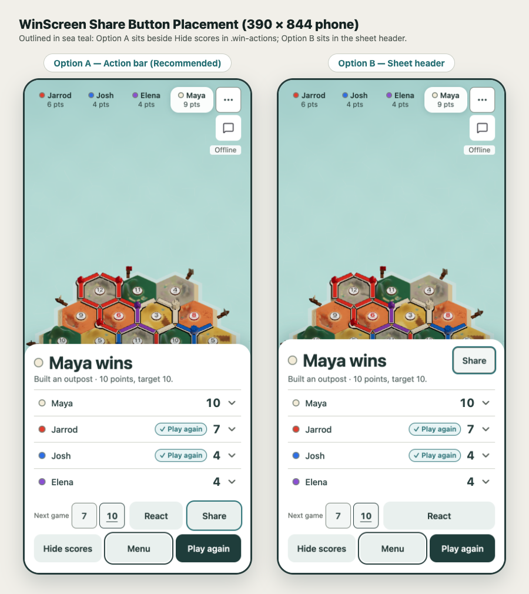
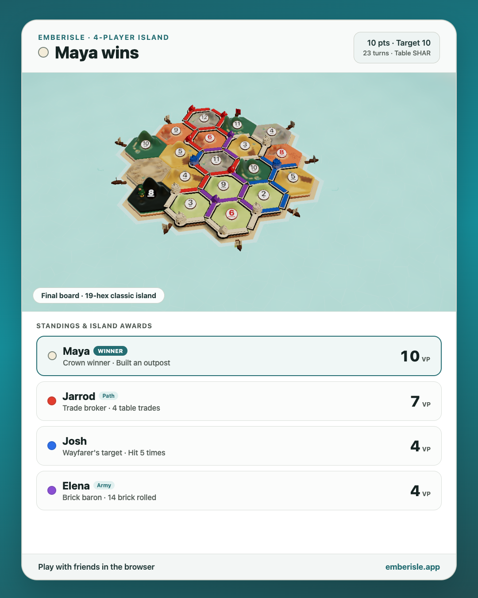
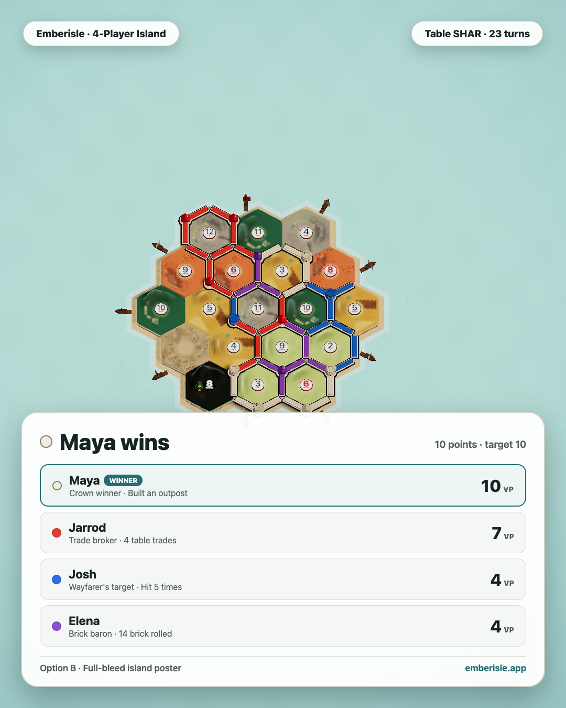
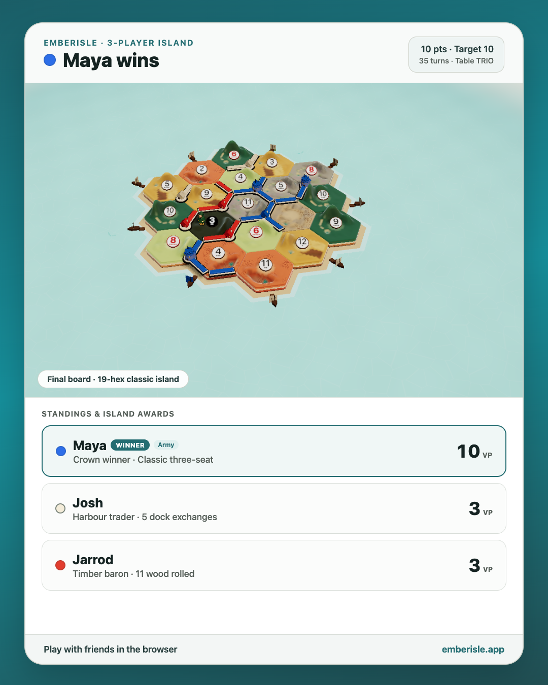
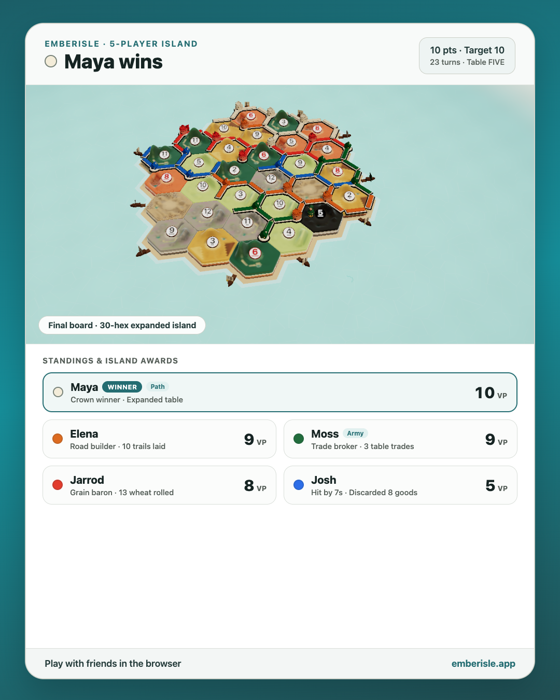
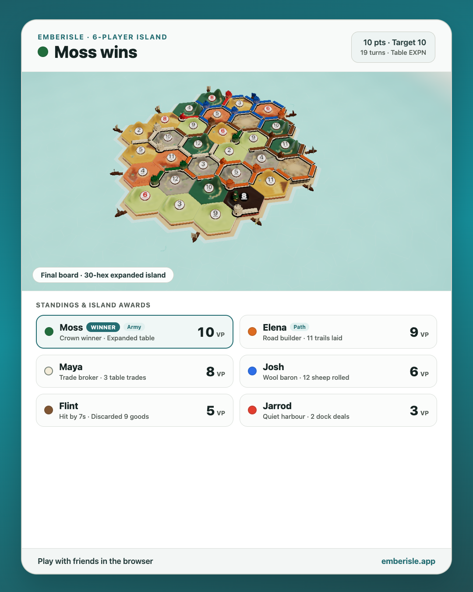
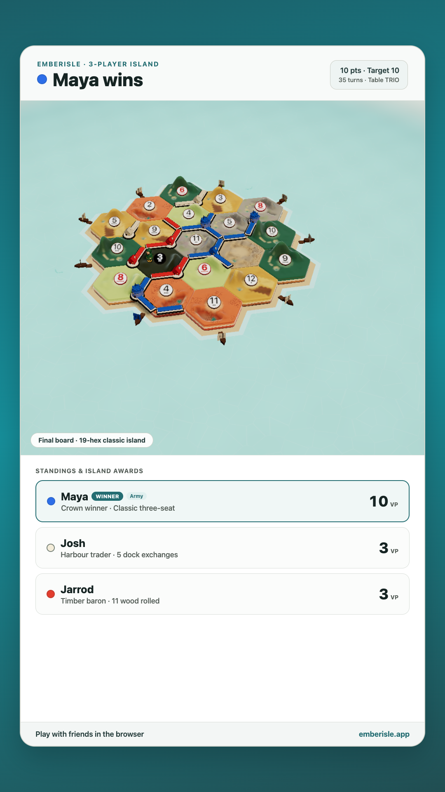
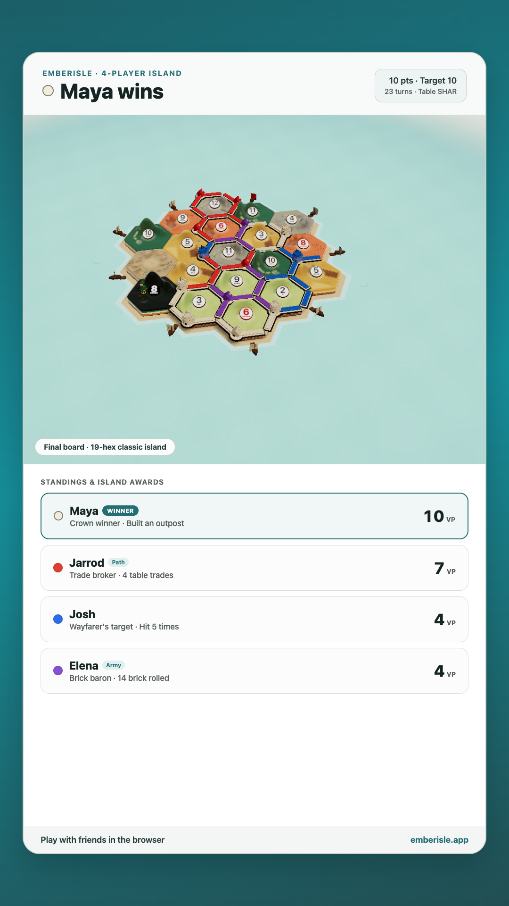
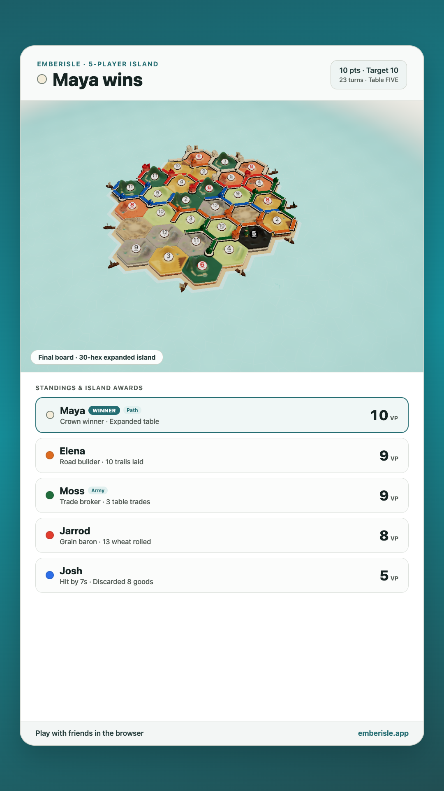
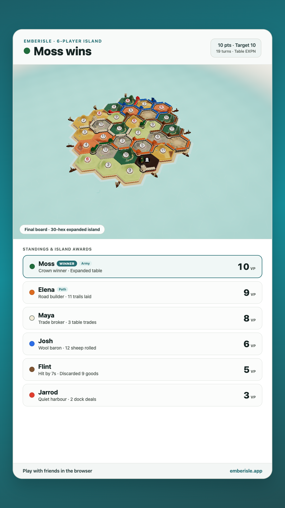

# Design: Share-Your-Game Card (#1454)

- date: 2026-11-17
- status: design packet (Step 1; awaiting owner choices on #1454)
- lane: hud (tier 1, prio:p1)
- issue: [#1454](https://github.com/jarrodjohnson-gif/emberisle/issues/1454)
- dependencies: #1450, #1452, DECISIONS 2026-10-27

## 1. Overview
The owner picked the top three fun features from #1450 on 2026-11-08.
This design packet covers item three: the share-your-game card.
A Share button on the results screen generates one image of the finished game.
The image combines the final 3D island, final standings for 3–6 seats, and island awards from #1452.
DECISIONS 2026-10-27 motivates sharing finished games on Threads and Instagram.

## 2. Open Owner Decisions
This packet proposes two design choices for the owner to pick on Issue #1454.
No runtime code ships until the owner approves both choices.

### Decision 1: Share Button Placement on WinScreen
The results screen currently places actions in `.win-actions` (`src/components/game/WinScreen.tsx:223-265`).
Two placements fit the 390 × 844 phone viewport without adding permanent board chrome:

- **Option A (Recommended) — Action bar beside Hide scores:**
  Insert a secondary `Share` button before `Hide scores` (`src/components/game/WinScreen.tsx:240-242`).
  On 390 × 844 phones, `Share` shares row one with `Next game` and `React`.
  It adds zero extra rows and keeps every post-game button in one bar.
  When scores hide (`src/components/game/WinScreen.tsx:149-160`), add a compact `Share` button to `win-chip`.
- **Option B — Results sheet header:**
  Place a 44 px `Share` button on the right of `#win-headline` (`src/components/game/WinScreen.tsx:203-208`).
  This leaves `.win-actions` untouched and keeps `React` wider on narrow phones.



### Decision 2: Card Visual Style
Two card styles render the real 3D final island at exact social dimensions:

- **Option A (Recommended) — Ocean-framed tray card:**
  Frames a crisp white Emberisle tray card inside a deep crystal-sea border.
  The final 3D island sits in its own panel above the standings.
  [capture.mjs](capture.mjs) verifies bounding boxes for every Option A card so no section or row overlaps.
- **Option B — Full-bleed island poster:**
  Fills the canvas edge-to-edge with one continuous crystal-sea and 3D island render.
  A floating white results tray overlays the bottom half, mirroring the live WinScreen.

| Option A — Ocean-framed tray (Recommended) | Option B — Full-bleed poster |
|---|---|
|  |  |

## 3. Card Formats for 3–6 Seat Tables
Emberisle tables always run with 3–6 seats.
Classic islands hold 3–4 seats (`src/lib/game/board.ts:199` adds a bot below three).
Expanded islands hold 5–6 seats (`src/lib/game/expanded.ts:44-48`, `EXPANDED_COLORS`, `EXPANDED_SEATS`).
Pictures below cover every real seat count: 3-seat (emptiest classic), 4-seat classic, 5-seat (first expanded), and 6-seat expanded.

### Portrait Feed: 1080 × 1350 px (4:5 Ratio)
Targeted at Instagram and Threads feed posts.
- **3–4 seats:** Single-column standings stack under the 19-hex island render; 3-seat cards give the island extra height.
- **5–6 seats:** Compact two-column standings grid under the 30-hex island render.
  On 5-seat cards, the winner spans the full width above a two-by-two grid for seats two through five.

| 3-Player Classic (1080 × 1350) | 4-Player Classic (1080 × 1350) |
|---|---|
|  |  |

| 5-Player Expanded (1080 × 1350) | 6-Player Expanded (1080 × 1350) |
|---|---|
|  |  |

### Vertical Story: 1080 × 1920 px (9:16 Ratio)
Targeted at Instagram Stories and full-screen mobile sharing.
- **Safe zones:** 110 px ocean borders at top and bottom keep content clear of Story UI overlays.
- **3–6 seats:** Single-column standings list fits every table size from three seats to six seats.

| 3-Player Classic (1080 × 1920) | 4-Player Classic (1080 × 1920) |
|---|---|
|  |  |

| 5-Player Expanded (1080 × 1920) | 6-Player Expanded (1080 × 1920) |
|---|---|
|  |  |

## 4. Native Share and Download Fallback
Tapping `Share` composes the PNG blob on an offscreen 2D canvas using the live WebGL snapshot.

- **Web Share API Level 2 (Phones):**
  Check `navigator.canShare?.({ files: [file] })` before calling `navigator.share({ files: [file], title, url })`.
  iOS Safari and Android Chrome open the native share sheet for Threads, Instagram, and other installed share targets.
  Treat `AbortError` as a clean user cancel with no error toast.
- **Download Fallback (Desktop and unsupported browsers):**
  Create an object URL for the PNG blob and trigger `<a download="emberisle-YYYY-MM-DD.png">`.
  Revoke the object URL after the click completes.

## 5. Privacy and Security Boundaries
- **Public link only:** Include the public game link only, never a seat secret or reconnect token.
- **Post-win only:** Mount the Share trigger strictly when `state.phase === "over"`.
- **No hidden leaks:** Never read or render unrevealed hands, deck order, or private profile fields.

## 6. Lazy Chunking and Size Budget
- **Zero `IslandCanvas` growth:** Keep all card layout and export code out of `IslandCanvas` and `index`.
- **Load on tap:** Dynamically import the new `ShareCard` module only when a player taps `Share`.
- **Measured budget:** This design packet contains no runtime code, so it states no guessed gzip estimate.
  Step 2 will measure the real built chunk with `npm run build && npm run size-prove` under a desk-set ceiling.

## 7. How the Mockups Were Captured
[capture.mjs](capture.mjs) plays real 3-, 4-, 5-, and 6-seat games to completion via `createAnyGame` and `chooseBotAction`.
It renders all four finished boards in the live Vite app with Playwright Chromium and captures real WebGL PNGs.
It verifies zero bounding-box overlap on every Option A card and pixel continuity across Option B's sea backdrop.
The 390 × 844 placement shots inject a mock `win-share-mock` button into the live WinScreen DOM.
They force a 44 px height on Option B's header button and fake the `"Play again"` seat state for illustration.
Run locally under the Playwright lock:
```bash
node --import ./server/register.mjs docs/design/share-card/capture.mjs
```
