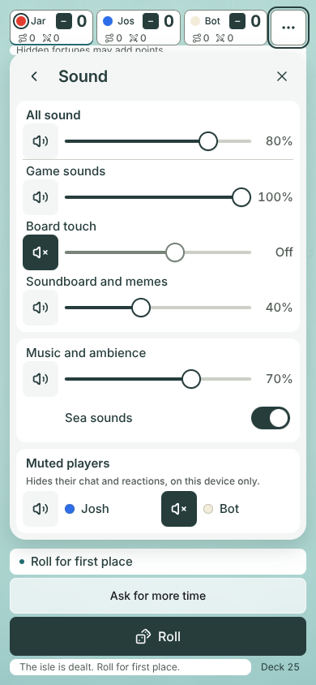
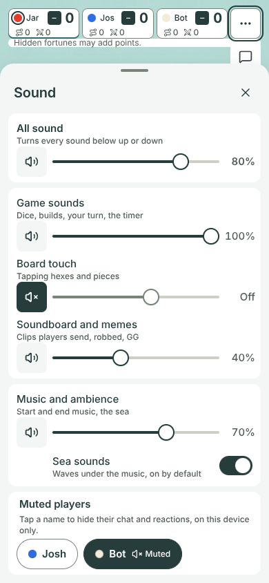
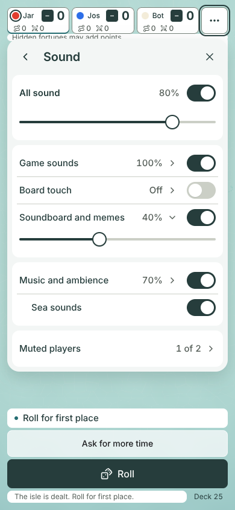

# Sound sheet mocks (#1276, for #669)

**Design stage only. No game code changes.** Jarrod picks one option, then #669 is built from it.
Author: Claude Opus 5.5, 2026-11-07. Base: `main` at `5b83aa1`.

## The options

| Option | In one line |
|---|---|
| **A. Panel in the menu's spot** (recommended) | Sound opens where the Table menu was, with every slider showing at once. |
| **B. Big sheet with hints** | A bigger sheet covers the table, and each slider says what it covers. |
| **C. Switches first** | Each kind of sound is one on/off switch; tap its row to show the slider. |
| **D. Something else** | Jarrod describes what he wants instead. |

### What is different

- **A** sits under the `…` button, in the space between the header and the dock. The dock and Roll stay visible. Back returns to the Table menu. Every control is one tap away. Muted players are speaker buttons, the same as the sliders' mute buttons.
- **B** is a bottom sheet on a phone held upright, and covers the dock. On a phone held sideways and on desktop it is a centred window with three columns. Every row has a short line saying what it covers. Muted players are name chips.
- **C** is the shortest list. A slider shows only for All sound and for the row you open (Soundboard is open here). Muted players is one row that opens its own list.

## Pictures

| Size | A | B | C |
|---|---|---|---|
| 390 × 844 | [a-390x844.png](a-390x844.png) | [b-390x844.png](b-390x844.png) | [c-390x844.png](c-390x844.png) |
| 844 × 390 | [a-844x390.png](a-844x390.png) | [b-844x390.png](b-844x390.png) | [c-844x390.png](c-844x390.png) |
| 1280 × 720 | [a-1280x720.png](a-1280x720.png) | [b-1280x720.png](b-1280x720.png) | [c-1280x720.png](c-1280x720.png) |

| 390 × 844, A | 390 × 844, B | 390 × 844, C |
|---|---|---|
|  |  |  |

The way in is the same for every option. "Table sounds on" and "Music on" fold into one **Sound** row in the Table menu: [entry-390x844.png](entry-390x844.png), [entry-844x390.png](entry-844x390.png), [entry-1280x720.png](entry-1280x720.png).

## What every option shares

- The controls from #669: All sound with a mute and a slider, then four kinds with their own mute and slider. The kinds are Game sounds, Board touch, Soundboard and memes, and Music and ambience. Last comes the muted players list.
- A **Sea sounds** switch under Music and ambience, for #1163.
- The #1274 look: white cards on the mist ground, ink text, one ink fill for "on" and the filled part of a slider. 8 px gaps, 44 px targets, 20 px sheet corners. No cream, no blur.
- Type: title 20/26 semibold, labels 15/22, notes 12/16. These are the game's `text-title`, `text-body` and `text-caption`.
- Sliders step in 10s and show the level as a percent. A muted kind shows "Off" and a grey slider that keeps its level.
- The levels in the pictures are examples, picked to show each state. Board touch is muted and the bot is muted.
- No option moves the map. The capture checks that the canvas keeps its size and place with each sheet open.

## Measurements

From the final run of [capture.mjs](capture.mjs). The full numbers are in [measurements.json](measurements.json).

| Option | Size | Sheet (w × h at x, y) | Under the fold | Controls under 44 px | Map moved |
|---|---|---|---|---|---|
| A | 390 × 844 | 366 × 601 at 12, 64 | 0 px | none | no |
| A | 844 × 390 | 552 × 314 at 280, 64 | 22 px (half the second player) | none | no |
| A | 1280 × 720 | 360 × 601 at 908, 64 | 0 px | none | no |
| B | 390 × 844 | 390 × 752 at 0, 92 | 0 px | none | no |
| B | 844 × 390 | 820 × 352 at 12, 19 | 0 px | none | no |
| B | 1280 × 720 | 880 × 348 at 200, 186 | 0 px | none | no |
| C | 390 × 844 | 366 × 551 at 12, 64 | 0 px | none | no |
| C | 844 × 390 | 560 × 314 at 272, 64 | 16 px (part of Muted players) | none | no |
| C | 1280 × 720 | 340 × 559 at 928, 64 | 0 px | none | no |

Every slider's touch area is 44 px tall. Chromium 153.0.8010.12. Browser errors: 0.

## Why A is recommended

- It opens where the Table menu was, so nothing new appears elsewhere on the screen.
- The dock and Roll stay visible on every size.
- Every level shows at a glance, and each one is one drag away.
- It fits a phone held upright and desktop with nothing under the fold.

Its cost: on a phone held sideways, half of the second muted player sits under the fold, so the card scrolls.

## How it was made

- A real host and a real online table ran: Jarrod hosting, Josh as a guest, one bot.
- [capture.mjs](capture.mjs) opens the game at each size and measures the gap the header and dock leave. It then adds each option from [sheet.mjs](sheet.mjs) and [sheet.css](sheet.css) to the running page.
- The sheets use only the game's own CSS tokens from `src/styles.css`. No `src/` file changed.
- Run it from the repo root: `node docs/design/sound-sheet-1276/capture.mjs`. Each run deals a new board, so the island differs between runs.
