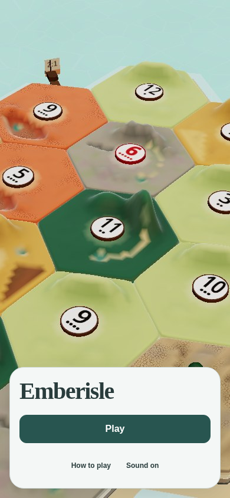

# Title → Play

**Proposal for owner acceptance; no game implementation.** Issue [#1151](https://github.com/jarrodjohnson-gif/emberisle/issues/1151). Design author: Astra-1030-title, **GPT-6 Astra**, 2026-10-30.

The first screen is the island, Emberisle, and **Play**. Play opens the game choices. A bounded detail panel shows open tables or private hosting/joining; the choices and identity remain in view. Six tables take two pages of three rows, so the sixth table is reachable without scrolling or shrinking a target. The proposal deliberately spends more screen area after Play; the front page stays small.

[Interactive mock](mock.html) · [All pictures](gallery.html) · [Measured geometry](measurements.json) · [Capture utility](capture.cjs)

Open the HTML through a local HTTP server. GitHub displays HTML source, so use the PNG links below for review there. This is a standalone review prototype: buttons that would enter a game show a clearly labelled end-of-prototype dialog. They do not create rooms. Help is a placeholder for the existing help sheet, not a proposed rewrite. Backgrounds are static screenshots of the **real current-main island**, captured with chrome hidden and reduced motion; they are not screenshots of implemented title UI. No proposed camera change is shown.

## Start with these pictures

| State | 390 × 844 | 844 × 390 | 1280 × 720 |
|---|---|---|---|
| Front | [Picture](assets/front-390x844.png) | [Picture](assets/front-844x390.png) | [Picture](assets/front-1280x720.png) |
| Play, zero tables | [Picture](assets/play-empty-390x844.png) | [Picture](assets/play-empty-844x390.png) | [Picture](assets/play-empty-1280x720.png) |
| Play, six tables / first three | [Picture](assets/play-six-390x844.png) | [Picture](assets/play-six-844x390.png) | [Picture](assets/play-six-1280x720.png) |
| Six tables / last three | [Picture](assets/play-six-last-390x844.png) | [Picture](assets/play-six-last-844x390.png) | [Picture](assets/play-six-last-1280x720.png) |
| Host / join / watch | [Picture](assets/private-390x844.png) | [Picture](assets/private-844x390.png) | [Picture](assets/private-1280x720.png) |
| Join with valid code | [Picture](assets/private-code-390x844.png) | [Picture](assets/private-code-844x390.png) | [Picture](assets/private-code-1280x720.png) |
| Watch link | [Picture](assets/watch-link-390x844.png) | [Picture](assets/watch-link-844x390.png) | [Picture](assets/watch-link-1280x720.png) |
| Join error | [Picture](assets/private-error-390x844.png) | [Picture](assets/private-error-844x390.png) | [Picture](assets/private-error-1280x720.png) |
| Back to front (keyboard focus restored) | [Picture](assets/back-front-390x844.png) | [Picture](assets/back-front-844x390.png) | [Picture](assets/back-front-1280x720.png) |
| Host open | [Picture](assets/host-open-390x844.png) | [Picture](assets/host-open-844x390.png) | [Picture](assets/host-open-1280x720.png) |

## Scope and precedence

The owner's 2026-10-26 direction on #1151 supersedes the single long title card in #1102 and the older direct-start meaning of the front **Play** button. The neutral colors come from #1117's accepted card, not polish.md's superseded cream palette. The 44 px targets, 8 px control gaps, 12 px text floor and restraint in polish.md/mobile-hud.md still apply. The old portrait 55vh scroll-card rule does not apply to this new Play page.

This design is a **proposal**, not a new owner decision. Approval must explicitly cover the two-panel Play layout, three-row pagination, identity/tools moving behind Play, and the deeper private entry for invitation links. #1117 remains the implementation base (head `4e51d74aa3253cdc3022a776c21ff4b6b7cc2c8a` when read). Keep its prefetch, Unicode name, failure and accessibility fixes. This docs PR is based on current main `13f73f44f7f11b30b20eefd330452f9ac43163f2`; it neither adopts nor modifies #1117.

## Navigation and exact copy

| Entry or action | Result | Return / focus |
|---|---|---|
| Fresh visit without valid invitation | Front: Emberisle, Play, How to play, Sound on/off | No seat form or discovery list on front |
| Front Play | Play page, open-table detail selected; no game starts | Focus Play heading; Back/Escape returns to front and focuses Play |
| Play against bots | Existing `startAi` action, with selected name/color and AI Wayfarer choice | Existing game Leave returns to front; no mock dialog in product |
| Pass this device | Existing `startHotseat(4)` | Existing game Leave returns to front |
| Open tables | Select open-table detail, first page on explicit re-entry | Four modes stay visible |
| Online private | Select private detail, code preserved for this visit | Back/Escape returns to Play/open tables; focus Online private |
| Host an open table | Private detail with heading “Host an open table”, Open selected | Back/Escape returns to Play/open tables |
| Host a table | Existing `hostTable(openMode ? "open" : undefined)` | Existing lobby, no extra confirmation |
| Private / Open | Toggle visibility before hosting; default Private | Private: “Only people with the code”; Open: “Listed for anyone to join” |
| Join / Watch | Existing code action after validity gate | Existing lobby/watch behavior, refusals and errors preserved |
| How to play / Wayfarer rules / Your color | Existing corresponding dialog | Close/Escape closes only the dialog and restores its opener |

The four mode labels are exactly **Play against bots**, **Pass this device**, **Open tables**, **Online private**. Helpers: “Just you and three bots.”, “Four people, one screen.”, “Join a listed table.”, “Host, join or watch.” Bots and pass-device remain usable with no network; no discovery error disables them. No new sign-in/profile flow. The profile-client issue can replace the guest identity later.

Front contains exactly one filled action, Play. Play/open tables gives bots that primary treatment as the immediate offline start. Selection of Open tables uses an outline and pale neutral fill, not another primary. Private detail has one primary: Host with an incomplete code, Join with an ordinary valid code, Watch with a valid watch invitation. The other actions stay secondary. Changing to private removes bots' primary treatment. Selection and primary are different states.

## Identity, code and links

- Name/color move together onto Play. Name label **Your name**, 44 px input, 16 px type. Preserve the store's 16 **code-point** limit and blank-to-Ember commit; do not restore HTML `maxLength=16`. Name changes survive navigation between details and front within the visit. Four original seat colors and marks remain; do not invent a fifth. No cream chrome: the Dune seat swatch retains its game identity.
- Your color opens the existing four-option sheet. Each radio is at least 44 × 44, with an 8 px gap. Preserve taken-color peek for the currently valid code, taken/disabled labels, selected mark, and selection behavior. The pictured colors are available fixtures; the runtime must also prove taken colors.
- Code label **Code**, placeholder **4-letter code**, accessible name **Join code**. Preserve existing normalization and `JOIN_CODE` acceptance, input limit and 300 ms / 5 s peek behavior. Zero- and three-character cases show Join and Watch disabled and send no join/watch request. A valid code enables both; announce “Watch available” once on the transition. Keyboard Enter performs Join normally and Watch for a watch invitation.
- A valid `?code=` or `?watch=` enters **private detail directly**, already filled. Never require a second Play press to use an invitation. If both parameters exist, preserve #1117's code precedence. Preserve uppercase normalization, invalid-link stripping, first-title-read guard and successful-prefetch-before-strip behavior. A stale chunk reload must still recover the invitation; a later ordinary return to title must not resurrect it.
- Back between title subpages is not `goTitle`: do not reset name/code/rules or mark an invite consumed there. Only the existing actual game/menu lifecycle resets rules and clears join intent. Clearing code disables Join/Watch again. Back never creates a room, joins, watches or starts bots.
- Subpages are local view state. Do not push URLs or add history entries just to switch them; browser Back retains the application's current behavior. Escape and visible Back follow the table above. Deep links are still handled by the existing URL logic, not by new routing.

## Open tables: bounded rows, unchanged meanings

Show **Open tables** and **N listed**. Three rows per page at all three target sizes. The header, four modes, identity, tools, pagination and hosting entry never move offscreen. Pagination reads **1–3 of 6**, then **4–6 of 6**; previous/next buttons are 44 × 44, 8 px apart, with accessible names **Previous tables** / **Next tables**. The unavailable direction is disabled. An explicit Open tables press resets to page one. Keep the current page during the existing 5 s refresh; clamp to the last page if rows disappear. Do not reorder by activity or move focus on refresh. Use the existing server order and code key; actions always bind to that row's code. A user-paged change keeps focus on the pager and politely announces the range.

| Server row | Visible status | Action |
|---|---|---|
| Lobby with capacity | `2/4 seated` | Join |
| Full lobby | `4/4 · full` | Full text, no action; do not add Watch |
| Playing | `4/4 · in game` | Watch |
| Over | `3/4 · game over` | Watch |

Names are single-line with ellipsis. The full name remains in the action accessible label and native title; count/status stay separate and never truncate into the action. The six-table fixture uses all four row meanings. Existing seatless WebSocket discovery and host-expected gate stay; do not introduce HTTP polling, auto-redial, host discovery, or a new server message. On a static/offline entry where the host is not expected, show the unavailable state without opening a discovery connection.

Zero rows after a successful list: **No open tables yet** / **Start one and let people join.** / **Host an open table**. While loading: **Finding tables…** / **You can play against bots while we look.** On failed load/disconnect/unavailable host: **Tables unavailable** / **You can still play against bots or pass this device.** / **Try again**. Retry is proposed new client wiring, replacing the failed optional discovery instance; never retries in a loop. A disconnect clears stale rows just as today. Empty, loading and failed are distinct, so a failed connection does not promise that no tables exist.

An action error stays in its detail panel as a polite/alert message using the existing error source, never by growing the front card. The private error example is **That table could not be joined. Check the code and try again.** Keep code and identity editable. Runtime-specific host-full/rate-limit/watch refusal wording remains the source of truth. For long server errors, use the bounded two-line summary plus a 44 px **Details** disclosure into an internally scrollable error dialog; do not clip diagnostic text or grow the page. Retry uses the same action. In-flight requests show **Joining table…**, **Watching table…**, or **Creating table…** and gate repeated action submissions using existing store semantics. Proposed new client requirement: Back must cancel/ignore that attempt's late result before changing page; do not add another transport or room-creation path.

## Sizes and visual tokens

All numbers are CSS pixels; 1× PNGs. No new web fonts or image assets in the product.

| Item | Portrait 390 × 844 | Landscape 844 × 390 | Desktop 1280 × 720 |
|---|---|---|---|
| Front card | x16, bottom16, w358, h206 | x12, bottom12, w320, h190 | x40, bottom40, w384, h222 |
| Front padding / gap | 16 / 16 | 12 / 12 | 20 / 16 |
| Wordmark | Georgia 40/48, 600 | Georgia 40/48, 600 | Georgia 48/56, 600 |
| Play card | x16, bottom16, w358; content heights in measurements | x12, y12, w616, h366 | x40, bottom40, w720, h522 |
| Play padding / column gap | 16 / single column | 12 / 12 | 20 / 20 |
| Mode area | two columns, 158 each, 8 gap | two columns within 280 wide, 8 gap | 280 wide, four stacked rows |
| Mode height | 64 | 64 | 64 |
| Detail padding | 12 | 12 | 16 |
| Table row height / gap | 56 / 8 | 56 / 8 | 64 / 8 |
| Play heading | 24/32 | 20/26 | 24/32 |
| Detail heading | 20/26 | 18/24 | 20/26 |

Outer card radius24; detail radius16; controls/rows radius12. Card `#f4f7f6`, detail/inputs white, text `#293c3c`, secondary text `#536763`, control border `#7f908e`, primary `#285550` with white text, error `#9d3529`, focus `#1b726e`. Card edge `#d1dbd9`; shadow `0 8px 32px #233e4320`. Normal mode labels 15/20 (14/20 on portrait, 14/18 landscape); secondary captions 12/16; list names14/20 (13/20 landscape); tools12/16. Inputs16px avoid iOS focus zoom. Front Play48px high; all remaining interactive targets at least44px in both dimensions. All adjacent controls have at least8px; label-to-own-field spacing may be4px.

The product should map these to scoped title tokens, without changing global game styles. Existing type face fallback can replace Georgia with the existing display token if metrics match these screenshots; do not download fonts. Color contrast and exact browser geometry are recorded in [verification.md](verification.md).

At target dimensions there is no page, card or list scrolling. Respect `env(safe-area-inset-*)` and use `100dvh`. The landscape card is the fit limit: at shorter safe-area-adjusted heights or browser zoom, use a **single-detail compact view** with its 44px Back header and identity available through Your seat; open tables still paginate (reduce to two rows if needed). At keyboard-open heights, keep the focused name/code field and its action visible in an internally scrollable form region; page scroll stays disabled. Do not squeeze targets, hide an available action, lock orientation, or claim the three target captures prove every keyboard/zoom case. The compact/keyboard view and long-error Details fallback are not mocked or accepted in this proposal. They require a follow-up owner-reviewed mock and implementation captures before shipping at those dimensions; builders must not invent their geometry from this paragraph. The three-size default design here is complete.

## Dialogs, focus and motion

Wayfarer rules keeps three 44px controls, labels **Play against bots**, **Host a table online**, **Pass this device**, each On/Off with On defaults and the original store choices. Entry is on Play, never inside a mode button. Existing How to play content remains unchanged. Dialogs have24px corners,16px padding,12px row separation,400px maximum width and safe-area bounds. Rules/color fit all three target sizes; help may scroll internally as today. Trap keyboard focus, make the page beneath inert, give an accessible dialog title, and return focus to its opener. Escape must close only the top layer.

Page changes use at most150ms opacity (no position/layout animation). The island keeps the existing title behavior and reduced-motion stop. Buttons preserve80ms press feedback and existing sounds; back plays the existing back sound. Reduced motion collapses page transitions to1ms. Sound uses a stable accessible name **Sound**, `aria-pressed` for on, and visible Sound on/off. Switching it should not lose focus. The prototype is silent.

## Implementation proof handoff — none changed here

Keep the original proof files and every behavioral, geometry, failure and accessibility intent. The following are proposed **equivalents**, subject to this mock's owner acceptance. The implementing PR must give exact file/line old→new rows from its actual base, in a separate assertion-replacement commit per DECISIONS 2026-10-25. This table is not blanket permission to relax anything.

| Existing intent / proof | New location and equivalent |
|---|---|
| `title-layout-prove`: title identity, modes, helpers and tools visible;44/8 geometry; island beside landscape | Assert minimal front first; press Play, assert every identity/mode/tool on the Play page; check detail and dialog bounds, row meanings and every target/gap. Capture0 and6 tables, both pages, private/code/error, back chain at all3 sizes. Front keeps island visible; explicitly measure the larger Play footprint shown here. |
| `title-layout-prove`: optional rows/error cannot push wordmark or Play offscreen | Front contains neither list nor action error. Assert front unaffected by discovery; Play header, mode choices, controls and pager stay on screen with6 rows and an error. Sixth row reachable by Next, without document/card scroll. Error stays inside its bounded region. |
| `title-prove`: one primary, labels, Watch availability and code gates | Front primary is exactly Play. Open details through Play; assert one computed primary for bots/open, host/no-code, Join/code and Watch/watch-link. Watch visible and disabled at0/3 chars, enabled at4; preserve announcements. No class-only substitutes. |
| `title-chunks-prove`: idle/hover/focus prefetch; held/failed optional chunks do not block eager starts | Keep Title prefetch at module initialization and rules/help idle requests from front; add Play step to actual game starts. Held discovery/rules/color modules cannot hide name or mode choices/Host. Keep no-click prefetch checks, retries and real host creation. |
| `watch-ui-prove`: invalid code sends nothing, valid spectator flow, refusals | Enter private via Play or direct watch link; retain all invalid3-character, network, lobby refusal, spectator permissions and return assertions. Enter means Watch only for watch link intent. |
| `chunk-fail-prove`: recover stale links and entered codes across chunk reload | Valid links go directly to private detail; retain stored code, first-read guard and strip-on-prefetch-success behavior. Later menu/reload remains empty. Add steps to reach private; keep exact failure counts, URL checks, reload limits and recovery deadlines. |
| `wayfarer-setup-prove`: defaults, each mode selection, persistence/reset | Open rules from Play, change the same three values, close and start the matching existing action. All original defaults and reset/persistence checks remain. |
| Open-table/open-host proofs: discovery, row actions, host visibility | Navigate through Play, paginate to the desired row; preserve real host assertions, full-lobby no-action behavior, watch playing/over, private exclusion and no unexpected seatless redial. |
| Shared chat/reflow/contrast/polish/connection-health/Pages proofs using title | Add navigation setup only where needed; keep real audio-first-click timing, host failures, accessibility and chunk checks. Replace obsolete card geometry only with owner-approved per-screen equivalents; never change thresholds to mask failures. |

No server protocol, game rules, room persistence, profile, lobby, board or asset change is needed by this design. No size ceiling or allowance may be raised. Implementation must merge current main normally with #1117, keep its fixes, run relevant existing proofs serially, and show real implemented before/after screenshots to the owner.
