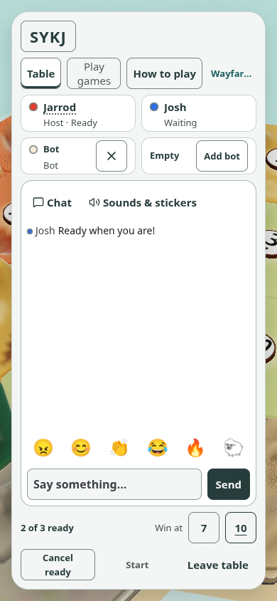
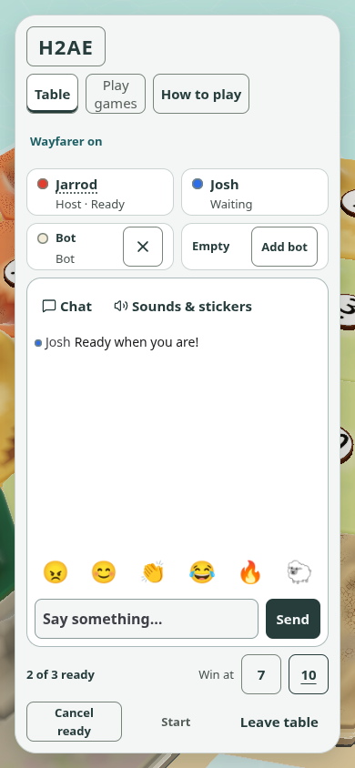
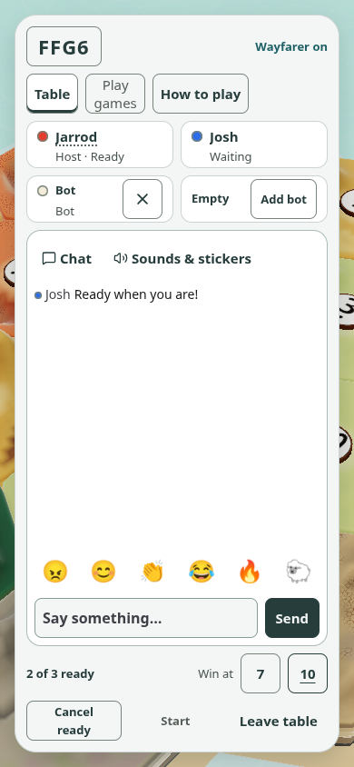
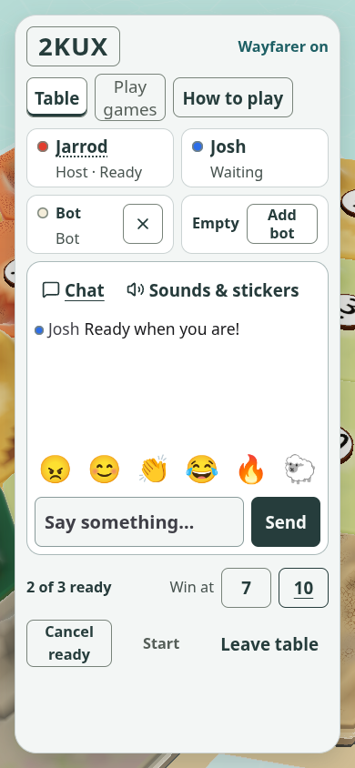
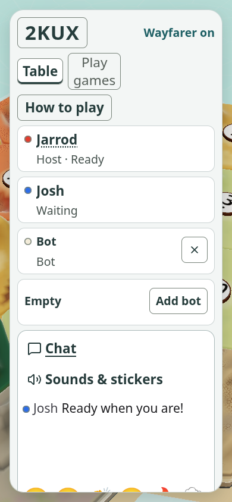
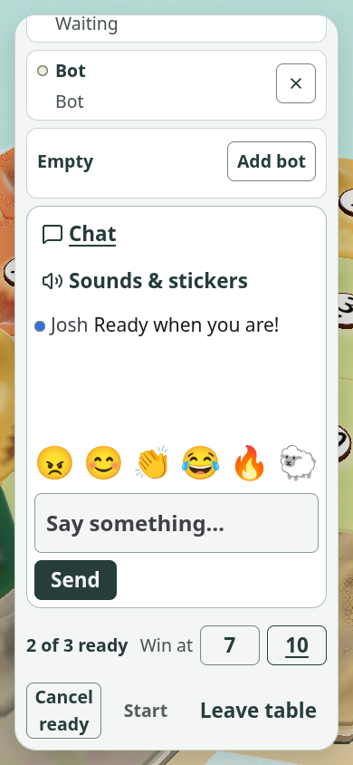

# #1235 draft: font scaling and unresolved fit

This is unfinished accessibility work, not a release or owner-acceptance claim.
Builder: Codex-p, GPT-6.1 Sol. Base: `1b47ff2a96c1ba040cc0423a2b18b9bbf78495e4`.
The runtime patch converts fixed font sizes and line heights to equivalent rem values.
At a 16 px root, those declarations retain their numeric sizes. It selects no new caption placement.

## Local evidence

The final proof and capture source stayed unchanged between the two controlled runs.
Each ran 15 cases: five issue viewports at 100%, 125% and 150% root text size.
Both used real host/guest/bot/empty-seat/chat fixtures, reduced motion and desktop Chromium CSS viewports.
They used different real room codes; this is not a matched-code or performance experiment.
No physical phone or OS Dynamic Type acceptance occurred. Other lobby panels remain unproven at enlarged text.

| Run | Exit | Total failed checks | Font-scaling failed checks | Browser errors |
|---|---:|---:|---:|---:|
|Unchanged CSS with final proof|1|328|300|0|
|Rem font units with final proof|1|38|0|0|

The full new proof FAILS. Scaling assertions improve; fit is unfinished.
The new proof checks visible text and input fonts, clipping, control overlap/reachability, code fit and page/horizontal overflow.
It does not establish acceptance of vertical card scrolling. That interpretation still needs an owner answer.
All original capture assertions remain. The fixture isolates its profile store instead of touching the shared writer lock.

At 150%, the font-unit draft still reports:

|Viewport|Code fits|Card overflow X/Y px|Clipped text nodes|Control overlaps|
|---|---|---|---:|---:|
|320x568|True|42/14|7|8|
|375x667|False|7/14|7|3|
|390x844|False|0/10|5|3|
|844x390|False|0/14|5|2|
|1280x720|False|0/2|2|3|

The UNCHANGED `lobby-layout-prove` PASSES all eight viewports with zero browser errors on the font-unit draft.
It retains the default two columns, minimum chat share, 44 px targets, 8 px gaps and no card/people scrolling.
Typecheck, build, proof registration (242) and advisory loosen (zero changed existing proofs) passed locally.
Size ceilings/growth passed against the preserved `/workspace/work/590` build.
That build's runtime inputs match the base (`src`, `public`, Vite config, index.html and lockfile); it is not a fresh base-head build.
Hosted CI and independent review remain separate. Draft skipped jobs are not passes.

## Placement evidence for an owner decision

These are different real rooms. Room-code and background differences are not causal evidence.

Current baseline at 390x844, 100%: the rule caption truncates.

An external prototype made full labels fit, but added a rule row.
Its unchanged layout proof FAILED the first 390x844 chat-share check: 0.46368715083798884 against 0.52.
Later layout cases were unrun. The threshold stayed intact. This prototype CSS is not in the draft runtime patch.

Controlled DOM-only mock at 100%: move the existing rule summary beside the room code.
This is a placement proposal, not product implementation or a proof pass.
It uses the external prototype CSS. Enlarged-text layout and overlay issues still require work; the mock does not approve them.

The external raw directory `resume-nov9/1235-text-size/` preserves all runs, JSON, screenshots, CSS and the mock script.
The first baseline failed 263 checks before stronger input/overlap coverage; it is not the final same-proof comparison.
The first prototype passed the earlier new-proof version but failed the existing layout proof.
That earlier pass is not full fit coverage. No passing retry is offered as a causal repair.
No existing proof assertion, deadline, budget, protocol or audio behavior changed.

## Controlled phone scrolling decision pictures

Requested by desk comment 6946386201. These four pictures are an UNAPPROVED
external CSS/DOM mock, not the runtime patch or a product proof pass.
Desktop Chromium 153.0.8010.12 uses touch/mobile emulation at 390x844, reduced
motion and 125%/150% root font size; this is not physical-phone or OS text-size acceptance.
The mock moves the existing summary into the header, uses vertical cover flow
and gives the private fixture chat log natural height. No runtime layout changed.

|Root size|Card top/bottom scroll px|Viewport/content height px|Clipped text|Control overlaps|Unreachable controls|
|---|---|---|---|---|---|
|125%|0/0|810/810|0|0|0|
|150%|0/328|810/1138|0|0|0|

Both records fit the real room code 2KUX and report zero horizontal/page overflow
and zero browser errors. At 125% the top and bottom pictures are identical
because no card scrolling is needed. At 150%, the top and bottom show the
header and the final controls respectively. Visual inspection covers all four
pictures; automated reachability observations cover intermediate controls.
These observations do not approve scrolling or the header placement, establish
physical touch usability, or repair the runtime draft's 38 failed checks.

Source commit: `9a771767af3c7d378587a5db6dd5886776ba1f6e`.
Mock script SHA256: `ec02d79d4078eb75f6b31c1e302efe5c449976cf2425e95d99a07b5ed25e80b5`.
Mock CSS SHA256: `bce6dabdab9b554a142dcf9b41923a9e09a5f96ba20bd45d97f8e08ca7119468`.
Raw measurements, log and script are preserved outside the repository under
`resume-nov9/1235-text-size/phone-scroll-mock/` and its parent.
Both owner questions remain pending; runtime layout remains paused.
