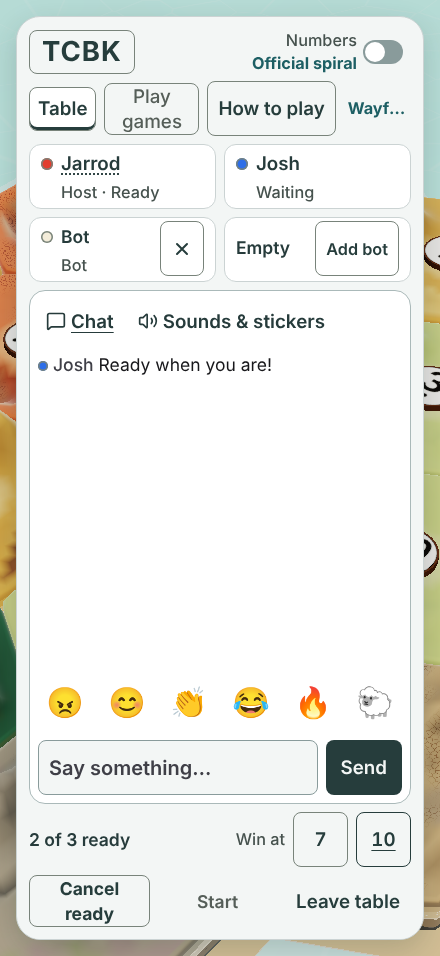
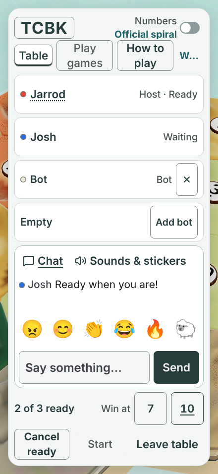
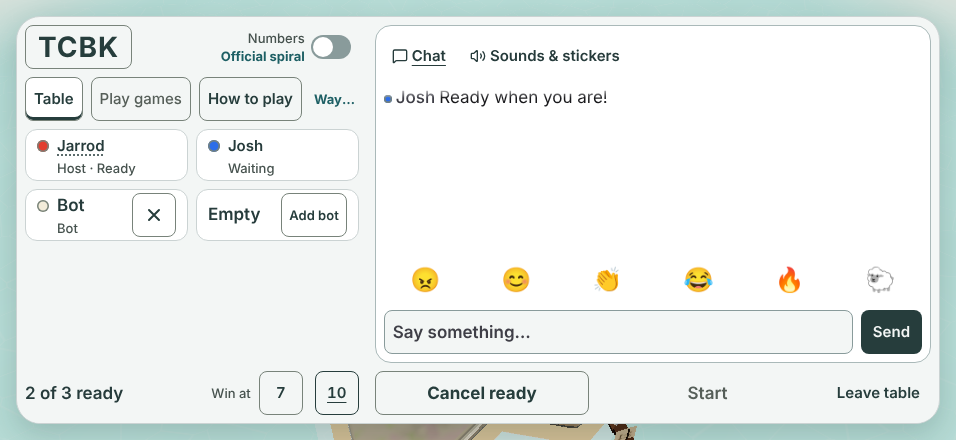
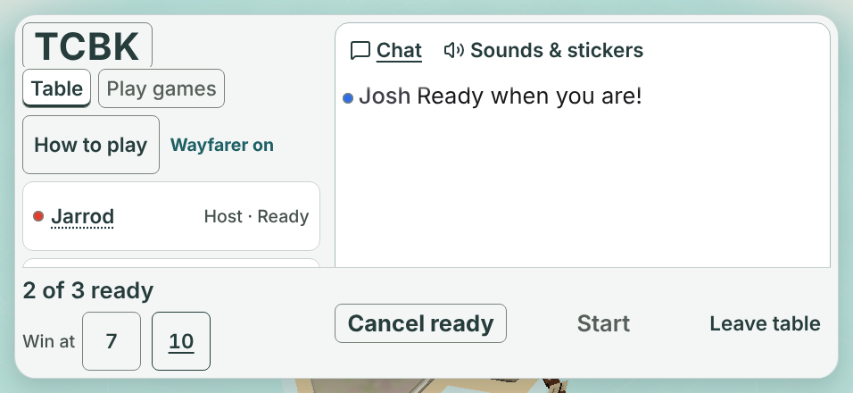

# #1235: the lobby at larger text sizes

Builder: claude-opus-a (Claude Opus 5.5), adopting Codex-p's draft. Design: [`docs/design/lobby-text-size`](../../design/lobby-text-size/README.md) (Fable 5.2).

## What is built

- Codex-p's rem conversion, plus the Numbers lines (#1156), which landed in px after it.
- The design's five rules, as `lobby.css` rules: rows grow with the text, seats go one per row when two no longer fit, "How to play" wraps on a narrow card, chat tab names wrap, and the chat keeps one line of log.
- Card 2, answer A (Fable, as Jarrod asked): the bottom bar is pinned and everything above it scrolls as one sheet. A hairline shows above the bar only while the card scrolls.
- Rows wrap only when the text is larger than the default (a style query on `sign(1rem - 16px)`). At 100% every row is as on main, in any font. The design measured with Inter. CI's wider system font (DejaVu Sans) needed two more rules, applied only above 100%: the bar's buttons may wrap to two lines and then two rows, and a chat tab name wraps inside its 44 px tab.
- The Table tab only. Play games keeps today's layout; the design did not measure it.

## Still open: the header

Card 1 A puts "Wayfarer on" beside the room code. Since PR #1866 the Numbers control sits there, and the design never measured the two together. The caption stays in the tab row, and the header stays as #1866 built it, until Jarrod answers the `Question:` on PR #1750.

`npm run lobby-text-prove` fails only on the header, every line of it:

| Case | Card scroll px | Clipped text | Overlapping controls | Unreachable | Bar pinned |
|---|---:|---|---|---|---|
| 320x568 at 100% | 0 | Wayfarer, on | none | none | yes |
| 320x568 at 125% | 328 | none | none | none | yes |
| 320x568 at 150% | 511 | none | Random numbers+Play games | Random numbers | yes |
| 375x667 at 100% | 0 | Wayfarer, on | none | none | yes |
| 375x667 at 125% | 0 | Wayfarer, on | none | none | yes |
| 375x667 at 150% | 358 | none | Random numbers+Play games; Random numbers+How to play | none | yes |
| 390x844 at 100% | 0 | on | none | none | yes |
| 390x844 at 125% | 0 | Wayfarer, on | none | none | yes |
| 390x844 at 150% | 199 | none | Random numbers+Play games; Random numbers+How to play | none | yes |
| 844x390 at 100% | 0 | Wayfarer, on | none | none | yes |
| 844x390 at 125% | 226 | none | Random numbers+Play games | Random numbers | yes |
| 844x390 at 150% | 315 | none | Random numbers+Play games | Random numbers | yes |
| 1280x720 at 100% | 0 | none | none | none | yes |
| 1280x720 at 125% | 0 | none | none | none | yes |
| 1280x720 at 150% | 89 | none | Random numbers+How to play | none | yes |

- "Wayfarer on" is cut at 100% too. Main cuts it the same way today ("Wayfar…").
- "Random numbers" is the host's Numbers switch. When larger text widens the header, #1866's rule wraps the switch to a second row and clips it away. The overlap is that hidden box. At 844x390 from 125%, and at 320x568 at 150%, the host can't reach the switch.

Every other check passes in all fifteen cases, with Inter and with DejaVu Sans: fonts follow the text size, the code fits, nothing scrolls sideways, the seats fit, and the bar stays inside the card at the top and at the end of the scroll.

## Pictures

[`built/`](built/): the five issue sizes and Jarrod's phone sizes (440x956, 956x440), each at 100%, 125% and 150%. Each picture shows the top of the card.

| 440x956 at 100% | 125% | 150% |
|---|---|---|
|  |  |  |

| 956x440 at 100% | 956x440 at 150% |
|---|---|
|  |  |

Capture: real local host, host Jarrod (ready), guest Josh, one bot, one empty seat, one chat line; desktop Chromium, reduced motion, device scale 1. Text size is the root font size: 16, 20 and 24 px. Phone sizes: `node scripts/lobby-text-capture.mjs --run phone --out <dir> --sizes 440x956,956x440`.

Not covered: a physical iPhone and iOS Dynamic Type, sizes above 150%, the Play games tab, six seats and long names.

## Earlier draft evidence (Codex-p, 2026-11-17)

The pictures in this folder outside `built/` are Codex-p's draft and mock pictures. The design page cites `390x844-150-top.png`. They are kept for that history and are not the built layout.
