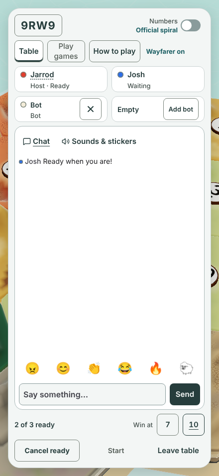

# #1235: the lobby at larger text sizes

Builder: claude-opus-a (Claude Opus 5.5), adopting Codex-p's draft. Design: [`docs/design/lobby-text-size`](../../design/lobby-text-size/README.md) (Fable 5.2).

## What is built

- Codex-p's rem conversion, plus the Numbers lines (#1156), which landed in px after it.
- The design's five rules, as `lobby.css` rules: rows grow with the text, seats go one per row when two no longer fit, "How to play" wraps on a narrow card, chat tab names wrap, and the chat keeps one line of log.
- Card 2, answer A (Fable, as Jarrod asked): the bottom bar is pinned and everything above it scrolls as one sheet. A hairline shows above the bar only while the card scrolls.
- Rows wrap only when the text is larger than the default (a style query on `sign(1rem - 16px)`). At 100% every row is as on main, in any font. The design measured with Inter. CI's wider system font (DejaVu Sans) needed two more rules, applied only above 100%: the bar's buttons may wrap to two lines and then two rows, and a chat tab name wraps inside its 44 px tab.
- The Table tab only. Play games keeps today's layout; the design did not measure it.

## The header: owner answer A

Jarrod's answer on PR #1750 (card `q1750-wayfarer-place`, 2026-11-27, Fable's pick for him): code, "Wayfarer on" and Numbers share one row where they fit. Where they don't, "Wayfarer on" stays in the tab row as today, and Numbers takes a second header row instead of being hidden.

- **One row where all three fit.** The header shows the caption between the code and Numbers when the header is at least 25rem wide: the widest supported code ("WWWW") plus the caption and the host's switch, with the gaps, measured at 389 px with Inter at 100%. The tab row is the same width, so the same 25rem hides its copy of the caption. Of the measured sizes, only 1280x720 at 100% and 125% qualifies.
- **Numbers never hides on the Table tab.** When a wide code or larger text leaves no room beside the code, the switch wraps to a second header row, right-aligned. Play games keeps #1866's clipped single row, as it keeps today's layout everywhere else.
- **The caption in the tab row.** At 100% the tab row stays one line, as on main, so on phones the caption is cut there as it is today ("W…"). Above 100% the tab row may wrap, and a caption that can't fit beside the tabs takes its own line, uncut.
- **The proof.** `lobby-text-prove` checks the tab-row caption apart from other text: it may be cut at 100% only. Its old and new lines are in the PR body. The capture counts the caption as one text role wherever it sits.

`npm run lobby-text-prove` passes all fifteen cases, with Inter and with DejaVu Sans. The measurements, with the phone sizes added:

| Case | Card scroll px | Clipped text | Caption cut (tab row) | Overlapping controls | Unreachable | Bar pinned |
|---|---:|---|---|---|---|---|
| 320x568 at 100% | 0 | none | Wayfarer, on | none | none | yes |
| 320x568 at 125% | 329 | none | none | none | none | yes |
| 320x568 at 150% | 573 | none | none | none | none | yes |
| 375x667 at 100% | 0 | none | Wayfarer, on | none | none | yes |
| 375x667 at 125% | 38 | none | none | none | none | yes |
| 375x667 at 150% | 420 | none | none | none | none | yes |
| 390x844 at 100% | 0 | none | on | none | none | yes |
| 390x844 at 125% | 0 | none | none | none | none | yes |
| 390x844 at 150% | 209 | none | none | none | none | yes |
| 844x390 at 100% | 0 | none | Wayfarer, on | none | none | yes |
| 844x390 at 125% | 279 | none | none | none | none | yes |
| 844x390 at 150% | 386 | none | none | none | none | yes |
| 1280x720 at 100% | 0 | none | none (in the header) | none | none | yes |
| 1280x720 at 125% | 0 | none | none (in the header) | none | none | yes |
| 1280x720 at 150% | 99 | none | none | none | none | yes |
| 440x956 at 100% | 0 | none | none | none | none | yes |
| 440x956 at 125% | 0 | none | none | none | none | yes |
| 440x956 at 150% | 45 | none | none | none | none | yes |
| 956x440 at 100% | 0 | none | Wayfarer, on | none | none | yes |
| 956x440 at 125% | 0 | none | none | none | none | yes |
| 956x440 at 150% | 318 | none | none | none | none | yes |

## Pictures

[`built/`](built/): the five issue sizes and Jarrod's phone sizes (440x956, 956x440), each at 100%, 125% and 150%. Each picture shows the top of the card, at the head that adds answer A.

| 440x956 at 100% | 125% | 150% |
|---|---|---|
|  |  |  |

| 956x440 at 100% | 956x440 at 150% |
|---|---|
|  |  |

Capture: real local host, host Jarrod (ready), guest Josh, one bot, one empty seat, one chat line; desktop Chromium, reduced motion, device scale 1. Text size is the root font size: 16, 20 and 24 px. Phone sizes: `node scripts/lobby-text-capture.mjs --run phone --out <dir> --sizes 440x956,956x440`.

Not covered: a physical iPhone and iOS Dynamic Type, sizes above 150%, the Play games tab, six seats and long names.

## Earlier draft evidence (Codex-p, 2026-11-17)

The pictures in this folder outside `built/` are Codex-p's draft and mock pictures. The design page cites `390x844-150-top.png`. They are kept for that history and are not the built layout.
