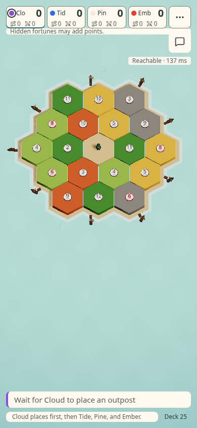
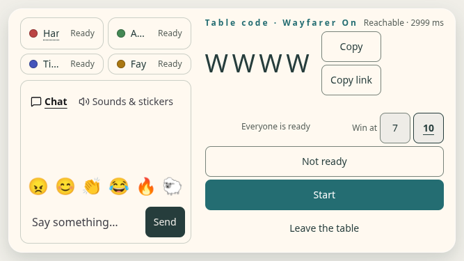

# Connection health on current main (#553 / #716)

Builder: Codex-p, formerly Codex-open-table-833. The branch retains original authorship and normal main merges. This evidence needs independent Opus review; old approvals do not cover the asynchronous connection shell.

The merged index first failed at 125626 B against 125200 B and +436 B against the unchanged +400 B allowance. The existing table API now loads on demand through the existing retryable chunk cache. A cancelled request cannot revive an offline game. Host URL, name, colour and rules are captured at the action; background peeks cannot supersede a saved-seat dial. The original quiet-restore 3000 ms fallback includes the download, keeps credentials, and allows offline Play. Fetch failure gives feedback and the next explicit action retries with a fresh URL.

Transport/probe protocol, backend and health UI match merge `7e1d6c7`; room shape stays 2. The code exposes `.load()` on the existing chunk helper without changing its prefetch/React cache machinery. Discovery and online UI may share or prefetch the table module: this is an entry-bundle reduction, not a claim that offline browsers never download it or that total online payload is smaller.

The new table chunk has its own 2200 B ceiling. Every existing ceiling/allowance remains exact main. Size fixtures gain only a table:2000 field; the checker and its assertions stay unchanged. CI registers the existing expanded health proof once on browser-a/a1, with a production build/preview owned by that script.

## Validation scope

Fresh clone: `work/verify716-oct25`, frozen root/server installs, Node 24.19.0 and Chromium 1243. All browser commands run serially. `logs/results.json` and `logs/validation.log` record broad validation at `e9568ec`: full native server39 and recovery/client/chat/chunk-fail/title/open pass. Haptics initially failed in its injected-frame fixture because it assumed eager client creation. Its assertions remain exact; it now waits for the actual injected socket under the existing STEP_MS. Failed runs are retained.

`logs/final/results.json` records supplemental checks at final code `a1ae342` after normal merge of main `2638b70`, Host-rules capture and haptics fixture adaptation. See raw logs for observed results. The scope audit compares final network/backend/UI bytes with the broad-tested head; main's new profile-seat assertions receive a separate focused run. Original health and haptics assertions/throw/exit lines are retained. Final verification and control results are recorded alongside the logs.

Four mutations at `e9568ec` each fail the intended cold-case assertion: removed cancellation, cached failed-module retry, 4000 ms restore fallback, and missing pending-peek guard. Source was restored byte-exact and the full health proof passed (`logs/controls.json`). A final late-Host-rules mutation is recorded separately with its restored positive run. These failures exercise browser behavior rather than mirroring implementation text.

No main push, merge to main, force push, owner-host change, account setting, CI retry or assertion-budget exception was used. Current-head CI and independent review remain separate from local proof results.

## Observed final results

At `a1ae342`, typecheck, registered139, loosen (none loosened), size-delta (all eight fixtures), build, all size ceilings/growth checks, full haptics, full connection-health, full Wayfarer setup and profile-seat158 pass. The late-rules mutation fails exactly “late edits cannot change the rules chosen at Host”; source SHA256 is restored and the complete health proof passes again. Both final positive phone/lobby captures above were inspected. Injected fetch failures in health logs are intentional and asserted; this is not a zero-console-error claim.

Built against main `2638b70`: index **124167 / 125200 B**, versus main125189 (**−1022 / +400 B allowance**); online7987 versus7796 (**+191 / 200 B**). Table is approximately2.08 kB against its new2.20 kB ceiling. Every old budget and size fixture value remains unchanged; see exact source audit and raw size output.

The full native and six neighboring browser runs were at `e9568ec`, rather than being relabelled final-head runs. Since then only the Host-rules snapshot, its health assertions, the injected haptics socket handshake and normal main updates changed. The final audit confirms backend, transport, protocol and health UI bytes match the broad-tested head. Main's extra profile-seat cases pass158 checks separately. No original assertion was replaced or deleted.

