# Other players' gains: a redesign, 2026-11-11

For Jarrod. This follows `docs/research/uiux-followup-2026-11-10.md`, part 2.
It redesigns one element: what you see when another player gains or loses goods in an online game.

## How the pictures were made

- Every picture is the real game. It is PR #867's build at `fe684c26`, run in headless Chromium, not Safari.
- Four seats play online through a real host: Jarrod (you, watching), Joshua, Isaac and Daking.
- **Roll.** Joshua rolls a 6. Joshua gains 2 wheat, Isaac gains 1 wood, Daking gains 1 sheep and 1 stone.
- **Trade.** Joshua gives Isaac 1 wheat for 1 wood. Their seats are neighbours.
- "Today" pictures are PR #867 untouched.
- Option pictures are the same live cue with its styles changed on the page. No code changed.
- All pictures are full-size PNG at twice the screen's pixels. Click one to see it at full size.
- In "today's" roll picture the big dice are still on the island. The option pictures came a moment later.

## What is wrong today

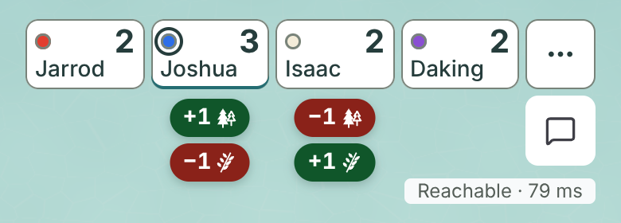

*Today at 390x844, top of the screen. PR #867 untouched.*

- **A trade stacks.** Two pills do not fit side by side under a 74 px seat. The cue reaches 58 px below the seat.
- **A stacked cue collides.** On the roll, Daking's second pill touches the "Reachable" line and crowds the chat button.
- **The sides swap.** Joshua's green pill is on top and Isaac's is underneath. You must read each pill.
- **The pills float.** Nothing ties a pill to its seat except being near it. Three seats' pills are three widths.
- **It looks like any app.** A rounded pill with a drop shadow is the most common badge there is.

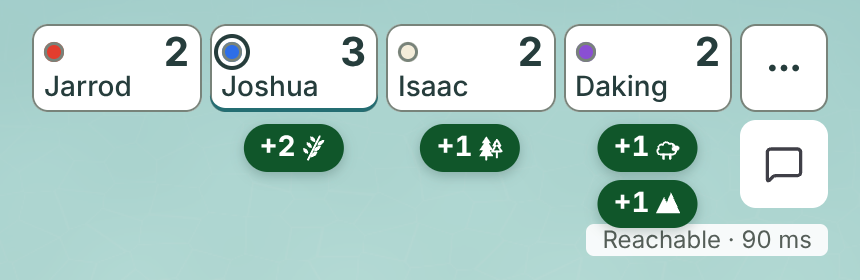

*Today at 430x932. Daking's second pill sits on the "Reachable" line.*

## Option A (recommended): a tag tucked behind the seat

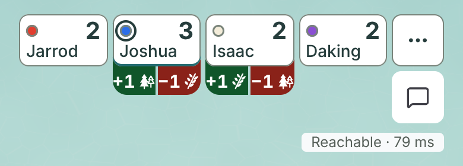

*Option A at 390x844. Styles changed: the cue is as wide as the seat, starts behind it, and has no shadow. Gains are ordered first.*

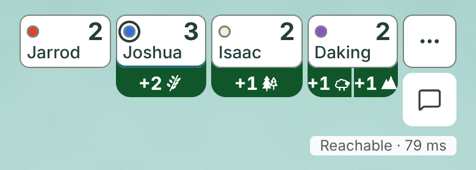

*Option A, the roll. Three seats, three tags, one height.*

- The seat wears a solid tag that pokes out from behind its bottom edge. Green is a gain. Red is a loss.
- The tag is exactly as wide as its seat. It cannot reach a neighbour.
- A trade is one row: green on the left, red on the right, at every seat. You read it by position.
- The tag shows 24 px below the seat. Today's stacked pills reach 58 px.
- The name and the score are untouched. The tag sits behind the seat, never on it.
- Numerals are 15 px, up from 14 px. There is no shadow, no outline and no word.
- On desktop the seats stack, so the tag comes out of the seat's right side.

Full screen, upright:

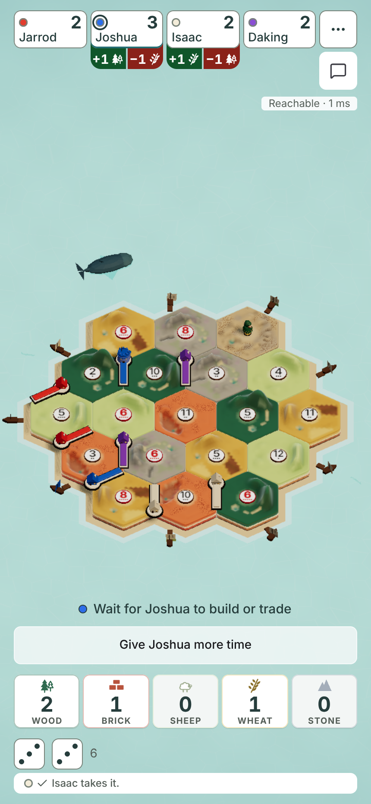

*Option A, the trade, 430x932.*

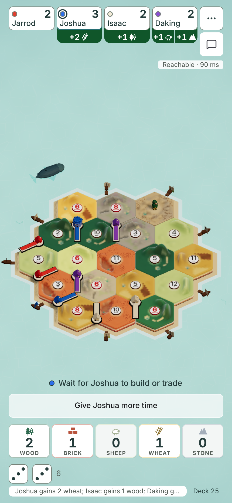

*Option A, the roll, 430x932.*

## Option B: a white line on the seat

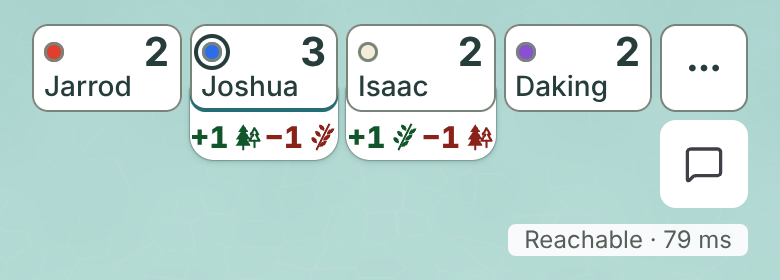

*Option B at 390x844. Styles changed: option A's shape, filled white like the seat, with green and red numerals.*

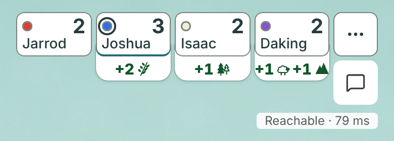

*Option B, the roll.*

- The seat grows one more white line for 2.5 seconds. The numerals on it are green or red.
- It is the quietest option, and the closest to the red "-1 wood" text in the build preview.
- It is weaker at a glance. Thin green and red text on white is harder to catch than a solid block.
- Two goods in one seat have no divider. Daking's "+1 sheep +1 stone" runs together at 390 wide.

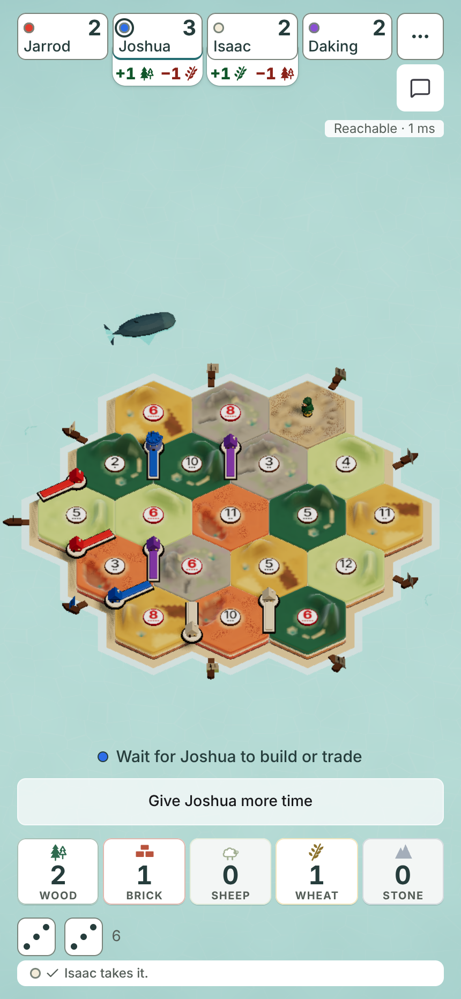

*Option B, the trade, 430x932.*

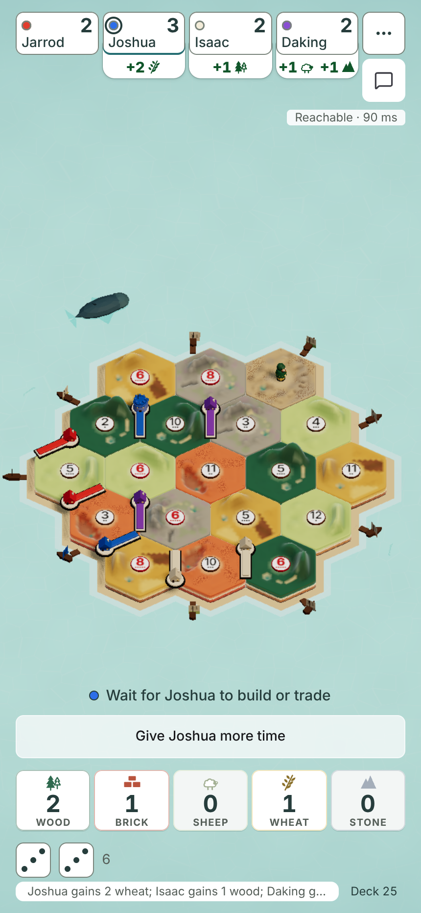

*Option B, the roll, 430x932.*

## Option C: small cards under the seat

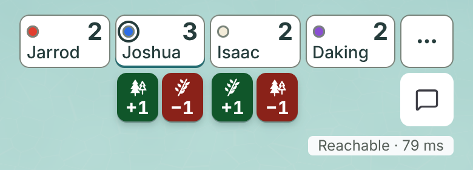

*Option C at 390x844. Styles changed: each pill is an upright card, icon over number, as the hand cards are. Gains are ordered first.*

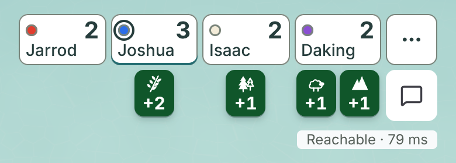

*Option C, the roll.*

- Each good is a small upright card, shaped like the cards in your hand. Green is a gain. Red is a loss.
- This is the nearest to your first thought, "the cards would come into your hand".
- A trade fits in one row. The cards reach 44 px below the seat. Option A reaches 24 px.
- The cards still float, like today's pills. They read as app tiles more than as part of the seat.
- Three goods at one seat would be 108 px wide. That is wider than a phone seat, so they would need a second row.

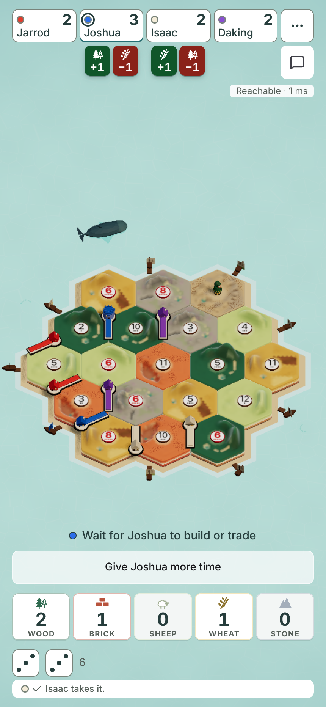

*Option C, the trade, 430x932.*

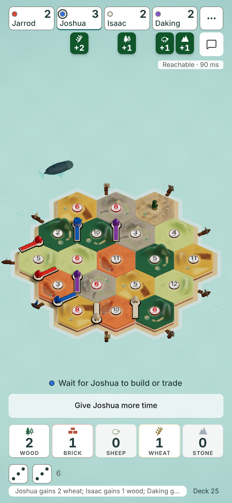

*Option C, the roll, 430x932.*

## Today, full screen, for comparison

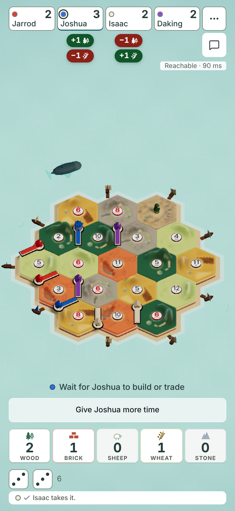

*Today, the trade, 430x932. PR #867 untouched.*

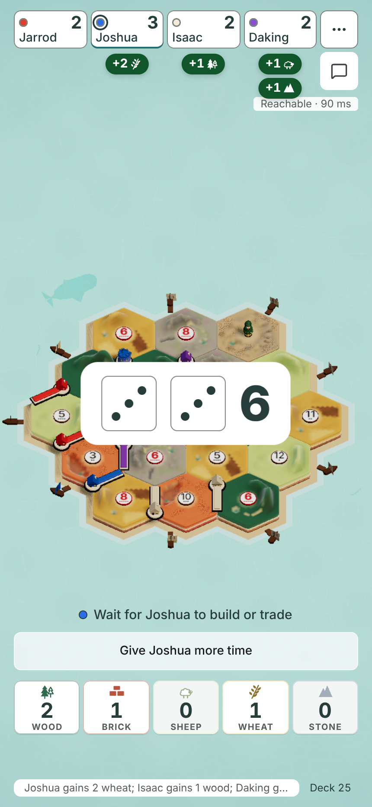

*Today, the roll, 430x932. PR #867 untouched.*

## Every size

Each link is a full-size PNG of the whole screen.

| Size | Moment | Today | A: tag | B: white line | C: cards |
|---|---|---|---|---|---|
| 430x932 | Trade | [open](gain-redesign-2026-11-11/today-trade-430x932.png) | [open](gain-redesign-2026-11-11/a-tag-trade-430x932.png) | [open](gain-redesign-2026-11-11/b-line-trade-430x932.png) | [open](gain-redesign-2026-11-11/c-cards-trade-430x932.png) |
| 430x932 | Roll | [open](gain-redesign-2026-11-11/today-roll-430x932.png) | [open](gain-redesign-2026-11-11/a-tag-roll-430x932.png) | [open](gain-redesign-2026-11-11/b-line-roll-430x932.png) | [open](gain-redesign-2026-11-11/c-cards-roll-430x932.png) |
| 390x844 | Trade | [open](gain-redesign-2026-11-11/today-trade-390x844.png) | [open](gain-redesign-2026-11-11/a-tag-trade-390x844.png) | [open](gain-redesign-2026-11-11/b-line-trade-390x844.png) | [open](gain-redesign-2026-11-11/c-cards-trade-390x844.png) |
| 390x844 | Roll | [open](gain-redesign-2026-11-11/today-roll-390x844.png) | [open](gain-redesign-2026-11-11/a-tag-roll-390x844.png) | [open](gain-redesign-2026-11-11/b-line-roll-390x844.png) | [open](gain-redesign-2026-11-11/c-cards-roll-390x844.png) |
| 844x390 | Trade | [open](gain-redesign-2026-11-11/today-trade-844x390.png) | [open](gain-redesign-2026-11-11/a-tag-trade-844x390.png) | [open](gain-redesign-2026-11-11/b-line-trade-844x390.png) | [open](gain-redesign-2026-11-11/c-cards-trade-844x390.png) |
| 844x390 | Roll | [open](gain-redesign-2026-11-11/today-roll-844x390.png) | [open](gain-redesign-2026-11-11/a-tag-roll-844x390.png) | [open](gain-redesign-2026-11-11/b-line-roll-844x390.png) | [open](gain-redesign-2026-11-11/c-cards-roll-844x390.png) |
| 1280x720 | Trade | [open](gain-redesign-2026-11-11/today-trade-1280x720.png) | [open](gain-redesign-2026-11-11/a-tag-trade-1280x720.png) | [open](gain-redesign-2026-11-11/b-line-trade-1280x720.png) | [open](gain-redesign-2026-11-11/c-cards-trade-1280x720.png) |
| 1280x720 | Roll | [open](gain-redesign-2026-11-11/today-roll-1280x720.png) | [open](gain-redesign-2026-11-11/a-tag-roll-1280x720.png) | [open](gain-redesign-2026-11-11/b-line-roll-1280x720.png) | [open](gain-redesign-2026-11-11/c-cards-roll-1280x720.png) |

Option A sideways and on desktop:

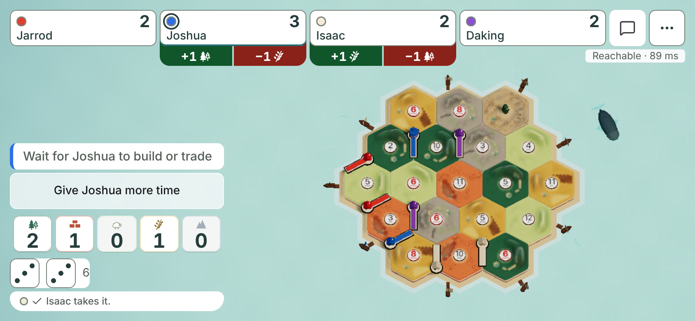

*Option A, the trade, 844x390. The seats are wide, so each half has room to spare.*

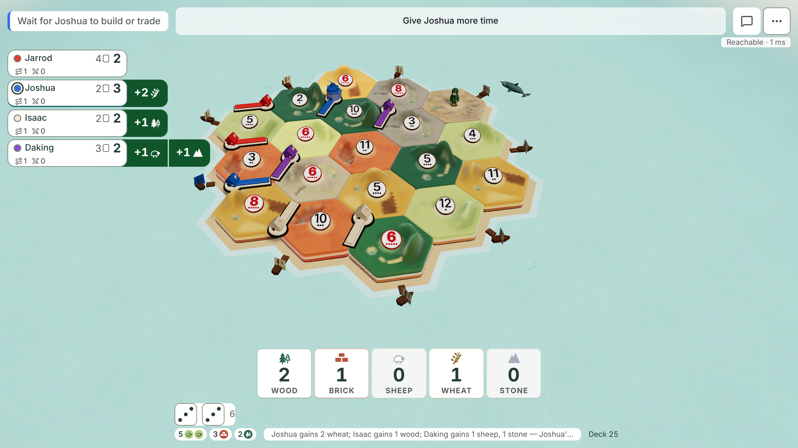

*Option A, the roll, 1280x720. The tag comes out of the seat's right side.*

On desktop the tag reaches the island's left shore. Today's pills reach just as far.

## Measured

Read from the page, in screen pixels. Seats are 74.5 px wide at 390 and 84.5 px wide at 430.

| | Today | A: tag | B: white line | C: cards |
|---|---|---|---|---|
| Rows for a trade on a phone | 2 | 1 | 1 | 1 |
| Reach below the seat, trade | 58 px | 24 px | 24 px | 44 px |
| Cue width at 390, trade | 50 px | 74.5 px, the seat's | 74.5 px, the seat's | 71 px |
| Numeral size on a phone | 14 px | 15 px | 15 px | 15 px |
| Numeral size on desktop | 17.5 px | 18 px | 18 px | 17 px |
| Gap from seat to cue | 6 px | none, tucked behind | none, tucked behind | 4 px |

## Recommendation

Build **A, the tag**.

- You see it at a glance. A solid block the width of the seat is the largest cue of the four.
- A trade reads by position. Green is always left and red is always right.
- It belongs to its seat. Nothing floats, so it does not look like a stock app badge.
- It keeps your rules: green for a gain, red for a loss, no good colours, no words, no covered name or score.
- It is the shortest. It stays clear of the chat button and the "Reachable" line.
- It keeps the solid green and red you already picked on card q1508-gain-show.

B is the calmest, and I like it second. It loses on "at a glance".
C is the nearest to cards, and it still floats.

## Should anything move?

Three ideas, from largest to smallest.

- **Goods fly from the island to other players' seats: no.** My view from yesterday stands.
  - One roll can pay three seats. That is up to six things flying to the top while you watch your own hand.
  - It needs new renderer code in the island's largest file. That file has needed its size limit raised before.
  - The own-hand flight (issue #740) is not built yet. Seat flights should wait until you have played with it.
- **A good slides between the two trading seats: no.** It works only for neighbours. Across the strip it crosses other seats.
- **The cue itself moves a few pixels: yes, a small one.** Something that moves catches the eye better than something that fades in.
  - For A, the tag slides 24 px out from behind its seat in about 220 ms, then holds still.
  - For C, a green card rises to the seat and a red card drops from it.
  - This is a few lines of styles. It needs no new code and no change to the island.
  - With "reduce motion" on, the cue appears with no slide.

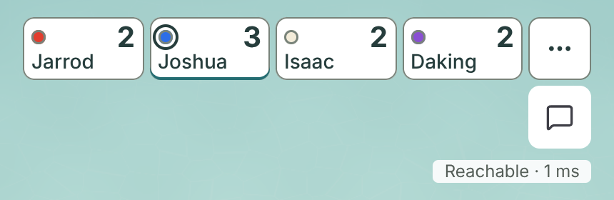

*Option A, start: the tag is fully behind the seat.*

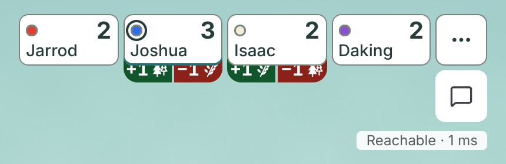

*Option A, middle: the tag is partly out.*

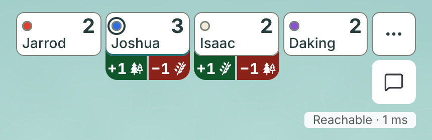

*Option A, at rest.*

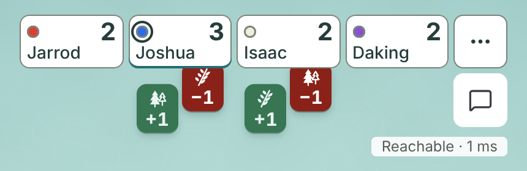

*Option C, middle: green cards rise to the seat, red cards drop from it.*

These are still pictures of a move. I have not watched it move. Judge the slide on a phone before it merges.

## Cost

All four use PR #867's logic as it is. Only the look changes. I did not build or measure any option.

| Option | New code | Size | Tests |
|---|---|---|---|
| A: tag | One stylesheet rewritten, about 25 lines. The seat's button needs its own white fill, so the tag hides behind it. | A few hundred bytes of styles at most. No new chunk. | No line needs replacing if the tag's hidden part is drawn as an extra layer. Add three checks: one row for a trade, green left of red, tag as wide as the seat. |
| A's slide | One short animation and its "reduce motion" rule. | Under a hundred bytes. | One check that the tag rests under the seat. One check that reduce motion skips the slide. |
| B: white line | The same as A, plus an outline so white shows on the pale sea. | The same as A. | Three colour lines in `seat-gains-prove` must be replaced. They assert a green or red fill with white text. That needs your approval under the 2026-10-25 rule. |
| C: cards | One stylesheet rewritten, plus a wrap rule for three goods. | The same as A. | The "no wider than the seat" check fails for three goods until the wrap is built. Add a check for it. |
| Today | None. | None. | None. |

The size figures are my estimate from the amount of styles. The builder must report measured bytes.

## What the builder must still settle for A

- **Three goods at one seat.** A third cell does not fit a 74 px seat at 15 px. It must wrap to a second row. Not drawn.
- **A number of 10 or more.** A cell must grow to fit it. Not drawn.
- **Chat bubbles at the seat.** A reaction bubbles at the seat too. I did not check the two together.
- **Colour is not the only cue.** The plus and minus signs carry the meaning as well. Keep them.

## What I could not do

- I did not run Safari or a real phone.
- I did not animate anything. The slide is shown as three still pictures.
- I did not build any option, so no size or proof result is measured.
- I did not draw three goods at one seat, or a bank trade.

## Owner decision needed

One card.

**Card: "How should another player's gain or loss look?"**

TLDR: Today a trade stacks two floating pills under each seat, and they can touch the chat button.
The tag is one row, as wide as the seat, green on the left and red on the right.

- **A (recommended): a solid tag tucked behind the seat,** with a short slide out. One row, 24 px tall.
- **B: a white line on the seat** with green and red numerals. Quietest, weaker at a glance.
- **C: small green and red cards under the seat,** rising in and dropping out. Nearest to cards, still floating.
- **D: keep today's pills** from PR #867 and merge it as it is.

Pictures for the card, all at 390x844:

- A: `gain-redesign-2026-11-11/close-a-tag-trade-390x844.png` and `close-a-tag-roll-390x844.png`
- B: `gain-redesign-2026-11-11/close-b-line-trade-390x844.png` and `close-b-line-roll-390x844.png`
- C: `gain-redesign-2026-11-11/close-c-cards-trade-390x844.png` and `close-c-cards-roll-390x844.png`
- D: `gain-redesign-2026-11-11/close-today-trade-390x844.png` and `close-today-roll-390x844.png`

If you pick A, B or C, the builder restyles PR #867. Its logic and its hidden-hand rule do not change.
