# Other players' gains, round 2: two finalists, 2026-11-11

For Jarrod. This follows `docs/research/gain-redesign-2026-11-11.md`.
You said all four had pros and you could not decide. This page cuts the choice to two.

## How the pictures were made

- Every picture is the real game: PR #867's build at `fe684c26`, in headless Chromium, not Safari.
- Four seats play online through a real host. You are Jarrod, watching.
- Each picture is one PNG with three rows: today, A, B. The rows are the same moment of the same game.
- "Today" is PR #867 untouched. A and B are the same live cue with its styles changed on the page.
- In the chat bubble pictures I also moved the bubble by hand for A and B. No code changed.
- All pictures are full-size PNG at twice the screen's pixels. Most are cropped to the top of the screen.

## What each round 1 option was really good at

Measured against your own rules.

| Round 1 option | The pro that matters | The con that matters |
|---|---|---|
| A: solid tag | Seen at a glance. Tied to its seat, so it does not look like a stock badge. | Two goods were tight in one seat at 390 wide. |
| B: white line | Fewest elements. The seat just grows a line. Nearest to the red "-1 wood" of the build preview. | Thin coloured text is the weakest at a glance. Two goods ran together. |
| C: small cards | Icon over number, like your hand cards. The number has room. | The cards float, like today's pills. Three goods are wider than the seat. |
| Today: pills | Already built and proved. | A trade stacks. The pills float. Two more problems are below. |

So the pros do not conflict. A's place, C's shape and B's restraint fit in one design.

## A: the refined option

A solid tag tucked behind the seat, with each good upright: icon over number.

- **From A:** the tag sits behind the seat's bottom edge and is exactly as wide as the seat. Green gain, red loss.
- **From C:** each good is upright, like a hand card. That frees width, so the numerals grow from 15 px to 17 px.
- **From B:** nothing is added. No shadow, no outline, no word, and no second row, ever.
- Gains are always on the left and losses on the right.
- The tag is 40 px tall in every case: one good or four.
- The name and the score are never covered.
- Sideways and on desktop the seats are wide, so the tag stays compact and does not stretch.

## B: the contrasting finalist

The white line, with round 1's faults fixed.

- The seat grows a white line. The numerals are green or red, 15 px.
- Goods now have a space between them. Gains come first.
- It is the quietest thing on the table. It is also the hardest to catch from the corner of your eye.
- Three or more goods take two rows: gains above, losses below.

## The two everyday states

### A trade between neighbours

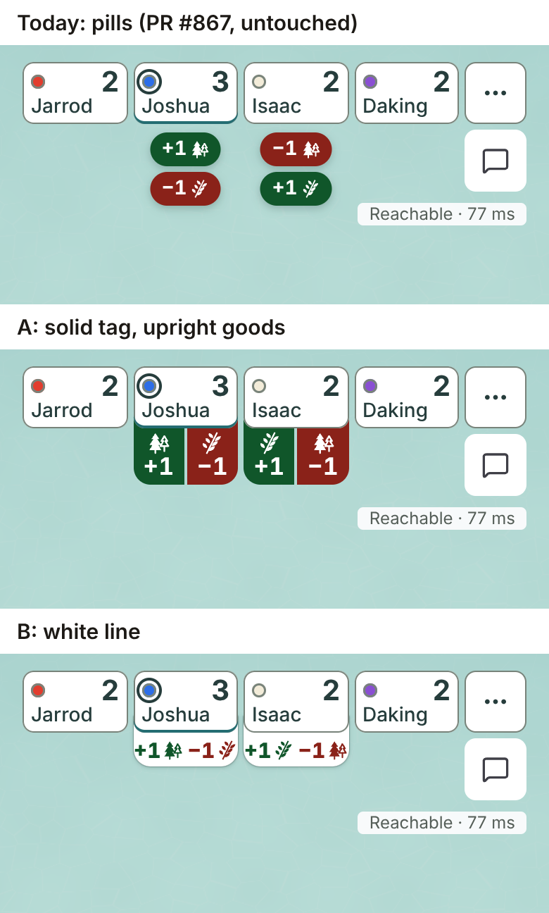

*390x844. Joshua gives Isaac 1 wheat for 1 wood.*

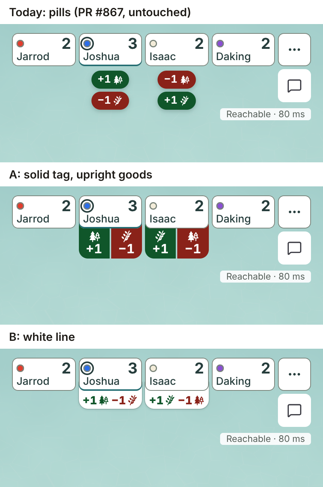

*430x932, the same trade.*

- Today stacks two pills and swaps the colours between the two seats.
- A is one row. Green is left and red is right at both seats.
- B is one row too, with under 1 px to spare at 390 wide. A slightly wider font on a real iPhone could push it to two rows.

### A roll that pays three seats

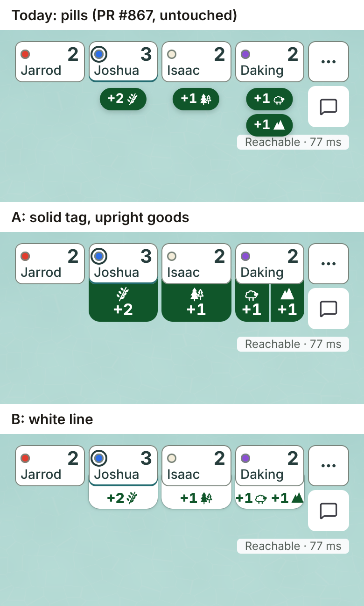

*390x844. Joshua gains 2 wheat, Isaac 1 wood, Daking 1 sheep and 1 stone.*

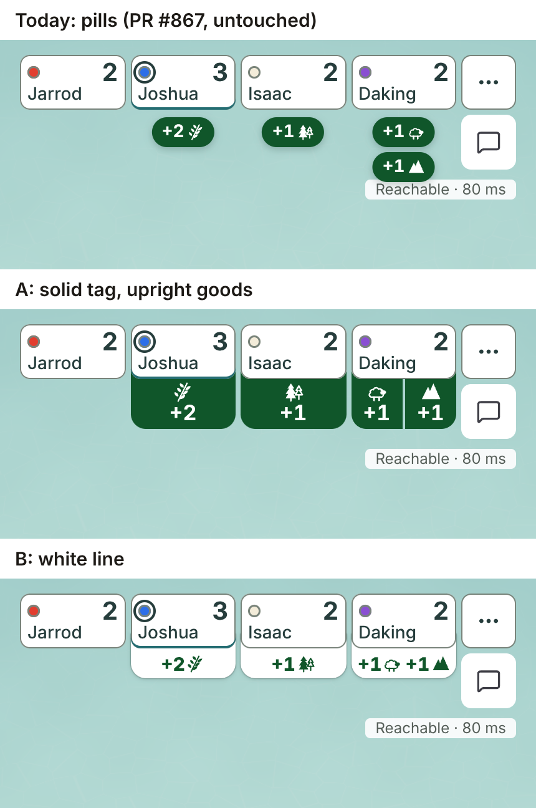

*430x932, the same roll.*

- A shows three tags of one height. Each number is the biggest thing under its seat.
- For a single good, A is taller than today: 40 px against 30 px.

## The three states not drawn last time

### A two for two trade

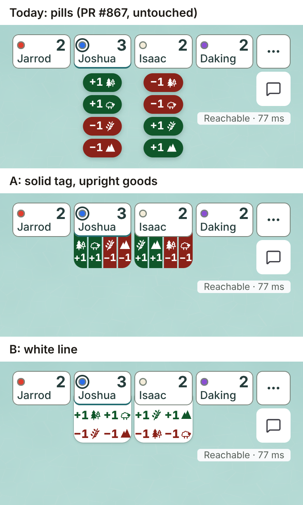

*390x844. Joshua gives 1 wheat and 1 stone for 1 wood and 1 sheep.*

- **Today breaks.** Four pills stack 114 px below the seat, past the chat button and the "Reachable" line.
- A stays one row and 40 px. Its numerals drop to 13 px to fit four goods in 74 px.
- B takes two rows, 48 px, and keeps 15 px numerals. Here B is easier to read than A.

### A number of 10

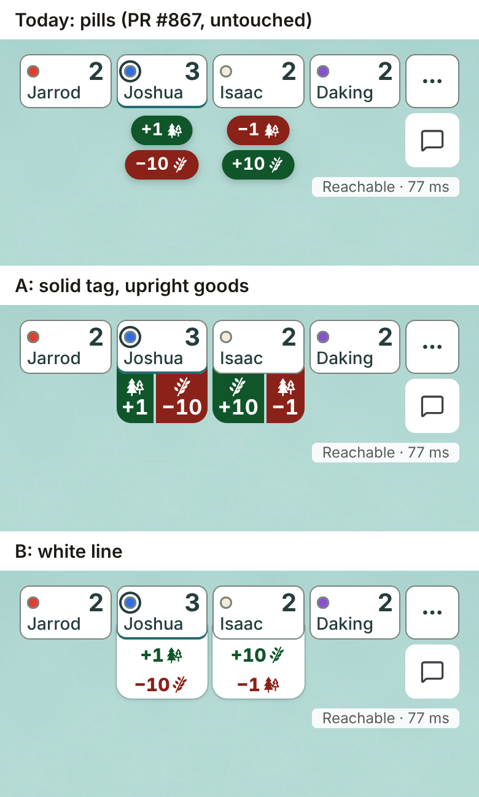

*390x844. Joshua gives 10 wheat for 1 wood.*

- A fits "-10" in one row at 17 px. It is snug.
- B wraps to two rows.

### A gain and a chat bubble on one seat

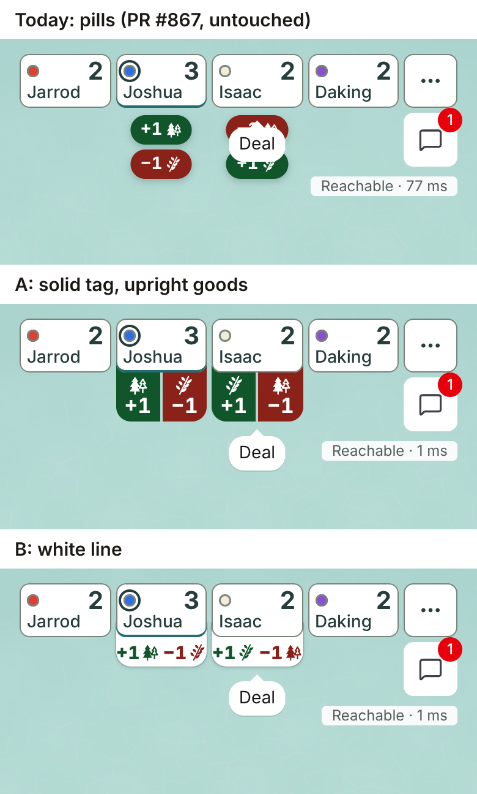

*390x844. Isaac says "Deal" as the trade lands.*

- **Today has a bug.** The chat bubble sits on top of Isaac's pills and hides them.
- In A and B the bubble must hang below the cue. I moved it there by hand for these pictures.
- That move is new work for either finalist. PR #867 needs the same fix if you keep today's pills.

## Sideways and desktop

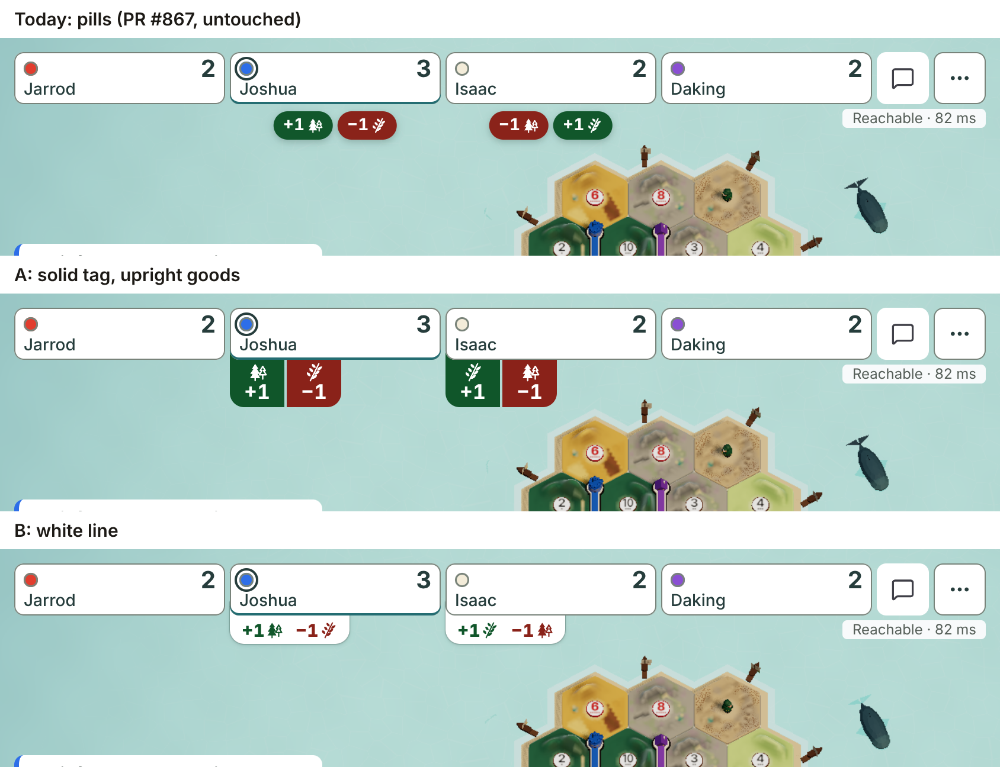

*844x390, the trade.*

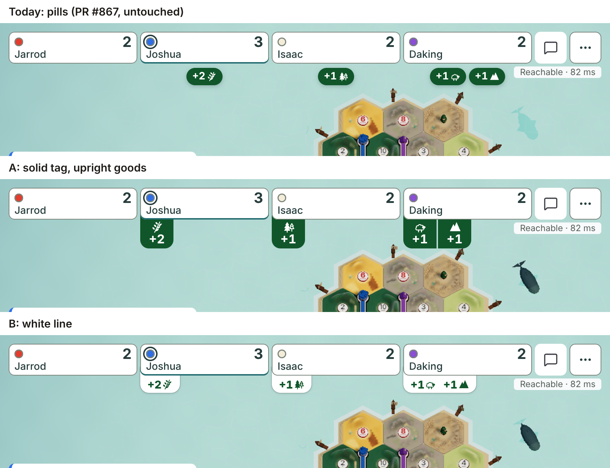

*844x390, the roll.*

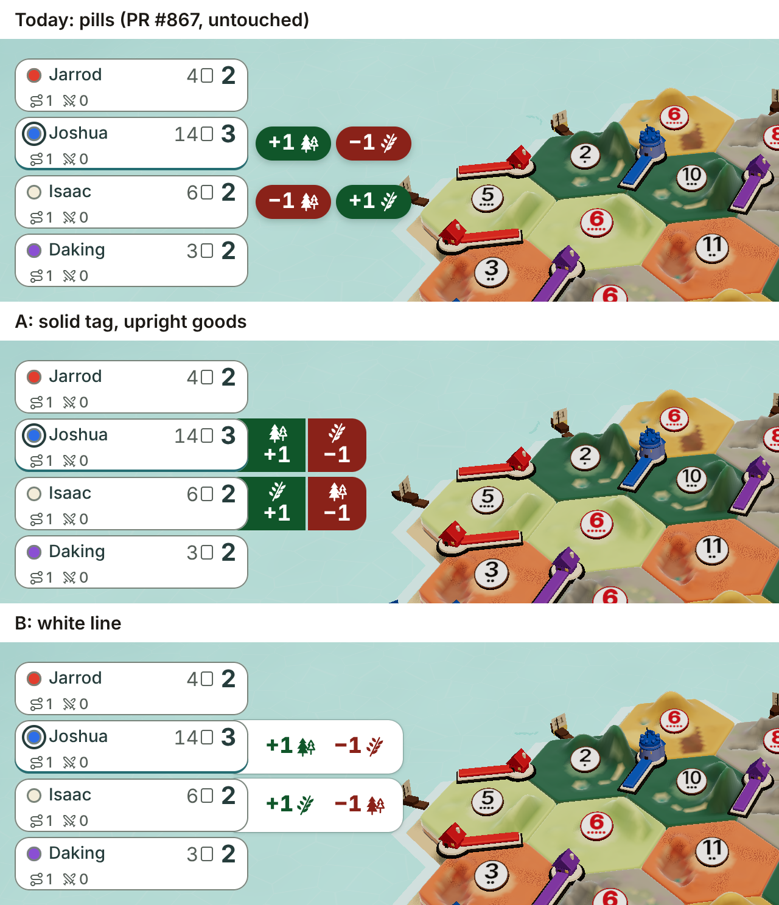

*1280x720, the trade. The seats stack, so the cue comes out of the seat's right side.*

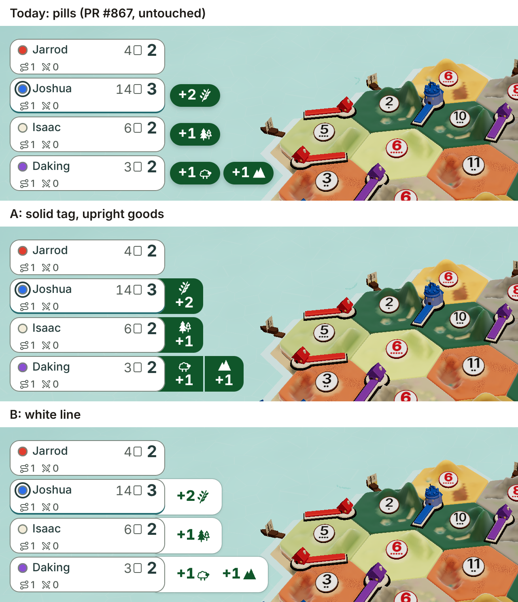

*1280x720, the roll.*

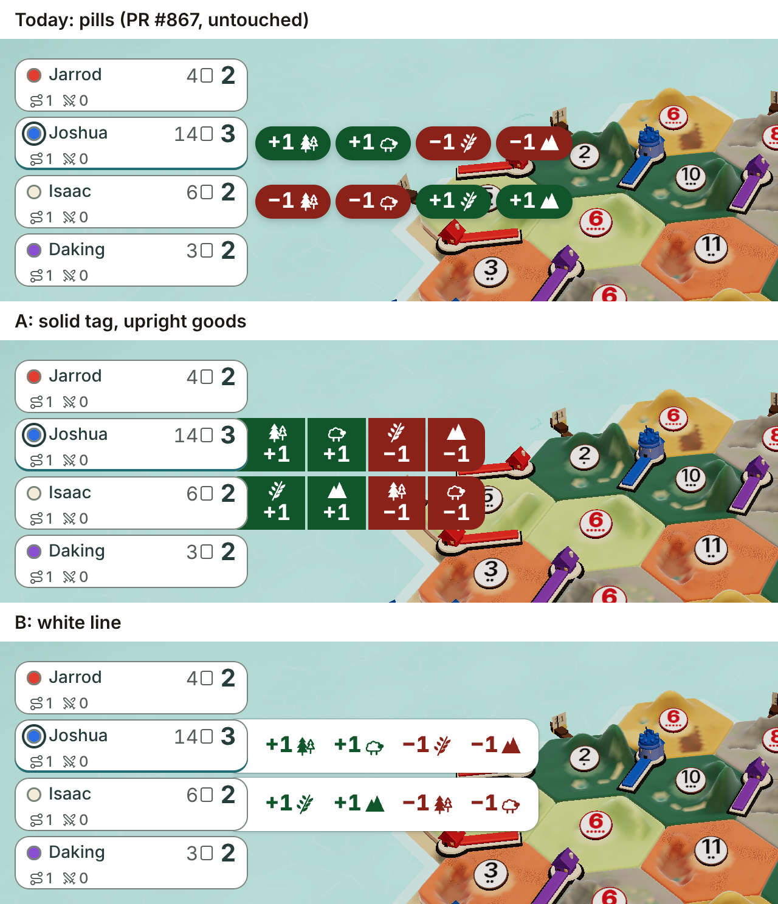

*1280x720, the two for two trade.*

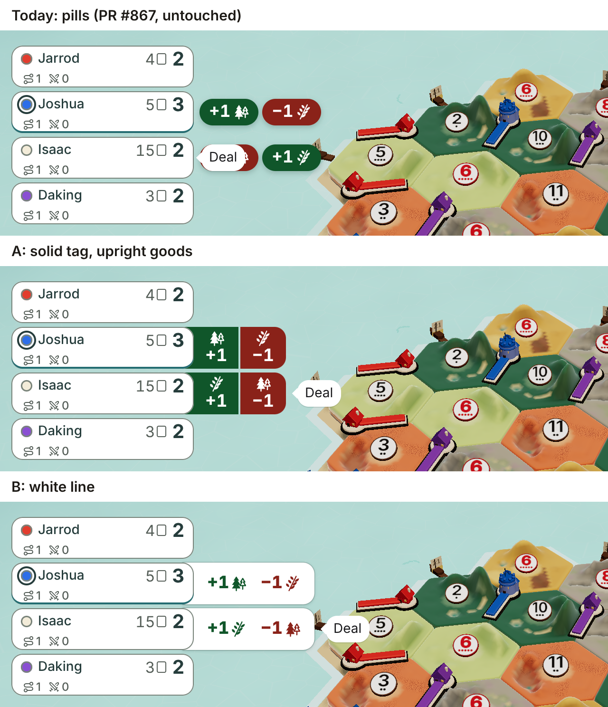

*1280x720, the trade with a chat bubble. Today's bubble covers Isaac's red pill.*

Both finalists have room to spare at these sizes. Nothing here changes the choice.

## The whole screen, upright

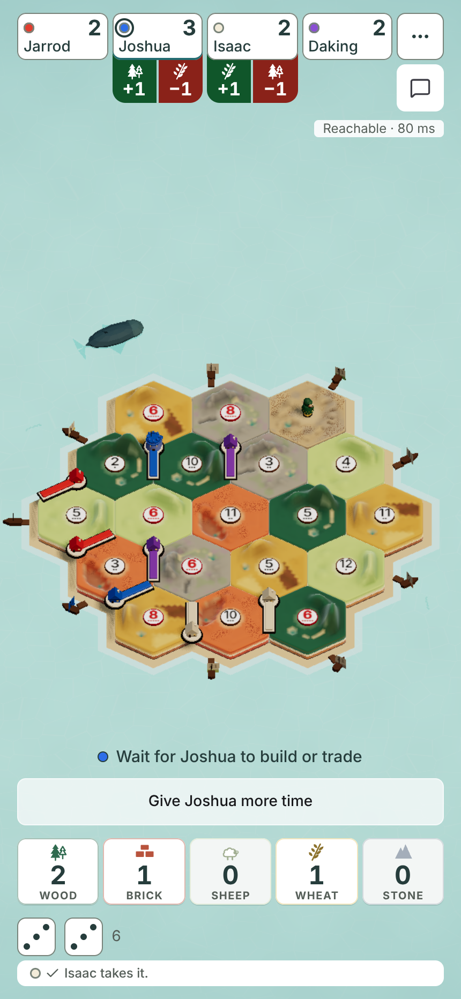

*A, the trade, 430x932.*

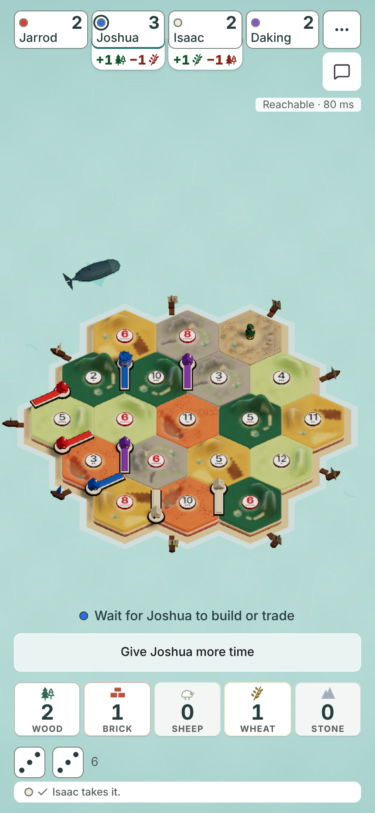

*B, the trade, 430x932.*

## Measured at 390x844

Read from the page, in screen pixels. The seat is 74.5 px wide.

| | Today | A | B |
|---|---|---|---|
| Reach below the seat, one good | 30 px | 40 px | 24 px |
| Reach below the seat, a trade | 58 px | 40 px | 24 px |
| Reach below the seat, two for two | 114 px | 40 px | 48 px |
| Reach below the seat, 10 for 1 | 58 px | 40 px | 48 px |
| Rows for a trade | 2 | 1 | 1 |
| Numerals, one to two goods | 14 px | 17 px | 15 px |
| Numerals, four goods | 14 px | 13 px | 15 px |
| Chat bubble covers the cue | yes | no, once the bubble is moved | no, once the bubble is moved |

## If you cannot decide, pick A

- **It is the one you can read without looking.** A solid block of green or red wins at phone size.
- **It never changes height.** One good or four, it is 40 px. B is 24 or 48, and today is 30 to 114.
- **It keeps what you already chose.** Solid green and red was your pick on card q1508-gain-show.
- **It is the cheaper change.** The proof's colour checks stay as they are. B needs three of them replaced.
- **It is cheap to undo.** A and B share their shape and place. Going from A to B later is one small change of styles.

Pick B only if the solid blocks look too loud to you on the pictures above.
B's real weakness is that it has under 1 px of spare room at 390 wide.

## Cost

I did not build either option. The size line is an estimate from the amount of styles.

| | A: solid tag, upright goods | B: white line |
|---|---|---|
| New code | One stylesheet rewritten. The seat's button gets its own white fill, so the tag hides behind it. | The same, plus an outline so white shows on the pale sea. |
| Chat bubble | A few lines so the bubble hangs clear of the cue. | The same. |
| Size | A few hundred bytes of styles at most. No new chunk. The builder must report measured bytes. | The same. |
| Tests replaced | None expected on a phone. The sideways tag is left-aligned, so one "centred" check may need replacing. | Three colour checks in `seat-gains-prove`, under the 2026-10-25 rule. |
| Tests added | One row always. Green left of red. Four goods fit. The bubble never covers the cue. | Two rows for three or more goods. Green before red. The bubble never covers the cue. |

The short slide from round 1 still applies to both. The cue slides out from behind the seat in about 220 ms.

## What I could not do

- I did not run Safari or a real phone. Fonts differ there, which matters most for B at 390 wide.
- I did not animate anything.
- I did not build either option, so no size or proof result is measured.
- I drew the three new states at 390x844 and 1280x720 only, to keep the repo small. I left out 10 for 1 on desktop.
- I did not draw a bank trade or three goods at one seat. Four goods is the harder case and is drawn.

## Owner decision needed

One card.

**Card: "Other players' gains: which of the two finalists?"**

TLDR: Round 1 had four options and each had a pro. This round joins the best parts into A and keeps one clear contrast, B.
Today's pills break on a two for two trade, and a chat bubble covers them.

- **A (recommended): a solid green or red tag behind the seat, each good upright.** Always one row, always 40 px.
- **B: a white line on the seat with green and red numerals.** Quietest. Two rows for three goods or more.
- **C: keep today's pills** and merge PR #867, after it fixes the chat bubble and the four pill stack.
- **D: neither.** Say what is missing and I will draw it.

Pictures for the card, all three rows in one PNG each:

- `gain-redesign-round2-2026-11-11/trade-390x844.png`
- `gain-redesign-round2-2026-11-11/roll-390x844.png`
- `gain-redesign-round2-2026-11-11/two-for-two-390x844.png`
- `gain-redesign-round2-2026-11-11/bubble-390x844.png`

If you pick A or B, the builder restyles PR #867. Its logic and its hidden-hand rule do not change.
