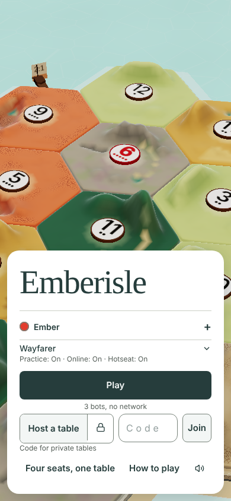
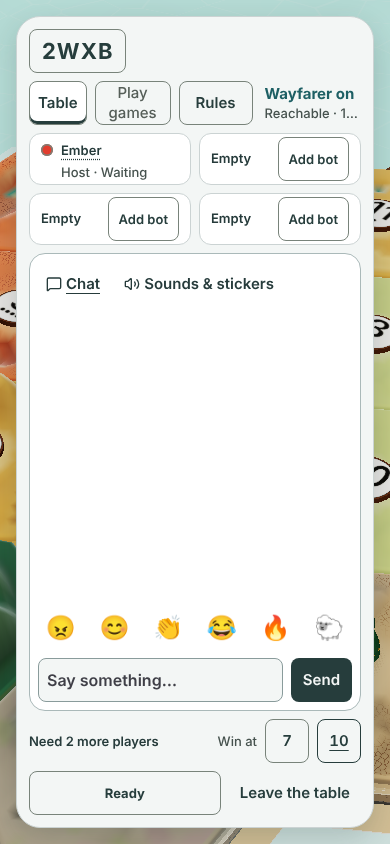
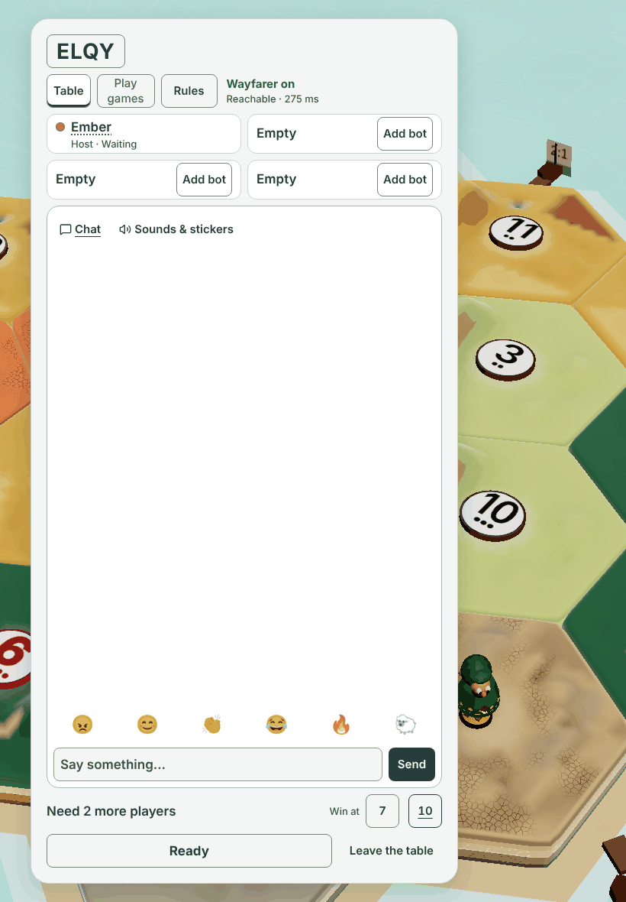
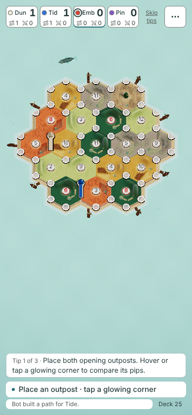
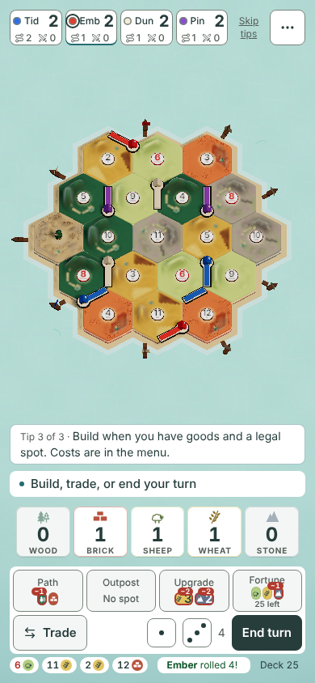
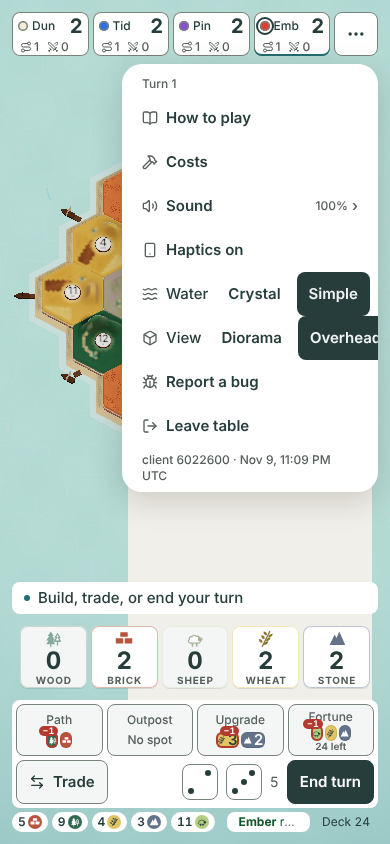
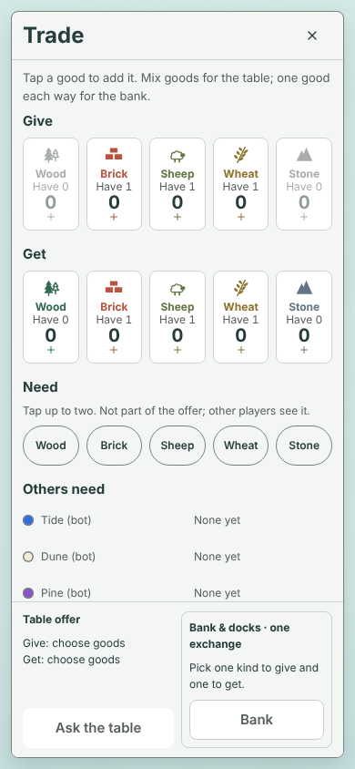
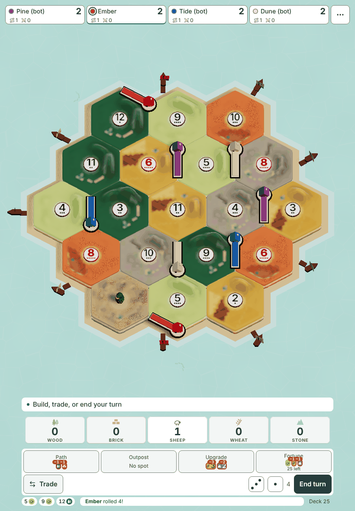

# Project overview, 2026-11-09

- gate worked: research
- date: 2026-11-09
- agent: Claude (claude-fable-5-2)
- base commit: `6022600` on `main`
- change: docs only. No code, test, script or size ceiling changed.

This is one overview of the whole project, with a UI and UX focus.
It is written for Jarrod, who plays on an iPhone Pro Max and an iPad, both upright.
The game also runs sideways, so the audit covers that too.

## Contents

1. [What I could not verify](#1-what-i-could-not-verify)
2. [Where the project stands](#2-where-the-project-stands)
3. [Screen by screen audit](#3-screen-by-screen-audit)
4. [The 10 highest value improvements](#4-the-10-highest-value-improvements)
5. [What not to build yet](#5-what-not-to-build-yet)
6. [Project risks](#6-project-risks)
7. [Three decisions for this week](#7-three-decisions-for-this-week)
8. [How I checked](#8-how-i-checked)

## 1. What I could not verify

Read this first. It limits how far to trust the rest.

- **The Desk Decisions page.** My session could not open it. Both the page read and the `decisions` data read failed with "not found or no access".
- I used `docs/DECISIONS.md` and issue #916 for owner answers. A newer answer on the page may be missing here.
- **A real phone.** Every picture is from headless Chromium at 390x844 and 820x1180. That is not Safari on an iPhone.
- I did not test the notch, the home bar, the Safari toolbar or a real finger.
- **Sound.** Headless Chromium plays nothing I can hear. I only read the Sound sheet.
- **The live site.** The network policy blocked the GitHub Pages address. I built and served `main` myself.
- **Results screen.** I did not finish a game. I read the owner approved pictures in `docs/design/play-again-1411/` and `docs/design/results-748/`.
- **Other table states.** I did not reach chat at the table, the wayfarer move or a dock sheet.
- I also did not reach a table trade offer or a hotseat game.
- **Profile sign in and the recovery code.** The sheet refused on a plain `http` address. I read the design in `docs/design/recovery-code-1070/`.
- **Tapping a corner with a finger.** I placed pieces through the hidden list of place buttons.
- **Design folders.** I did not check each of the 87 entries in `docs/design/` against the code.

## 2. Where the project stands

### Built and live

- The full game works in the browser: practice against 3 bots, hotseat, and online tables with a 4 letter code.
- The host saves tables to disk. A dropped player gets the same seat back.
- The lobby has chat, reactions, stickers, bots, a win line of 7 or 10, and two small waiting games.
- The table has a hand, a build bar, fortunes, a turn timer and a first game coach.
- Trades work with the table, the bank and the docks.
- Sound has one panel with a level for each kind of sound. Sea and wind ambience merged today.
- Profiles exist: sign in, edit, PIN, wins, delete, and a short recovery code.
- A startup loading screen shows real progress, then a Start button.
- The game installs to a phone home screen from the browser.
- `main` builds clean. Every chunk is inside its size ceiling on a fresh build.
- The README says GitHub Pages publishes `main` each night. I could not reach it to confirm.

### Designed only

These have a design or mock in `docs/design/` or an open design PR. By my reading they are not built.

- Island awards and the dice story on the results screen (#1452, #1453). Owner approved. Work in progress on a branch, no PR yet.
- Lobby reach, option A (#1430). Work in progress on a branch, no PR yet.
- A minimal title and Play pages (PR #1216). Parked.
- Permanent free hosting (PR #1240). Not for merge until it meets "no drops during a game".
- Dock trade marks that blend into the island (#1491). Mock first, no code.
- Fog of war (PR #849) and expansions (PR #853). Old drafts, priority p2.
- The quick react tray contract, the desktop dock, spectators, rematch, six players and open trade asks.
- The Unreal client. Specs only. It needs the gaming PC.

### Waiting on the owner

Issue #916 says nothing is open on the Decisions page right now. These are the next items that will need Jarrod:

- New pictures for the desktop results width (PR #1446). Jarrod said the two award columns are too wide.
- The dock mark mock (#1491). Jarrod rejected the big tags in PR #881.
- Built pictures for awards and dice, and for lobby reach.
- A look at PR #905. The desk board marks it "Ready for Jarrod".
- The hold from 2026-11-09: no new builders until Jarrod lifts it.
- Hosting. The game still runs from Jarrod's Mac (`docs/DECISIONS.md`, 2026-10-27).

### Merged this week

`git log --since=2026-11-02 --first-parent origin/main` shows 129 merges in 8 days. In groups:

- **Player facing features.** Loading screen, Sound panel, sea ambience, compact results list, who wants to play again.
- **Profiles.** Title sheet, edit and PIN, wins and history, delete, recovery code.
- **Lobby.** Apple style type and spacing, tap the code to copy the link, tabs as two boxes, tic tac toe.
- **Wording and function batches.** Give, Get, Need. No before Yes. Hotseat Leave asks first. Backdrop closes sheets.
- **Table polish.** Legal spots glow, piece drop and dust, seat dot rings, seat details from the bottom, help sheets.
- **Design papers and mocks.** About 15, most with real game pictures.
- **Proof repairs.** About 12 merges only fix a flaky proof.
- **Size work.** Two ceiling raises, four trims, and one red `main` fixed (#1478).
- **CI.** Browser legs now run only for runtime changes (#1466).

### Open PRs

19 are open. I read the list from the GitHub API at 23:10 UTC.

- **Fresh, moving.** #1492 landing dust flake. #1490 doc trim. #1488 orphan temp sweep, changes needed.
- **Drafts in progress.** #1480 lobby wording. #1446 desktop results width. #1341 appearance selection.
- **Parked by owner answer.** #1255 ore climber. #1216 title design. #1144 stationary phone dock.
- **Parked or blocked.** #881 dock tags, do not merge. #1240 hosting design.
- **Stale, red or conflicted.** #970, #905, #867, #1345.
- **Old drafts from October.** #853, #849, #799.
- **Not a real PR.** #699 is the desk inbox.

Five of the 19 show no update since 2026-11-03 or earlier.

## 3. Screen by screen audit

Sizes are CSS pixels, measured in the built app at 390x844 unless I say otherwise.
"Thumb zone" means the bottom third of an upright phone.

### Loading screen

- **Job.** Load the game, then let sound start on the first tap.
- **First 10 seconds.** Clouds, the name, one Start button and a full bar. It is clear and calm.
- **Thumb.** Start is 324x48 at the bottom. Good.
- **Unfinished.** Nothing. This is the best first impression in the app.

### Title



- **Job.** Pick a name and colour, then start one of three kinds of game.
- **First 10 seconds.** A friend sees the island behind a card. Play is the clear main button.
- A friend who got a link wants Join. Join is the smallest thing in its row.
- **Thumb.** The whole card sits in the bottom half. Play is 324x48. Good.
- **Wasted space.** None. The card is dense instead.
- **Wording.** The button says "Four seats, one table". The Wayfarer line calls the same mode "Hotseat".
- The caption "Code for private tables" explains a lock icon that has no word on it.
- "Wayfarer Practice: On · Online: On · Hotseat: On" is three settings a first time friend cannot understand yet.
- **Tap targets.** All are 44 or taller. The lock is 44x44 and sits tight against Host a table.
- **Whose turn.** Not relevant here.
- **Unfinished.** Profile hides inside the name row. You must open the row to find it.
- The minimal title design in PR #1216 answers most of this. It is parked.

### Lobby



- **Job.** Gather 3 or 4 players, share the code, and start.
- **First 10 seconds.** The code is big and clear. "Need 2 more players" is plain and good.
- Nothing tells the host to tap the code to copy the link. The tap does work.
- **Thumb.** Ready and the win line are in the thumb zone. Good.
- The code and the three tabs sit at the very top. The host must reach for the most used control.
- Add bot buttons sit in the top quarter. The reach work in #1430 is the right fix.
- **Wasted space.** The empty chat box is about 330 px tall. That is 39% of the screen.
- **Wording.** "Leave the table" here. "Leave table" in the Table menu.
- "Reachable · 155 ms" is engineer talk, and it is cut off on a phone.
- "Table" is a tab here, a menu at the table, and a trade target in "Ask the table".
- **Tap targets.** All 44 tall. Leave the table starts 8 px from Ready.
- The 2026-10-19 decision says Leave frees the seat at once. A slip next to Ready costs a seat.
- **What can I do.** The host sees Ready, not Start. Draft PR #1480 keeps Start visible. That is the right call.
- **iPad.** The lobby is a 560 px column with a tall empty chat. It works. It does not use the screen.



### Table: opening placement



- **Job.** Place two outposts and two paths.
- **First 10 seconds.** A tip card and a status line both say what to do. Good.
- The tip says "Hover or tap". A phone cannot hover.
- **Tap targets.** The glowing corner dots draw at about 14 px. They sit about 30 px apart.
- I could not test how forgiving the touch picking is. This needs a check on a real phone.
- **Wasted space.** The island is about 330 px tall. About 280 px of open sea sits above and below it.
- **Whose turn.** The seat with the ring is the current player. The status line says "Your turn." in words.

### Table: my turn



- **Job.** Show the board, my goods, and what I can do now.
- **First 10 seconds.** "Build, trade, or end your turn" is a strong line. End turn is dark and obvious.
- **Thumb.** Hand, build bar, Trade and End turn all sit in the bottom 220 px. This is well done.
- Trade is bottom left and End turn is bottom right. Both thumbs reach them.
- **Wasted space.** The island uses about 39% of the height. About 110 px under it is empty sea.
- The board is the game. On a phone it is the smallest it could be.
- **Seat strip.** Names are cut to three letters: "Emb", "Tid", "Dun", "Pin". Friends' real names will collide.
- The two small tallies under each name have no label. A new player cannot guess them.
- **Build bar.** Each button is 87x52. The size is good.
- The third button reads "Upgrade". Its spoken label and the README say "Stronghold".
- The red cost badges cover the top of the word "Fortune".
- The cost badges use text of about 10 px. They are hard to read at arm's length.
- "Outpost · No spot" is a good plain reason for a greyed button.
- **Bottom strip.** Small number chips show which rolls pay me. Nothing explains them.
- With five chips the log line shrinks to "Ember r…". The newest event becomes unreadable.
- **Hand.** Five cards at 67x62 with a big count. Clear.
- **Not checked.** Chat, the wayfarer move and a table offer.

### Table menu



- **Job.** Help, costs, sound, haptics, water, view, bug report, leave.
- **Thumb.** The button is 44x44 in the top right corner. That is the hardest spot on an upright Pro Max.
- The menu opens at the top too. Every row needs a stretch or a second hand.
- **Bug.** At 390 wide the "Overhead" choice runs off the right edge of the menu. The picture shows it.
- **Wording.** "Water: Crystal or Simple" and "View: Diorama or Overhead" are fine once seen.
- The last line shows a build stamp, "client 6022600 · Nov 9, 11:09 PM UTC". It is useful for bug reports and looks like debug text.
- **Tap targets.** Rows are 240x44. Good.
- **Unfinished.** A pale blank panel showed under the open menu in my capture. It may be a headless artefact. Check on a phone.

### Sound sheet

- **Job.** One level and one mute for each kind of sound.
- **First 10 seconds.** Five labelled sliders and a Sea sounds switch. It reads at once.
- **Thumb.** It opens in the top half. The sliders are 230x44 and the mutes are 44x44.
- **Wording.** "Soundboard and memes" is honest and friendly.
- **Unfinished.** Nothing I can see. I could not hear the levels.

### Seat details

- **Job.** Show one player's public numbers.
- **Thumb.** It slides up from the bottom. Close is 44x44. This is the right pattern for a phone.
- **Wording.** "Wayfarers played", "Longest path", "Largest army" and "Hidden fortunes may add points" are all plain.
- The Table menu and the Sound sheet should open the same way.

### Trade



- **Job.** Offer goods to the table, or swap with the bank or a dock.
- **First 10 seconds.** Give and Get are clear. Each card shows what I have. That is good.
- The top instruction is two dense sentences. Most friends will skip it.
- **Thumb.** The panel fills the screen. Give starts 152 px from the top.
- Every trade starts with a reach to the top half, then a tap at the bottom.
- **Wording.** Give, Get and Need are consistent on screen. The spoken labels still say "to want".
- The footer has "Table offer", "Ask the table", "Bank & docks · one exchange" and "Bank". That is four names for two actions.
- The 2026-10-19 decision chose Table and Bank tabs. The built panel shows both at once.
- I could not tell if a later owner answer changed that.
- **Tap targets.** Good cards are 60x100. Need pills are 62x44. Both are fine.
- **Sideways.** The Need row hides under the footer until you scroll.

### Dock sheet and robber

- Each dock on the board has a 44x44 touch target. That is good.
- I did not open a dock sheet or move the wayfarer.
- Owned dock marks are still unsolved. PR #881 is parked and #1491 will mock a new mark.

### Results

- **Source.** The approved picture `docs/design/play-again-1411/a-390x844.png`, not a game I finished.
- **Job.** Say who won, show how, and get everyone into the next game.
- **First 10 seconds.** The winner and the score are huge. The reason is in one line. Good.
- **Thumb.** "I'll play again" and "Back to menu" sit at the bottom. Good.
- **Wording.** "target 10" here. "Win at" in the lobby. "Back to menu" here. "Leave table" in the menu.
- **Unfinished.** Long names push the winner's name to three lines.
- The awards and dice story is approved and half built.

### Profile and recovery code

- **Job.** Keep a friend's name, picture and wins across nights.
- **First 10 seconds.** On a plain `http` address the sheet says "Profiles need the HTTPS link".
- It also shows "Host: ws://127.0.0.1:8787/". A friend should never see that.
- "Continue as guest" is the right escape. It is 324x44 in the thumb zone.
- **Unfinished.** A tall blank pale panel showed above the title card with the sheet open. Check on a phone.
- I could not see sign in, PIN or the recovery code screens.
- The reviewer's note on the recovery code still stands. A stranger who knows a login can burn its ten tries.

### Help sheets

- How to play and Costs open from the Table menu. Close is 44x44.
- They share one look since #1438.
- I did not read their text for wording.

### iPad upright, 820x1180



- The island is large and beautiful. This is the best view of the game.
- The dock stretches the full width. Trade and End turn are about 590 px apart.
- The build buttons are 175 px wide, yet the cost badges are still tiny.
- A narrower dock, centred or near one thumb, would fit a held iPad better.

### Sideways phone, 844x390

I checked this after Jarrod's note that the game runs sideways too. I kept the pictures to the agreed eight.

- The layout works. The dock moves to the left and the island to the right.
- All four seats show full names. That is better than upright.
- The seat strip and the tip card cover the top of the island. The bottom edge is cut off.
- The hand cards lose their names and show only small icons.
- The log line shrinks to "E…" beside the number chips.
- The trade panel hides the Need row under its footer.

## 4. The 10 highest value improvements

Ranked by value to friends playing. "QUICK WIN" means small and needs no new design.

1. **Make the island bigger on an upright phone.**
   - Problem: the board uses about 39% of the screen and open sea uses about 33%.
   - Why: friends squint at numbers and miss taps on corners.
   - Size: medium.
   - Needs: a mock, then the owner, then a strong builder. It overlaps PR #1144 and issue #971.

2. **Give friends one link that always works.**
   - Problem: the game only runs while Jarrod's Mac and a tunnel are up.
   - Why: a new tunnel address each night breaks saved links and home screen icons.
   - Size: large.
   - Needs: an owner decision on PR #1240 first.

3. **Fix the build bar words and badges. QUICK WIN.**
   - Problem: "Upgrade" and "Stronghold" name one thing, and cost badges cover "Fortune".
   - Why: the build bar is tapped every turn, and new players learn the game from it.
   - Size: small.
   - Needs: one owner word choice, then a builder.

4. **Make the lobby start plain and safe. QUICK WIN.**
   - Problem: the host sees no Start, and Leave sits 8 px from Ready.
   - Why: game night stalls at the door, or a slip drops a seat.
   - Size: small.
   - Needs: a builder. PR #1480 covers Start. Moving Leave needs a small mock.

5. **Bring the Table menu to the thumb, and fix the clipped row.**
   - Problem: the menu lives in the top right corner, and "Overhead" is cut off.
   - Why: sound, help and leave are out of reach with one hand.
   - Size: small for the clip (QUICK WIN), medium for the move.
   - Needs: a builder for the clip. A mock for the move, using the seat details sheet as the pattern.

6. **Simplify the title and use one name for hotseat.**
   - Problem: the title shows three modes, three wayfarer settings and a hidden Profile.
   - Why: a friend with a link needs Join and a name, and little else.
   - Size: medium.
   - Needs: an owner decision on PR #1216, then a builder.

7. **Tighten the trade panel on a phone.**
   - Problem: trading starts at the top of the screen and uses four names for two actions.
   - Why: trading is the social heart of the game, and slow trades stall the table.
   - Size: medium.
   - Needs: a mock, and a check against the 2026-10-19 tabs decision.

8. **Show real names and a readable last event.**
   - Problem: seats show three letters, and the log shrinks to a few letters.
   - Why: friends need to see who did what without opening anything.
   - Size: small to medium.
   - Needs: a mock, then a builder.

9. **Polish the sideways phone layout.**
   - Problem: the top and bottom of the island are covered or cut off.
   - Why: some friends will hold the phone sideways, and the board is the game.
   - Size: small to medium.
   - Needs: a builder, with before and after pictures for the owner.

10. **Speak plainly when profiles are not available. QUICK WIN.**
    - Problem: the Profile sheet shows a raw host address and an "HTTPS link" message.
    - Why: it looks broken to a friend on the home network.
    - Size: small.
    - Needs: a wording choice by the desk, then a builder.

## 5. What not to build yet

- Expansions and fog of war. Both are p2 and the core phone table is not settled.
- More waiting room games. Two is enough until the lobby reach work lands.
- The ore climber (PR #1255). The owner already said it is not a priority.
- New stickers, clips or music. The Sound panel just landed. Let friends use it first.
- Owned dock tags in code. Wait for the #1491 mock.
- Six players and spectators. Neither helps the next game night.
- The Unreal client. It needs the gaming PC and the browser game comes first.
- Another audit. See the doc sprawl risk below.

## 6. Project risks

### Size ceilings nearly full

Measured with `node scripts/size-prove.mjs` on a fresh build of `6022600`. Sizes are gzip.

| Chunk | Measured | Ceiling | Room left |
|---|---|---|---|
| `WayfarerOptions` | 0.49 kB | 0.50 kB | about 10 B |
| `LobbyView` | 2.48 kB | 2.50 kB | about 20 B |
| `table` | 2.18 kB | 2.20 kB | about 20 B |
| `focus-trap` | 0.53 kB | 0.55 kB | about 20 B |
| `ProfileSheet` | 5.95 kB | 6.00 kB | about 50 B |
| `WinList` | 1.30 kB | 1.36 kB | about 60 B |
| `OpenTables` | 1.24 kB | 1.30 kB | about 60 B |
| `index` | 126.04 kB | 127.00 kB | about 960 B |
| `IslandCanvas` | 201.03 kB | 203.50 kB | about 2,470 B |

- The tool prints two decimals, so the small numbers are rough.
- `focus-trap` already turned `main` red on 2026-11-08 (#1478).
- The lobby work in flight touches `LobbyView`, which has about 20 B left.
- The awards work touches the results chunks. `WinList` has about 60 B left.
- Every one of the top 10 items above touches a chunk that is nearly full.
- The risk is not page weight. The risk is that each small fix needs a trim or an owner row first.
- There are now 42 ceilings. Most new features add one.

### Flaky proofs

- `.github/flaky.json` lists 8 patterns across issues #860, #887, #1176, #1200 and #1326.
- The four flakes seen on 2026-11-09 (#1474, #1475, #1476, #1479) are not in that file.
- `docs/DESK.md` says to add a flake the day it is seen. That step was missed.
- #1475, #1476 and #1479 are closed. Their fixes merged as #1484, #1485 and #1486.
- #1474 is open. Its fix, PR #1488, needs changes.
- A fifth flake, #1489, appeared the same day. Its fix is PR #1492.
- About 12 merges this week only repaired a proof.
- Many flakes are timing checks, such as 1,004 ms against 1,000, or 19.0 px against 20.
- Those will keep coming while proofs measure wall clock time on shared runners.

### CI cost

- There are 13 workflow files and about 215 proof scripts.
- The repo has run 28,294 workflow runs in total.
- 129 merges in 8 days means at least 129 full PR suites, plus every extra push.
- The repo is public, so minutes are free. The cost is time and re-runs.
- #1466 now skips browser legs for docs changes. That was the right move.
- `auto-merge.yml` is still on `main`, though the owner dropped it on 2026-10-21.

### Doc sprawl

- `docs/` holds 3,874 files and 355 MB. That is about 88% of the files in the repo.
- `docs/proofs/` is 2,507 files and 198 MB. `docs/design/` is 1,067 files and 145 MB.
- There are 281 Markdown files in `docs/`. The README alone is 89 KB.
- At least seven earlier papers already review the UX. This paper makes eight.
- They include `ux-review-2026-10.md`, `ux-roadmap.md`, `ux-ui-improvements.md`, `visual-audit.md`, `mobile-ux-benchmark.md`, `menus-audit.md` and `app-review/`.
- No single file says which design is current, built, parked or dead.
- A builder that reads an old design can build the wrong thing with full confidence.
- A shallow clone took several minutes in my session, mostly for pictures.

### How the work is run

- **One account does everything.** Every agent PR and every merge comes from Jarrod's account.
- That account can merge past required checks. Only the desk's own rule stops it. #1168 already slipped through.
- **The desk state is hand written.** Issue #916 is edited each round and can be stale.
- Example: #916 lists lobby reach under #1430 as in progress. Issue #1430 is closed.
- **Owner answers live outside the repo first.** My session could not read the Decisions page at all.
- If a desk session loses access, it cannot see the owner's newest answers.
- **Loops are easy to start by mistake.** The desk made one on 2026-11-09 and had to disable it.
- **The PR pile is growing.** 19 are open and 5 show no update since 2026-11-03.
- **Rules are spread wide.** A new agent must read six rule files before it starts.
- **Cost has bitten before.** One desk session reached 570K tokens and about $500 in October.
- **Speed hides taste.** 129 merges a week is fast. The phone table still has the basic issues listed above.

## 7. Three decisions for this week

Each one is for the owner. The desk should put each on the Decisions page with pictures.

### Decision 1: the phone table layout

- **Question.** May one design pass redo the upright phone table as a whole?
- It would cover island size, the dock, the Table menu position, the seat names and the bottom strip.
- **Why now.** It unblocks items 1, 5 and 8, and settles PR #1144 and issue #971.
- **Recommended.** Yes. One mock with three options at 390x844 and 430x932, by a design capable model.
- **If no.** Do only the quick wins and leave the island at its current size.

### Decision 2: hosting

- **Question.** What is the hosting goal that PR #1240 must meet, and may it cost money?
- **Why now.** It unblocks item 2, stable home screen icons, and profiles for every friend.
- **Recommended.** Keep "no drops during a game" as the bar. Allow a small monthly cost if free cannot meet it.
- **If no.** Keep the Mac and a named tunnel, and say so in the README.

### Decision 3: one word list

- **Question.** Which single word does the game use for each of these?
- Hotseat, or "Four seats, one table".
- Stronghold, or Upgrade, on the build button.
- "Leave table", "Leave the table", or "Back to menu".
- "Win at", or "target".
- **Why now.** It unblocks items 3, 4, 6 and 10, and PR #1480 is mid flight on lobby wording.
- **Recommended.** Hotseat. Stronghold. Leave table. Win at.
- **If no.** Wording batches keep landing one string at a time.

## 8. How I checked

- I read `README.md`, `AGENTS.md`, `docs/DECISIONS.md`, `docs/FRAMEWORK.md` (Writing), `docs/DESK.md` and issue #916.
- I listed merges with `git log --since=2026-11-02 --first-parent origin/main`.
- I listed open PRs and the flake issues through the GitHub API.
- I ran `npm ci`, `npm run build` and `node scripts/size-prove.mjs` on `6022600`.
- I ran the rules host from `server/`, which also serves the built page.
- I drove one headless Chromium at a time with Playwright.
- I played the opening and the first turn of a practice game, then opened each sheet.
- I measured every visible control's size and position from the page.
- The capture script is not in this commit.

## Handoff

```
done: overview written, 8 pictures captured
left: a check on a real iPhone, and the screens listed in section 1
broke: nothing; no code changed
next agent: the desk, to turn section 7 into Decisions cards
```
