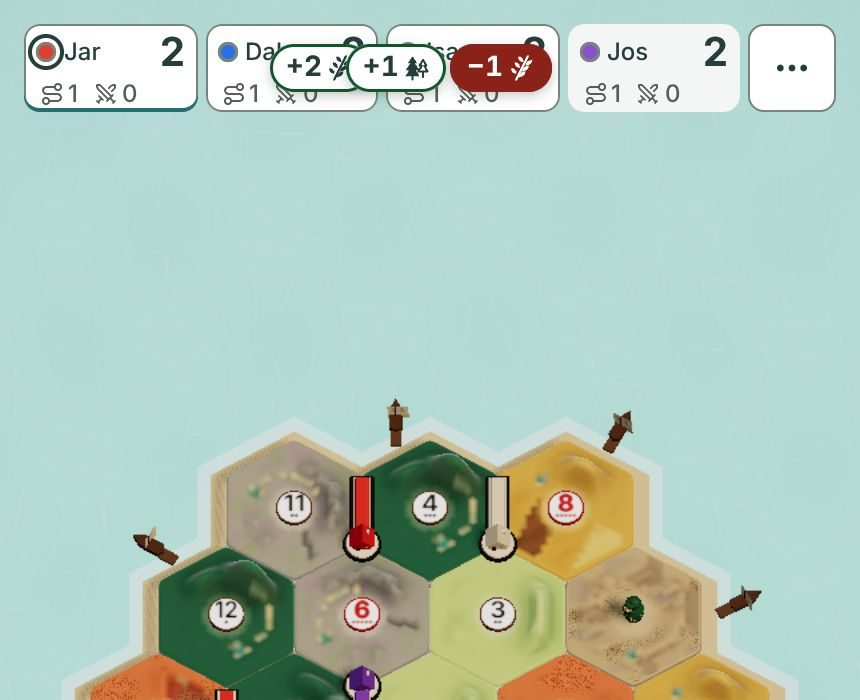
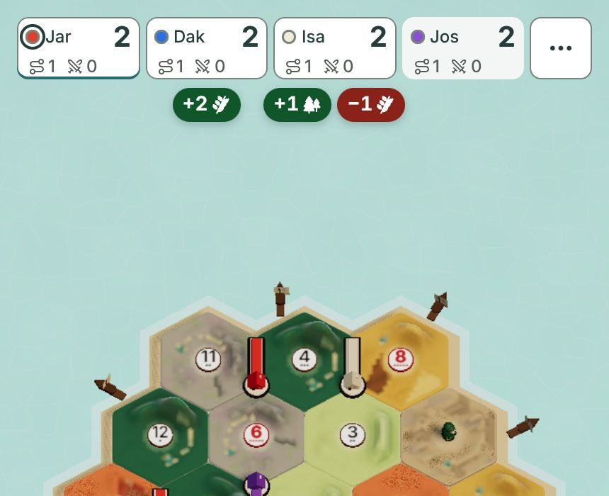

# Two follow ups: the table goal and the gain pills, 2026-11-10

For Jarrod. This follows `docs/research/uiux-upright-2026-11-10.md`.
Pictures are headless Chromium on a build of `main`, not Safari. No code changed.

## 1. Option A against Astra's 60% goal (card q1504-table)

### The straight answer

Astra's 60% and my option A measure two different things. They do not compete.

- **Astra's number is the empty space.** It is the height between the seat strip and the dock.
- Astra's paper says so itself: "A declaration of a hole does not prove the island fits it."
- **Option A is about the island inside that space.** It makes the island fill the space it was given.

So the camera change does not replace Astra's number. It is the half that was never done.

### What I measured on `main`, Pro Max size, 430x932

| What | Today | Option A |
|---|---|---|
| Empty space between seats and dock | 614 px, 66% of the screen | about the same |
| Island height | 320 px, 34% of the screen | 365 px, 39% of the screen |
| Share of the empty space the island uses | 52% | 59% |
| Island width against the screen | 86% | 98% |

At 390x844 the empty space works out to about 62% of the screen. Astra's baseline was 60%.
So Astra's number is already real on `main`. The island just does not use it.

### What was already agreed

- 58.3% clear height on an upright phone, with a 34 px bottom gap (q1274-1).
- 16 px gutters upright (q1274-11). `main` still measures 12 px.
- Sheets anchored at the bottom (q1274-8).
- The 10 px capital hand names stay (q1274-5).
- The dock keeps the same slots in every phase, and the board does not jump between phases.

Option A keeps all of these.

### What is new in option A

- The camera fits the island's shore to the screen edges. That is the 14% growth.
- The island sits low in the space, nearer the thumb.
- Seats show the full name. The two small tallies move to the seat sheet.
- The turn line, the hand tray and the button tray lose their boxes.
- The "pays on" number chips go, so the last event can be read.

### Does the camera fix make Astra's number real?

- **For the space: it was already real.** 62% to 66% today.
- **For the island: no, and nothing can.** The island is as wide as it is tall, and the phone is narrow.
- At full width the island tops out near 40% of a Pro Max screen held upright.
- In Safari, with its toolbar showing, the screen is shorter. There the island reaches about 49%.
- So the honest target is "the island touches both side edges", not a height percent.

### For your pick

- Pick **A** if you want the bigger island and the cleaner dock in one go.
- Pick **B** if you want only the bigger island now, and the dock later.
- Either pick keeps every Astra answer you already gave.

One flag for the card: "60% of the height" should be retired as an island goal.
It stays true as a rule for how tall the dock may be.

## 2. Other players' gains (PR #867)

### Finding

Your words: gains green, losses red, like the path preview. PR #867 does half of that.
Its loss pill is red. Its gain pill is white with a thin green edge, so it reads as neutral.

I also found a layout problem at phone size. The pills sit on top of the seat.
They cover the name and the score, and a trade's two pills spill onto the next seat.

*PR #867's stylesheet, applied to the real game on `main` at 430x932. Pills added to the page by hand: Daking gains 2 wheat, Isaac trades 1 wheat for 1 wood.*

I could not run the PR's own build in a practice game. Its pills only show in online games.
So this picture uses its styles, not its code. The builder should confirm it at 390 and 430 wide.

### Recommendation A: solid green, solid red, hung under the seat

- A gain is a solid green pill with white text. A loss is a solid red pill with white text.
- They use the same green and red as the hand's plus 1 and minus 1.
- The pills hang just under the seat, over open sea. The name and score stay readable.
- Nothing can spill onto a neighbour, because each group is centred under its own seat.

*Mock. CSS changed: pill group moved to 6 px under the seat and centred. Gain fill set to the game's green, icons to white.*

### Alternatives

- **B: keep the pills on the seat, make the gain solid green.** Smallest change. The cover and spill problems stay on phones.
- **C: goods fly to that seat.** See below.

A beats B because a friend should never lose sight of a name or a score.

### Is "goods fly to that seat" worth building?

Split it in two, because the two halves are worth very different amounts.

- **Goods fly into your own hand: yes, worth it.** This is what you pictured.
- It is already designed, in `docs/design/payout-flight.md` (issue #740). It is not built.
- The paper is careful: at most two flying goods per grant, all done in under a second.
- **Goods fly to other players' seats: not yet.** On one roll, three friends can gain at once.
- That is up to six things moving toward the top of the screen while you watch your own hand.
- It works against "few elements, one thing to do at a time".
- The pills already say who got what, and they hold for 2.5 s so you can read them.

**What it would cost.**

- Pills in green and red, under the seat: small. One stylesheet in a PR that is already open.
- Flights to your own hand: medium to large. A new scene piece, its own proof, and care on slow phones.
- Flights to other seats: a small step after that, since the same flight just ends at a seat.

So build the pills now and the own hand flight next. Look at seat flights after you have played with both.

### Owner decision needed? Yes, one card

Card: "How should other players' gains show on a phone?"
A: solid green and red pills under the seat. B: the same pills on top of the seat. C: wait for flying goods.

No card is needed for the own hand flight. Issue #740 already carries your approval from #642.

## What I could not do

- I did not run PR #867's build. I reproduced its pill styles on `main`.
- I did not animate anything. The flight advice rests on the design paper, not on a moving mock.
