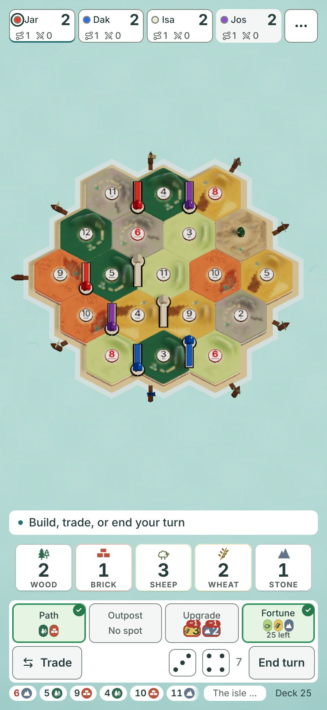
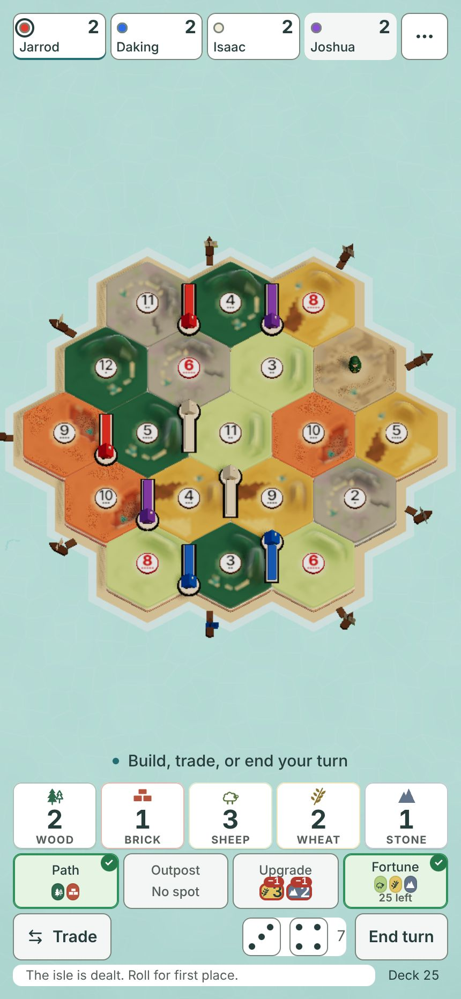
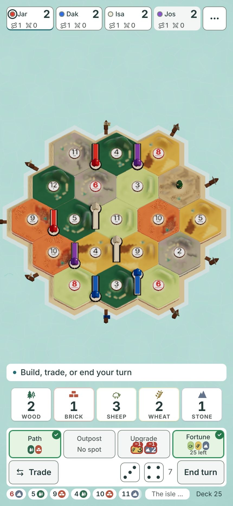
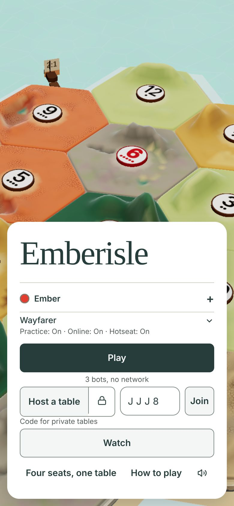
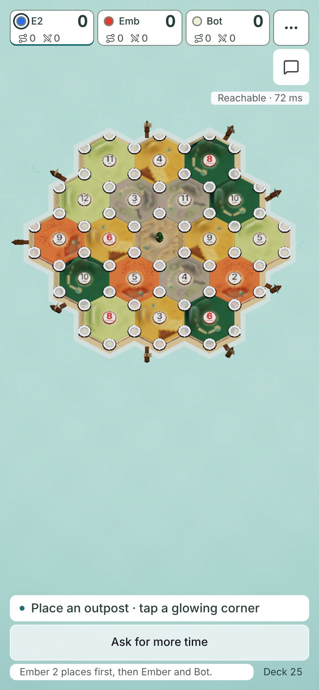
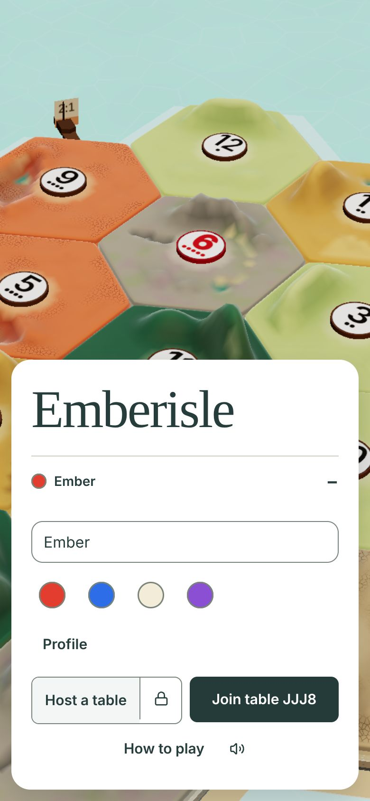
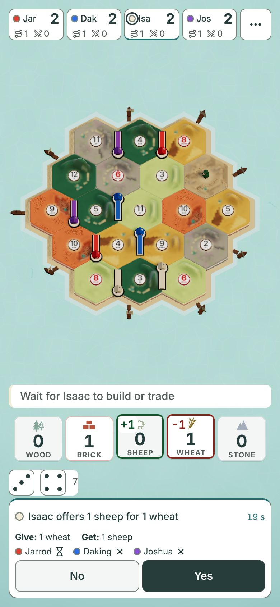
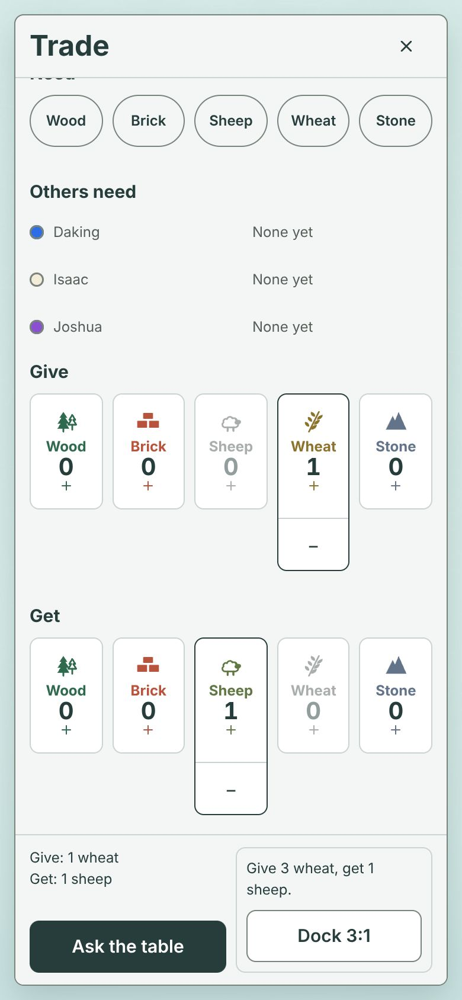
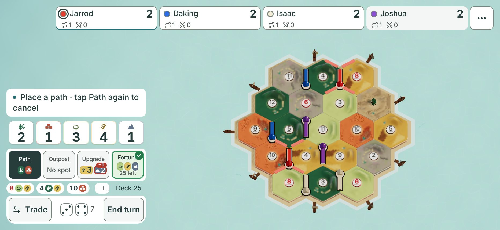

# Upright phone UX: four answers, 2026-11-10

For Jarrod. Built from `main` at `6022600`.
All pictures are headless Chromium, not Safari. Safari's toolbar and home bar take more height than shown.
Option pictures are the real game with styles changed on the page. No code changed.

The goal behind every answer is the same one you gave: it should not look like AI slop.
In your words that means boxy, wordy, generic, with words leaving their boxes.
So each recommendation removes boxes and words first, and adds nothing.

## 1. The upright phone table

### Finding

The island is held back by the camera, not by the dock.
On a Pro Max it draws 370 px wide and 320 px tall, which is 34% of the screen height.
The space between the seats and the dock is 614 px, so about half of it is empty sea.
The dock itself stacks five rows and thirteen boxes, and breaks three of your rules:

- Text under 12 px: the red cost numbers are 9 px, and "25 left" and the tick are 10 px.
- Words leaving boxes: the red cost badges sit on top of "Upgrade" and "Fortune".
- Gutters measure 12 px. You approved 16 px upright.

Seat names are cut to three letters, such as "Jar" and "Dak".
The number chips at the bottom squeeze the last event down to "The isle ...".

*Today. No styles changed.*

### Recommendation A: fill the width, quiet the dock

- The camera fits the island's shore to the screen edges. The island grows 14%, to 422 px wide.
- Ships at the sides are cropped a little. Hex numbers and pieces are not.
- The island sits low in the open space, so corners are nearer the thumb.
- Each seat shows the full name on its own line, with the score beside the dot.
- The two small tallies leave the seat strip. They stay in the seat sheet.
- The turn line is plain text with no box.
- The boxes around the hand and around the buttons go. The number chips go.
- The last event gets the full width.

*Option A. CSS changed: canvas scaled 1.14 and moved down 44 px. Box styles removed, number chips and tallies hidden, seat name on a second line.*

I checked option A at Safari's shorter height, 430x739. The island fills the space and nothing collides.

### Alternatives

- **B: bigger island only.** Same camera change, dock untouched. It is the smallest build.

  

  *Option B. CSS changed: canvas scaled 1.14 and moved down 44 px. Nothing else.*

- **C: shrink the dock to free more room.** Not drawn. The island is limited by width, so a shorter dock adds only sea.

A beats B because B keeps the boxes, the cut names and the squeezed event line.
A beats C because C costs thumb targets and gains nothing.

### Owner decision needed? Yes

Card: "Which upright phone table should we build?"
A: bigger island and a quiet dock. B: bigger island only. C: keep today's table.

Two smaller choices ride inside A and should be shown on the same card:

- The path and army tallies leave the seat strip.
- The "pays on" number chips leave the bottom strip.

## 2. The first 60 seconds for a friend with a join link

### Finding

A friend meets these problems, in this order.

1. **The biggest button is the wrong one.** The link fills the code, but "Play" is still the dark full width button. Play starts a bot game. "Join" is 49 px wide, the smallest control in its row.
2. **A new "Watch" button appears, also full width.** It is six times wider than Join.
3. **Nobody asks for a name.** The name field hides behind a plus sign. I joined as "Ember 2", and my seat read "E2".
4. **The lobby shows "Reachable · 72 ms".** That means nothing to a friend.
5. **After Ready, the button says "Not ready".** It reads like a status. It is an action.
6. **The opening roll shows "Ask for more time" above Roll.** It is full width on the first screen a friend ever plays.
7. **At first placement the island sits in the top half.** About 290 px under it is empty, and "Ask for more time" is the largest control.
8. **I saw no first game tips in the online game.** Practice has them. A joining friend is the one who needs them.

The turn line is good: "Place an outpost · tap a glowing corner".
The lobby's "Need 1 more player" and "2 of 3 ready" are good too.

*Today, opened from a join link. No styles changed.*

*Today, the friend's first placement. No styles changed.*

### Recommendation A: a join link opens a join screen

- When the link carries a code, show only the name, the colour and one dark button, "Join table JJJ8".
- The name field is open and empty, so the friend types a real name.
- Play, Watch, Wayfarer settings and hotseat are not shown on this screen.
- "Host a table" can stay as a small text link, or go. The picture still shows it as a box.

*Option A. Styles changed: Play, Watch, the Wayfarer row, the code box and hotseat hidden; the name row opened; Join made dark and relabelled.*

### Alternatives

- **B: same title, swap the emphasis.** Join turns dark and Play turns pale when a code is present. Smaller build, still busy.
- **C: skip the title and land in the lobby.** Fastest, but the name must then be asked in the lobby top, which is off limits.

A beats B because your own note on the title was "too busy and not good apple ui ux".
A beats C because it does not touch the lobby top.

### Owner decision needed? Yes

Card: "What should a friend see when they open a join link?"
A: a join screen with name and one Join button. B: today's title with Join made the main button. C: no change.

Three fixes need no card, because they only apply rules you already set:

- "Ask for more time" becomes a small text link until time is short.
- "Reachable" shows only when the connection is bad.
- "Not ready" becomes "Cancel ready".

## 3. One trade on a phone

### Finding

The counts are good. The reach and the words are not.

| Trade | Taps | Where the taps land at 390x844 |
|---|---|---|
| Table trade | 4 | Trade at the bottom, Give near the top, Get in the middle, Ask the table at the bottom |
| Bank trade | 4 | Trade, Give once, Get once, then "Bank 4:1" at the bottom |
| Answer an offer | 1 | Yes or No at the bottom |

- Give sits 152 px from the top. Two of four taps are outside the thumb zone.
- The bank trade is smart. One tap on Give is enough and the game works out the four.
- The window shows about 60 words before any trade. Most are help sentences and box titles.
- After "Ask the table" the window closes. A strip in the dock shows who has answered, with Cancel.

**How a player knows an offer arrived.** A card rises where the build buttons were.
It says "Isaac offers 1 sheep for 1 wheat", with No and Yes, each 172 px wide.
The hand shows plus 1 and minus 1 on the two goods. The card came 1.9 s after the bot's turn began.
So the offer already pops up, and it already sits in the thumb zone. This part is right.

One thing does not match your answer. You said an offer holds until it is declined or accepted.
The card carries a countdown, 19 s in my practice game. I could not check an online game.

*Today, an incoming offer. No styles changed.*

### Recommendation A: same window, fewer words, rows near the thumb

- Give and Get move to the bottom of the window, just above the buttons.
- Need and "Others need" move to the top, since they are read more than tapped.
- The two help sentences go. The titles "Table offer" and "Bank & docks · one exchange" go.
- The Bank box keeps one line and one button.
- Keep "Have" on the Give row only. My picture hides it on both rows.
- Keep the incoming offer card exactly where it is. Do not move it under the turn line.

*Option A. Styles changed: help lines, "Have" lines and box titles hidden; Give and Get ordered last in the window.*

With A, Give lands 333 px from the top, not 152.

### Alternatives

- **B: a half height sheet that leaves the island in view.** Better feel, bigger build, and Need would have to move elsewhere.
- **C: build the offer by tapping hand cards in the dock.** Fewest reaches, but it is a new design and a new habit.

A beats both because it is the approved window with less in it.

### Owner decision needed? Yes, two short cards

Card 1: "Trade window: move Give and Get to the bottom and cut the help text?"
A: yes. B: cut the text only. C: no change.

Card 2: "Should an offer card count down, or wait until every player answers?"
A: wait, no countdown. B: keep a countdown, but longer. C: keep it as it is.

This also closes the open conflict from your answers. The offer stays a pop up card at the bottom.

## 4. Sideways phone: support or tolerate?

### Verdict: tolerate

At 932x430 the table works. The island is whole and every seat shows a full name.
It is not as good as upright, and it does not need to be.

*Today. No styles changed.*

- **Tolerate** means it must never break, and it gets no design time. Fix a sideways bug only when a friend hits it.
- **Support** means every table change is designed, built and proved twice. That slows the upright work your friends use.

You already said it: "sideways looks weird but whatever". Your friends play upright.

### Owner decision needed? No

## Build tasks, in order

1. **Make the dock obey the rules you already set.** No text under 12 px, no badge on top of a label, 16 px gutters. No card needed.
2. **Join link screen.** Option A from question 2, after its card.
3. **Bigger island with the quiet dock.** Option A from question 1, after its card.

## What I could not do

- I could not hear the sound that should play when an offer arrives.
- I did not test a real finger on the small corner dots at first placement.
- I simulated Safari's height. I did not run Safari.
